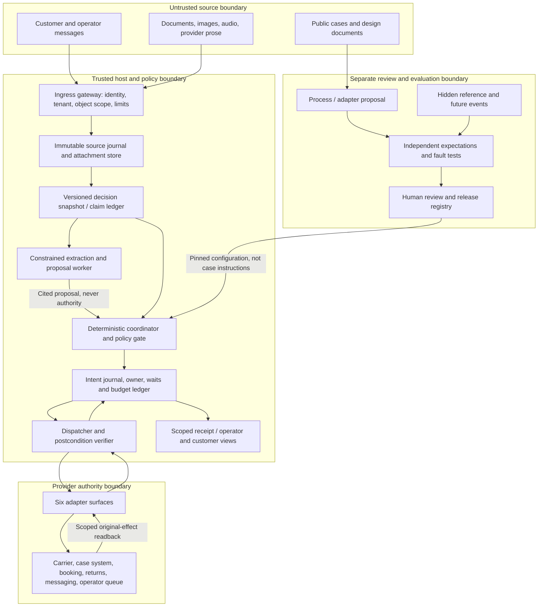
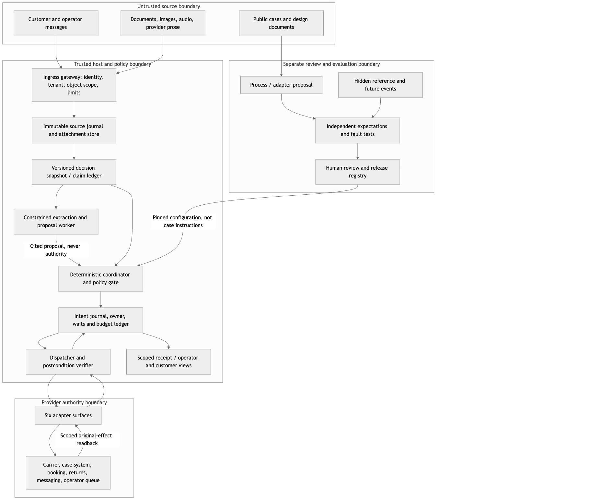
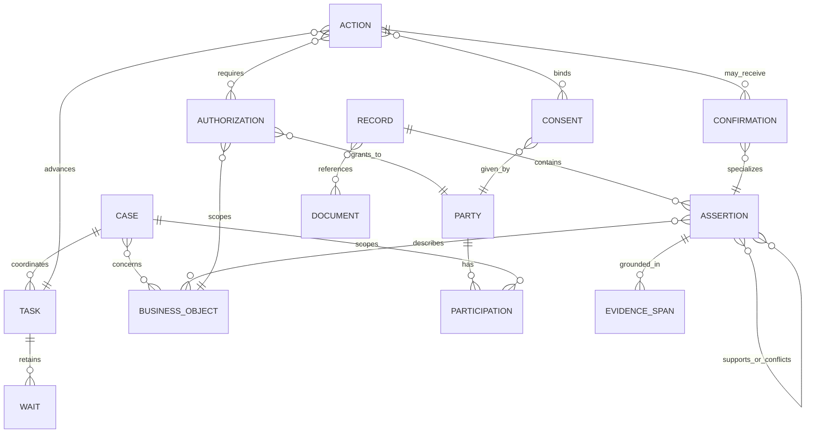
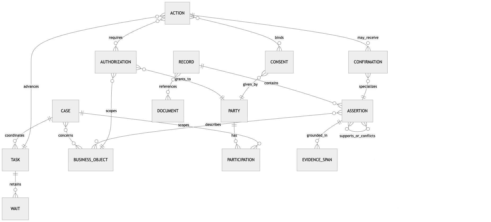
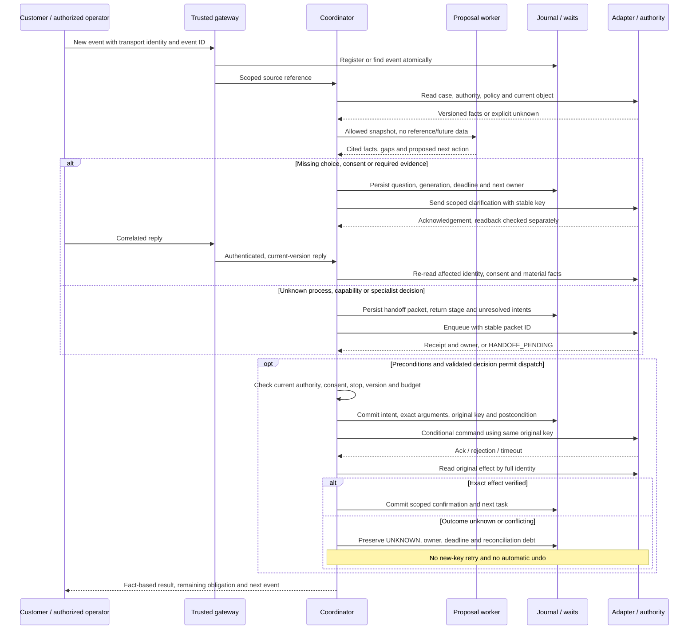
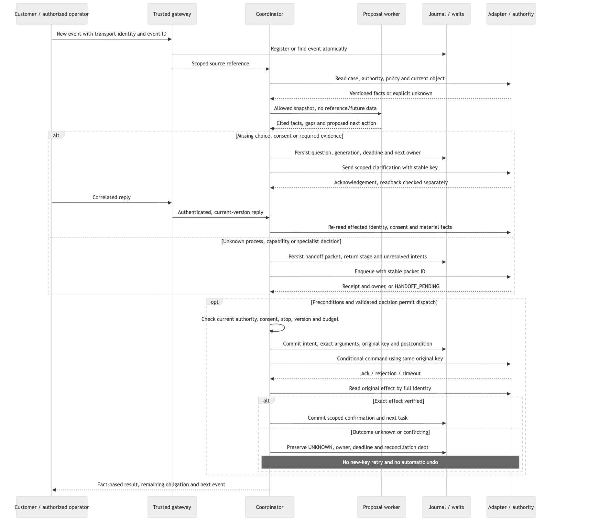
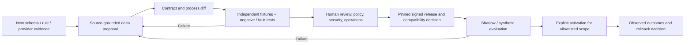
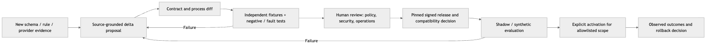

# Dwelly / ProofKey agent architecture

Date: 10 October 2026. Status: **architecture proposal grounded in current sources; not a production-readiness claim**.

## 1. Decision and scope

Build a small, evidence-preserving case coordinator around six replaceable adapters, with a deterministic execution kernel and a constrained language-model proposal layer. Optimize for (1) integrating a newly supplied system quickly, (2) adapting to an unfamiliar but documented process through reviewed changes, and (3) reaching a verifiable outcome or an explicitly owned wait. Do not optimize for the number of autonomous actions.

The initial executable business scope is whole-order delivery rescheduling and goods refusal, with separately authorized return initiation. Other logistics requests—including customs, disputed delivery, billing, specialist safety decisions and partial-order exceptions—are operator-owned. The assistant can summarize, request permitted evidence and prepare the handoff; it cannot make the specialist decision. A customer preference, a coordinator's title, an agent-generated plan and a provider's HTTP acknowledgement are each insufficient authority to execute a change.

This document is a design deliverable only. It neither activates adapters nor changes production policy. The supplied folder is a team design package, not an official organizer API specification. All public case identities and communications are fictional. Their narrative confirmations are observations about a story, not executable provider state or independently authenticated identities.

### 1.1 What exists, what is proposed, what is missing

| Layer | Implemented / observed locally | Target or missing evidence |
| --- | --- | --- |
| Public-case intake | Standalone `tools/dwelly_cases` imports Delivery & Logistics histories into provenance-bearing decision snapshots and evaluator-only references. Deterministic baseline proposes unsent next communications. | General extraction of arbitrary business semantics; authenticated external ingestion; meaningful multimodal interpretation. Imported records do not become executable runtime fixtures. |
| Runtime execution | Six typed ports, policy/intent/readback contracts, simulated adapters, durable state and bounded execution machinery. Default public replay supports two fixed synthetic cases: window rescheduling and whole-order goods refusal plus return initiation. | Six native integrations; general case-to-runtime mapping; complete live operational acceptance. Interface presence is not integration success. |
| Adaptation | Explicit trusted synthetic preparation/registration paths; an opt-in finite `window-readiness-v3` source lane with four readiness reads and bounded scheduling envelopes. | Arbitrary process induction, safe activation from documents alone, complete migration/rollback and real human approval custody. V3 is not an arbitrary graph executor; it does not establish registered recover/reply/stop/transfer support. |
| Reasoning | Inspectable lexical baseline for offline draft routing; bounded planning contracts exist in the runtime. | Validated general semantic reasoner, calibrated abstention and real model/provider participation. Routing agreement is not a semantic score. |
| Resolution | Synthetic tests and recorded scoped execution evidence distinguish dispatch, verification, waiting and partial outcomes. | Real carrier effect readback, actual customer/operator onboarding, live timeout/fault drills and installation qualification for later source changes. |

Local-workspace evidence inspected for this design, **not included in this repository**: `runtime/README.md` (runtime support map), `runtime/src/proofkey/ports.py` (six ports), `runtime/src/proofkey/contracts.py` (wire contracts), `openspec/changes/dwelly-case-intake-pilot/design.md` (offline pilot design), and `docs/verification/2026-10-10-window-readiness-adaptation.md` (window-readiness evidence). This document inspected source and existing evidence; it did not rerun the runtime or qualify a release. See [pilot verification](pilot-verification.md) and [offline pilot data](../data/dwelly-public-cases/README.md) for the packaged evidence. Full runtime regression remains pending at this package snapshot.

### 1.2 Alternatives considered

| Approach | Benefit | Cost / decision |
| --- | --- | --- |
| Fixed workflow scripts only | Fastest for the two known cases; easy to reason about. | Brittle for unknown fields and new process variants. Keep as the deterministic execution foundation, not the whole product. |
| LLM directly drives a generic tool catalogue | Flexible surface-level interpretation. | Cannot establish authority, freshness, idempotency or physical completion; difficult to audit. Do not use for authorization or direct dispatch. |
| **Evidence coordinator + reviewed adapters/process packs** | Separates uncertain interpretation from enforceable rules; allows small, testable changes. | Requires explicit capability contracts and review. Recommended; begin with one adapter and one supported process rather than a universal platform. |

## 2. Current Drive sources and coverage

The connected Google Drive folder was listed and all four direct children fetched on 10 October 2026. It contained no child folders and no native Google Docs. The Google Drive and Google Docs skill workflows were used for source discovery and format routing; no Drive content was changed. The Markdown and both PDFs were read completely as text. The Draw.io XML was read as data, including its ten pages and node/edge labels; no XML or embedded content was executed. Visual PDF layout and live hyperlink navigation were not independently reviewed in this architecture task.

| ID | Current source | Drive file ID | Modified time (UTC) | Coverage and role |
| --- | --- | --- | --- | --- |
| O | [data-ontology-v1.md](https://drive.google.com/file/d/1L7N-a6j8GgKxsDD0gnuuM6K2zO4XlDCt/view) | `1L7N-a6j8GgKxsDD0gnuuM6K2zO4XlDCt` | 2026-10-10 09:07:14.728 | 31,821 bytes; full text. Main conceptual ontology, provenance and leakage requirements. Explicitly proposed, not a real data/API schema. |
| W | [ProofKey-Workflows.pdf](https://drive.google.com/file/d/1b9qiM53I7L7lozjEjJ-sGLEZ7L6Ew3xZ/view) | `1b9qiM53I7L7lozjEjJ-sGLEZ7L6Ew3xZ` | 2026-10-09 12:45:04 | 1,766,145 bytes; all ten pages' text. Proposed v5 process. Cite sheet and block ID, not PDF text-extraction order. |
| S | [START-HERE.pdf](https://drive.google.com/file/d/1PFzIAcFLaJV0_VFE1smfIcztZHaNEub0/view) | `1PFzIAcFLaJV0_VFE1smfIcztZHaNEub0` | 2026-10-09 12:45:04 | 81,901 bytes; both pages. Roles, reading order, three business scenarios, unresolved event-specific contracts. |
| X | [ProofKey-Workflows.drawio](https://drive.google.com/file/d/1TzNDb9ZCgV3Dkfv0HkNic_3gYLX5NJ1M/view) | `1TzNDb9ZCgV3Dkfv0HkNic_3gYLX5NJ1M` | 2026-10-09 12:44:36 | 218,002 bytes; ten XML pages: 00, A, B, C, R, D, E, F, Z, P. Editable source of W; matching block labels provide exact semantic anchors. |

Folder: [Dwelly Hackathon](https://drive.google.com/drive/folders/1MPwvVnAIhDVEcQ8V-iAy63pjPKC4M_Pa). The file IDs and timestamps identify this read, not an immutable archive; re-fetch before implementation if sources change. No folder source was unavailable. The missing sources are the actual event dataset, provider contracts, permitted-action policy, identity system and operational limits, which S p.2 itself says must be established at the event.

The public-case snapshot separately used here is [DwellyOrg/HackatonPublicCases, commit 9bcdca585955dfb930005ed742572606e68f5688](https://github.com/DwellyOrg/HackatonPublicCases/tree/9bcdca585955dfb930005ed742572606e68f5688). Its 50 Delivery & Logistics cases were previously read in full, including index, history and relevant text attachments. The fresh ontology source O references this same commit. Prior review is documented in the local-workspace `docs/verification/dwelly-reference-review-2026-10-10.md` (not included here); it is explicitly **not blind**. Cross-track examples below come from O's cited cross-checks, not a claim that this task independently re-audited all 200 cases.

## 3. Components and trust boundaries





The boxes depict the target decomposition; they do not assert that each is a deployed service. Start as a modular single process plus SQLite and a private attachment directory. Split services only when operational requirements justify it. Keep business provider state separate from the coordinator's journal: the latter cannot prove that the former changed merely by recording an intent.

Responsibilities and non-responsibilities:

- **Gateway:** authenticates transport, resolves tenant/caller/object scope, verifies webhook provenance where applicable, bounds bytes and deduplicates ingress. A URL, a portal label or a body field is not authentication.
- **Source journal:** preserves raw bytes, origin, hash, source span and availability. No fetched document can alter the instruction hierarchy. Content parsers have no network credentials or dispatch capability.
- **Snapshot/claim ledger:** constructs a time-bounded, role-appropriate view. Conflicting claims remain visible; missing fields remain unknown. It never imports evaluator answers.
- **Proposal worker:** extracts typed candidates with evidence spans, identifies gaps and suggests a permitted next step. It cannot issue tokens, grant consent, invent a provider capability or mark an effect verified.
- **Kernel:** checks state, current authority, consent scope, material revisions, process/profile version, stop fence, owner and budgets. Unknown capability fails closed to a scoped handoff.
- **Dispatcher/verifier:** records immutable intent before dispatch; correlates acknowledgement and original readback; verifies exact postconditions. It never treats a timeout as proof of nonexecution.
- **Views:** derive customer/operator summaries from stored facts and scoped outcomes. If generation fails, a deterministic template still reports the known effect, unknowns and next owner.
- **Review lane:** proposes a new adapter/process pack, tests it independently and activates only an explicitly approved compatible version. Case content never activates its own rules.

## 4. Information model: observations first, normalized entities second

O distinguishes the source's actual format from a useful target model. The observed public source is Markdown: 50 `index.md` files, 50 `history.md` files, event headers/anchors and optional attachments. There are no normalized operational tables or proven carrier API payloads. `Stage` is useful in Delivery & Logistics; it must not be generalized to other tracks without a separate schema review. Channel labels are preserved verbatim because elsewhere they can describe a record type rather than a transport.

### 4.1 Identity and ontology





This is a proposed relational/conceptual model, not an existing graph database schema. Begin with tables and JSON fields plus explicit foreign keys; graph storage or OWL is unnecessary for the initial scope.

| Target type | Minimum meaning | Non-equivalence that must survive normalization |
| --- | --- | --- |
| `Case`, `Task`, `OpenIssue`, `Wait` | A case coordinates tasks; each task has its own expected result, owner and completion evidence. Multiple independent waits can coexist. | Case ≠ order; rebooking task complete ≠ delivery complete; one customer reply does not resolve every task. |
| `Party`, `Participation` | Human, organization, team or system; actor type separate from case-specific role. | Role/title ≠ permission. Source word “agent” does not establish an AI actor. Preserve attribution to Iona rather than assuming software. |
| `Record`, `Document`, `EvidenceSpan` | Raw communication/attachment, author, channel, source path, hash, spans, origin and availability. | A mentioned absent document is not a zero-byte document. A file's presence in a checkout does not establish earlier availability. |
| `Assertion`, `Confirmation` | Subject/property/value, asserting party, temporal scope and cited evidence; confirmation additionally names the exact effect/object it supports. | Reported, verified-in-scope, disputed and unknown are different. A confirmation is not universal truth about the case. |
| `Constraint`, `Authorization`, `Consent` | Source-backed service rule, scoped permission and particular party's agreement respectively. Include object, action, limits, conditions, revision and expiry if supplied. | Information disclosure permission ≠ booking change permission ≠ spending authority. Unknown expiry ≠ forever. |
| `Action`, `Commitment` | Proposed/permitted/dispatched/accepted/verified action; separately, someone's promise to do something by a time. | Future commitment ≠ completed action; acknowledgement ≠ effect. |
| `Order`, `Shipment`, `HandlingUnit`, `Booking`, `Offer`, `Location` | Commerce order, carrier movement, parcel/pallet, specific reservation, available option and physical place. | One order may have several parcels; one `DL-*` source reference does not prove separate shipment/parcel IDs. Selected slot ≠ booked slot. |
| `Movement`, `Return`, `Investigation`, `Incident` | Scoped physical event, reverse process, disputed-delivery inquiry and risk episode. | Departure ≠ arrival ≠ recipient receipt; collection request ≠ pickup ≠ merchant receipt; inquiry registered ≠ finding. |
| `Charge`, `Credit`, `Payment`, `Refund` | Separate financial records with amount, currency, purpose, object, source and state. | Approved cap ≠ charge ≠ payment. Credit on unpaid invoice ≠ refund. No payment executor is in scope. |

Key rules:

1. Source keys use `{dataset, track, case_number}` and `{case_key, event_id}`. Public examples and later challenge data with the same number are not the same case. Native business identifiers are typed and namespace-qualified; `INV-024` is an investigation while `INV-049` is an invoice. Prefix inference is unsafe.
2. Do not fabricate an order ID for Delivery case 001. Preserve its observed `DL-001` reference and “lamp delivery”; a normalized object may retain unresolved type. Names alone do not merge parties or cases.
3. The index key **Recipient is the next-action addressee**, not a universal customer or parcel recipient. Use a separate role assignment with evidence; baseline-inferred labels are not authenticated contacts.
4. Keep `recorded_at`, reported `occurred_at` and `available_at` distinct. If a message at 10:05 reports an event at 09:48, keep both. Unknown times stay unknown; equal timestamps retain source order without inventing causal ordering. The current importer's `occurred_at` field copies the history header timestamp; it has not implemented this richer temporal distinction and must not be interpreted as the physical event time.
5. Claims can support, contradict, refine or supersede one another, but recency alone does not decide truth. Preserve disagreement between tracking and recipient; ask the designated source for the disputed fact.
6. State is multidimensional: task, action, physical object and epistemic state. Do not collapse them into a single “resolved” boolean. Overall completion requires every mandatory task to meet its scoped postcondition; unknown/waiting obligations take precedence in the displayed summary.

### 4.2 Concrete provenance example — proposed schema, not current API

The following illustrates O's case-001 analysis at event 002. Generated local IDs are explicitly not native carrier identifiers. The source does not independently authenticate a real person or portal.

```json
{
  "case_key": {"dataset": "public-9bcdca5", "track": "Delivery & Logistics", "number": "001"},
  "cutoff": {"event_id": "event-002", "stage": "Escalation"},
  "object_refs": [{"namespace": "source-story", "type": "delivery_reference", "value": "DL-001"}],
  "assertions": [
    {"local_id": "claim-001", "predicate": "offered_windows", "source_event": "event-001",
     "value": ["2026-02-03 15:00–18:00 UTC", "2026-02-04 10:00–13:00 UTC"],
     "epistemic_state": "reported_in_source", "source_span": "history.md:13"},
    {"local_id": "claim-002", "predicate": "requests_rescheduling", "source_event": "event-002",
     "value": true, "epistemic_state": "reported_in_source", "source_span": "history.md:23"}
  ],
  "unknowns": ["selected_window", "real_transport_authentication"],
  "proposed_next_step": "ask_customer_to_choose_an_offered_window",
  "execution_authority": "none"
}
```

Event 004's later selection and event 005's booking confirmation cannot enter this snapshot. Even after reading event 005, the strongest source-supported story outcome is a changed booking, not a completed delivery.

## 5. Decision, waits and reliable resolution





The diagram is a target protocol, not evidence of live execution. A specialist handoff does not subsequently dispatch a business action until a valid decision is returned and the same gates pass again.

### 5.1 Scope-specific completion

| Scenario | Required evidence for this coordination task | What must not be claimed |
| --- | --- | --- |
| Reschedule whole order | Explicit applicable customer selection/consent; fresh allowed slot; exact booking readback for the original intent; obsolete booking handled as provider contract specifies. | Delivery completed, parcel handed over, or cancellation of the physical shipment. |
| Goods refusal | Current whole-order inventory and applicable refusal authority; exact refusal record readback. | Return created, goods collected, refund issued. |
| Return initiation | Refusal verified if required; independent return permission and any required pickup consent; exact return request and inventory/destination readback. | Physical return, merchant receipt or payment. |
| Operator handoff | Durable packet, confirmed queue receipt and accountable owner. A decision remains a separate wait. | Specialist decision made or underlying dispute resolved. |
| Unsupported / safety-sensitive request | Evidence-preserving escalation to the correct authorized role; visible urgent risk and unresolved facts. | Diagnosis, emergency service attendance, customs clearance, charge approval or completed remediation. |

### 5.2 Wait records are first-class state

Persist a wait before yielding: `wait_id`, case/task, question/packet ID, expected actor, transport scope, generation, requested facts, consent/decision version, created time, deadline, retry budget, return stage, fallback owner and outstanding effect IDs. A reply is an event, not an overwrite: validate its author, object binding, current generation and policy before consuming it once. Expiry goes to a defined successor or owned pending state; it does not manufacture a negative answer. New facts invalidate only dependent decisions, but every dispatched command still gets fresh boundary checks.

Stop is durable revocation of **new** actions. If an earlier dispatch has unknown outcome, retain the stop fence and reconcile only that original effect. Stop does not erase history or authorize an undo. Resume/restart must retain the original key, intent, consumed replies, budgets and version binding; incompatible or missing state routes to review rather than restarting blind. These are target requirements from W/X F0–F5 and R; their availability varies by current runtime entrypoint and registration, as §1.1 states.

## 6. Six adapter contracts

The six interfaces already exist in `runtime/src/proofkey/ports.py:9–47`. Actual organizer endpoints are unknown. Each provider implementation must supply a versioned capability record for permission basis, acknowledgement meaning, original-effect readback, idempotency scope, conditional-write coverage, terminal nonexecution proof, deadlines and shared limits. The existing `OperationCapability` type names these fields; “supported” must have source evidence, not an agent assertion.

| Surface | Existing methods | Required readback / authority contract | Ack, retry and idempotency contract |
| --- | --- | --- | --- |
| Case | `read_case`, `read_principal` | Case/object binding, principal scope, request/consent revisions and declared authority facts. Return only authorized tenant/object facts with source revision and observation time. | Read-only, bounded and scoped; a read response cannot grant a broader scope than the trusted resolver. Revalidate changed binding before effects. |
| Delivery | `read_delivery`, `read_refusal`, `register_goods_refusal`, `register_service_refusal` | Exact goods/refusal record, whole-order inventory, type of refusal, current stage/risk and original effect identity. Service and goods refusal stay distinct. | Ack is not recorded refusal. Stable original key; same key/different arguments conflicts. Unknown readback prevents another refusal or downstream return. |
| Scheduling | `list_permitted_slots`, `read_schedule`, `reschedule` | Timezone, permitted window or exact slot, capacity, cost/conditions, booking version and consent scope; read exact new booking under original effect identity. | Conditional write on all material revisions, not merely HTTP ETag for an unrelated object. Reuse key only under documented contract; slot changes require renewed selection when material. |
| Returns | `read_return_policy`, `read_return`, `create_return` | Refusal prerequisite, eligible inventory, destination, pickup conditions and independent authority; read exact return-request identity/state. | Separate intent/key from refusal. Ack ≠ collection. Missing return record is not nonexecution unless provider guarantees it. No hidden compensation/payment call. |
| Messaging | `read_message`, `send_clarification`, `send_status` | Permitted recipient/channel/purpose; message/question ID and content fingerprint; distinguish accepted, sent and delivered if exposed. | Deduplicate by original intent; never resend because customer has not replied. A delivered message still does not establish consent. Transport identity comes from outside text. |
| Operator | `read_receipt`, `read_resume`, `read_owner`, `enqueue_handoff`, `transfer_owner` | Packet/version/hash, accepted queue receipt, owner identity/epoch, decision scope and return stage. The receiving actor's permission is separately checked. | Enqueue acknowledgement ≠ accepted ownership ≠ decision. Preserve original packet on retry. Owner transfer requires its own authorized conditional transition; not all current launch paths support it. |

Common wire anchors are `ReadRequest` / `ReadTarget` (`contracts.py:137–174`), `AuthorityReadback` (`212–222`), `OperationCapability` (`262–274`), `EffectIntent` (`283–310`) and `VerificationResult` (`320–334`). The read target for an original effect contains operation, generation, action ID, provider key and argument fingerprint. “Latest status” is not an acceptable replacement.

### 6.1 Adapter admission checklist

Before enabling one operation, an engineer must demonstrate: authenticated scoped reads; exact field/timezone mapping; non-ambiguous status vocabulary; conditional-write coverage; same-key/same-arguments deduplication; same-key/different-arguments conflict; timeout before and after commit; delayed/stale/wrong-object readback; rate/quota accounting; and a documented path to resolve unknown outcomes. If the provider offers neither safe deduplication nor original-effect lookup, disable automatic writes and use an operator. Never claim exactly-once execution from a local journal alone.

The operational provider may atomically enforce revisions that a local preflight cannot. Where it cannot, explicitly record residual race risk and restrict the operation; do not silently downgrade safety by treating a prior read as a lock. Retries are bounded by the case budget and provider contract, with persisted cooldowns rather than a new budget after restart.

## 7. Fast, reviewed adaptation to unknown processes

Adaptation happens outside a running case. “Rapid” means a narrow diff with reusable tests and explicit approval, not autonomous self-modification.





A process pack should bind `pack_id/version`, source manifest, ontology/schema version, adapter versions, allowed operation set, input/output schema hashes, policy/consent interpretation, mandatory postconditions, dependency invalidation rules, waits/timeouts, test expectation version, review receipt and compatibility/migration policy. Content hashes provide change detection; they do not by themselves prove trusted authorship or human review.

Review steps:

1. Capture the new source and classify the delta: renamed field, added optional data, material authority change, new operation or changed effect semantics.
2. Produce a mapping diff and a short evidence-backed proposal. The model can draft this; it cannot approve it. Unknown fields are quarantined or preserved raw, not guessed into an existing permission.
3. Add independent positive, negative and boundary fixtures before activation. Include missing fields, changed versions, cost/consent limits, no-answer and timeout-after-commit cases. Keep expected outcomes outside the proposal worker's inputs.
4. Have an accountable human review both semantics and evidence. A synthetic review grant in a test is not actual human custody.
5. Pin code, adapter, ontology, policy, process and expectation versions. Reject incompatible in-flight state; do not migrate a pending intent by changing its parameters or key.
6. Shadow first, then explicitly allowlist one operation/tenant/provider. Roll back future admission while still reconciling old unknown effects using their original adapter/version contract.

Changes must follow the repository's Superpowers/OpenSpec workflow. This document is input to a separately approved implementation proposal; it is not a substitute for `openspec/specs/`, a migration plan, tests or a release authorization. The current offline pilot has its own scoped OpenSpec change and should not be expanded into live execution by interpretation.

## 8. Evaluation and leakage control

### 8.1 Stage cutoffs

For the pinned Delivery dataset, event 001 is Context and event 002 Escalation. Event 003 is the recorded next action. The agent receives only the first two events at this decision point. The generic importer finds the unique Agent action and cuts before it rather than hardcoding the number; it validates event numbering, chronology and stage structure. The index is never agent input: its title/context/next action/result can carry hindsight.

All six physical attachments in the 50-case snapshot first appear in follow-through at event 004 (two in case 021, and one each in cases 031, 032, 045 and 049), not at escalation. Their filenames, hashes and contents remain evaluator-only at the initial cutoff. Inline evidence stated in events 001–002 is different and remains visible. The presence of an attachment on disk must not backdate availability.

```text
raw/                         exact source bytes; restricted audit access
agent/<case>.json            visible events, spans, allowed attachment metadata, input hash
agent/assets/<case>/...      only attachments first linked in visible events
evaluation/<case>.json       recorded action, later events, index path; not proposal input
manifest.json + ledger.jsonl source inventory, hashes, reference provenance, development labels
proposals/ + assessments/    frozen unsent drafts and separate assessment
```

The implemented runner freezes all proposals before opening reference files. This is a useful code-level boundary, **not a secure sandbox**: a future arbitrary model worker must run with only its allowlisted snapshot/assets, no raw/evaluation directory access, no network and no provider credentials. A hash is integrity metadata, not authenticity; an attacker can self-hash fabricated content. Validate structure, identity, source references, chronology and availability as well as hashes.

### 8.2 What to score

The current pilot measures input isolation, repeatability, structural proposal contract and normalized recipient/channel agreement. It keeps semantic correctness unassessed, no live calls and no operational effects. The completion-claim checker is a finite lexical diagnostic; it is **not** a proof that every possible unsupported claim is absent. The deterministic baseline consumes visible text, not general multimodal meaning, and may route a specialist matter too broadly unless covered by a reviewed rule.

The prior 50-case independent routing review has C/R/P/S labels (clarify customer / request evidence / contact provider / escalate specialist), but it was not blind: the reviewer had earlier seen complete histories. Cases 016 and 019 admit defensible alternative next steps; cases 006, 010 and 025 contain reference wording about a verified channel not independently established in visible events 001–002. Do not train a model to copy that unsupported adjective. Same recipient/channel can hide an unsafe message; a different route can be reasonable. Therefore report routing match as a proxy with denominator and ambiguity, not “accuracy.”

Target evaluation separates:

- **Extraction:** evidence-span precision, typed identity resolution, conflict preservation, missing/unknown handling and temporal availability.
- **Decision quality:** permitted useful next step, necessary clarification versus unnecessary delay, correct role/channel, specialist abstention and scope-preserving consent.
- **Execution:** exact postconditions, no duplicated effects, stale-version denial, bounded reconciliation, truthful partial/unknown outcomes and owned waits.
- **Adaptability:** time and reviewed changes needed to onboard a new process/provider, plus regression failures and unsupported capabilities—not just success on familiar templates.
- **User outcome:** mandatory coordination tasks completed, unresolved obligations retained, customer effort and handoff quality. Physical receipt/payment require separate real evidence and cannot be inferred from a synthetic coordination score.

Use new, independently authored challenge families as holdout only after freezing policy, prompts and expectations. Group splits by template/process family, not random case number; maintain exposure records. Use mutation controls that change only future events/index/attachments and assert identical agent snapshots and proposal bytes. Add wrong-recipient, wrong-object, unsafe-completion, no-output and malformed-reference controls. Keep judge disagreements and ambiguous cases visible. No all-50 development result establishes production reliability.

## 9. Deployment, failure and recovery

Initial target deployment is one tenant-scoped host process, SQLite journals and private local artifacts, with process-isolated untrusted parsing/proposal workers. Production multi-host ownership, database migration, backups and key rotation need a separate operational design. Do not share a journal among uncontrolled workers or assume a filesystem lock is a distributed lease.

| Failure / boundary | Safe behavior | Durable evidence and recovery | Current evidence limit |
| --- | --- | --- | --- |
| Duplicate inbound event | Return stored response or resume original checkpoint; no second action. | Event ID + tenant + source binding, original generation/key. | Target authenticated ingestion; replay has synthetic identity. |
| Parser/model fails or is unavailable | Preserve raw input, ask a constrained clarification or route to operator with deterministic summary. | Parse/proposal error, permitted facts and unresolved question. | No general semantic or multimodal availability claim. |
| Missing auth, wrong tenant/object or stale consent | Deny without disclosure or dispatch; re-resolve scope if authorized. | Sanitized denial reason and version binding, not secret credentials. | Native identity/tenant integration is missing. |
| Slot/policy/owner changes between read and write | Provider conditional write rejects; re-read and renew only affected decisions. | Material revision vector and rejection. | Simulated CAS tests exist; actual provider guarantees unknown. |
| Timeout after possible commit | Mark UNKNOWN; read original effect; do not send with a new key. | Immutable intent, provider key, dispatch receipt, readback attempts and debt. | Live provider fault drill required. |
| Proven terminal nonexecution | Retry only if contract, authority, stop and budget allow; same intent/key. | Provider-specific nonexecution proof and reason. | Absence/404 alone is not proof. |
| Stop while effect unresolved | Block all new writes, reconcile original effect, report actual outcome. | Stop generation/fence plus outstanding intent. | Public registration support is limited; do not promise universal stop/recover. |
| No customer/operator reply | Persist owned wait and expiry; escalate through approved route, without assuming agreement. | Question/packet, expected actor, deadline, fallback owner. | Live channels and service-level deadlines not specified. |
| Queue ack without owner acceptance | Remain HANDOFF_PENDING; bounded retry of same packet, then incident owner. | Queue receipt separate from owner receipt and decision. | No real operator onboarding evidence. |
| Runtime crash/restart | Reopen exact compatible checkpoint; reconcile unknown effect before advancing; deny damaged/incompatible state. | Version pin, original request/intent, budget and consumed replies. | Specific source tests exist; entrypoint/registration support differs. |
| Offline import/run normal error | Do not overwrite existing output or publish partial files. | Exclusive empty destination reservation, sibling staging, checked rename. | This is implemented file publication, not business-effect recovery. |
| Offline import/run abrupt death | Leave any empty reservation/staging for explicit inspection; use a fresh output path. | An incomplete reservation is not a valid completed bundle. | No automatic crash cleanup or crash-recovery claim. |
| Evidence export unavailable | Preserve journal/effect debt and report publication failure separately from action outcome. | Separate publication and execution status. | Successful JSON/rendering is not a verified business effect. |
| Adapter/process version retired | Stop new admission; keep reconciliation-compatible old adapter until debt closed. | Release compatibility map and pending-intent inventory. | Full migration and live rollback acceptance remain missing. |

The offline importer's input limits currently include 4 MiB per file, 32 MiB aggregate, at most 64 files per case, bounded directory traversal and 1–256 expected cases. The runner bounds cases, events and attachments and uses strict JSON without duplicate keys/nonfinite constants. Limits are acceptance constraints, not a promise to sandbox actively mutating hostile filesystems. The publication mechanism reserves an empty final directory exclusively, builds a sibling, and replaces only the same still-empty inode; this is why normal failures can clean up while abrupt death may leave empty/staging artifacts. Do not advertise automatic crash recovery or a populated partial final bundle.

Operational telemetry should count unauthorized attempts, stale decisions, unknown effects and age, handoff acceptance latency, open waits by owner, duplicate suppression, budget consumption, adapter version and export failure. Logs contain source references/hashes and minimal reasons by default, not raw PII, full prompts or credentials. Alerts need an accountable human recipient; a dashboard is not an owner.

## 10. Authentication, privacy and deterministic permissions

Authentication is a trusted integration concern, not language understanding. A real deployment must choose the identity provider, transport verification and credential custody before exposing writes. The current in-process/API resolver and synthetic proof examples are integration seams, not a native authentication service. A localhost address, header string, name, role label or order-linked message is not enough by itself.

In the target deployment, every effect and read must be checked against tenant, principal, object, operation, purpose and current authority. Apply least-privilege adapter credentials and separate read-only evidence access from dispatch credentials. Keep secrets outside documents/model context and reject attempts to export them. Attachment retrieval must be allowlisted and byte-bounded; do not follow arbitrary remote links or allow document-origin network fetches. The current offline pilot has no authenticated tenant model; runtime synthetic scope checks do not establish native tenant isolation.

Consent binds the actual selected option, relevant price/terms, object, purpose, recipient and version. A changed booking or material condition invalidates affected consent. Existing explicit authority can already authorize a bounded action: O's case 042 allows GBP 30 total and later reports a GBP 24 option, so unnecessary re-consent is not a safety feature. But 31, a different currency/purpose or unverified authority requires a new decision. This example is a target policy/evaluation fixture; specialist unloading and monetary execution are outside the initial executable business scope.

Amounts use decimal minor units and explicit currency/purpose, never binary floating-point comparisons. The kernel, not the model, evaluates caps and permissions. The initial design has **no payment/refund/compensation tool**. Financial evidence can be recorded and routed; no text, operator suggestion or credit note silently becomes permission to move money.

Apply field-level disclosure: customer views exclude internal investigations and third-party contacts; operator views include only the role's required context. O's Insurance case 050 illustrates purpose-specific work-contact sharing, not permission to disclose a personal phone. Define retention, deletion, encryption, data residency, audit access and legal basis with the actual controller before live use; these policies are presently unknown and this document does not invent them.

## 11. Concrete API and artifact examples

### 11.1 Existing interfaces, not new endpoints

The current runtime's optional explicitly constructed API exposes `POST /v1/commands`, `POST /v1/batch` and `GET /v1/profile`; it does not expose a general “ingest this arbitrary case and solve it” endpoint. `create_app` receives trusted runtime/auth/profile composition. Its `x-proofkey-proof` resolver maps to a trusted transport handle; literal header content is not self-authenticating. The default public path remains the two registered synthetic replay releases.

The standalone offline pilot has these local commands; they do not invoke that API or any provider:

```sh
python3 -m tools.dwelly_cases import --source /absolute/path/to/pinned-source --output /absolute/path/to/new-bundle --expected-cases 50
python3 -m tools.dwelly_cases run --bundle /absolute/path/to/new-bundle --output /absolute/path/to/new-run
```

Both output paths must be new and outside their input trees. The placeholders above must be replaced with real local paths; these lines were not executed for this document.

### 11.2 Existing unsent proposal shape

This illustrative output uses the current proposal schema; the digest placeholder must be the actual imported snapshot hash in a real run.

```json
{
  "schema_version": "dwelly-proposal-v1",
  "case_id": "delivery-logistics-001",
  "input_hash": "<actual snapshot SHA-256>",
  "mode": "deterministic_baseline",
  "status": "proposed_unsent",
  "action": {
    "kind": "request_customer_choice",
    "recipient": "Vessa Lorne, recipient",
    "channel": "Customer portal",
    "message": "Please choose your preferred option from the offered delivery slots before scheduling proceeds."
  },
  "evidence_refs": ["event-001", "event-002"],
  "effects": [],
  "limitations": ["Development-only draft; contact labels are not verified authority."]
}
```

### 11.3 Proposed live ingress and result contracts

These are **new design examples, not implemented routes**. A future ingress facade may accept `POST /v1/case-events`, with transport identity supplied outside the body, and read receipts by scoped case/task ID. It must not accept body-supplied roles as authority.

```json
{
  "schema_version": "case-event-v1",
  "source_event_id": "carrier-event-1842",
  "object_ref": {"namespace": "carrier-a", "type": "booking", "value": "booking-19"},
  "occurred_at": "2026-10-10T09:30:00Z",
  "kind": "customer_option_selected",
  "payload": {"offer_id": "offer-7", "option_id": "window-2", "offer_revision": "r3"},
  "source_document_refs": []
}
```

```json
{
  "schema_version": "case-result-v1",
  "task": "reschedule_booking",
  "coordination_state": "waiting_reconciliation",
  "action_state": "outcome_unknown",
  "verified_effects": [],
  "outstanding_intent": {"action_id": "action-19", "provider_key": "stable-original-key"},
  "next": {"kind": "read_original_effect", "owner": "booking-reconciliation", "deadline": "2026-10-10T09:40:00Z"},
  "customer_summary": "The booking-change request may have reached the carrier. Its result is not yet confirmed; no second request will be sent while it is checked."
}
```

Persist such an outcome independently of whether the text renderer succeeds. A verified receipt would name the exact original object/action/fingerprint, postcondition, evidence reference and observation time; it would still say “booking changed,” not “delivery completed.”

## 12. Source-to-design-to-test traceability

Source anchors O refer to the line numbers of the fetched Markdown text; section names are included so the source remains findable after line drift. W/X anchors are stable sheet/block IDs, with W PDF page in parentheses. Existing tests below are source hooks inspected or located, **not tests newly run by this document**. `TARGET` denotes a test that must be added or independently accepted before broader support; it is not an existing pass.

| Requirement / exact source anchor | Design consequence | Existing hook and missing acceptance |
| --- | --- | --- |
| O lines 3–22, “What physically exists”; S pp.1–2 | Preserve narratives as observations; do not invent organizer schema/API. | Importer `parse_case`; TARGET native-source/schema contract fixture and authenticated ingestion. |
| O lines 30–46, “Common entities” | Separate case/task/object, assertion, consent, authorization, action, confirmation and wait. | Runtime contracts are a partial foundation; TARGET normalized claim graph and evidence-span roundtrip tests. |
| O lines 50–57, “Relations and identity” | Typed/namespaced IDs, context roles, no name/prefix merge. | Pilot `test_reference_is_not_parameter_and_case_id_does_not_choose_policy`; TARGET `INV-024` investigation vs `INV-049` invoice and duplicate-name fixtures. |
| O lines 63–75; Delivery 020 history lines 13, 23, 33 | Order/parcel cardinality; two of three delivered is incomplete. | `test_weak_postcondition_subset_cannot_hide_missing_whole_order_or_recipient` in `test_verifier.py:100`; TARGET explicit three-parcel normalized model fixture. |
| O lines 81–89 | Human/AI/software attribution and three time axes remain separate. | Importer equal-time ordering test; TARGET record/report/availability time and unknown actor-type fixtures. |
| O lines 91–102; Delivery 024 history lines 13, 23, 43 | Preserve conflicting receipt claims; investigation registered is not a finding. | TARGET contradiction retention and inquiry-not-loss semantic tests; current lexical baseline is insufficient. |
| O lines 106–110; Delivery 046 history lines 13, 23, 43, 53 | Signatory authority differs from operator/title; mandate acceptance differs from clearance. | `test_reply_body_cannot_make_source_complete_or_create_permission` in `test_waits.py:178`; TARGET shipment-scoped mandate fixture. |
| O lines 77, 108; Delivery 042 history lines 13, 23, 43 | GBP 30 authority permits eligible 24, not 31; allocation is not unloading/payment. | TARGET decimal/currency/purpose cap boundary and scoped authority tests; outside initial automated business scope. |
| O lines 73, 150; Delivery 049 history lines 13, 23, 43 | Unpaid duplicate credit is not a refund. | Pilot common unsupported payment-claim controls; TARGET invoice/credit/payment state assertions. |
| O lines 112–126; Delivery 001 history lines 13, 23, 43, 53 | At E2 ask choice; later selection/booking not visible; booking confirmation is scoped. | `test_canonical_visible_rescheduling_inventory_requires_choice` in pilot tests; `test_matched_schedule_requires_authoritative_original_and_slot` in `test_verifier.py:21`. |
| O lines 130–136; W/X P4–P6 (p.10) | Hide recorded answers/index/future attachments; version and freeze inputs before assessment. | Importer future-mutation test; runner reference isolation; validation tests for future source refs/attachments; TARGET process-isolated worker and genuinely unexposed family holdout. |
| W/X A0–A7 (p.2), S p.1 | Authenticate and deduplicate before interpretation; content is data, not policy. | `test_acl_wrong_object_wrong_proof_and_cross_port_scope_leak_no_facts` in `test_adapters.py:125`; TARGET native webhook/tenant tests. |
| W/X B0–B4/BALT (p.3) | Fresh options, scoped consent, bounded alternative requests. | `test_explicit_slot_choice_is_not_requested_again`; `test_window_dates_and_exact_selection_require_original_scope` in `test_policy.py:88`; TARGET real offer expiry/change drills. |
| W/X C0–C4 (p.4), R0/ROK/R4 (p.5) | Persist intent before dispatch; original-key readback; contract-bound retries. | `test_same_key_different_arguments_conflicts_and_same_intent_deduplicates` in `test_adapters.py:243`; `test_timeout_after_commit_preserves_original_readback_without_resend`:217. Native acceptance missing. |
| W/X D0–D5 (p.6), S p.2 | Refusal and return are independent intents/permissions; no physical-return claim. | `test_refusal_and_return_are_separate_without_private_compensation` in `test_adapters.py:251`; `test_return_initiation_does_not_claim_physical_receipt` in `test_verifier.py:51`. |
| W/X E1–E4 (p.7) | Queue receipt, owner acceptance and operator decision are separate. | `test_message_sent_and_queue_ack_are_not_delivery_or_owner_acceptance` in `test_adapters.py:261`; `test_true_operator_recipient_reply_is_one_use_untrusted_facts_not_customer_consent` in `test_operator_boundary.py:306`. |
| W/X F0–F5 (p.8), R2/RSTOP (p.5) | Stop blocks new writes, preserves existing effects and original reconciliation debt. | `test_stopped_unknown_terminal_nonexecution_never_resends` in `test_stop.py:34`; broader registered restart/reply support remains missing. |
| W/X Z0–Z7 (p.9), O lines 140–154 | Derive truthful partial/waiting output from evidence; no blanket “success.” | Verifier and operator tests above; TARGET customer-summary semantic assertions and renderer-failure fallback. |
| W/X P0–P6 (p.10), S p.2 | Reviewed process/adapter changes, pinned versions, independent expectations. | `test_planner_never_rewrites_graph_adds_refund_or_hidden_tools` in `test_model_plan_gate.py:64`; TARGET genuine human custody, migration and rollback drills. |

The ontology's proposed tests in O lines 144–154 are requirements, not evidence they already ran. The matrix intentionally marks the gap between a related synthetic test and the exact new semantic test.

## 13. Near-term priorities and exit gates

1. **Finish the offline baseline as a bounded diagnostic.** Freeze the source commit, final code and artifact hashes; retain all 50 cases, ambiguity and no-holdout labels; verify isolation, malformed-input controls and publication failure paths. Exit: reproducible offline report with unsent drafts, zero provider effects, explicit unassessed semantics. This is not launch approval.
2. **Implement the minimum claim/identity projection.** Start with case/task, typed object refs, parties/roles, source spans, assertions/conflicts and availability. Add cases 001/020/024/042/046/049 as semantic tests. Exit: those fixtures preserve unknowns and cannot collapse booking/physical/financial outcomes.
3. **Qualify one real read-only adapter.** Obtain actual fields, identity/ACL contract, clocks, limits and original-effect semantics. Map them to an existing port. Exit: scoped readback, no cross-tenant disclosure and documented unsupported capabilities. Do not activate writes yet.
4. **Qualify one narrowly permitted write path.** Reschedule one whole-order booking with exact consent/revision binding, provider idempotency, original readback and timeout-after-commit drills. Exit: observed provider effects and reconciled unknowns on a reviewed candidate, with accountable operator fallback.
5. **Onboard human waits and refusal/return separately.** Test expired/foreign/duplicate replies, owner acceptance, stop-after-dispatch and independent return permission. Exit: actual role/channel acceptance and no false physical return/payment claims.
6. **Add controlled semantic reasoning only after the boundaries hold.** Independently label new challenge families, add ambiguity-aware graders and calibrate abstention. Exit: reliable decisions under exposure-controlled evaluation, not a higher routing match on known templates.
7. **Rehearse adaptation and operations.** Time one unfamiliar process change from source diff through review, tests, activation and rollback; drill restart, exhausted budgets and evidence export failure. Exit: a retained runbook and actual custody/effect evidence for the deployment target.

### 13.1 Team assessment: four separate ten-minute rehearsals

The team's requested budget is **at most ten minutes per rehearsal**, not a measured result. Start each clock from its declared input and retain timestamps, exact source/profile versions, traces and failures. Do not add the four clocks together or omit human-review time from adaptation latency.

| Rehearsal | Start → stop | Required evidence | Boundary |
| --- | --- | --- | --- |
| Adapt an unfamiliar profile | Engineer receives the frozen new schema/process description → a reviewed candidate passes admission and can be selected explicitly. | Mapping/contract diff, independent tests, review receipt, version pin and elapsed time. Include changed acknowledgement/readback meaning and one changed process step. | A proposal or synthetic approval alone is not activated adaptation. Real owner review remains required for live use. |
| Complete a positive case | A supported case is accepted → its specific coordination postcondition is verified and remaining obligations are reported. | Original intent, provider or explicitly labelled simulator receipt, exact readback and final scoped result. | A draft, HTTP acknowledgement or operator queue entry is not completion of delivery, return or payment. |
| Recover after a crash | The selected worker is terminated after a recorded dispatch boundary → the restarted worker reconciles the original effect and produces a truthful state. | Persisted checkpoint, unchanged original key/arguments, no duplicate effect, retained budget and result. | Test before/after commit separately. If the provider cannot establish the result, an owned UNKNOWN is the safe outcome, not a passed completion test. |
| Reject an unsafe action | A stale, out-of-scope, unauthorised or unsupported request arrives → denial/owned escalation is durably reported without prohibited effects. | Negative-case identity, gate reason, zero prohibited dispatches and any permitted handoff receipt. | Report each threat variant separately; one rejected string is not general safety coverage. |

Rehearse first with declared simulators, then repeat applicable tests against an explicitly authorized integration. Record which tier was exercised. None of these timed acceptance claims is established by the offline routing baseline or this document.

Genuine unknowns blocking a real launch: organizer action/API contracts and eligibility; permitted customer/operator channels and authentication; authoritative booking/return identity mapping; money/disclosure policy; idempotency and read-after-write guarantees; all service-level time/retry limits; native provider credentials and rate limits; data retention/residency requirements; migration/recovery support for the chosen entrypoint; and who accepts unresolved operational debt. The Drive package explicitly leaves these open. They must be answered by authorized system owners, not inferred by an LLM.
