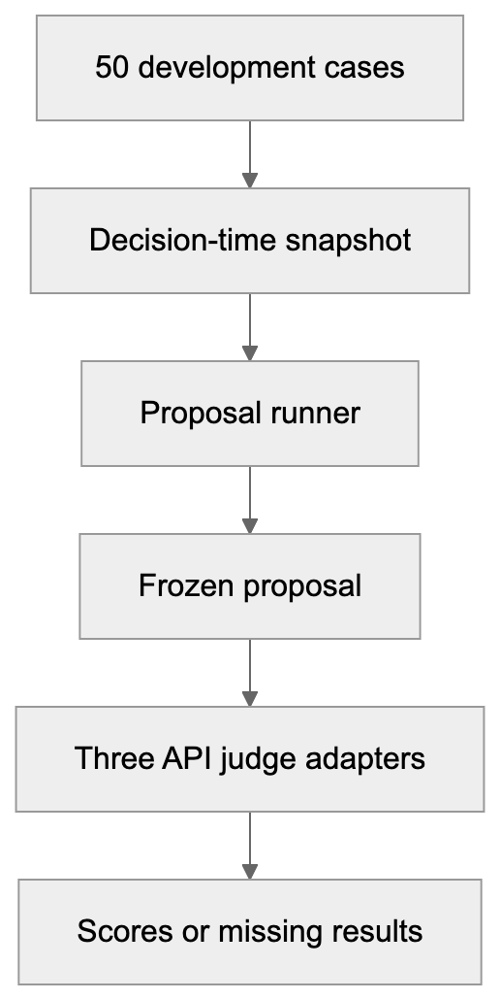
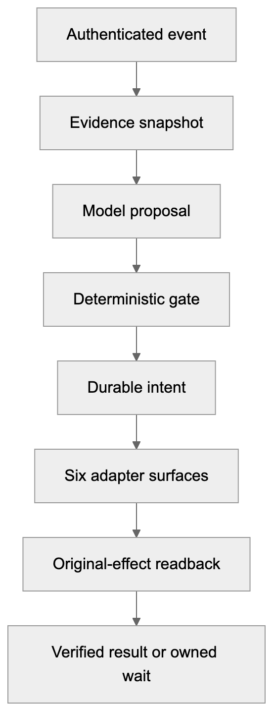

# Dwelly / ProofKey architecture

10 October 2026. A compact overview of the shipped experiment and the proposed operational system. The [detailed design snapshot](architecture-reference.md) retains source references and implementation requirements.

## 1. What is shipped

The standalone [model package](../tools/dwelly_model/README.md) prepares next-action proposals and supports three API judge adapters: OpenAI, Anthropic and Gemini. It uses the [50 public Delivery & Logistics cases](../data/dwelly-public-cases/README.md) as already-exposed development data.

The [release verification](model-release-verification.md) records 60 model tests and 58 intake tests passing, plus an offline Docker run over all 50 cases. That offline run used the deterministic baseline: no model answers, API calls or scored judge results. A separate two-case live smoke received eight responses: two valid proposals and six valid judge outputs across OpenAI, Anthropic and Gemini, with zero business effects. This establishes request compatibility on those cases; calibrated judging, semantic quality and unseen accuracy remain unestablished.

[Zoomable SVG](diagrams/stable/overview-1.svg) · [Editable Mermaid source](diagrams/stable/overview-1.mmd)

The package does not send customer messages, change bookings, create returns or move money. The separate operational runtime is not shipped in this release.

## 2. Target operational system

The proposed integration harness coordinates cases through six adapter surfaces: case, delivery, scheduling, returns, messaging and operator handoff. Typed interfaces and synthetic runtime evidence do not establish six working provider integrations.

[Zoomable SVG](diagrams/stable/overview-2.svg) · [Editable Mermaid source](diagrams/stable/overview-2.mmd)

The model proposes. The gate checks authority, consent, current state and budget. A provider acknowledgement does not prove an effect; verification requires the original operation's readback. Unknown outcomes retain an owner and a reconciliation path.

## 3. First integration priority

Connect one documented provider and one bounded process before expanding the catalogue. Whole-order rescheduling is the initial candidate: read the current booking and permitted slots, obtain the required selection and consent, persist an intent, dispatch under the provider's concurrency and idempotency contract, then verify the exact booking change.

Admission requires authenticated, scoped reads and tests for stale state, wrong-object responses, duplicate commands and timeouts after possible execution. If the provider cannot safely deduplicate or identify the original effect, route the write through an operator. A changed booking does not mean delivery is complete.

## 4. Adaptation priority

Treat a new schema or process as a reviewed change. Capture its source, map fields and permissions, identify changed postconditions, add independent positive and failure cases, then obtain human review before activation. Pin the accepted adapter and process versions; shadow-test and restrict the first activation to an explicit scope.

Start with a small mapping or one new operation that can reuse existing contracts and tests. Case messages and model-generated plans cannot authorize their own rules. Unsupported processes retain evidence and transfer to an accountable operator.

## 5. Evidence and next gates

Use the [package guide](../tools/dwelly_model/README.md) for local commands and API configuration, and the [verification record](model-release-verification.md) for measured results and limits. The [data guide](../data/dwelly-public-cases/README.md) describes provenance and development-only use. Consult the [reference design](architecture-reference.md) for ontology, adapter contracts, failure handling and source traceability.

Next evidence needed: the complete 50-case model experiment, the team's independent evaluation cases and permitted real examples, human-reviewed proposal quality on new cases, and a separately qualified provider integration. The two-case smoke, offline tests and model agreement do not establish these broader results.
