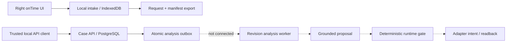
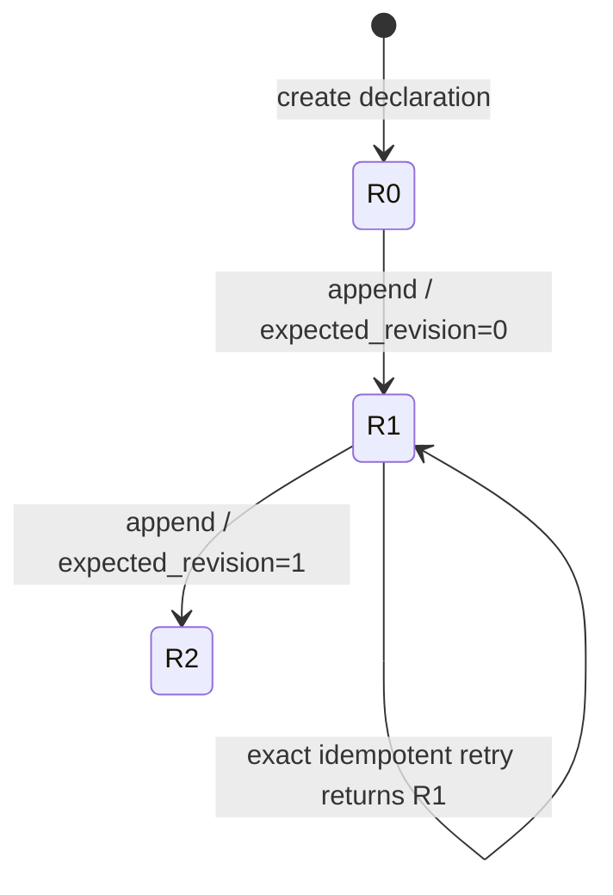
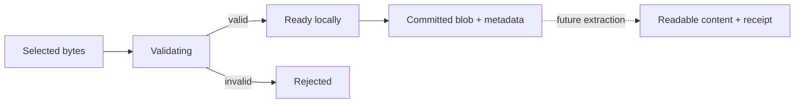
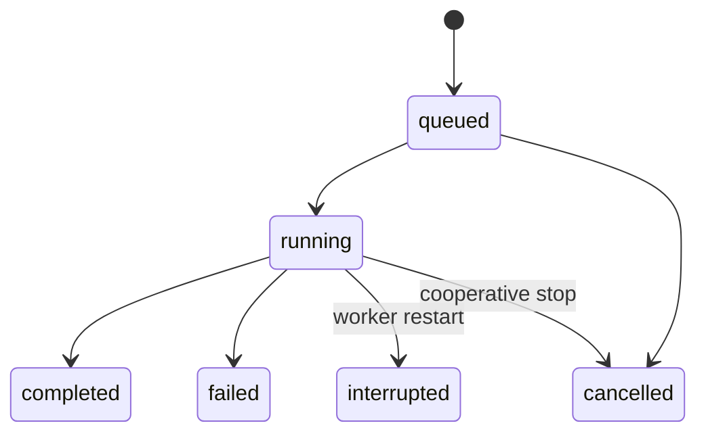
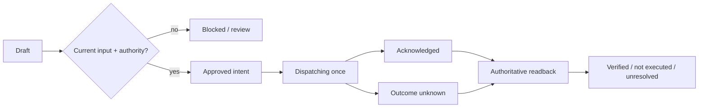

# Team backend and data boundary v1

This is the shared implementation boundary for parallel UI, E2E and training/evaluation work. It fixes **data meaning and interfaces**, not a claim that every target component already exists. Start from [contract pack](../../contracts/v1/README.md).

## 1. System map

Solid arrows exist locally. Dashed arrows are the new-case pipeline target, not installed connections. The separate [PostgreSQL case API](postgres-case-backend.md) atomically persists revisions and pending analysis intents; its worker is not connected. The existing SQLite model-job worker reads its startup benchmark bundle; it does not consume newly created cases. The optional shadow bridge checks a host-owned mapping but is inert. Current browser storage is private to one browser origin/device and is not shared backend state.

## 2. Case input: immutable revisions

Revision equals the number of committed input events. Declarations bind order, customer, responsible operator and participant IDs, but these are **declared relationships, not authenticated ownership**. Events retain source `occurred_at`; commit order wins when a delayed message arrives. Current store has no authoritative received timestamp; consumers use `source_received_at=null`/unavailable rather than infer one.

Canonical snapshots are checked on every read. The predecessor hash links revisions; earlier events and declaration fields cannot change. No generic `case.status=resolved` is added: input completeness, analysis status and execution outcome live separately. One business outcome may coexist with new evidence needing review.

## 3. Evidence bytes and extraction

Local validation checks bounded size, allowed MIME, actual bytes and image decoding before a file is usable. Browser SHA-256 identifies local bytes; an API event's supplied hash alone does not verify bytes on the server. Audio may be previewable but remains untranscribed. Extraction records need engine/version, input content hash, status, timestamps, result references and error category; observations remain evidence, not trusted instructions.

Private object storage and an authenticated asset service are target components. Server-issued asset IDs must be bound to the case, authorised uploader and verified bytes before an event can assert availability. Never fetch arbitrary user URLs/paths. Invalid, missing and unavailable assets stay explicit; no model claim can refer to unseen pixels/audio as observed content.

## 4. Analysis is revision-bound, not case-wide

`freshness=current|superseded` is independent from the processing status. A completed result for R1 remains immutable historical evidence after R2; it cannot overwrite R2's current decision. The PostgreSQL increment commits R2 and one unique `(case_id, revision)` intent carrying its snapshot hash together; its leases are fenced and expiring, but no analysis worker is connected. The later versioned analysis pipeline still needs `(case_id, revision, snapshot_hash, pipeline_version)`, attempt IDs and provider receipts; paid/model calls must not replay blindly after an uncertain crash. Outbox `completed` is an internal acknowledgement, not the completed model-analysis state in the diagram.

Model output proposes typed next steps (request evidence/customer choice, operator review, propose reschedule, wait, reconcile, no action). Proposed reschedule parameters include a slot but do not authorise dispatch. At first, authority policy is human-approved; training-derived candidate policy cannot activate itself. There is one responsible human reviewer, with explicit ID/version/review receipt required before changing approved policy.

## 5. Operation intent and outcome

These are proposed **service projections**, not a replacement for the runtime's existing phase names or wire models. Reuse `RequestBinding`, `RevisionVector`, `EffectIntent`, dispatch and verification contracts from the runtime when implementing the adapter; do not create weaker parallel authority.

Before dispatch recheck input version, current owner, consent, policy version, capability and approval. Persist intent/action ID before I/O. An acknowledgement is only receipt of the request. Timeout creates `outcome_unknown`, not failure/no-effect. Read back using the original effect identity; only proof of non-execution permits a newly authorised attempt. New evidence after dispatch does not erase the intent or undo an effect. Stop/cancel prevents future sends, not already performed external actions. Operator escalation is itself a tracked request requiring receipt, not merely an LLM sentence.

## 6. Storage ownership

| Record | Owner now | Target / invariant |
|---|---|---|
| Case head/snapshots/idempotency | Shared-backend path: `PostgresCaseStore`; legacy local path: SQLite `CaseStore` | Atomic append; immutable history; same v1 snapshots |
| Local UI metadata and bytes | Separate versioned IndexedDB | Browser-only, transaction commits both |
| Uploaded bytes | Not implemented | Private object store; metadata DB binds verified hash/size/owner |
| Analysis jobs/results | PostgreSQL revision outbox/leases; separate legacy benchmark jobs | Worker/results still unconnected; history never overwritten |
| Execution intents/receipts | Separate synthetic runtime journal | Actual adapters still disconnected |
| Episode labels/transitions | Evals dataset, not live case store | No leakage to model input; human review provenance |

Google Cloud deployment requires a durable database, private bucket, authenticated ingress/BFF, secret store and task/lease queue. Local SQLite on ephemeral Cloud Run disk is not sufficient. The `.env` file is local configuration only and must never enter frontend code, dataset exports or Git.

## 7. API contract and browser boundary

[OpenAPI](../../contracts/v1/openapi.json) lists the frozen case routes, plus health. The separate PostgreSQL service adds readiness and read-only outbox metadata documented in [its API table](postgres-case-backend.md#api). Future paths remain under `x-target-interfaces`, so generated clients cannot mistake them for available operations. Benchmark job routes remain documented in [model service](../model-service.md).

The local service checks loopback Host, bearer token and rejects every `Origin` header, including same-origin browser requests. Do not solve this by disabling the check or embedding the token. A future authenticated BFF is the trusted client and enforces per-user case permissions/CSRF and bounded upload before contacting the service. Until then the UI saves locally and exports explicit request payloads for developer tooling.

## 8. Minimum E2E/evaluation matrix

| Test | Required evidence |
|---|---|
| Create case | Revision 0, exact declaration, canonical snapshot hash |
| Append / duplicate retry | Revision 1 once; exact retry returns original R1 after restart/R2 |
| Concurrent append | One CAS winner, one conflict; no lost/merged input |
| Valid local photo / audio | Stored bytes survive reload; hash and preview, no analysis claim |
| Rejected upload | No ready/committed evidence, actionable error, draft retained |
| New input during analysis | Older result retained and superseded; no current-state overwrite |
| Grounded draft | Exact evidence references, needed details, no invented completion |
| Missing ownership / policy / consent | Deterministic block even if every model judge agrees |
| Crash after dispatch | Reconcile original intent, no duplicate action |
| Escalation | Await real operator receipt; bounded timeout remains unresolved |

The last five are target integration tests until the corresponding worker/BFF/adapter exists. Simulated receipts must carry a synthetic/replay tag. Live provider identity, costs, errors and judge disagreements are recorded separately. A green schema suite proves contract conformance, not correct logistics decisions.

## 9. Work allocation

UI can implement forms/list/preview on the local contract now. Backend can implement assets/BFF first, then revision-triggered analysis with readback. E2E can author fixed happy/adverse paths against the contract without model keys. Evals can label 10–20 independent episodes while retaining assistant-authored-draft status until the responsible human validates them. Real-world examples require permission and redaction; source text never becomes instructions for the system.
