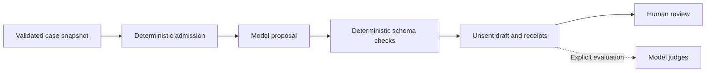
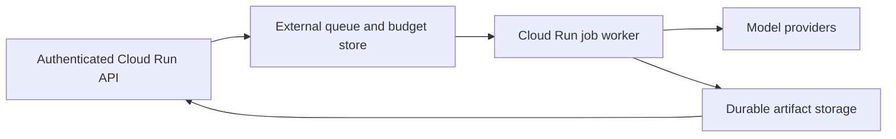

# Parallel model service

The model service is a single-operator local queue for unsent contact proposals. It persists jobs and a shared conservative spending ledger on a local POSIX filesystem, then overlaps bounded model requests inside one active job. It sends no customer messages, books no delivery and transfers no money. The separate `runtime/` harness is not invoked by this service.

## Boundary and status



Snapshot validation, hashing, queue ownership, budget admission, schema validation and reporting are deterministic controls. Proposed text and optional judge assessments are model output. Judge agreement is not calibrated correctness or permission to act. The six simulated adapter surfaces in the separate harness do not establish six real integrations.

| Scope | Status and limit |
| --- | --- |
| Local HTTP service | Implemented for one operator and one active job; persistent SQLite queue and POSIX budget ledger |
| Parallel provider work | Bounded requests inside that job; defaults are four total and two per provider |
| Proposal-only workflow | Default; no evaluation-file reads or judge calls |
| Explicit evaluation | Freezes all proposals before references are opened; optional judges remain provisional |
| Cloud Run | Offline CLI smoke template prepared; no deployment or live cloud worker included |
| Business operations | No message dispatch, bookings, returns, payment, or operational runtime connection |

## Run locally

Use Python 3.11 or newer from the repository root. Set a private token of at least 16 characters without whitespace. Generate it in the current shell or load it from your private secret store; never commit its value. The default server binds to loopback and starts without permission for live provider calls.

```sh
export PROOFKEY_SERVICE_TOKEN="$(openssl rand -hex 32)"
PROOFKEY_STATE="$(mktemp -d)"
chmod 700 "$PROOFKEY_STATE"
python3 -B -m tools.dwelly_service \
  --bundle "$PWD/data/dwelly-public-cases" \
  --config "$PWD/tools/dwelly_model/config.example.json" \
  --state-dir "$PROOFKEY_STATE"
```

Keep the state directory for restarts. It contains the SQLite queue, shared budget, evidence and raw provider receipts; protect it as private data. Run only one service owner against it. Never put state inside the input bundle or put inputs inside state. Inputs/config are fixed by the operator at startup; clients cannot submit file paths, provider configuration or secrets.

`--allow-live` is a separate startup opt-in. Live jobs additionally require `"mode":"live"` in the submission and the configured provider credentials in the server environment. Startup opt-in permits spending under the configured ledger; it does not validate credentials, prices, balance, provider availability or human acceptance. Shared reservations are not a provider billing cap and are retained after unknown outcomes or errors.

## Submit, poll and cancel

`GET /healthz` is a minimal unauthenticated health check. It refuses healthy status when the worker has failed or stopped; new submissions are also refused until the worker is available. All `/v1/` routes require `Authorization: Bearer ...`. Browser Origin requests are refused; the service has no CORS surface. Requests are limited to 16 KiB and return sanitized errors. At most 256 jobs may be pending, counting queued and running jobs; a full queue returns HTTP 429.

```sh
curl --fail-with-body http://127.0.0.1:8080/v1/capabilities \
  -H "Authorization: Bearer $PROOFKEY_SERVICE_TOKEN"

curl --fail-with-body http://127.0.0.1:8080/v1/jobs \
  -H "Authorization: Bearer $PROOFKEY_SERVICE_TOKEN" \
  -H 'Content-Type: application/json' \
  -H 'Idempotency-Key: offline-example-001' \
  --data '{"mode":"dry_run","limit":2,"evaluate":false,"max_parallel_requests":4,"per_provider_limit":2}'

# Copy job_id from the submission response.
PROOFKEY_JOB_ID='copy-job_id-from-response'
curl --fail-with-body "http://127.0.0.1:8080/v1/jobs/$PROOFKEY_JOB_ID" \
  -H "Authorization: Bearer $PROOFKEY_SERVICE_TOKEN"
curl --fail-with-body "http://127.0.0.1:8080/v1/jobs/$PROOFKEY_JOB_ID/proposals" \
  -H "Authorization: Bearer $PROOFKEY_SERVICE_TOKEN"
curl --fail-with-body "http://127.0.0.1:8080/v1/jobs/$PROOFKEY_JOB_ID/summary" \
  -H "Authorization: Bearer $PROOFKEY_SERVICE_TOKEN"
curl --fail-with-body -X POST "http://127.0.0.1:8080/v1/jobs/$PROOFKEY_JOB_ID/cancel" \
  -H "Authorization: Bearer $PROOFKEY_SERVICE_TOKEN" \
  -H 'Content-Type: application/json' --data '{}'
```

Submit only the documented fields: `mode` (`dry_run` or `live`), `limit` (1–50), `evaluate` (Boolean), `max_parallel_requests` (1–16), and `per_provider_limit` (1–8). Identical submissions with the same idempotency key return the same job; a changed body with that key is a conflict. The server commits the submission before acknowledging it.

Status polling returns state and progress counts, not raw prompts/replies. The authenticated `/proposals` route retrieves the actual unsent drafts for operator review. States are `queued`, `running`, `completed`, `cancelled`, `failed` and `interrupted`. The summary route returns a validated summary only when available. Cancellation stops new admission, drains requests already sent, and retains their evidence and reservations. It cannot revoke a provider request or promise a refund. On restart, queued jobs can run; previously running work is reconciled to valid terminal evidence or marked interrupted, never automatically replayed.

## Local Docker service

`Dockerfile.service` is separate from the CLI `Dockerfile`. It runs as UID/GID 10001, copies only the three tool packages, and requires a persistent state volume plus read-only input mounts. Its Dockerfile-specific ignore file excludes tests, caches, local outputs and common secret files. The stock Python base tag is not digest-pinned; record the resolved digest when reproducing a release.

```sh
docker build -f Dockerfile.service -t proofkey-service:local .
docker volume create proofkey-service-state
docker run --rm --name proofkey-service \
  -p 127.0.0.1:8080:8080 \
  -e PROOFKEY_SERVICE_TOKEN \
  --mount type=volume,source=proofkey-service-state,target=/state \
  --mount "type=bind,source=$PWD/data/dwelly-public-cases,target=/input/bundle,readonly" \
  --mount "type=bind,source=$PWD/tools/dwelly_model/config.example.json,target=/input/config.json,readonly" \
  proofkey-service:local
```

An existing compatible local Python image can be selected with `--build-arg PYTHON_IMAGE=...` for an offline build. The named volume persists when the container exits. A host bind mount for `/state` must be writable by UID 10001 and support normal POSIX locks; do not use a bucket mount. For local live use, explicitly add provider environment names and override the image command with the same fixed paths plus `--allow-live`; do not pass secrets in command arguments.

## Planned cloud path



These cloud boxes are planned, not included implementations. The local server refuses managed Cloud Run environments. A future API must persist submission and admission before responding; the worker must preserve reservations before dispatch and publish evidence continuously. A final upload after work is insufficient after a crash or forced stop. The shared queue/budget needs atomic external updates and duplicate-execution protection; immutable evidence belongs in durable object storage.

Cloud Run's default filesystem is ephemeral, and request-based service CPU can be restricted after a response. Cloud Storage FUSE lacks file locking and full POSIX semantics, so it cannot substitute for local SQLite and `flock`. See Google's [container contract](https://docs.cloud.google.com/run/docs/container-contract), [background-work guidance](https://docs.cloud.google.com/run/docs/tips/general), and [FUSE limitations](https://docs.cloud.google.com/run/docs/configuring/jobs/cloud-storage-volume-mounts).

The [cloud preparation guide](../deploy/cloud-run/README.md) and [job template](../deploy/cloud-run/job.template.yaml) specify a disposable offline smoke and the remaining live-cloud acceptance gates. Prepared configuration, locally tested behavior, cloud deployment and provider verification are separate evidence levels. None establishes calibrated model quality or business authorization.
