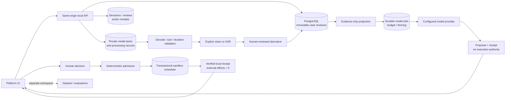

# ProofKey / Right onTime platform

## Product summary

A reusable case-operations platform for delivery exceptions. The primary user is the engineer/operator integrating unfamiliar workflows. The platform keeps original evidence, versioned analysis, human decisions, policy checks and effect receipts separate. The first operational path is same-address delivery rescheduling in a local sandbox; refusals, refunds, returns and unknown cases remain human-review paths.

This is an integrated **local platform**, not a production deployment. The existing case-storage cloud pilot and the old runtime simulators are separate systems. No real courier, customer communication, payment or cloud service is changed by the platform.

See the [verification record and UI screenshots](verification/platform-ui-2026-10-10/README.md) for tested paths, exact boundaries and remaining gaps.

## Product screens

- **Team** at `/`: searchable cases, operator queue, Summary / Requests / Sources, ownership and activity. Analysis remains a proposal; approval and sandbox execution are separate controls under Requests.
- **Customer** at `/customer.html?case=<case-id>`: operator-assisted window preference and current status. It writes a proposal to the same case; it cannot approve or execute. This is not an authenticated external customer portal.
- **Preparation** at `/preparation.html`: current service capabilities, six adapter mappings, process/acknowledgement/readback settings, browser-local save/load and JSON export. Preflight is read-only; the draft is not activated in the runtime.

The Team-to-Customer link preserves case identity. New evidence invalidates old decision status while retaining history. See the [product-screen verification](verification/product-workspace-2026-10-10/README.md) for current tests and screenshots.

## Run

Use Python with `requirements-postgres.lock` and `requirements-platform.txt` installed. ASR validation also requires `ffprobe` on PATH. Supply the PostgreSQL DSN through the environment; never put it or provider keys into browser code or Git.

```sh
PYTHONPATH=.:tools:runtime/src python -m tools.dwelly_platform serve \
  --database-url-env PROOFKEY_PLATFORM_DATABASE_URL \
  --schema proofkey_platform_local --migrate --port 8095
```

Open `http://127.0.0.1:8095/`. The default is no model dispatch and no media dispatch. Historical model/media records remain readable without enabling new calls. Migration is explicit and additive; it does not clear cases.

Add `--channel-config tools/dwelly_channels/examples/channels.local.json` for the **Communications** workspace and local email/chat/phone ingress. Optional `--channel-port 8096` starts a separate signed loopback listener; it requires signing secrets from the environment. See [inbound communications](inbound-communications.md) for exact contracts, setup and boundaries. This does not connect any real mailbox, messenger or telephone account.

For an authorized provider experiment, add `--allow-live` for case reasoning and/or `--allow-media` for photo analysis/ASR. Optional `--provider-env-file .env` uses the existing non-executing, allowlisted loader. The configured example case models are not recommendations or claims of account access. `--image-model` and `--asr-model` control media models. Keys stay server-side.

Media uses a conservative full USD25 reservation per provider/model/experiment, so only one new request per model is admitted until a more precise accounting policy is implemented. The CLI connects media and text to the same durable model-budget ledger: existing text reservations can block a media run, and vice versa. Failed/unknown requests retain their reservation; retrying with a new key is not a way around the budget. Reuse `--budget-scope` across restarts of the same experiment. This is a local reservation limit, not a billing-system guarantee; also set provider-side limits.

## User journey

1. Create a case with declared order/customer/operator IDs. Declarations are not verified identities.
2. Append original text, image, voice note or call recording. Revision/hash changes; the old snapshot stays immutable.
3. For media, explicitly request photo analysis or ASR after content validation. Inspect the original and derived text side by side.
4. If useful, explicitly confirm review and add derived text as an **internal operator event**, retaining the source asset ID/hash. It is never relabeled as a customer quote.
5. Run deterministic analysis and optionally a real configured model. Model candidates and provider receipts do not authorize actions.
6. Propose a delivery window with source event references. Deterministic guards check current revision, unchanged address, future bounded times and evidence references.
7. Approve with a recorded local operator attestation of customer consent, or reject/escalate. Execute separately in the sandbox.
8. Inspect the committed sandbox booking receipt. New evidence requires a new decision; previous approval does not carry over.

## Architecture



## State model

All machine states, UI labels, errors and decisions are English. Original source text is preserved, not automatically translated.

| Axis | States | Meaning |
|---|---|---|
| Lifecycle | `new`, `awaiting_information`, `in_review`, `awaiting_approval`, `ready`, `resolved`, `escalated` | Current operational work, not a model's self-report |
| Evidence | `empty`, `text_available`, `media_unprocessed`, `mixed` | Original evidence composition; individual media runs show processing independently |
| Analysis | `not_started`, `running`, `current`, `stale`, `failed`, `outcome_unknown` | Freshness and execution of the latest relevant analysis |
| Decision | `none`, `proposed`, `blocked`, `approved`, `rejected`, `superseded` | Current revision-bound proposal/review |
| Action | `none`, `verified` | This slice has atomic local effects; external asynchronous action states remain future integration work |
| Media run | `running`, `succeeded`, `failed`, `outcome_unknown` | Explicit extraction, never evidence authenticity or identity verification |
| Inbound receipt | `accepted`, `quarantined` | Durable evidence admission, never sender identity proof or case resolution |

History retains all proposals and receipts. A `verified` historical sandbox action can remain visible when newer evidence makes the case unresolved again. `resolved` means the current local sandbox workflow succeeded, not delivery confirmation from a real carrier.

## Deterministic vs model-driven

| Deterministic host responsibilities | Nondeterministic provider responsibilities |
|---|---|
| Schema, file/hash/duration limits | Image observations and visible text |
| Immutable revisions and source references | ASR transcript draft |
| Idempotency, concurrency and budget admission | Evidence-based next-step proposal |
| Time/address/evidence/approval checks | Explicit uncertainties, requests for information |
| Sandbox booking and transactional receipt | No authority, execution or invented result |

The deterministic baseline intentionally asks for information/review rather than claiming semantic understanding. Unlabeled real cases have `reference:null` and `evaluation:null`; a successful model run is not an accuracy score.

## Integrations

| Surface | Current state |
|---|---|
| Case/CRM records | Local PostgreSQL connected |
| Delivery operations | Interface only; no real carrier |
| Scheduling | Transactional PostgreSQL sandbox |
| Returns | Interface only; human review |
| Customer messaging | Optional local inbound email/chat/phone harness; no real account or outbound sends/calls |
| Operator inbox | Local review queue |

## Media limits and controls

PNG/JPEG uploads: 10 MiB; audio MPEG/WAV/MP4/WebM: 25 MiB; per-case media: 100 MiB. Upload verifies the claimed format signature and computes SHA-256. Before external processing, images must decode and contain at most 16 megapixels. Audio is inspected with a 10-second `ffprobe` timeout and must be audio-only with duration at most 600 seconds. ASR is configured for the agreed English source scope; this is not a language-detection claim.

Derived text and metadata require review and are treated as untrusted input. Corrupt files, empty model output, missing validator/provider and mismatched source bindings fail closed. A media request left running after process failure becomes `outcome_unknown` through conservative timeout handling and is not resent automatically.

Provider payloads follow official [image-input documentation](https://developers.openai.com/api/docs/guides/images-vision) and [speech-to-text documentation](https://developers.openai.com/api/docs/guides/speech-to-text). Image generation is reserved for a separate synthetic-evaluation workflow and is not enabled in operational cases.

## Deployment boundary

The server binds only to loopback and rejects cloud execution markers. Its trusted-local-operator model is not tenant authentication. Before any production deployment: add authenticated user roles/tenancy, private object storage and retention, deployment-safe workers, rate/body/concurrency limits, malware scanning policy, real service authority, adapter readback/failure handling, and live-provider evaluations. Do not expose port 8095 to a network or simply deploy this server to Cloud Run.
