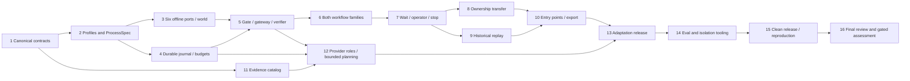

# ProofKey Adaptive Logistics Runtime Implementation Plan

> **For agentic workers:** REQUIRED SUB-SKILL: Use superpowers:subagent-driven-development (recommended) or superpowers:executing-plans to implement this plan task-by-task. Steps use checkbox (`- [ ]`) syntax for tracking.

**Goal:** Build an engineer-first, six-port offline integration harness that safely resolves permitted logistics cases, adapts reviewed environment profiles and produces auditable assessment evidence.

**Architecture:** One Python modular monolith shares a policy gate, SQLite journal and operation-specific verifier across library/CLI/loopback API. Six adapters operate against a separate simulated operational world; they cannot privately dispatch another effect. Frozen ProcessSpec/profile/policy versions govern execution; engineer adaptation is a proposal/test/human-review/release loop, not runtime self-modification.

**Tech Stack:** Python 3.11+, Pydantic, SQLite, argparse, unittest, thin FastAPI; provider-neutral Anthropic extraction/planning and ElevenLabs transcription routes, disabled for live use until authorized.

**Spec:** [Approved design](../../../openspec/changes/proofkey-v21-harness-contracts/design.md), [OpenSpec tasks](../../../openspec/changes/proofkey-v21-harness-contracts/tasks.md), and the four [capability deltas](../../../openspec/changes/proofkey-v21-harness-contracts/specs/).

**Approval record:** On 8 October 2026 the user replied “да делай автономно” to approval of the updated written design and proceeding to detailed planning. All 18 original and ten follow-up decisions are retained. This plan is prepared autonomously with independent read-only coverage review. It is not an implementation receipt or approval of paid/native/publication actions. Written plan review precedes product implementation under the preserved workflow; do not infer approval of a previously unwritten plan from design approval.

**Execution approval:** The subsequent “да” approves this written plan and subagent-driven implementation; “да делай уже блять” confirms the managed worktree. Implementation runs in `/Users/nbk/.codex/worktrees/proofkey-runtime/Pitch project` on `codex/proofkey-runtime`, based on `e851629`. Routine local implementation continues autonomously; external/spend/publication boundaries remain unchanged. This approval is not a runtime completion receipt.

## Global Constraints

The following project constraints are copied from the approved design; concrete implementation details below implement them, not relax them.

- “Use a clean `runtime/` subtree containing the `proofkey` package, project metadata, tests, public development fixtures, README and LICENSE.”
- “The proposed bet is Python 3.11+, Pydantic canonical schemas, typing protocols, SQLite, argparse and unittest.”
- “All effects use the same policy gate, immutable intent journal, shared budget and verifier.”
- “Policy stays in the core, not in vendor mappings.”
- “Owned new code is Apache-2.0.”
- “Internal-case disposition is record-only initially; actual creation is deferred/disabled.”
- “Automatic reminders are off by default.”
- “Native diagram synchronization/integration is out of the first scope.”
- “Live provider spend stays zero until a separately approved campaign.”
- “For calibration use 120 seconds active execution per case, 4 planner calls, 24 total tool calls including readbacks and failures, 6 distinct logical effects with one reserved for handoff, 3 reconciliation reads per intent, at most one contract-safe resend, and 2 clarification requests.”
- “A tool call is bounded by 10 seconds or the remaining active budget.”
- “Structured-only has zero planner calls.”
- “Never claim external exactly-once from local deduplication.”
- “Runtime can replan inside the approved graph, not rewrite it or change permissions.”
- “The human-reviewed ProcessSpec and its contract tests are canonical.”
- “An offline milestone can remain explicitly incomplete on these live/assessment gates.”

Raw archives, `work/`, `outputs/`, historical model assessments, source diagrams and frozen v2.2 artifacts are read-only evidence. Do not import the archived simulator as the target runtime, stage the whole workspace or relicense original evidence. No dependency install, product scaffold, provider call or runtime test occurs while writing this plan.

## Review Focus

Each line has owning executable tests in the indicated task; these are expected failure cases, not observed bugs.

1. A valid old-owner decision prepared before transfer must be fenced even while the epoch is unchanged — Task 8, `test_prepared_decision_fenced_by_pending_state`.
2. Crash after extraction/transcription/planning entry must not refund the pre-debited attempt or fabricate a receipt — Tasks 4/12, `test_interrupted_invocation_is_consumed_for_each_role`.
3. Completed replay containing an unknown return must not quietly refresh business state or invoke extraction — Task 9, `test_historical_unknown_replay_has_no_business_calls`.
4. A symlink, Unicode/case collision or path-escape case ID must not overwrite another case's export — Task 10, `test_export_path_and_collision_controls`.
5. A changed processing lineage, shared evaluator identity or leaked error canary must not inherit calibrated/protected scores — Task 14, `test_lineage_change_invalidates_scores` and `test_shared_identity_is_rehearsal`.

---

## Delivery milestones and execution topology

| Milestone | Required tasks | Evidence / meaning |
|---|---|---|
| M0: reviewed foundation | 1–3, plan review | Frozen schema/port/profile contracts and public fixtures; no outcome claim |
| M1: deterministic offline candidate | 1–10 | All six surfaces, both autonomous workflow families, service refusal/handoff, recovery/stop/transfer/replay and export; simulated guarantees only |
| M2: complete agreed candidate preparation | 11–15 | Required evidence classes, AI-role protocols, reviewed process adaptation, eval tooling and clean release; actual-role/media/native/custody readiness may remain unfinished |
| M3: measured/eligible entry | 14–16 plus external gates | Frozen four drills, complete receipts, actual enabled content/model processing and confirmed event/native/publication constraints |

No milestone can satisfy missing requirements with universal escalation or label a replay an actual provider run. The 59–94 additive person-hour range remains unmeasured; tasks are ordered by dependency, not promised wall-clock slots.



Root owns shared contracts, OpenSpec updates, plan and integration commits. Adapter worker owns only `adapters/` and its tests after Task 2 freezes; journal worker owns `journal.py`, `schema.sql`, `budget.py` and its tests. Evidence worker can start Task 11 after Task 1. Consumers request a contract change rather than editing the shared file. Run an independent spec-compliance review then a quality review per completed task, and a fresh whole-candidate review at Task 16. Reviewer findings must be checked against actual code/tests; agent summaries do not establish completion. Separate worktrees/branches, if used, start from the approved plan commit with explicit ownership and are integrated non-destructively.

## File ownership and responsibility map

All paths below are **future files**, not claims they exist. Project root is `/Users/nbk/Documents/Pitch project`.

| Files under `runtime/` | Responsibility / owner |
|---|---|
| `pyproject.toml`, `src/proofkey/__init__.py`, `contracts.py`, `identity.py` | Owned package metadata, strict wire models and stable identities; root |
| `profiles.py`, `process.py`, `profiles/{flat-v1,nested-v1}.json`, `processes/{reschedule-window,reschedule-exact,goods-refusal,service-refusal}.json` | Frozen mappings/capabilities and finite processes; contract owner |
| `ports.py`, `adapters/{world,case,delivery,scheduling,returns,messaging,operator}.py` | Six typed surfaces and separate offline authority world; adapter owner |
| `journal.py`, `schema.sql`, `budget.py` | Durable intents/checkpoints/invocations/generations/results, saved finite limits; core owner |
| `policy.py`, `gateway.py`, `verifier.py`, `engine.py`, `waits.py`, `ownership.py`, `replay.py` | Shared action discipline, workflows and safe resume; core owner |
| `exporter.py`, `batch.py`, `cli.py`, `api.py` | Every-case output, global deadline and shared entry points; interface owner |
| `evidence/{catalog,intake,redaction}.py`, `providers/{protocols,invocations,replay,unavailable,anthropic,elevenlabs}.py`, `planner.py` | Media/provenance, invocation receipts and bounded proposals; evidence owner |
| `factory/{proposal,release,views}.py` | Engineer proposal/regression/review/compatible activation; adaptation owner |
| `assessment/{ledger,labels,cache,coverage,drills,isolation,readiness,audit}.py` | Runnable rehearsal/evidence and truthful qualification; eval owner |
| `release.py`, `README.md`, `LICENSE`, `NOTICE`, `RIGHTS.md`, `.gitignore` | Clean owned-source packaging and rights; release owner |
| `tests/support.py`, named `test_*.py` files below, `tests/crash_worker.py`, `fixtures/development/` | Synthetic public deterministic controls; corresponding task owner |
| `requirements.lock`, `DEPENDENCIES.json` | Exact tested environment pins/license/host receipts; root at dependency preflight |

Python modules remain focused: do not turn `engine.py` into the adapter, provider, release and grader implementation. Tests do not import private evaluator labels into production modules. No nested Git repository.

## Frozen interface spine

Task 1 defines the strict schemas below; its consumers must use these names/fields rather than inventing parallel contracts. All JSON-facing models forbid undeclared fields, reject non-finite numbers, validate aware timestamps and keep untrusted narrative distinct from authoritative observations.

| Type | Required public fields |
|---|---|
| `CanonicalRequest` | `case_id`, `object_id`, `principal_id`, `request_id`, `request_revision`, `consent_revision`, `kind`, `consent_mode` (`window`, `exact_slot`, explicit `unknown`), `arguments`, `evidence_ids`, optional `narrative`; input modality/no-text is distinct from consent; transport event ID is not business identity |
| `AuthContext` | `caller_id`, `proof_reference`; not permission flags supplied in a body |
| `ReadRequest` / `ReadTarget` | case/object, caller/proof reference, purpose, bounded deadline and a tagged target: authority facts, original effect (operation/generation/action/provider key/fingerprint), transfer (transfer/packet/revision), operator packet or question; no hidden-world selector |
| `RequestBinding` | case/object/principal/request identity, historical revisions, durable `generation`, intent `fingerprint`, optional supersession relation |
| `AuthorityObservation` | designated `authority`, `fact`, `object_id`, strict `value`, `revision`, provider/observation times, `evidence_ref` |
| `AuthorityReadback` | operation/object, typed observations, provider request/action/fingerprint where available, execution stage, terminal-nonexecution proof or explicit unknown, authoritative as-of/evidence; absent identity cannot verify an effect |
| `RevisionVector` | mapping of **all material designated authority/fact identities** to revisions |
| `OperationCapability` | operation, authority, permission basis, acknowledgement/readback contract, idempotency scope, conditional coverage, timeout, terminal-nonexecution basis, shared account quota/concurrency/rate limits, evidence mode/version |
| `EffectIntent` | binding, operation/stage, stable action ID/provider key, immutable argument fingerprint, original profile/process/policy/consent versions, expected revisions, postcondition, deadline, optional decision/ownership-state binding |
| `DispatchResult` | `status`: rejected/acknowledged/outcome_unknown; provider request identity and evidence, never verification |
| `VerificationResult` | `status`: verified/rejected/pending/outcome_unknown/conflict; matching object/action/fingerprint/postcondition and authoritative evidence/as-of |
| `PhaseCheckpoint` | binding, phase/next gate, versions, processing status, observations, question/awaited fields, ownership state/revision, stop, persisted budget/deadline |
| `BudgetLedger` | case-scoped active time/deadline, calls/effects/reads/retries/clarifications, per-role invocations/usage allowances and shared account pressure; no reset on new generation |
| `WaitState` / `ScopedReply` | question ID, binding, origin/next gate, recipient/owner state, awaited fields, expiry/budget; response actor proof, matching question/revisions and simulated flag |
| `OperatorPacket` / `OperatorReceipt` / `OperatorDecision` | case/object/binding, packet hash/revision, current owner/state/epoch, source scope, accepted receipt or scoped decision, expiry and replay identity |
| `TransferIntent` / `HumanOwnership` | stable transfer ID, same binding/case/packet, expected owner/state revision, target owner, expiry; HumanOwnership exposes `binding`, `owner`, `epoch`, `state_revision`, packet identity and acceptance/pending evidence. Epoch is distinct from pending-state revision |
| `ArtifactRecord` / `ProcessingReceipt` | original hash/MIME/source/case/access/time/lineage; invocation/role/provider/requested-and-observed model/prompt/version/input hashes/mode/status/latency/usage and typed output (assertions, transcript or bounded `ActionProposal`) plus output hashes/references/available coordinates |
| `EvidenceAssertion` | artifact/content/lineage, tagged locator (text span, page/region, audio time or unknown), uncertainty and source-processing receipt; no invented coordinates |
| `CampaignPermit` | exact input hashes/role/provider/model/endpoint, privacy/rights approval, finite cost/usage/invocation ceilings, expiry and approval receipt; simulated versus actual authorization distinct |
| `ProcessorIdentity` / `InvocationRequest` / `InvocationReservation` | immutable case/generation/role (`extraction`, `transcription`, `planning`), campaign/permit hash, input hashes, requested provider/model/endpoint/prompt/version, profile/process and deadline, reserved invocation/usage/worst-case cost; unique invocation ID, consumed/unknown status and shared case/role/campaign debits |
| `ActionProposal` | operation/stage/arguments/evidence references only; no permissions, adapter code or invented authority |
| `GateDecision` | allowed flag, explicit reason and denied-path `VerificationResult`; a policy denial is not provider business acceptance |
| `SavedResult` / `CaseResult` | saved authorized results require binding/fingerprint, result version/as-of, per-effect independent states, stop, wait/handoff/media status, evidence/policy references, concise rationale and historical flag; denied/error CaseResult has no stored binding/evidence/effects and only caller-supplied correlation ID plus generic reason. Read-only `case_id` delegates to authorized binding or supplied correlation ID; `exportable` means valid auditable response, not business success |
| `ProcessSpec` / `EnvironmentProfile` | finite allowed phases/edges/operations, prerequisites/waits/approval/ack/readback/completion, mappings/authority/capabilities/policy hashes and original versioned releases; profile carries typed `processes` by request kind for frozen graph selection |
| `AdaptationProposal` / `ReviewPacket` / `ReleaseReceipt` | source/baseline/proposal/diff/test/migration and agent hashes; regression hash, affected pending contracts and actual/simulated human approval; typed proposed profile/process bundle and compatibility material, fail closed if absent at release; immutable release hashes/version and preserved old contracts |
| `HumanReviewApproval` | exact proposal/regression hashes, named reviewer identity/proof/scope, decision/time and actual-versus-simulated mode; neither runtime input nor model consensus can mint actual approval |
| `ExportReceipt` / `BatchReceipt` | original supplied case IDs, safe output names/hashes or visible failures, every-case ledger, budget/deadline/as-of and measured reserve |
| `LedgerAudit` / `CaseAssessment` / `QualificationReceipt` | source/reference/label/rubric/lineage hashes, complete denominators/ambiguity, per-effect verdicts, repeatability/sensitivity/noise results and explicit qualification limits |
| `DrillReceipt` / `IsolationReceipt` | frozen workload/candidate/baseline/result hashes, full clocks/waits/partials; actual enforced probe evidence, identity/custody and rehearsal/protected status |
| `SourceReleaseReceipt` / `ReproductionReceipt` / `ImplementationAudit` | allowlisted file/rights/dependency/candidate hashes; actual command exits and observed artifacts; requirement-derived readiness with missing/invalid evidence retained, not caller-provided completion booleans |

### Test support contract

`tests/support.py` provides `make_request(**overrides) -> CanonicalRequest`, `make_auth(**overrides) -> AuthContext`, `make_binding(request=None,**overrides) -> RequestBinding`, `make_intent(binding=None,**overrides) -> EffectIntent`, `make_checkpoint(binding=None,**overrides) -> PhaseCheckpoint`, `make_result(binding=None,**overrides) -> SavedResult` and `load_test_profile(name="flat-v1") -> EnvironmentProfile`. SavedResult is a validated authorized CaseResult subtype accepted by exporter. Builders have documented synthetic defaults: case `C1`, object `O1`, customer `U1`, request `REQ1`, generation `G1`, revisions `v1`, UTC window 10:00–12:00 and complete goods inventory `item-1:1`. `make_binding(request=...)` derives exact historical revisions and canonical intent fingerprint; `case_id` overrides rebuild binding consistently; `return_status` on `make_result` creates the canonical `effects["create_return"]` record. No builder grants production authority. `FakeClock` has `now()` and `advance(seconds)`; receipt assertions use fixed aware UTC time rather than sleeps. Each builder revalidates updates, not unchecked model-copy mutation. Task 2 supplies the profile loader before any consumer calls it; Task 1 support does not eagerly import unfinished profiles. Later tasks explicitly add their named fixture helpers; production modules never import support.

Tests importing support run with `PYTHONPATH=runtime/src:runtime/tests`. Before execution verify the chosen interpreter is Python 3.11+ and capture exact installed/pinned Pydantic/FastAPI and transitive versions/license metadata. An unavailable package is an infrastructure failure, not a passing behavioral test. Pin the actual resolved test environment in Task 1; do not guess latest versions in this planning artifact. A network install is a later implementation step, not performed here.

---

### Task 1: Package, strict contracts and stable identities

**Files:** Create `runtime/pyproject.toml`, `runtime/src/proofkey/{__init__,contracts,identity}.py`, `runtime/tests/{support,test_contracts}.py`, `runtime/requirements.lock`, `runtime/DEPENDENCIES.json`.

**Interfaces:** Produces the interface spine above, builders and `stable_action_id(binding, operation, stage) -> str`, `fingerprint(arguments) -> str`. `OperationCapability` uses explicit unknown states; no permissive bool default. Consumers: every subsequent task.

- [ ] **Step 1 — write red tests for strict input and stable identity.**

```python
import unittest
from proofkey.contracts import CanonicalRequest
from proofkey.identity import stable_action_id, fingerprint
from support import make_request, make_binding

class ContractTests(unittest.TestCase):
    def test_same_generation_identity_is_stable(self):
        binding = make_binding()
        self.assertEqual(stable_action_id(binding, "reschedule", "commit"),
                         stable_action_id(binding, "reschedule", "commit"))
        self.assertNotEqual(stable_action_id(binding, "register_goods_refusal", "register"),
                            stable_action_id(binding, "create_return", "initiate"))
        self.assertNotEqual(fingerprint({"slot": "S1"}), fingerprint({"slot": "S2"}))

    def test_body_cannot_grant_permission(self):
        payload = make_request().model_dump(mode="json")
        payload["permission_granted"] = True
        with self.assertRaises(ValueError):
            CanonicalRequest.model_validate(payload)
```

Also parameterize NaN/Infinity, wrong ID types, naive timestamps, absent request identity and invalid processing/dispatch/verification statuses. Missing authority may be represented as unknown, never silently fabricated.

- [ ] **Step 2 — confirm red.** Run `PYTHONPATH=runtime/src:runtime/tests python3 -m unittest discover -s runtime/tests -p test_contracts.py -v`; expect import failure before package implementation, then specific validation failures until each guard exists. Retain the output; an unrelated dependency error is not the behavioral red result.
- [ ] **Step 3 — implement strict wire models and canonical IDs.**

```python
import hashlib, json
from pydantic import BaseModel, ConfigDict

class WireModel(BaseModel):
    model_config = ConfigDict(extra="forbid", frozen=True, strict=True, allow_inf_nan=False)

def fingerprint(arguments: dict) -> str:
    encoded = json.dumps(arguments, sort_keys=True, separators=(",", ":"),
                         ensure_ascii=False, allow_nan=False).encode("utf-8")
    return hashlib.sha256(encoded).hexdigest()

def stable_action_id(binding, operation: str, stage: str) -> str:
    return fingerprint({"case": binding.case_id, "object": binding.object_id,
                        "generation": binding.generation,
                        "operation": operation, "stage": stage})
```

Define every model/enum in the spine with these strict rules, typed nested records and aware-time validation. `frozen=True` alone does not freeze nested mappings: use defensive canonical snapshots and revalidate their fingerprint against the immutable journal before dispatch; test nested argument/vector mutation cannot change a prepared action. Keep argument fingerprint separate from action identity; the journal later rejects changed arguments under one ID. Declare Python floor in metadata and capture exact successfully tested dependency pins, not subscription/provider secrets.
- [ ] **Step 4 — green and review.** Run the Task 1 command and complete current suite. Inspect serialized defaults and constructor signatures against the spine. No product workflow claim follows.
- [ ] **Step 5 — scoped commit.** `git add runtime/pyproject.toml runtime/src/proofkey runtime/tests/support.py runtime/tests/test_contracts.py runtime/requirements.lock runtime/DEPENDENCIES.json`; commit `feat: freeze strict runtime contracts and identities` after checking the staged files.

### Task 2: Capability profiles, normalization and initial ProcessSpec

**Files:** Create `runtime/src/proofkey/{profiles,process}.py`, `runtime/profiles/{flat-v1,nested-v1}.json`, `runtime/processes/{reschedule-window,reschedule-exact,goods-refusal,service-refusal}.json`, `runtime/tests/{test_profiles,test_process}.py`.

**Interfaces:** Consumes Task 1; produces `load_profile(path) -> EnvironmentProfile`, `normalize_input(payload, profile) -> CanonicalRequest`, `ProcessController(profile).permits(phase, operation, observed_prerequisites) -> bool`. Profile activation is not supplied by request content. Each enabled operation names its material revision coverage and evidence basis.

- [ ] **Step 1 — failing no-text parity and process prerequisite tests.**

```python
import unittest
from proofkey.profiles import normalize_input
from proofkey.process import ProcessController
from support import make_request, load_test_profile

class ProfileTests(unittest.TestCase):
    def test_flat_nested_no_text_parity(self):
        request = make_request(narrative=None)
        flat = request.model_dump(mode="json")
        nested = {"data": {"request": flat}}
        self.assertEqual(normalize_input(flat, load_test_profile("flat-v1")),
                         normalize_input(nested, load_test_profile("nested-v1")))

    def test_return_requires_verified_refusal(self):
        process = ProcessController(load_test_profile())
        self.assertFalse(process.permits("return_gate", "create_return",
                                         {"refusal": "acknowledged"}))
        self.assertTrue(process.permits("return_gate", "create_return",
                                        {"refusal": "verified"}))
```

Add malformed/nested-extra/policy-injection, missing-intent, unknown conditional/readback capability, exact-slot confirmation, all saved phases and diagrams unable to activate runtime tests. A map may produce missing facts; it cannot make them authoritative.
- [ ] **Step 2 — red.** Run `PYTHONPATH=runtime/src:runtime/tests python3 -m unittest discover -s runtime/tests -p 'test_pro*.py' -v` before the modules exist, then for the exact guard failures.
- [ ] **Step 3 — implement finite declarative graphs and fail-closed manifests.** The following fragment is the refusal process prerequisite, not the whole manifest:

```json
{"process_id":"goods-refusal-v1","edges":[
  {"from":"refusal_gate","operation":"register_goods_refusal","to":"verify_refusal"},
  {"from":"return_gate","operation":"create_return","to":"verify_return",
   "requires":{"refusal":"verified"}}
],"completion":{"refusal":"independent","return":"initiation_only"}}
```

Create full finite phase graphs for intake/extraction/completeness/auth, both consent modes, waits/expiry/facts-only return, dispatch/verification, stop and operator handling. Preserve unknown capability fields; disable the corresponding effect. Public fixture manifests explicitly label simulated conditional-vector/idempotency/readback behavior. Finite test expiry values may be used as **synthetic test policy**, never inferred native/customer policy. Live per-role usage/cost/privacy values are absent and live routes disabled.
- [ ] **Step 4 — green and freeze.** Run profile/process tests and suite; hash all profile/process/policy/contract bytes. Root reviews examples before parallel consumers start. A later change must update tests and release version.
- [ ] **Step 5 — commit.** Stage only Task 2 files and commit `feat: add reviewed baseline profiles and finite processes`.

### Task 3: Six ports and independent simulated operational world

**Files:** Create `runtime/src/proofkey/ports.py`, `runtime/src/proofkey/adapters/{world,case,delivery,scheduling,returns,messaging,operator}.py`, `runtime/tests/test_adapters.py`, synthetic `runtime/fixtures/development/world.json`.

**Interfaces:** `AdapterBundle` exposes `case`, `delivery`, `scheduling`, `returns`, `messaging`, `operator` with the method sets below. Every read takes a `ReadRequest` including its bounded deadline and returns `AuthorityReadback` with typed observations; every effect takes `EffectIntent` and returns `DispatchResult`. `SimulatedWorld(path, fixture).bundle() -> AdapterBundle` creates separate provider state, not journal state. Test-driver-only `mutate(fact, value)`, `material_revisions() -> RevisionVector`, `set_fault(operation, behavior)`, `calls` (records with operation/purpose) and `effect_count(operation) -> int` are not runtime tools and never appear in public responses.

| Port | ReadRequest → AuthorityReadback | EffectIntent → DispatchResult |
|---|---|---|
| case | `read_case`, `read_principal` | none |
| delivery | `read_delivery`, `read_refusal` | `register_goods_refusal`, `register_service_refusal` |
| scheduling | `list_permitted_slots`, `read_schedule` | `reschedule` |
| returns | `read_return_policy`, `read_return` | `create_return` |
| messaging | `read_message` | `send_clarification`, `send_status` |
| operator | `read_receipt`, `read_resume`, `read_owner` | `enqueue_handoff`, `transfer_owner` |

- [ ] **Step 1 — failing conditional-vector and partial-effects tests.**

```python
import tempfile, unittest
from pathlib import Path
from proofkey.adapters.world import SimulatedWorld
from support import make_intent

class AdapterTests(unittest.TestCase):
    def test_consent_race_rejects_stale_vector(self):
        with tempfile.TemporaryDirectory() as folder:
            world = SimulatedWorld(Path(folder) / "world.sqlite",
                                   Path("runtime/fixtures/development/world.json"))
            intent = make_intent(operation="reschedule", expected_revisions=world.material_revisions())
            world.mutate("consent", "revoked")
            reply = world.bundle().scheduling.reschedule(intent)
            self.assertEqual(reply.status, "rejected")
            self.assertEqual(world.effect_count("reschedule"), 0)
```

Parameterize independent material fact races: binding, risk, consent, stage/capacity/policy, inventory/quantity/destination and ownership **state/revision**. Test all six ports, HTTP-success/business-rejection mapping, wrong-object readback, sent-versus-delivered, queue ack without owner acceptance, same-key fingerprint conflict, bounded shared 429 pressure and no private compensation.
Include omitted consent/risk/pending-ownership keys and wrong-authority vectors: caller-supplied vector keys cannot choose which material facts the provider protects. Read-target tests distinguish multiple original actions, generations, messages, questions and transfers on the same case/object; a case-only lookup cannot verify the selected original effect.
- [ ] **Step 2 — red.** Run `PYTHONPATH=runtime/src:runtime/tests python3 -m unittest discover -s runtime/tests -p test_adapters.py -v`; verify missing operation/conditional protection failure, not a fixture-file typo.
- [ ] **Step 3 — implement provider-owned atomic conditional writes.**

```python
# SimulatedWorld owns this transaction; the runtime journal cannot perform it.
connection.execute("BEGIN IMMEDIATE")
try:
    required = required_material_keys(connection, intent.operation, intent.stage)
    if not required.issubset(intent.expected_revisions.keys()):
        connection.rollback()
        return DispatchResult(status="rejected", evidence_ref="missing_material_revision")
    current = read_material_revisions(connection, required)
    expected = {key: intent.expected_revisions[key] for key in required}
    if current != expected:
        connection.rollback()
        return DispatchResult(status="rejected", evidence_ref="stale_material_revision")
    reply = apply_declared_operation(connection, intent)
    connection.commit()
    return reply
except BaseException:
    connection.rollback()
    raise
```

`required_material_keys`, `read_material_revisions` and `apply_declared_operation` are private world functions created in this task. Mandatory qualified authority/fact keys come from the trusted operation manifest, not the intent; wrong-authority substitutions cannot cover them. Refusal and return are separate records/actions/readbacks. Readbacks match the strict selected original identity, not merely the latest case status. One account pressure ledger spans relevant ports. No effect adapter directly invokes another effect adapter. Fault injection remains test-driver-only; operational data are exposed only via public scoped reads. This world demonstrates modeled guarantees, not protected oracle isolation or native atomicity.
- [ ] **Step 4 — green and review.** Run adapters plus full suite; inspect public response keys for fault/expected-label leakage. Freeze the wire operation contracts and quota behavior before core integration.
- [ ] **Step 5 — commit.** Stage Task 3 files only; commit `feat: add six scoped offline adapters with conditional world state`.

### Task 4: Durable journal, phase checkpoints and finite budgets

**Files:** Create `runtime/src/proofkey/{journal,budget}.py`, `runtime/src/proofkey/schema.sql`, `runtime/tests/{test_journal,test_budgets,test_provider_invocation_recovery}.py`, `runtime/tests/crash_worker.py`.

**Interfaces:** `CaseStore(path,before_commit=None)` exposes `bind(RequestBinding)`, `find_request(case_id,request_id,request_revision,consent_revision,fingerprint) -> RequestBinding | None`, `save_checkpoint(PhaseCheckpoint)`, `checkpoint(case_id) -> PhaseCheckpoint`, `prepare(EffectIntent)`, `begin_dispatch(intent,now,is_resend=False)` (atomic current stop/ownership eligibility, distinct-effect/call debit and dispatch mark), `record_verification(action_id, VerificationResult)`, `intents(case_id)`, `set_stop(case_id,generation)`, `consume(case_id,kind,amount,now)`, `reserve_invocation(request: InvocationRequest,now) -> InvocationReservation`, `record_processing(invocation_id,ProcessingReceipt)`, `save_result(SavedResult)` and `saved_result(case_id,generation)`. `close()` releases the connection. Fault fixtures use this production transaction, not a test-only public dispatch-state bypass. One journal/accounting database owns all cases sharing a campaign: invocation reservation atomically binds exact inputs/route/permit and debits case, role and campaign invocation/usage/worst-case-cost allowances in one transaction. `BudgetExceeded` and `JournalFailure` never authorize transport. Optional `before_commit` is an injected host callback, never a runtime tool; support adds `CommitFault.arm()`/`__call__()` to raise `JournalFailure` on the next commit for an exact fault test.

- [ ] **Step 1 — failing durability and provider-debit tests.**

```python
import tempfile, unittest
from pathlib import Path
from proofkey.journal import CaseStore
from support import make_binding, make_checkpoint, make_intent, FakeClock

class JournalTests(unittest.TestCase):
    def test_restart_preserves_stop_key_and_budget(self):
        with tempfile.TemporaryDirectory() as folder:
            path = Path(folder) / "journal.sqlite"
            store = CaseStore(path)
            store.bind(make_binding())
            store.save_checkpoint(make_checkpoint())
            intent = make_intent()
            store.prepare(intent)
            store.consume("C1", "tool_calls", 1, FakeClock().now())
            store.set_stop("C1", "G1")
            store.close()
            reopened = CaseStore(path)
            self.assertTrue(reopened.checkpoint("C1").stop_requested)
            self.assertEqual(reopened.intents("C1")[0].intent.action_id, intent.action_id)
            self.assertEqual(reopened.checkpoint("C1").budget.tool_calls, 1)
```

Also test commit failure before intent/dispatch/provider debit, mismatched fingerprint, incompatible schema/checkpoint, every saved phase, per-role finite cap and distinct subsequent attempt, generation admission without case-budget reset and absolute deadline persistence. Real subprocess kill probes cover prepare, dispatch mark, external write/pre-verification and post-verification boundaries; injected exceptions alone do not prove storage durability.
- [ ] **Step 2 — red.** Run `PYTHONPATH=runtime/src:runtime/tests python3 -m unittest discover -s runtime/tests -p 'test_journal.py' -v` and the budget/invocation files independently; record actual missing-persistence failures.
- [ ] **Step 3 — implement explicit schema and pre-debit transactions.**

```sql
CREATE TABLE schema_meta(version INTEGER NOT NULL);
CREATE TABLE cases(case_id TEXT PRIMARY KEY, checkpoint_json TEXT NOT NULL, revision INTEGER NOT NULL);
CREATE TABLE requests(case_id TEXT NOT NULL, generation TEXT NOT NULL, binding_json TEXT NOT NULL,
                      stop_requested INTEGER NOT NULL DEFAULT 0, PRIMARY KEY(case_id,generation));
CREATE TABLE intents(action_id TEXT PRIMARY KEY, case_id TEXT NOT NULL, generation TEXT NOT NULL,
                     fingerprint TEXT NOT NULL, intent_json TEXT NOT NULL, dispatch_state TEXT NOT NULL,
                     verification_json TEXT);
CREATE TABLE invocations(invocation_id TEXT PRIMARY KEY, case_id TEXT NOT NULL, role TEXT NOT NULL,
                         reservation_json TEXT NOT NULL, state TEXT NOT NULL, receipt_json TEXT);
CREATE TABLE campaigns(permit_hash TEXT PRIMARY KEY, permit_json TEXT NOT NULL,
                       consumed_json TEXT NOT NULL, revision INTEGER NOT NULL);
CREATE TABLE waits(question_id TEXT PRIMARY KEY, case_id TEXT NOT NULL, wait_json TEXT NOT NULL);
CREATE TABLE transfers(transfer_id TEXT PRIMARY KEY, case_id TEXT NOT NULL, transfer_json TEXT NOT NULL,
                       state TEXT NOT NULL);
CREATE TABLE results(case_id TEXT NOT NULL, generation TEXT NOT NULL, result_json TEXT NOT NULL,
                     PRIMARY KEY(case_id,generation));
CREATE TABLE audit(sequence INTEGER PRIMARY KEY, case_id TEXT NOT NULL, event_json TEXT NOT NULL);
```

Use foreign-key/check/uniqueness constraints and transactions where cross-row invariants need them. Explicit schema-version verification on open; no automatic migration. Verify selected SQLite WAL/FULL settings and host/storage fault behavior. Persist consumed active time plus deadlines; a restart cannot obtain a fresh 120 seconds. Commit the complete immutable invocation reservation and cumulative shared campaign debit before entry; interrupted calls remain consumed/unknown. Two cases competing for the last campaign allowance cannot both reserve it. Input/model/permit substitution under one ID is a conflict. Unknown final usage retains the reserved worst-case allowance, not a refund. Persist scoped wait/transfer JSON, not evaluator secrets. Reserve one effect for permitted handoff; failures and readbacks debit shared call budget. `BaseException` at an uncertain transport boundary leaves recovery state, not success.
- [ ] **Step 4 — green and fault review.** Run all Task 4 tests and subprocess probes. Inspect a reopened database and receipt hashes; separately disclose limitations of abrupt host/storage failure. Do not claim distributed/external exactly-once.
- [ ] **Step 5 — commit.** Stage only Task 4 files; commit `feat: persist phase intents and budgets before external entry`.

### Task 5: Deterministic gate, common gateway and authoritative verifier

**Files:** Create `runtime/src/proofkey/{policy,gateway,verifier}.py`, `runtime/tests/{test_policy,test_gateway,test_verifier}.py`.

**Interfaces:** `PolicyGate(profile).evaluate(request, proposal, observations, checkpoint) -> GateDecision`, `.bind_request(request,auth,observations) -> RequestBinding`; `ActionGateway(profile,bundle,store,clock).execute(intent) -> VerificationResult`, `.reconcile(action_id) -> VerificationResult`; `verify(intent, authoritative_readback) -> VerificationResult`. Gateway refreshes designated material authorities and budgets all public reads; raw arguments or model confidence never grant permission. Unsupported operations fail before transport. Request binding needs designated identity evidence, not body self-assertion; persist it before deriving effects.

- [ ] **Step 1 — failing dispatch-order and unknown-retry tests.**

```python
import tempfile, unittest
from pathlib import Path
from proofkey.adapters.world import SimulatedWorld
from proofkey.journal import CaseStore
from proofkey.gateway import ActionGateway
from support import make_binding, make_checkpoint, make_intent, load_test_profile, FakeClock

class GatewayTests(unittest.TestCase):
    def test_unknown_stopped_intent_is_never_resent(self):
        with tempfile.TemporaryDirectory() as folder:
            world = SimulatedWorld(Path(folder) / "world.sqlite",
                                   Path("runtime/fixtures/development/world.json"))
            store = CaseStore(Path(folder) / "journal.sqlite")
            store.bind(make_binding())
            store.save_checkpoint(make_checkpoint())
            intent = make_intent()
            store.prepare(intent)
            store.begin_dispatch(intent, FakeClock().now())
            store.set_stop("C1", "G1")
            world.set_fault("read_schedule", "terminal_not_executed")
            gateway = ActionGateway(load_test_profile(), world.bundle(), store, FakeClock())
            gateway.reconcile(intent.action_id)
            self.assertEqual(world.effect_count("reschedule"), 0)
            self.assertTrue(store.checkpoint("C1").stop_requested)
```

Test intent/dispatch commit failure yields zero transport; transport ack is not verified success; wrong object/key/fingerprint/postcondition is conflict; absent/eventually consistent readback is not terminal proof; terminal already-executed is not retry permission. Safe resend needs (idempotency OR authoritative never-executed-and-cannot-execute-later) AND fresh active non-stopped scope; same key only, cap one. Gate every message, handoff and transfer identically. Unknown all-material conditional coverage disables effects, even after a successful fresh local read.
- [ ] **Step 2 — red.** Run `PYTHONPATH=runtime/src:runtime/tests python3 -m unittest discover -s runtime/tests -p 'test_gateway.py' -v` plus policy/verifier files; retain dispatch-order red cases.
- [ ] **Step 3 — implement the common sequence, not adapter-owned policy.**

```python
def execute(self, intent):
    observations = self.read_material_authorities(intent)
    decision = self.gate_for(intent, observations)
    if not decision.allowed:
        return decision.verification
    self.store.prepare(intent)
    self.store.begin_dispatch(intent, self.clock.now())
    dispatch = self.dispatch_declared_port(intent)
    return self.read_and_verify(intent, dispatch)
```

All four private gateway helpers are defined in this task with bounded reads, effect-ID deduplication, quota backpressure, current stop/ownership state checks and operation-specific readback. `begin_dispatch` performs the durable atomic debit/mark and fails closed if another local actor set stop or pending transfer after preparation. The simulated provider separately conditions all material external revisions. Resend uses an existing intent/key and `is_resend=True`, with retry/call debit but no second distinct-effect debit. Reconciliation never clears stop or lets a human invent non-execution proof. Verifier records independent operation states/as-of evidence; no broad “delivery complete” shortcut.
- [ ] **Step 4 — green and gate review.** Run policy/gateway/verifier, conditional races, journal failures and full suite. Review event order and fake-world state independently of returned prose.
- [ ] **Step 5 — commit.** Stage Task 5 files only; commit `feat: gate and verify every effect through one durable gateway`.

### Task 6: Positive workflows and exact-phase engine

**Files:** Create `runtime/src/proofkey/engine.py`, `runtime/tests/test_workflows.py`; extend `runtime/tests/support.py` with `build_test_runtime(folder)`.

**Interfaces:** `WorkflowEngine(profile,bundle,store,clock,planner=None,evidence=None).run(request,auth) -> CaseResult`, `.recover(case_id,auth) -> CaseResult`; read-only `.gateway -> ActionGateway` exposes the same gated service for integration tests, not a bypass. `build_test_runtime(folder,before_commit=None) -> RuntimeFixture` returns `engine`, `store`, `world`, `clock`, `profile`, `auth`, `request`; it instantiates Tasks 1–6 against two separate temporary databases and passes any test commit hook to CaseStore. Later tasks attach their own services through the existing engine constructor/configuration, not a second workflow engine.

- [ ] **Step 1 — red positive and partial outcomes.**

```python
import tempfile, unittest
from support import build_test_runtime, make_request

class WorkflowTests(unittest.TestCase):
    def test_refusal_survives_unknown_return(self):
        with tempfile.TemporaryDirectory() as folder:
            fx = build_test_runtime(folder)
            fx.world.set_fault("create_return", "timeout_after_execute")
            fx.world.set_fault("read_return", "outcome_unknown")
            result = fx.engine.run(make_request(kind="goods_refusal"), fx.auth)
            self.assertEqual(result.effects["register_goods_refusal"].status, "verified")
            self.assertIn(result.effects["create_return"].status, ("pending", "outcome_unknown"))
            self.assertEqual(fx.world.effect_count("register_goods_refusal"), 1)
            self.assertNotIn("refund", result.effects)
```

Use one independent fixture for each fault: rejection, pending, unknown, wrong order/item/quantity/destination. Positive controls require verified window/exact-slot reschedule, whole-order refusal/return and service refusal plus permitted handoff. Exact-slot change cannot pick another slot; no address inference. Partial-item request never expands to whole order. Assert fresh binding, lifecycle/capacity/policy/inventory and conditional vector at every effect.
Complementary `test_return_timeout_with_authoritative_readback_is_verified` injects only `create_return=timeout_after_execute` with normal matching `read_return`; require verified initiation and exactly one refusal. A lost transport acknowledgement is not a permanent unknown when independent evidence establishes execution.
- [ ] **Step 2 — red.** Run `PYTHONPATH=runtime/src:runtime/tests python3 -m unittest discover -s runtime/tests -p test_workflows.py -v`; do not let expected results come from the engine's own prose.
- [ ] **Step 3 — implement finite phase execution over the gateway.**

```python
def run(self, request, auth):
    # Task 9 installs the completed-result disclosure branch before this flow.
    checkpoint = self.authenticate_and_bind(request, auth)
    while not self.process.is_terminal(checkpoint.phase):
        checkpoint = self.run_one_approved_phase(checkpoint, request, auth)
        self.store.save_checkpoint(checkpoint)
    return self.build_case_result(checkpoint)
```

Create these private engine helpers here, plus `ProcessController.is_terminal(phase)` in the root-owned process file as a reviewed additive interface. `run_one_approved_phase` saves the transition/next external gate before entering that external operation; the loop's final save records its observed result, not the first pre-effect checkpoint. No phase emits transport except through the gateway. Restore the exact next gate, not intake by default; stale facts invalidate checkpoints. Return initiation requires verified refusal. Distinct registration/return/service/handoff states remain independent in results. The deterministic/no-text path calls no planner. If mandatory evidence is missing, use explicit wait/operator/unsupported states, never fabricate a new intent or consent. Task 7 supplies the full scoped wait/resume services; do not claim M1 until those gates pass.
- [ ] **Step 4 — green and workflow review.** Run workflows and full suite; inspect provider state/actions, both positive families and unnecessary handoff count independently. Repeat each saved phase with a fresh engine process.
- [ ] **Step 5 — commit.** Stage Task 6 plus the reviewed `process.py` extension; commit `feat: execute both logistics workflows with independent outcomes`.

### Task 7: Scoped clarification, operator packets and durable stop

**Files:** Create `runtime/src/proofkey/waits.py`, `runtime/tests/{test_waits,test_stop,test_operator_boundary}.py`; modify `engine.py` to expose `.reply(ScopedReply,auth)`, `.stop(case_id,generation,auth)` and the scoped wait/receipt phases.

**Interfaces:** `WaitService(profile,bundle,store,clock).create(checkpoint,fields) -> WaitState`, `.accept(reply,auth) -> PhaseCheckpoint`, `.expire(question_id) -> PhaseCheckpoint`; engine stop returns recorded per-effect state without claiming undo. `build_operator_packet(checkpoint, permitted_artifacts) -> OperatorPacket`; all message/handoff effects still use Task 5. Local operator dispositions record refund/coverage/internal-case review only.

- [ ] **Step 1 — red early-operator and stopped non-execution.**

```python
import tempfile, unittest
from support import build_test_runtime, make_request, make_auth

class StopTests(unittest.TestCase):
    def test_stopped_timeout_never_retries_even_if_not_executed(self):
        with tempfile.TemporaryDirectory() as folder:
            fx = build_test_runtime(folder)
            fx.world.set_fault("reschedule", "timeout_before_execute")
            fx.world.set_fault("read_schedule", "outcome_unknown")
            first = fx.engine.run(fx.request, fx.auth)
            fx.engine.stop("C1", first.binding.generation, fx.auth)
            calls_before_recovery = len(fx.world.calls)
            fx.world.set_fault("read_schedule", "terminal_not_executed")
            restored = fx.engine.recover("C1", fx.auth)
            self.assertTrue(restored.stop_requested)
            self.assertEqual(fx.world.effect_count("reschedule"), 0)
            self.assertFalse(any(call.operation == "reschedule"
                                 for call in fx.world.calls[calls_before_recovery:]))
```

R02–R08/R09/R13 tests include stop before send, after actual execution, duplicate stop and migration, separately authorized refusal after stop with dependency checks/no case-budget reset, wrong/stale question/replayed/expired/unscoped replies, repeated authentication failures, missing wait policy, script simulation labeling and queue acknowledgement without accepted packet/owner. An operator supplying facts returns to completeness/current customer authority; their note is not consent. Expiry triggers no automatic reminder/reassignment/payment/internal-case creation.
- [ ] **Step 2 — red.** Run wait/stop/operator-boundary files independently using unittest discover and inspect the original source-node failure drivers.
- [ ] **Step 3 — implement persisted scopes and origin gates.**

```python
def accept(self, reply, auth):
    wait = self.load_wait(reply.question_id)
    self.verify_reply_binding(wait, reply, auth)
    checkpoint = self.restore_origin_checkpoint(wait)
    return self.merge_observations_then_reenter_gate(checkpoint, reply)
```

Create those private wait helpers in this task. Persist question/fields/recipient/owner state/revisions/origin/next gate/deadline/budgets before sending; do not resend on restart. An unknown expiry disables unsupported waiting, not all independently authorized reads. Use explicit synthetic bounded expiry only in test policies. Stop atomically fences undispatched business intents in its generation; interrupted original effects keep original identities and reconcile without resend even under idempotency. A later explicit refusal gets a separately authenticated generation and fresh material gates, never automatic conversion. Build source-linked operator packets respecting evidence access (Task 11 enriches actual artifact processing); no actual internal-case or financial method exists.
- [ ] **Step 4 — green and review.** Run R02–R09/R13 variants plus independent positive scripted/interactive fixture replies; interactive fixture tests remain simulated, not evidence of a real customer response.
- [ ] **Step 5 — commit.** Stage Task 7 files only; commit `feat: preserve scoped waits operator boundaries and stop disposition`.

### Task 8: Conditional ownership transfer and stale-decision fencing

**Files:** Create `runtime/src/proofkey/ownership.py`, `runtime/tests/test_ownership.py`; modify `runtime/tests/support.py` for the ownership fixtures below and `engine.py` for `.transfer(TransferIntent,auth) -> HumanOwnership`, and shared contracts/journal only through root review if a missing field is found.

**Interfaces:** `OwnershipService(profile,bundle,store,clock).transfer(intent,auth) -> HumanOwnership`, `.reconcile(transfer_id,auth) -> HumanOwnership`, `.validate_decision(decision,auth) -> GateDecision`. The existing sixth operator port owns `transfer_owner`/`read_owner`; no seventh port or case-record write. Current pending-state revision, not just epoch, is a material dispatch condition.

- [ ] **Step 1 — red prepared-decision race and unknown expiry.**

```python
import tempfile, unittest
from support import (build_test_runtime, make_intent, make_transfer,
                     seed_operator_ownership)

class OwnershipTests(unittest.TestCase):
    def test_prepared_decision_fenced_by_pending_state(self):
        with tempfile.TemporaryDirectory() as folder:
            fx = build_test_runtime(folder)
            owned = seed_operator_ownership(fx, owner="OP1")
            prepared = make_intent(binding=owned.binding, decision_owner_epoch=owned.epoch,
                                   decision_owner_state_revision=owned.state_revision,
                                   expected_revisions=fx.world.material_revisions())
            fx.store.prepare(prepared)
            fx.world.set_fault("transfer_owner", "ack_without_acceptance")
            fx.engine.transfer(make_transfer(owned, target_owner="OP2"), fx.auth)
            result = fx.engine.gateway.execute(prepared)
            self.assertNotEqual(result.status, "verified")
            self.assertEqual(fx.world.effect_count(prepared.operation), 0)
```

Support adds `seed_operator_ownership(fx,owner) -> HumanOwnership`, which seeds a clearly simulated accepted same-case operator packet in world/journal/checkpoint and returns its binding/packet/epoch/state revision; it is not a runtime activation path. `make_transfer(owned,target_owner,**overrides) -> TransferIntent` derives the same case/packet/stable transfer identity/conditional state and an explicit fixture expiry. Parameterize definite rejection, verified target acceptance, unknown transport, crash before/after acceptance, local expiry without terminal proof, late old-owner reply, already-started old decision changing packet revision and budget/stop preservation. Test no duplicate handoff case or fresh-key transfer replacement.
- [ ] **Step 2 — red.** Run `PYTHONPATH=runtime/src:runtime/tests python3 -m unittest discover -s runtime/tests -p test_ownership.py -v` and verify the pending-state variant fails even though epoch stayed 1.
- [ ] **Step 3 — implement shared-journal fence and conditional authority transition.**

```python
def transfer(self, intent, auth):
    self.validate_transfer_scope(intent, auth)
    self.persist_pending_and_fence_decisions(intent)
    outcome = self.gateway_transfer(intent)
    return self.apply_authoritative_acceptance_or_preserve_unknown(intent, outcome)
```

Define each private helper here; the journal transaction covers newly received decisions and previously prepared undispatched intents. Already-started effects retain possible execution, not local cancellation. Old owner stays accountable while acceptance is unknown, but neither contender can authorize actions then. Only matching durable target acceptance plus conditional owner/packet readback advances epoch. Definite rejection retains old owner; expiry with unknown acceptance preserves fencing and original transfer key. Native missing conditional/acceptance guarantees leave transfer disabled.
- [ ] **Step 4 — green and race review.** Run ownership plus gateway/stop tests; use test barriers/provider transactions rather than sleep-based race assumptions. Verify ownership does not expand evidence access.
- [ ] **Step 5 — commit.** Stage scoped Task 8 changes; commit `feat: fence pending owner transfers and stale decision intents`.

#### Task8 closed internal staging refinement — 9 October 2026

Parent Task8 remains incomplete; the original public transfer sketch is not implemented merely by its storage/source foundations. Refinements implement its already approved requirements, not a new user business operation.

- [x] 8A typed ownership contracts/storage and immutable pending/decision/audit fencing, independently Approved at270ffb8+692d6a0. These are local synthetic storage receipts, not current source permission.
- [x] 8B v1.4 exact source grants/conditional original transfer/target acceptance, independently Approved at e2a467f+420dfa3. Source acceptance mints no target action grant; old profile/process bytes retained.
- [ ] 8C1 scoped trusted-host `decision_record(binding, decision_id)` getter. Binding ownership-decision-inventory.md closes exactly journal.py/ownership_store.py/new test_ownership_decision_inventory.py. Behavioral TDD, stable named manifest, exact commit and independent review precede consumers; getter grants no current authority or consumption.
- [ ] 8C2 public gateway/service/engine consumers and registered policy/verifier composition. Read-only private73-line design proposes exact six production/three new test-helper files; root must close interfaces/ownership before GO after context and8C1 gates. Actual lease IDs, current actual operator proof/source grant, original customer consent/material policy and atomic decision consumption stay mandatory. Never relax ordinary principal binding or mint accepted-target permission. Separate missing native/initial activation/stopped fresh-confirmation stays visible.

Do not mark fullTask8/10/M1 or timed qualification complete from a foundation, fixture setup, getter or all-denied tests. Independent sourceful positives and both legal race orderings remain required.

### Task 9: Completed-request disclosure-only saved-result replay

**Files:** Create `runtime/src/proofkey/replay.py`, `runtime/tests/test_replay.py`; modify `engine.py` to check saved-result eligibility before evidence/planning/business orchestration.

**Interfaces:** `ReplayService(profile,bundle,store,clock).lookup(request,auth) -> CaseResult | None`; `None` means no exact completed request, not permission for an uncertain duplicate to become a new generation. A recognized but unauthorized replay returns a disclosure-denied response with no saved case details. Any current access read consumes its applicable saved allowance.

- [ ] **Step 1 — red historical unknown and revoked disclosure tests.**

```python
import tempfile, unittest
from support import (build_test_runtime, make_result, make_binding,
                     make_checkpoint, make_request)

class ReplayTests(unittest.TestCase):
    def test_historical_unknown_replay_has_no_business_calls(self):
        with tempfile.TemporaryDirectory() as folder:
            fx = build_test_runtime(folder)
            request = make_request(kind="goods_refusal")
            binding = make_binding(request=request)
            fx.store.bind(binding)
            fx.store.save_checkpoint(make_checkpoint(binding=binding))
            fx.store.save_result(make_result(binding=binding, return_status="outcome_unknown"))
            fx.world.mutate("return_status", "received")
            before = list(fx.world.calls)
            replay = fx.engine.run(request, fx.auth)
            self.assertTrue(replay.historical)
            self.assertEqual(replay.effects["create_return"].status, "outcome_unknown")
            new_calls = fx.world.calls[len(before):]
            self.assertTrue(all(call.operation in {"read_case", "read_principal"}
                                and call.purpose == "disclosure" for call in new_calls))
            self.assertEqual(fx.world.effect_count("create_return"), 0)
```

Support's result builder converts `return_status` into the canonical effects mapping. Bind exact historical request/fingerprint; confirm as-of/version unchanged; separate `test_stopped_schedule_replay_retains_stop` uses a saved stopped scheduling generation rather than inventing a stopped goods-refusal request. Separate cases: revoked/unverifiable/exhausted disclosure access, mismatched object/request/fingerprint, historical business-consent revocation with still-valid disclosure scope, genuine new business intent, saved partial/unknown and later external business change. Assert zero processing/business-readback/reconciliation/message/handoff calls and no new generation or reset. Changed consent alone cannot mint new intent.
- [ ] **Step 2 — red.** Run `PYTHONPATH=runtime/src:runtime/tests python3 -m unittest discover -s runtime/tests -p test_replay.py -v`; install a counting fake planner to catch accidental extraction/planning, not just effects.
- [ ] **Step 3 — implement first-branch replay with current access gate.**

```python
def lookup(self, request, auth):
    binding = self.find_exact_historical_binding(request)
    if binding is None:
        return None
    saved = self.store.saved_result(binding.case_id, binding.generation)
    if saved is None:
        return None
    if not self.current_disclosure_allowed(binding, auth):
        return self.disclosure_denied_response()
    return self.historical_projection(saved)
```

Create these helpers here; exact match includes immutable intent fingerprint and historical request/consent identity. Historical business consent need not still authorize actions for pure disclosure. Do not fetch present delivery/scheduling/returns/owner business status, run recovery, reset budgets or reprocess artifacts. Keep independent unfinished-effect recovery separately scoped; returned historical unknown remains unknown.
- [ ] **Step 4 — green and replay review.** Run R15, gateway/recovery and interface tests when available. Verify denial responses do not leak stored result existence/details beyond authorized disclosure policy.
- [ ] **Step 5 — commit.** Stage Task 9 files only; commit `feat: replay authorized historical results without repeated actions`.

### Task 10: Library/CLI/loopback API, every-case export and bounded batch

**Files:** Create `runtime/src/proofkey/{exporter,batch,cli,api}.py`, `runtime/tests/{test_exporter,test_interface_parity,test_batch}.py`; expose approved library functions in `__init__.py`.

**Interfaces:** `export_case(result, output_root) -> ExportReceipt`, `run_batch(requests,engine,auth_resolver,deadline,export_reserve,output_root) -> BatchReceipt`, `cli.main(argv) -> int`, `api.create_app(engine,auth_resolver) -> FastAPI`. `AuthResolver` resolves external caller proof to `AuthContext`; request body/localhost is never that proof. Exporter creates `ANSWERS/<case>/ANSWER.md` and `REASONING.md` from result facts, not hidden chain-of-thought.

- [ ] **Step 1 — red path/collision and every-case denominator.**

```python
import tempfile, unittest
from pathlib import Path
from proofkey.exporter import export_case, ExportFailure
from support import make_result

class ExportTests(unittest.TestCase):
    def test_export_path_and_collision_controls(self):
        with tempfile.TemporaryDirectory() as folder:
            root = Path(folder) / "ANSWERS"
            with self.assertRaises(ExportFailure):
                export_case(make_result(case_id="../escape"), root)
            export_case(make_result(case_id="CaseA"), root)
            with self.assertRaises(ExportFailure):
                export_case(make_result(case_id="casea"), root)
            self.assertTrue((root / "CaseA" / "ANSWER.md").exists())
```

Include absolute IDs, Unicode-normalized collisions, symlink escapes, pre-existing file conflicts, interrupted atomic saves, malformed-case visible error records, failed/no-output cases and global timeout mid-batch. An unsafe ID gets a visible export failure ledger entry, not silent loss or unsafe file creation. Compare semantic output/journal/phase/budget for positives, denial, partial/unknown, wait/reply, stop and replay through all three interfaces. Loopback app rejects missing scoped proof and cannot be served on non-loopback without a separate reviewed deployment design.
- [ ] **Step 2 — red.** Run exporter, interface-parity and batch files with unittest discover; capture actual path/collision failures. API test-client dependency absence is infrastructure failure, not semantic parity.
- [ ] **Step 3 — implement safe incremental export and a thin interface.**

```python
def main(argv):
    args = parse_cli(argv)
    engine, auth = build_approved_runtime_and_auth(args)
    result = engine.run(read_canonical_input(args.input), auth)
    export_case(result, args.output)
    return 0 if result.exportable else 2
```

All four CLI helpers/properties are defined/validated here; `exportable` means a valid auditable result, not business success. Add commands `run`, `batch`, `recover`, `reply`, `stop`, `transfer`, `inspect-profile` with the same engine/gates. Do not accept inline permission flags/secrets. Export with safe root traversal, collision registry, no-follow path checks and atomic replace of **new run-owned** files only. Batch persists each result before next work, respects shared deadline and measured export reserve, retains every supplied case ID/error and writes a manifest; no throughput promise. Account backpressure cannot wait past the remaining global deadline.
- [ ] **Step 4 — green, local demonstration and M1 review.** Run all tests, then a new synthetic run directory via CLI and loopback test client; inspect generated Markdown and provider/journal receipts. M1 passes only if all six surfaces and both autonomous positive families work, required negative/partial/stop/owner/replay controls pass and unfinished cases stay visible.
- [ ] **Step 5 — commit.** Stage Task 10 files only; commit `feat: expose shared interfaces and every-case bounded output`.

#### Task10 closed internal staging refinement — 9 October 2026

The parent goal/interfaces remain binding; [execution-context.md](../../../openspec/changes/proofkey-v21-harness-contracts/execution-context.md) and [host-interfaces.md](../../../openspec/changes/proofkey-v21-harness-contracts/host-interfaces.md) close implementation gaps. This is not a freshly user-reviewed feature or new authority. Stages have separate independent spec/quality gates and preserve fullTask10/M1 unchecked until actual evidence exists.

- [x] 10A: captured immutable host context and creator-owned durable storage lease bounds, independently Approved at d7fd9b5. This is storage evidence, not consumer/interface completion.
- [ ] 10B: exact engine/gateway/replay/invocation consumers plus execution_consumer.py/new focused test; genuine pacing RED before consumer edits; full-delay/post-reservation/current ACL/monotonic debt and real crash controls. No shared schema/source/wait changes. Consume current Approved C2+source bytes and coordinate one stable named covering cohort before review.
- [ ] 10C1: new host_contracts.py/clock.py/host_files.py/host.py and test_host_contracts.py/test_host_clock.py/test_host.py only. Complete RuntimeFactory constructs/uses/closes on one serial owner; pinned registry and external proof resolver; bounded queue, same context before setup, conservative queued cancel/started pending and durable private inventory. Actual window/goods positives and real thread/crash evidence; no test-support production imports. Public host enqueue/wait/cancel handles are not wire/source authority. Root explicitly assigns this small publisher seam; exporter/shared receipts remain unchanged.
- [ ] 10C2: batch.py/cli.py/api.py/interface+batch tests and explicitly owned package exports/API entrypoints. Consume independently Approved10B/10C1; all-ordinal strict companion manifests preserve malformed IDs and publication failures. One cutoff/reserve, incremental hash-verified output, real library/CLI/API positive/journal/debt parity. Transfer stays unavailable until reviewed8C; no M1 substitute from all-denied parity/test-client availability.

For each stage: record behavioral/scaffolding failures distinctly; implement minimum owned change; run focused tests; freeze the exact named source/test/data snapshot; capture pristine one-cohort output; root stages exact files with exit-gated checks and sends a different nonauthor the complete stage diff/brief/report. Fix rounds follow the existing parent SDD ledger. Queue/thread/kernel/fsync timeout is measured scheduling evidence, not hard cancellation or actual native authority. Source editable reproduction/wheel data and clean rights packaging remain15-owned, not silently repaired here.

### Task 11: Evidence catalog, finite media intake and scoped derivatives

**Files:** Create `runtime/src/proofkey/evidence/{__init__,catalog,intake,redaction}.py`, `runtime/tests/{test_evidence_catalog,test_media_intake}.py`, synthetic `runtime/fixtures/development/media/` and its provenance manifest.

**Interfaces:** `EvidenceCatalog(root,clock=None,*,allowed_input_roots,access_resolver).register(path,case_id,source,scope) -> ArtifactRecord`, `.get(artifact_id,auth) -> ArtifactRecord`, `.assertion(artifact_id,content,locator) -> EvidenceAssertion`; `inspect_content(record, declared_limits) -> ProcessingReceipt`; `redact_derivative(record,rule_set,rights) -> ArtifactRecord`. Catalog owns the injected/default aware UTC clock. Input roots and the proof-aware access resolver are trusted construction inputs, never request-body choices; absent proof/access fails closed. Task 1 defines `EvidenceAssertion` and explicit unknown locators. `declared_limits` and rights are trusted profile/review inputs, not narrative instructions. Registering the known synthetic input path is explicitly allowlisted in the test catalog; arbitrary caller-selected roots are not.

- [ ] **Step 1 — red scoped access and supplied-transcript separation.**

```python
import tempfile, unittest
from pathlib import Path
from proofkey.evidence.catalog import EvidenceCatalog, EvidenceAccessDenied
from support import make_auth

class EvidenceTests(unittest.TestCase):
    def test_new_owner_does_not_inherit_recording_scope(self):
        with tempfile.TemporaryDirectory() as folder:
            fixture_root = Path("runtime/fixtures/development/media").resolve()
            catalog = EvidenceCatalog(Path(folder) / "evidence",
                                      allowed_input_roots=[fixture_root],
                                      access_resolver=synthetic_proof_resolver)
            record = catalog.register(Path("runtime/fixtures/development/media/synthetic.wav"),
                                      "C1", "synthetic_fixture", {"allowed_actors": ["OP1"]})
            with self.assertRaises(EvidenceAccessDenied):
                catalog.get(record.artifact_id, make_auth(caller_id="OP2"))
```

Define the trusted synthetic proof resolver in the fixture, not as a production test shortcut. Also test claimed authorized actor with wrong proof, allowlist escape/symlink, original byte hash/MIME/source/scope/time, derivative hash/lineage, malformed/encrypted/unsupported/unavailable/failed media, text/span/page/region/audio locators without invented coordinates, conflicting assertions and no auto-delete/publication. Supported first formats: UTF-8 TXT/JSON, supplied transcript, JPEG/PNG, unencrypted PDF, WAV/MP3. Every missing decoder/content right remains visible. A supplied transcript is text, never proof of ASR.
- [ ] **Step 2 — red.** Run `PYTHONPATH=runtime/src:runtime/tests python3 -m unittest discover -s runtime/tests -p 'test_evidence_catalog.py' -v` and `test_media_intake.py` before implementation; reject unsafe paths/oversized content before decoder calls.
- [ ] **Step 3 — implement catalog/intake/lineage, not synthetic semantic findings.**

```python
def register(self, path, case_id, source, scope):
    payload = self.read_permitted_local_bytes(path)
    return self.persist_original_record(
        payload_hash=hashlib.sha256(payload).hexdigest(),
        mime=self.inspect_declared_content_type(payload, path),
        case_id=case_id, source=source, scope=scope,
        original_reference=self.private_reference(path),
        observed_at=self.clock.now())
```

Define these catalog helpers here with approved root/path/symlink/size boundaries and no automatic remote fetching. Use actual bytes through declared parsers/decoders for format/content validation; a format decode without semantic extraction cannot be claimed to establish delivery evidence. Synthetic tiny image/PDF/audio files are clearly labeled; an audio tone validates format, not speech recognition. Real ASR/semantic content acceptance later requires rights-cleared intelligible speech and source-linked outputs from Task 12. Add any tested content-decoder dependency/pin/license to the Task 1 lock/receipt through root review. Originals stay private/case-role-scoped; derivatives need rights, specific redaction rules and hashes. Missing coordinates are unknown. Exact retention policy remains an explicit native gate, not a silently chosen TTL.
- [ ] **Step 4 — green and evidence review.** Inspect every initial small synthetic fixture and assertion/lineage record; test access after ownership transfer. Report intake/format processing separately from actual model/extraction/ASR readiness.
- [ ] **Step 5 — commit.** Stage Task 11 and approved dependency/notice changes only; commit `feat: catalog scoped multimodal evidence with explicit processing status`.

### Task 12: Provider-neutral roles, durable invocation guard and bounded proposals

**Files:** Create `runtime/src/proofkey/providers/{__init__,protocols,invocations,replay,unavailable,anthropic,elevenlabs}.py`, `runtime/src/proofkey/planner.py`, `runtime/src/proofkey/assessment/{__init__,readiness}.py`, `runtime/tests/{test_processing_protocols,test_model_plan_gate,test_readiness_ledger}.py`; extend `runtime/tests/support.py`, Task 4's invocation recovery tests and Task 11 catalog integration.

**Interfaces:** `Extractor.extract(records,context) -> ProcessingReceipt`, `Transcriber.transcribe(record,context) -> ProcessingReceipt`, `Planner.propose(checkpoint,observations) -> ProcessingReceipt`. A successful planning receipt contains a typed `ActionProposal`; an interrupted/invalid receipt contains no usable proposal. Engine calls every model-backed role through `InvocationService(case_id,store,clock,campaign,processor_identity).call(role,input_hashes,usage_ceiling,invoke) -> ProcessingReceipt`, then passes only the validated receipt's proposal to PolicyGate. The service constructs Task 1's immutable InvocationRequest and reserves/debits before invoking the callable. `ReadinessLedger(required).record(dimension,receipt)` / `.complete() -> bool` never upgrades replay/unavailable to actual-role readiness. Support adds `make_processing_receipt(**overrides) -> ProcessingReceipt`, `make_processor_identity(**overrides) -> ProcessorIdentity` and `make_fixture_campaign(**overrides) -> CampaignPermit`, with synthetic input `fixture_hash`, injected transport mode, finite ceilings and no live endpoint/approval.

- [ ] **Step 1 — red all-role debit and dishonest-readiness controls.**

```python
import tempfile, unittest
from proofkey.providers.invocations import InvocationService
from proofkey.assessment.readiness import ReadinessLedger
from proofkey.journal import JournalFailure
from support import (build_test_runtime, make_processing_receipt,
                     make_fixture_campaign, make_processor_identity,
                     make_binding, make_checkpoint, CommitFault)

class ProcessingTests(unittest.TestCase):
    def test_replay_cannot_satisfy_actual_audio_or_model_role(self):
        ledger = ReadinessLedger(required={"audio_asr", "runtime_ai_plan"})
        ledger.record("audio_asr", make_processing_receipt(mode="recorded_replay"))
        ledger.record("runtime_ai_plan", make_processing_receipt(mode="recorded_replay"))
        self.assertFalse(ledger.complete())

    def test_invocation_commit_failure_never_calls_provider(self):
        with tempfile.TemporaryDirectory() as folder:
            fault = CommitFault()
            fx = build_test_runtime(folder, before_commit=fault)
            fx.store.bind(make_binding())
            fx.store.save_checkpoint(make_checkpoint())
            calls = []
            fault.arm()
            service = InvocationService("C1", fx.store, fx.clock, make_fixture_campaign(),
                                        make_processor_identity(role="transcription"))
            with self.assertRaises(JournalFailure):
                service.call("transcription", ["fixture_hash"], 1, lambda: calls.append("entered"))
            self.assertEqual(calls, [])
```

The fixture campaign is a simulated authorization envelope, not a live approval. `test_interrupted_invocation_is_consumed_for_each_role` is parameterized over extraction/transcription/planning using subprocess entry barriers: kill after the durable debit and before a complete processing receipt; reopen and assert consumed case/role/campaign counts, unknown status and a distinct charged attempt on any permitted repeat. Add two cases competing for the last shared campaign allowance, changed input/model under an existing invocation ID and receipt substitution from another campaign. For planning, separately test valid matching receipt/proposal propagation, missing/mismatched receipt, malformed proposal with retained consumed usage and interruption with no usable proposal. Add usage ceilings, observed versus requested model identity, malformed response, missing content route, exact byte hash/provenance, unknown locators, media/PDF prompt injection and planner refund/hidden-tool/process-rewrite proposals. Deterministic/no-text runs never satisfy all three AI roles by themselves.
- [ ] **Step 2 — red.** Run processing/model-gate/readiness/invocation recovery files independently. Tests default to injected transport/replay/unavailable; enforce zero external network calls in this suite.
- [ ] **Step 3 — implement guarded calls and strict proposals.**

```python
def call(self, role, input_hashes, usage_ceiling, invoke):
    self.campaign.validate_exact_scope(role, input_hashes, usage_ceiling, self.clock.now())
    request = self.make_invocation_request(role, input_hashes, usage_ceiling)
    attempt = self.store.reserve_invocation(request, self.clock.now())
    try:
        receipt = invoke()
    except BaseException:
        self.preserve_consumed_unknown(attempt)
        raise
    self.validate_receipt_identity_and_inputs(attempt, receipt)
    self.store.record_processing(attempt.invocation_id, receipt)
    return receipt
```

`case_id` and the trusted processor descriptor are bound when creating the service in the engine, never accepted from provider output. Define `make_invocation_request`, `preserve_consumed_unknown`, `validate_receipt_identity_and_inputs` and campaign/receipt validation here. The reservation transaction rechecks exact permit/input/route/deadline scope and remaining case/role/campaign allowances; a prior read-only permit check cannot reserve spend. Persist the complete requested identity before entry, then observed model or uncertainty in the result. A planning output cannot reach the gateway until its matching processing receipt is durably saved and validated. Unavailable mode records no fabricated provider invocation; replay records origin/status, not a fresh API result. Implement Anthropic and ElevenLabs clients behind injectable transports with trusted endpoint allowlists/timeouts/byte limits and strict receipt parsing. Refresh official API/schema/model/terms references before implementation or enablement; record current native observed identity or explicit unknown, not a copied documentation example. Do not let attachments choose URLs, credentials or models.

The live gate defaults closed: subscription alone is insufficient; exact API entitlement, privacy rights for named inputs, numeric cap, usable route and explicit campaign approval are required. No actual API calls to demonstrate wiring without those gates. After an approved campaign, genuinely process text/transcript/image/PDF/audio content and capture bytes/output/usage/model receipts. Keep all six class and three role rows incomplete wherever actual evidence is absent. A coding-agent adaptation proposal must have its own declared receipt in Task 13. Planner emits a strict proposal; gateway alone decides dispatch inside the frozen ProcessSpec.
- [ ] **Step 4 — green and conditional content acceptance.** Run offline contracts/adversarial cases and suite. Only run an explicitly authorized capped actual-processing campaign when its permit exists; otherwise deliver interfaces with unavailable/replay rows and retain incomplete readiness, not a fabricated pass. Inspect raw content/receipts and failed cases.
- [ ] **Step 5 — commit.** Stage Task 12 and scoped core/catalog wiring only; commit `feat: guard provider roles and constrain model step proposals`.

### Task 13: Engineer adaptation proposals, compatible release and process views

**Files:** Create `runtime/src/proofkey/factory/{__init__,proposal,release,views}.py`, `runtime/tests/{test_adaptation_factory,test_process_views}.py`, synthetic `runtime/fixtures/development/adaptation/` packet. Extend `runtime/tests/support.py` and CLI with `propose-profile`, `check-profile`, `release-profile`; runtime input cannot invoke activation.

**Interfaces:** `prepare_proposal(packet,baseline,agent_receipt) -> AdaptationProposal`; `check_proposal(proposal,regression_receipt) -> ReviewPacket`; `release_profile(review_packet,human_approval,pending_intents) -> ReleaseReceipt`; `derive_view(process,release_hash) -> str`. Consume Task 1's strict adaptation schemas. Support adds `make_review_packet(**overrides) -> ReviewPacket` using synthetic baseline/diff/passed-regression hashes and `make_human_approval(packet) -> HumanReviewApproval`, explicitly simulated and bound to the exact proposal/regression hashes, never actual human evidence. Preserve proposal sources/diff/test/migration/agent identity and human approval as separate evidence. `ReleaseDenied.reason` distinguishes missing approval, failed regression and incompatible pending contract.

- [ ] **Step 1 — red semantic/process changes and missing review.**

```python
import unittest
from proofkey.factory.release import release_profile, ReleaseDenied
from support import make_review_packet, make_intent, make_human_approval

class AdaptationTests(unittest.TestCase):
    def test_pending_old_intent_cannot_be_reinterpreted(self):
        old = make_intent(operation="create_return", stage="initiate",
                          process_version="v1", postcondition="return_initiated")
        packet = make_review_packet(process_version="v2", completion="return_received")
        with self.assertRaises(ReleaseDenied) as failure:
            release_profile(packet, human_approval=make_human_approval(packet),
                            pending_intents=[old])
        self.assertEqual(failure.exception.reason, "incompatible_pending_contract")
        self.assertEqual(old.process_version, "v1")
        self.assertEqual(old.postcondition, "return_initiated")
```

Add a separate missing-approval test with otherwise compatible contracts and passed regression. Add HTTP200/business rejection, extra authoritative readiness prerequisite, nested/no-text mapping regression, attempted permission expansion, incompatible old-version pending effects, stopped generation revival, changed ownership/wait versions and diagram edit unable to activate a release. Include two positive controls: reviewed compatible release with no affected unknown intents; explicitly compatible migration preserving original identity/fingerprint/postcondition/stop/budgets. After rejected activation and after compatible migration, reopen the persisted journal and recover an original pending intent with its old contract; unchanged local frozen input alone is not migration proof. A test approval fixture is simulated, not human event evidence.
- [ ] **Step 2 — red.** Run adaptation/view files; assert both acknowledgment/readback **and** process change are exercised, not only schema normalization.
- [ ] **Step 3 — implement deterministic proposal checking and atomic compatible activation.**

```python
def release_profile(review_packet, human_approval, pending_intents):
    require_matching_human_approval(human_approval, review_packet.proposal_hash,
                                   review_packet.regression_hash)
    require_passed_regression(review_packet.regression_hash)
    require_compatible_pending_contracts(review_packet, pending_intents)
    return freeze_release_bytes_and_manifest(review_packet)
```

Define these helpers here; release artifacts pin adapter/process/policy/contract hashes and migration proof. Runtime can choose allowed edges but cannot rewrite profiles or grant permissions. Views identify release/source hashes, preserve imported originals and remain explanatory; no native Draw.io/Figma integration. Measure the complete loop in Task 14, including actual declared coding-agent proposal and real human review; a prewritten fixture diff does not satisfy the actual development-AI or 600-second drill receipt.
- [ ] **Step 4 — green and adaptation review.** Run profile/core/workflow regressions against old and candidate releases; preserve all affected pending contracts. Prepare an unsent human review packet with precise source basis and incompatibilities. Human approval is not replaced by agent consensus.
- [ ] **Step 5 — commit.** Stage Task 13 files and approved schema/CLI additions only; commit `feat: release reviewed compatible adapter and process changes`.

### Task 14: Case ledger, provisional labels, complete clocks and isolation checks

**Files:** Create `runtime/src/proofkey/assessment/{ledger,labels,cache,coverage,drills,isolation}.py`, `runtime/tests/{test_label_reference_versions,test_eval_coverage_and_receipts,test_isolation_probes}.py`, `runtime/fixtures/development/cases.jsonl`, `runtime/fixtures/development/expectations.jsonl`, `runtime/fixtures/development/rubric.json`; modify Task 12's `assessment/readiness.py` and `test_readiness_ledger.py` for assessment dimensions.

**Interfaces:** `validate_case_ledger(rows) -> LedgerAudit`; `score_case(observed,reference) -> CaseAssessment`; `cache_key(candidate_hash,input_hash,output_hash,grader_hash,label_hash,rubric_hash,lineage_hash) -> str`; `qualify_grader(repeated_judgments,controls) -> QualificationReceipt`; `run_drill(kind,packet,candidate,clock) -> DrillReceipt`; `verify_isolation(configuration,probe_results,custodian) -> IsolationReceipt`. Candidate hash covers source/dependencies/profile/process/policy/runtime prompts; grader hash covers exact route/model/prompt/version and grading configuration. Output hash covers the exact observed bytes being judged. Evaluator expectations stay outside runtime input and public tool responses. Same-host test fixtures are rehearsal until enforced identity/custody gates pass.

- [ ] **Step 1 — red cache lineage, denominator and false isolation.**

```python
import unittest
from proofkey.assessment.cache import cache_key
from proofkey.assessment.isolation import verify_isolation

class AssessmentTests(unittest.TestCase):
    def test_lineage_change_invalidates_scores(self):
        first = cache_key("candidate", "input", "output", "grader", "labels-v1",
                          "rubric-v1", "lineage-v1")
        second = cache_key("candidate", "input", "output", "grader", "labels-v1",
                           "rubric-v1", "lineage-v2")
        self.assertNotEqual(first, second)

    def test_shared_identity_is_rehearsal(self):
        receipt = verify_isolation({"runtime_uid": 501, "evaluator_uid": 501},
                                   probe_results=[], custodian=None)
        self.assertFalse(receipt.protected)
        self.assertEqual(receipt.status, "rehearsal")
```

Also test abstentions/errors/missing output retained; universal escalation fails both positive-family coverage; initiation-only evidence defeats unsupported model consensus; label/rubric/lineage changes invalidate affected cached scores; human review adds history, not overwrites proposals; source-family grouping and feedback contamination; leaked canary through public/error/debug response fails isolation; denied mounts/tool/network/credential/inherited-handle probes; public legitimate policy remains readable. Never treat two folders/processes under one UID as isolation.
Separate cache tests change only observed output, candidate process/policy/prompt release or grader prompt/route/version and require a miss; unchanged exact evidence hits without erasing historical judgments.
- [ ] **Step 2 — red.** Run label/coverage/isolation/readiness files with no provider calls. Fixture model identities are replay/unknown, not named actual judge participation.
- [ ] **Step 3 — implement inspectable ledgers and full receipts.** Case ledger rows contain `case_id`, source/group, tags, exact input/expectation hashes, authority assumptions, required per-effect behavior, reference provenance, ambiguity/exclusions and split/seed. Freeze source-family splits before optimization; feedback turns a family into validation. Label proposals retain provider/model or uncertainty, prompt/version, evidence, ambiguity/disagreement and `provisional_llm`; unsent team packet keeps accept/change/ambiguous history.

```python
def cache_key(candidate_hash, input_hash, output_hash, grader_hash,
              label_hash, rubric_hash, lineage_hash):
    return fingerprint({"candidate": candidate_hash, "input": input_hash,
                        "output": output_hash, "grader": grader_hash,
                        "labels": label_hash, "rubric": rubric_hash,
                        "lineage": lineage_hash})
```

Implement grader qualification using identical output bytes in randomized/swapped order, verdict flips/spread/abstentions, known-good/bad controls and deliberately disabled/improved mechanisms. Separate grading noise from unchanged-system execution variability; report paired uncertainty by independent source group. Missing reference/sensitivity leaves the pilot unqualified, not zero or calibrated. A sample count alone is not statistical power.

Four independent complete 600-second exercises use frozen workloads from acceptance.md: A composite adaptation + schema/no-text; B seven positives; C four faults; D twelve unsafe cases. Include setup after release, queue/human/provider wait, retries and export; A retains starting baseline and resulting reviewed release hashes. Record full finish times and all partial/failure/no-output denominators. R01–R15 additional untimed independent drivers must pass before complete-candidate measurement; do not silently add them to timed 7/4/12 batches or inherit old receipts. The official 30-minute batch remains separate with measured export reserve and unknown organizer workload.

Isolation tooling probes real enforced boundaries, not only configuration claims. If distinct identities/restricted mounts/endpoints/handles/canary denial and independent non-tuning human custody cannot be demonstrated, keep `rehearsal`. Do not create OS accounts, elevate permissions, message custodians or install a sandbox as an inferred side effect of this plan; prepare reproducible probe inputs/commands and report the missing enablement gate.
- [ ] **Step 4 — green and inspect all initial cases.** Validate ledger hashes/duplicates/balance/leakage and manually inspect the small initial set. Run the local pilot with explicit qualification/readiness limits. Actual timed/LLM campaigns require eligible frozen candidate and separate permits; no stub/timer-only pass.
- [ ] **Step 5 — commit.** Stage Task 14 files and safe synthetic ledger only; commit `feat: preserve assessment denominators references and isolation limits`.

### Task 15: Rights-scoped release package and clean reproduction

**Files:** Create `runtime/src/proofkey/release.py`, `runtime/{README.md,LICENSE,NOTICE,RIGHTS.md,.gitignore}`, `runtime/tests/test_release_manifest.py`; extend CLI with `prepare-release`, not publish/submit.

**Interfaces:** `prepare_release(source_root,rights_inventory,output_root) -> SourceReleaseReceipt`; `verify_release(receipt) -> ReproductionReceipt`. Package only owned runtime source, dependency notices and approved synthetic/public fixtures; never copy private workspace folders by default. Receipt contains source/lock/profile/process/policy/test/rights hashes, intended file inventory and unsupported readiness modes.

- [ ] **Step 1 — red private-file/secret inclusion.**

```python
import tempfile, unittest
from pathlib import Path
from proofkey.release import prepare_release, ReleaseRightsError

class ReleaseTests(unittest.TestCase):
    def test_private_recording_is_not_automatically_relicensed(self):
        with tempfile.TemporaryDirectory() as folder:
            source = Path(folder) / "synthetic-source"
            source.mkdir()
            (source / "private-call.wav").write_bytes(b"synthetic private-like test bytes")
            inventory = {"private-call.wav": {"classification": "private",
                                               "public_rights": False,
                                               "include_in_release": True}}
            with self.assertRaises(ReleaseRightsError):
                prepare_release(source, inventory, Path(folder) / "release")
```

Add private artifact/archive/organizer material, credential-like content, symlink escape, missing dependency notice, synthetic fixture origin, unavailable/replay disclosure and attempted overwrite of frozen outputs. A clean manifest is not authorization to publish. An inventory entry with no corresponding source file must be a visible inventory error rather than a silently ignored rights test.
- [ ] **Step 2 — red.** Run `PYTHONPATH=runtime/src:runtime/tests python3 -m unittest discover -s runtime/tests -p test_release_manifest.py -v`; the test owns its synthetic private-like source file and never reads a real recording.
- [ ] **Step 3 — implement an allowlisted package and honest README.**

```python
def prepare_release(source_root, rights_inventory, output_root):
    files = enumerate_owned_allowlisted_files(source_root)
    validate_every_file_rights_and_notices(files, rights_inventory)
    scan_for_excluded_private_and_secret_material(files)
    return write_new_release_with_hash_manifest(files, output_root)
```

Define helpers here; recoverable/new run-owned outputs only. Apache-2.0 applies to owned new code; dependency SDK/data/model/service terms remain separate. README documents Python floor, exact installation/lock, environment-variable names without values, CLI/library/loopback usage, profiles/discovery, policies/auth, example results, tests/fault probes, adaptation release, provider gates and known limits. Fresh environment reproduction must not rely on `work/`, private attachments or inherited credentials.

Prepare private `work/runtime-release-<run-id>/demo-script.md`, `linkedin-draft.md`, `x-draft.md`, `demo.mp4` and `demo-receipt.json`, never publication. The 60-second script allocates 0–8 seconds to engineer-first purpose; 8–25 to unfamiliar-profile semantics/process proposal and review; 25–38 to a verified positive; 38–52 to a crash/unsafe gate; 52–60 to independent outcome/receipt and simulated-versus-actual limits. Capture only reproducible local CLI/output views and rights-cleared synthetic fixtures, with visible mode labels and no credentials/private sources. Verify available local capture/render tools before use; if unavailable, retain script and report the video obligation unfinished rather than inventing a render. Inspect native playback, duration/legibility/content and source/result hashes; a script alone does not complete OpenSpec 8.8. Draft social copy links the local package/video only as an unsent placeholder-free preview; public repository/video URLs await separate publication authority.
- [ ] **Step 4 — green and reproduction.** Reproduce from the allowlisted package in a fresh task-owned directory/venv, run full tests and new synthetic demo, compare expected receipt/source hashes and inspect output. Disclose infrastructure/media/native/isolation failures; preparing a package does not establish event eligibility.
- [ ] **Step 5 — commit.** Stage Task 15 files and dependency notices only; commit `docs: package owned source with reproducible gated operation`.

#### Task15 closed internal staging refinement — 9 October 2026

Read [release-preparation.md](../../../openspec/changes/proofkey-v21-harness-contracts/release-preparation.md): caller rights flags/bare receipt hashes do not provide trusted source/root/rights context, and static copying is not actual reproduction. This is internal15 implementation, not new authority or fresh user approval.

- [ ] 15A: only new release.py/test_release_manifest.py. Trusted immutable exact SourceReleaseContextV1; complete hash/rights/notice/artifact inventory join, bounded no-follow new-output copy/readback/failure visibility. prepare_release missingcontext denies; verify_release_static returns explicitly static evidence; actual verify_release remains unavailable. Focused TDD on task-owned synthetic trees and independent review, no scan/package/qualification of actively changing candidate. This pure stage may run parallel10B with disjoint imports/files and coordinated peer-review savepoints.
- [ ] 15B: after combined source/10C packaging/dependency/rights freeze, explicitly assign real owned manifest/context, README/LICENSE/NOTICE/RIGHTS/.gitignore/CLI prepare-release, artifact-hashed notices/installer inventory, no-index fresh source-editable install/full packaged tests/new positive demo with nonempty actual command/timing/hash receipts. Wheel/all-interpreter/platform support unclaimed without its own evidence. Actual60-second video/playback/hash receipt and unsent local social drafts; no publication/submission/live calls. Retain failure/timeout/partial denominators and actual source custody limits.

Every stage keeps shared receipts unchanged and separates actual expected candidate/release hash recipes from differently scoped assessment hashes. Root exactstages exit-gated checks; different nonauthor spec/quality review is required. No static test/context fixture can complete real rights, dependency/install/media/event/production obligations.

### Task 16: Independent final review, gated drills and living-spec closure

**Files:** Create `runtime/src/proofkey/assessment/audit.py`, `runtime/tests/test_audit.py`; modify active OpenSpec `tasks.md` only for verified completions; create new private run receipts under a unique `work/runtime-verification-<run-id>/` directory; add an implementation review receipt alongside this plan. Do not overwrite any prior proposal/model assessment or source capture.

**Interfaces:** `assess_candidate(manifest,artifact_reader) -> ImplementationAudit` consumes a strict manifest of required artifact references/hash/scope/mode, not claimed boolean readiness. `ArtifactReader.read(reference) -> bytes` is an injected allowlisted receipt reader defined here; support's `MemoryArtifactReader(mapping)` implements it for adversarial tests. The audit verifies hashes, joins candidate/input/reference versions, checks actual commands/processing/drill clocks and returns complete/unfinished dimensions with missing gates. Only if every required implementation/acceptance obligation is genuinely satisfied may OpenSpec archival update living specs.

- [ ] **Step 1 — write the final requirement audit checks before claiming completion.**

```python
import unittest
from proofkey.assessment.audit import assess_candidate, AuditInputError
from support import MemoryArtifactReader

class AuditTests(unittest.TestCase):
    def test_claimed_booleans_cannot_be_completion_evidence(self):
        claims = {"required_runtime_tests_passed": True,
                  "all_three_actual_ai_role_receipts": True}
        with self.assertRaises(AuditInputError):
            assess_candidate(claims, MemoryArtifactReader({}))
```

Add missing/tampered/out-of-scope/old-candidate receipt cases and an honest incomplete offline positive: runtime tests alone do not complete actual media/three roles/adaptation/four clocks/readiness. Native/production/protected/official claims additionally need their own guarantees, custody and organizer receipts. An offline staged implementation can be useful while incomplete and must say so.
- [ ] **Step 2 — run the full commands and inspect failures.**

```bash
PYTHONPATH=runtime/src:runtime/tests python3 -m unittest discover -s runtime/tests -p 'test_*.py' -v
OPENSPEC_TELEMETRY=0 /opt/homebrew/bin/openspec validate proofkey-v21-harness-contracts --strict
git diff --check
```

Capture actual command/exit/output/candidate/profile/input/label/lineage hashes. Run approved subprocess fault probes and per-interface reproduction. Paid provider, native operations, protected holdout or event submission remain stopped at their own missing authority gates. Confirm actual request-versus-observed model identities, failed attempts and receipt limits for any named assessment; do not substitute a same-model agent review for an external five-provider panel.
- [ ] **Step 3 — implement evidence-derived audit; independent reviews and focused fixes.**

```python
def assess_candidate(manifest, artifact_reader):
    parsed = parse_strict_artifact_manifest(manifest)
    verified = verify_hashes_versions_scopes_and_modes(parsed, artifact_reader)
    return evaluate_required_dimensions(verified)
```

Define these three audit helpers here. Missing or invalid evidence remains unfinished; caller prose cannot set a dimension green. Request a fresh spec-compliance review against all four capability specs and a separate quality/security review of actual code, tests, docs and staged diff. Use Superpowers receiving-code-review/systematic-debugging/TDD for defects, rerun affected and full tests, then update receipts and mark only proven OpenSpec tasks complete. No score-driven tuning on protected cases; inspected failures become validation.
- [ ] **Step 4 — final handoff and archive decision.** Report M1/M2/M3 dimensions separately: runnable/tests, actual media/model processing, calibrated labels, protected isolation/custody, native/provider access and official eligibility. Keep this runtime change active if required work remains. Use `/opsx:archive` only after implemented requirements and acceptance pass; update `openspec/specs/`, not the Superpowers default spec folder. Never archive a planning file as a completed runtime.
- [ ] **Step 5 — scoped evidence commit.** Commit reviewed source/docs/approved synthetic receipts only; private run data stay private. No push, PR, release publication, team/organizer messages or submission without direct authorization.

## Requirements-to-task coverage

| Capability / requirement family | Tasks / test ownership |
|---|---|
| Typed routes/current authority; both consent modes; whole-order scope | 1–6; contracts/profiles/policy/workflows |
| Clarification/operator boundaries; all phases; provider pre-debit | 4, 6–7, 11–12; journal/waits/invocations |
| Stop, safe resend, logical generations, subsequent refusal | 1, 4–7, 13; gateway/stop/migration |
| Independent effects; goods/service/return/receipt limits | 3, 5–7; adapters/verifier/workflows |
| Historical completed disclosure, budgets, every-case output | 4, 9–10; replay/batch/export |
| Six ports; unknown capabilities; all-material conditional protections | 2–5; profile/adapter/gateway |
| Owner transfer, pending-state races, bounded waits/no reminders | 3–5, 7–8; operator/ownership/waits |
| Public patterns not native guarantees; canonical reviewed process | 2, 13, 15–16; profile/views/release |
| Required evidence classes/access/provenance; three bounded AI roles | 1, 4, 11–12; catalog/protocols/readiness |
| Common entrypoints; Apache/rights release | 10, 15; parity/release manifest |
| Discovery; full adaptation loop; four timed targets | 2, 13–14, 16; capability/adaptation/drills |
| Provisional references, cache/regrading, grader qualification | 14; labels/cache/coverage |
| Enforced oracle isolation/custody/source grouping | 14, 16; real probes + external human custody gate |
| Positive coverage not universal escalation; complete denominators | 6, 10, 14, 16; workflows/batch/assessment |

R01 → 2/6; R02–R04 → 4/5/7/13; R05 → 6/7; R06/R08 → 7; R07 → 4/6/12; R09 → 3/5/7; R10–R12 → 3/5/8; R13 → 7; R14 → 11/13/15; R15 → 9/10. Exact case IDs/input hashes/expectations are frozen in Task 14, not invented timing receipts at planning time.

## Plan self-review and execution handoff

Root self-review covered the four capability specs against the table and each task's interface/test/code steps, checked consumer signatures and dependency order, resolved undefined schemas/helpers, and assigned all five Review Focus tests. Placeholder/link/fence/OpenSpec checks and two targeted same-model reviews are recorded in [the planning review receipt](2026-10-08-proofkey-runtime-review.md). Independent coverage/review agents supplement, not replace, this root self-review. The plan is not runtime code: code blocks are implementation/test anchors, and each owning task must implement and exercise **all listed independent failure drivers**, not only paste one green example.

Approved execution is subagent-driven development with frozen contracts and one owner per shared file, scoped parallel adapter/journal/evidence work, per-task spec/quality review and whole-candidate review. The user approved the written plan and worktree; do not require them to answer the same discovery or routine execution questions again. Preserve their accepted choices. Native/paid/publication/security gates remain separate; only actual implementation/review evidence can complete tasks.
