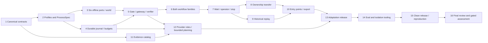

# ProofKey Adaptive Logistics Runtime Implementation Plan

> **For agentic workers:** REQUIRED SUB-SKILL: Use superpowers:subagent-driven-development (recommended) or superpowers:executing-plans to implement this plan task-by-task. Steps use checkbox (`- [ ]`) syntax for tracking.

**Goal:** Build an engineer-first, six-port offline integration harness that safely resolves permitted logistics cases, adapts reviewed environment profiles and produces auditable assessment evidence.

**Architecture:** One Python modular monolith shares a policy gate, SQLite journal and operation-specific verifier across library/CLI/loopback API. Six adapters operate against a separate simulated operational world; they cannot privately dispatch another effect. Frozen ProcessSpec/profile/policy versions govern execution; engineer adaptation is a proposal/test/human-review/release loop, not runtime self-modification.

**Tech Stack:** Python 3.11+, Pydantic, SQLite, argparse, unittest, thin FastAPI; provider-neutral Anthropic extraction/planning and ElevenLabs transcription routes, disabled for live use until authorized.

**Spec:** [Approved design](../../../openspec/changes/proofkey-v21-harness-contracts/design.md), [OpenSpec tasks](../../../openspec/changes/proofkey-v21-harness-contracts/tasks.md), and the four [capability deltas](../../../openspec/changes/proofkey-v21-harness-contracts/specs/).

**Approval record:** On 8 October 2026 the user replied “да делай автономно” to approval of the updated written design and proceeding to detailed planning. All 18 original and ten follow-up decisions are retained. This plan is prepared autonomously with independent read-only coverage review. It is not an implementation receipt or approval of paid/native/publication actions. Written plan review precedes product implementation under the preserved workflow; do not infer approval of a previously unwritten plan from design approval.

**Execution approval:** The subsequent “да” approves this written plan and subagent-driven implementation; “да делай уже блять” confirms the managed worktree. Implementation runs in `/Users/nbk/.codex/worktrees/proofkey-runtime/Pitch project` on `codex/proofkey-runtime`, based on `e851629`. Routine local implementation continues autonomously; external/spend/publication boundaries remain unchanged. This approval is not a runtime completion receipt.

## Global Constraints

The following project constraints are copied from the approved design; concrete implementation details below implement them, not relax them.

- “Use a clean `runtime/` subtree containing the `proofkey` package, project metadata, tests, public development fixtures, README and LICENSE.”
- “The proposed bet is Python 3.11+, Pydantic canonical schemas, typing protocols, SQLite, argparse and unittest.”
- “All effects use the same policy gate, immutable intent journal, shared budget and verifier.”
- “Policy stays in the core, not in vendor mappings.”
- “Owned new code is Apache-2.0.”
- “Internal-case disposition is record-only initially; actual creation is deferred/disabled.”
- “Automatic reminders are off by default.”
- “Native diagram synchronization/integration is out of the first scope.”
- “Live provider spend stays zero until a separately approved campaign.”
- “For calibration use 120 seconds active execution per case, 4 planner calls, 24 total tool calls including readbacks and failures, 6 distinct logical effects with one reserved for handoff, 3 reconciliation reads per intent, at most one contract-safe resend, and 2 clarification requests.”
- “A tool call is bounded by 10 seconds or the remaining active budget.”
- “Structured-only has zero planner calls.”
- “Never claim external exactly-once from local deduplication.”
- “Runtime can replan inside the approved graph, not rewrite it or change permissions.”
- “The human-reviewed ProcessSpec and its contract tests are canonical.”
- “An offline milestone can remain explicitly incomplete on these live/assessment gates.”

Raw archives, `work/`, `outputs/`, historical model assessments, source diagrams and frozen v2.2 artifacts are read-only evidence. Do not import the archived simulator as the target runtime, stage the whole workspace or relicense original evidence. No dependency install, product scaffold, provider call or runtime test occurs while writing this plan.

## Review Focus

Each line has owning executable tests in the indicated task; these are expected failure cases, not observed bugs.

1. A valid old-owner decision prepared before transfer must be fenced even while the epoch is unchanged — Task 8, `test_prepared_decision_fenced_by_pending_state`.
2. Crash after extraction/transcription/planning entry must not refund the pre-debited attempt or fabricate a receipt — Tasks 4/12, `test_interrupted_invocation_is_consumed_for_each_role`.
3. Completed replay containing an unknown return must not quietly refresh business state or invoke extraction — Task 9, `test_historical_unknown_replay_has_no_business_calls`.
4. A symlink, Unicode/case collision or path-escape case ID must not overwrite another case's export — Task 10, `test_export_path_and_collision_controls`.
5. A changed processing lineage, shared evaluator identity or leaked error canary must not inherit calibrated/protected scores — Task 14, `test_lineage_change_invalidates_scores` and `test_shared_identity_is_rehearsal`.

---

## Delivery milestones and execution topology

| Milestone | Required tasks | Evidence / meaning |
|---|---|---|
| M0: reviewed foundation | 1–3, plan review | Frozen schema/port/profile contracts and public fixtures; no outcome claim |
| M1: deterministic offline candidate | 1–10 | All six surfaces, both autonomous workflow families, service refusal/handoff, recovery/stop/transfer/replay and export; simulated guarantees only |
| M2: complete agreed candidate preparation | 11–15 | Required evidence classes, AI-role protocols, reviewed process adaptation, eval tooling and clean release; actual-role/media/native/custody readiness may remain unfinished |
| M3: measured/eligible entry | 14–16 plus external gates | Frozen four drills, complete receipts, actual enabled content/model processing and confirmed event/native/publication constraints |

No milestone can satisfy missing requirements with universal escalation or label a replay an actual provider run. The 59–94 additive person-hour range remains unmeasured; tasks are ordered by dependency, not promised wall-clock slots.



Root owns shared contracts, OpenSpec updates, plan and integration commits. Adapter worker owns only `adapters/` and its tests after Task 2 freezes; journal worker owns `journal.py`, `schema.sql`, `budget.py` and its tests. Evidence worker can start Task 11 after Task 1. Consumers request a contract change rather than editing the shared file. Run an independent spec-compliance review then a quality review per completed task, and a fresh whole-candidate review at Task 16. Reviewer findings must be checked against actual code/tests; agent summaries do not establish completion. Separate worktrees/branches, if used, start from the approved plan commit with explicit ownership and are integrated non-destructively.

## File ownership and responsibility map

All paths below are **future files**, not claims they exist. Project root is `/Users/nbk/Documents/Pitch project`.

| Files under `runtime/` | Responsibility / owner |
|---|---|
| `pyproject.toml`, `src/proofkey/__init__.py`, `contracts.py`, `identity.py` | Owned package metadata, strict wire models and stable identities; root |
| `profiles.py`, `process.py`, `profiles/{flat-v1,nested-v1}.json`, `processes/{reschedule-window,reschedule-exact,goods-refusal,service-refusal}.json` | Frozen mappings/capabilities and finite processes; contract owner |
| `ports.py`, `adapters/{world,case,delivery,scheduling,returns,messaging,operator}.py` | Six typed surfaces and separate offline authority world; adapter owner |
| `journal.py`, `schema.sql`, `budget.py` | Durable intents/checkpoints/invocations/generations/results, saved finite limits; core owner |
| `policy.py`, `gateway.py`, `verifier.py`, `engine.py`, `waits.py`, `ownership.py`, `replay.py` | Shared action discipline, workflows and safe resume; core owner |
| `exporter.py`, `batch.py`, `cli.py`, `api.py` | Every-case output, global deadline and shared entry points; interface owner |
| `evidence/{catalog,intake,redaction}.py`, `providers/{protocols,invocations,replay,unavailable,anthropic,elevenlabs}.py`, `planner.py` | Media/provenance, invocation receipts and bounded proposals; evidence owner |
| `factory/{proposal,release,views}.py` | Engineer proposal/regression/review/compatible activation; adaptation owner |
| `assessment/{ledger,labels,cache,coverage,drills,isolation,readiness,audit}.py` | Runnable rehearsal/evidence and truthful qualification; eval owner |
| `release.py`, `README.md`, `LICENSE`, `NOTICE`, `RIGHTS.md`, `.gitignore` | Clean owned-source packaging and rights; release owner |
| `tests/support.py`, named `test_*.py` files below, `tests/crash_worker.py`, `fixtures/development/` | Synthetic public deterministic controls; corresponding task owner |
| `requirements.lock`, `DEPENDENCIES.json` | Exact tested environment pins/license/host receipts; root at dependency preflight |

Python modules remain focused: do not turn `engine.py` into the adapter, provider, release and grader implementation. Tests do not import private evaluator labels into production modules. No nested Git repository.

## Frozen interface spine

Task 1 defines the strict schemas below; its consumers must use these names/fields rather than inventing parallel contracts. All JSON-facing models forbid undeclared fields, reject non-finite numbers, validate aware timestamps and keep untrusted narrative distinct from authoritative observations.

| Type | Required public fields |
|---|---|
| `CanonicalRequest` | `case_id`, `object_id`, `principal_id`, `request_id`, `request_revision`, `consent_revision`, `kind`, `consent_mode` (`window`, `exact_slot`, explicit `unknown`), `arguments`, `evidence_ids`, optional `narrative`; input modality/no-text is distinct from consent; transport event ID is not business identity |
| `AuthContext` | `caller_id`, `proof_reference`; not permission flags supplied in a body |
| `ReadRequest` / `ReadTarget` | case/object, caller/proof reference, purpose, bounded deadline and a tagged target: authority facts, original effect (operation/generation/action/provider key/fingerprint), transfer (transfer/packet/revision), operator packet or question; no hidden-world selector |
| `RequestBinding` | case/object/principal/request identity, historical revisions, durable `generation`, intent `fingerprint`, optional supersession relation |
| `AuthorityObservation` | designated `authority`, `fact`, `object_id`, strict `value`, `revision`, provider/observation times, `evidence_ref` |
| `AuthorityReadback` | operation/object, typed observations, provider request/action/fingerprint where available, execution stage, terminal-nonexecution proof or explicit unknown, authoritative as-of/evidence; absent identity cannot verify an effect |
| `RevisionVector` | mapping of **all material designated authority/fact identities** to revisions |
| `OperationCapability` | operation, authority, permission basis, acknowledgement/readback contract, idempotency scope, conditional coverage, timeout, terminal-nonexecution basis, shared account quota/concurrency/rate limits, evidence mode/version |
| `EffectIntent` | binding, operation/stage, stable action ID/provider key, immutable argument fingerprint, original profile/process/policy/consent versions, expected revisions, postcondition, deadline, optional decision/ownership-state binding |
| `DispatchResult` | `status`: rejected/acknowledged/outcome_unknown; provider request identity and evidence, never verification |
| `VerificationResult` | `status`: verified/rejected/pending/outcome_unknown/conflict; matching object/action/fingerprint/postcondition and authoritative evidence/as-of |
| `PhaseCheckpoint` | binding, phase/next gate, versions, processing status, observations, question/awaited fields, ownership state/revision, stop, persisted budget/deadline |
| `BudgetLedger` | case-scoped active time/deadline, calls/effects/reads/retries/clarifications, per-role invocations/usage allowances and shared account pressure; no reset on new generation |
| `WaitState` / `ScopedReply` | question ID, binding, origin/next gate, recipient/owner state, awaited fields, expiry/budget; response actor proof, matching question/revisions and simulated flag |
| `OperatorPacket` / `OperatorReceipt` / `OperatorDecision` | case/object/binding, packet hash/revision, current owner/state/epoch, source scope, accepted receipt or scoped decision, expiry and replay identity |
| `TransferIntent` / `HumanOwnership` | stable transfer ID, same binding/case/packet, expected owner/state revision, target owner, expiry; HumanOwnership exposes `binding`, `owner`, `epoch`, `state_revision`, packet identity and acceptance/pending evidence. Epoch is distinct from pending-state revision |
| `ArtifactRecord` / `ProcessingReceipt` | original hash/MIME/source/case/access/time/lineage; invocation/role/provider/requested-and-observed model/prompt/version/input hashes/mode/status/latency/usage and typed output (assertions, transcript or bounded `ActionProposal`) plus output hashes/references/available coordinates |
| `EvidenceAssertion` | artifact/content/lineage, tagged locator (text span, page/region, audio time or unknown), uncertainty and source-processing receipt; no invented coordinates |
| `CampaignPermit` | exact input hashes/role/provider/model/endpoint, privacy/rights approval, finite cost/usage/invocation ceilings, expiry and approval receipt; simulated versus actual authorization distinct |
| `ProcessorIdentity` / `InvocationRequest` / `InvocationReservation` | immutable case/generation/role (`extraction`, `transcription`, `planning`), campaign/permit hash, input hashes, requested provider/model/endpoint/prompt/version, profile/process and deadline, reserved invocation/usage/worst-case cost; unique invocation ID, consumed/unknown status and shared case/role/campaign debits |
| `ActionProposal` | operation/stage/arguments/evidence references only; no permissions, adapter code or invented authority |
| `GateDecision` | allowed flag, explicit reason and denied-path `VerificationResult`; a policy denial is not provider business acceptance |
| `SavedResult` / `CaseResult` | saved authorized results require binding/fingerprint, result version/as-of, per-effect independent states, stop, wait/handoff/media status, evidence/policy references, concise rationale and historical flag; denied/error CaseResult has no stored binding/evidence/effects and only caller-supplied correlation ID plus generic reason. Read-only `case_id` delegates to authorized binding or supplied correlation ID; `exportable` means valid auditable response, not business success |
| `ProcessSpec` / `EnvironmentProfile` | finite allowed phases/edges/operations, prerequisites/waits/approval/ack/readback/completion, mappings/authority/capabilities/policy hashes and original versioned releases; profile carries typed `processes` by request kind for frozen graph selection |
| `AdaptationProposal` / `ReviewPacket` / `ReleaseReceipt` | source/baseline/proposal/diff/test/migration and agent hashes; regression hash, affected pending contracts and actual/simulated human approval; typed proposed profile/process bundle and compatibility material, fail closed if absent at release; immutable release hashes/version and preserved old contracts |
| `HumanReviewApproval` | exact proposal/regression hashes, named reviewer identity/proof/scope, decision/time and actual-versus-simulated mode; neither runtime input nor model consensus can mint actual approval |
| `ExportReceipt` / `BatchReceipt` | original supplied case IDs, safe output names/hashes or visible failures, every-case ledger, budget/deadline/as-of and measured reserve |
| `LedgerAudit` / `CaseAssessment` / `QualificationReceipt` | source/reference/label/rubric/lineage hashes, complete denominators/ambiguity, per-effect verdicts, repeatability/sensitivity/noise results and explicit qualification limits |
| `DrillReceipt` / `IsolationReceipt` | frozen workload/candidate/baseline/result hashes, full clocks/waits/partials; actual enforced probe evidence, identity/custody and rehearsal/protected status |
| `SourceReleaseReceipt` / `ReproductionReceipt` / `ImplementationAudit` | allowlisted file/rights/dependency/candidate hashes; actual command exits and observed artifacts; requirement-derived readiness with missing/invalid evidence retained, not caller-provided completion booleans |

### Test support contract

`tests/support.py` provides `make_request(**overrides) -> CanonicalRequest`, `make_auth(**overrides) -> AuthContext`, `make_binding(request=None,**overrides) -> RequestBinding`, `make_intent(binding=None,**overrides) -> EffectIntent`, `make_checkpoint(binding=None,**overrides) -> PhaseCheckpoint`, `make_result(binding=None,**overrides) -> SavedResult` and `load_test_profile(name="flat-v1") -> EnvironmentProfile`. SavedResult is a validated authorized CaseResult subtype accepted by exporter. Builders have documented synthetic defaults: case `C1`, object `O1`, customer `U1`, request `REQ1`, generation `G1`, revisions `v1`, UTC window 10:00–12:00 and complete goods inventory `item-1:1`. `make_binding(request=...)` derives exact historical revisions and canonical intent fingerprint; `case_id` overrides rebuild binding consistently; `return_status` on `make_result` creates the canonical `effects["create_return"]` record. No builder grants production authority. `FakeClock` has `now()` and `advance(seconds)`; receipt assertions use fixed aware UTC time rather than sleeps. Each builder revalidates updates, not unchecked model-copy mutation. Task 2 supplies the profile loader before any consumer calls it; Task 1 support does not eagerly import unfinished profiles. Later tasks explicitly add their named fixture helpers; production modules never import support.

Tests importing support run with `PYTHONPATH=runtime/src:runtime/tests`. Before execution verify the chosen interpreter is Python 3.11+ and capture exact installed/pinned Pydantic/FastAPI and transitive versions/license metadata. An unavailable package is an infrastructure failure, not a passing behavioral test. Pin the actual resolved test environment in Task 1; do not guess latest versions in this planning artifact. A network install is a later implementation step, not performed here.

---

### Task 1: Package, strict contracts and stable identities

**Files:** Create `runtime/pyproject.toml`, `runtime/src/proofkey/{__init__,contracts,identity}.py`, `runtime/tests/{support,test_contracts}.py`, `runtime/requirements.lock`, `runtime/DEPENDENCIES.json`.

**Interfaces:** Produces the interface spine above, builders and `stable_action_id(binding, operation, stage) -> str`, `fingerprint(arguments) -> str`. `OperationCapability` uses explicit unknown states; no permissive bool default. Consumers: every subsequent task.

- [ ] **Step 1 — write red tests for strict input and stable identity.**

```python
import unittest
from proofkey.contracts import CanonicalRequest
from proofkey.identity import stable_action_id, fingerprint
from support import make_request, make_binding

class ContractTests(unittest.TestCase):
    def test_same_generation_identity_is_stable(self):
        binding = make_binding()
        self.assertEqual(stable_action_id(binding, "reschedule", "commit"),
                         stable_action_id(binding, "reschedule", "commit"))
        self.assertNotEqual(stable_action_id(binding, "register_goods_refusal", "register"),
                            stable_action_id(binding, "create_return", "initiate"))
        self.assertNotEqual(fingerprint({"slot": "S1"}), fingerprint({"slot": "S2"}))

    def test_body_cannot_grant_permission(self):
        payload = make_request().model_dump(mode="json")
        payload["permission_granted"] = True
        with self.assertRaises(ValueError):
            CanonicalRequest.model_validate(payload)
```

Also parameterize NaN/Infinity, wrong ID types, naive timestamps, absent request identity and invalid processing/dispatch/verification statuses. Missing authority may be represented as unknown, never silently fabricated.

- [ ] **Step 2 — confirm red.** Run `PYTHONPATH=runtime/src:runtime/tests python3 -m unittest discover -s runtime/tests -p test_contracts.py -v`; expect import failure before package implementation, then specific validation failures until each guard exists. Retain the output; an unrelated dependency error is not the behavioral red result.
- [ ] **Step 3 — implement strict wire models and canonical IDs.**

```python
import hashlib, json
from pydantic import BaseModel, ConfigDict

class WireModel(BaseModel):
    model_config = ConfigDict(extra="forbid", frozen=True, strict=True, allow_inf_nan=False)

def fingerprint(arguments: dict) -> str:
    encoded = json.dumps(arguments, sort_keys=True, separators=(",", ":"),
                         ensure_ascii=False, allow_nan=False).encode("utf-8")
    return hashlib.sha256(encoded).hexdigest()

def stable_action_id(binding, operation: str, stage: str) -> str:
    return fingerprint({"case": binding.case_id, "object": binding.object_id,
                        "generation": binding.generation,
                        "operation": operation, "stage": stage})
```

Define every model/enum in the spine with these strict rules, typed nested records and aware-time validation. `frozen=True` alone does not freeze nested mappings: use defensive canonical snapshots and revalidate their fingerprint against the immutable journal before dispatch; test nested argument/vector mutation cannot change a prepared action. Keep argument fingerprint separate from action identity; the journal later rejects changed arguments under one ID. Declare Python floor in metadata and capture exact successfully tested dependency pins, not subscription/provider secrets.
- [ ] **Step 4 — green and review.** Run the Task 1 command and complete current suite. Inspect serialized defaults and constructor signatures against the spine. No product workflow claim follows.
- [ ] **Step 5 — scoped commit.** `git add runtime/pyproject.toml runtime/src/proofkey runtime/tests/support.py runtime/tests/test_contracts.py runtime/requirements.lock runtime/DEPENDENCIES.json`; commit `feat: freeze strict runtime contracts and identities` after checking the staged files.

### Task 2: Capability profiles, normalization and initial ProcessSpec

**Files:** Create `runtime/src/proofkey/{profiles,process}.py`, `runtime/profiles/{flat-v1,nested-v1}.json`, `runtime/processes/{reschedule-window,reschedule-exact,goods-refusal,service-refusal}.json`, `runtime/tests/{test_profiles,test_process}.py`.

**Interfaces:** Consumes Task 1; produces `load_profile(path) -> EnvironmentProfile`, `normalize_input(payload, profile) -> CanonicalRequest`, `ProcessController(profile).permits(phase, operation, observed_prerequisites) -> bool`. Profile activation is not supplied by request content. Each enabled operation names its material revision coverage and evidence basis.

- [ ] **Step 1 — failing no-text parity and process prerequisite tests.**

```python
import unittest
from proofkey.profiles import normalize_input
from proofkey.process import ProcessController
from support import make_request, load_test_profile

class ProfileTests(unittest.TestCase):
    def test_flat_nested_no_text_parity(self):
        request = make_request(narrative=None)
        flat = request.model_dump(mode="json")
        nested = {"data": {"request": flat}}
        self.assertEqual(normalize_input(flat, load_test_profile("flat-v1")),
                         normalize_input(nested, load_test_profile("nested-v1")))

    def test_return_requires_verified_refusal(self):
        process = ProcessController(load_test_profile())
        self.assertFalse(process.permits("return_gate", "create_return",
                                         {"refusal": "acknowledged"}))
        self.assertTrue(process.permits("return_gate", "create_return",
                                        {"refusal": "verified"}))
```

Add malformed/nested-extra/policy-injection, missing-intent, unknown conditional/readback capability, exact-slot confirmation, all saved phases and diagrams unable to activate runtime tests. A map may produce missing facts; it cannot make them authoritative.
- [ ] **Step 2 — red.** Run `PYTHONPATH=runtime/src:runtime/tests python3 -m unittest discover -s runtime/tests -p 'test_pro*.py' -v` before the modules exist, then for the exact guard failures.
- [ ] **Step 3 — implement finite declarative graphs and fail-closed manifests.** The following fragment is the refusal process prerequisite, not the whole manifest:

```json
{"process_id":"goods-refusal-v1","edges":[
  {"from":"refusal_gate","operation":"register_goods_refusal","to":"verify_refusal"},
  {"from":"return_gate","operation":"create_return","to":"verify_return",
   "requires":{"refusal":"verified"}}
],"completion":{"refusal":"independent","return":"initiation_only"}}
```

Create full finite phase graphs for intake/extraction/completeness/auth, both consent modes, waits/expiry/facts-only return, dispatch/verification, stop and operator handling. Preserve unknown capability fields; disable the corresponding effect. Public fixture manifests explicitly label simulated conditional-vector/idempotency/readback behavior. Finite test expiry values may be used as **synthetic test policy**, never inferred native/customer policy. Live per-role usage/cost/privacy values are absent and live routes disabled.
- [ ] **Step 4 — green and freeze.** Run profile/process tests and suite; hash all profile/process/policy/contract bytes. Root reviews examples before parallel consumers start. A later change must update tests and release version.
- [ ] **Step 5 — commit.** Stage only Task 2 files and commit `feat: add reviewed baseline profiles and finite processes`.

### Task 3: Six ports and independent simulated operational world

**Files:** Create `runtime/src/proofkey/ports.py`, `runtime/src/proofkey/adapters/{world,case,delivery,scheduling,returns,messaging,operator}.py`, `runtime/tests/test_adapters.py`, synthetic `runtime/fixtures/development/world.json`.

**Interfaces:** `AdapterBundle` exposes `case`, `delivery`, `scheduling`, `returns`, `messaging`, `operator` with the method sets below. Every read takes a `ReadRequest` including its bounded deadline and returns `AuthorityReadback` with typed observations; every effect takes `EffectIntent` and returns `DispatchResult`. `SimulatedWorld(path, fixture).bundle() -> AdapterBundle` creates separate provider state, not journal state. Test-driver-only `mutate(fact, value)`, `material_revisions() -> RevisionVector`, `set_fault(operation, behavior)`, `calls` (records with operation/purpose) and `effect_count(operation) -> int` are not runtime tools and never appear in public responses.

| Port | ReadRequest → AuthorityReadback | EffectIntent → DispatchResult |
|---|---|---|
| case | `read_case`, `read_principal` | none |
| delivery | `read_delivery`, `read_refusal` | `register_goods_refusal`, `register_service_refusal` |
| scheduling | `list_permitted_slots`, `read_schedule` | `reschedule` |
| returns | `read_return_policy`, `read_return` | `create_return` |
| messaging | `read_message` | `send_clarification`, `send_status` |
| operator | `read_receipt`, `read_resume`, `read_owner` | `enqueue_handoff`, `transfer_owner` |

- [ ] **Step 1 — failing conditional-vector and partial-effects tests.**

```python
import tempfile, unittest
from pathlib import Path
from proofkey.adapters.world import SimulatedWorld
from support import make_intent

class AdapterTests(unittest.TestCase):
    def test_consent_race_rejects_stale_vector(self):
        with tempfile.TemporaryDirectory() as folder:
            world = SimulatedWorld(Path(folder) / "world.sqlite",
                                   Path("runtime/fixtures/development/world.json"))
            intent = make_intent(operation="reschedule", expected_revisions=world.material_revisions())
            world.mutate("consent", "revoked")
            reply = world.bundle().scheduling.reschedule(intent)
            self.assertEqual(reply.status, "rejected")
            self.assertEqual(world.effect_count("reschedule"), 0)
```

Parameterize independent material fact races: binding, risk, consent, stage/capacity/policy, inventory/quantity/destination and ownership **state/revision**. Test all six ports, HTTP-success/business-rejection mapping, wrong-object readback, sent-versus-delivered, queue ack without owner acceptance, same-key fingerprint conflict, bounded shared 429 pressure and no private compensation.
Include omitted consent/risk/pending-ownership keys and wrong-authority vectors: caller-supplied vector keys cannot choose which material facts the provider protects. Read-target tests distinguish multiple original actions, generations, messages, questions and transfers on the same case/object; a case-only lookup cannot verify the selected original effect.
- [ ] **Step 2 — red.** Run `PYTHONPATH=runtime/src:runtime/tests python3 -m unittest discover -s runtime/tests -p test_adapters.py -v`; verify missing operation/conditional protection failure, not a fixture-file typo.
- [ ] **Step 3 — implement provider-owned atomic conditional writes.**

```python
# SimulatedWorld owns this transaction; the runtime journal cannot perform it.
connection.execute("BEGIN IMMEDIATE")
try:
    required = required_material_keys(connection, intent.operation, intent.stage)
    if not required.issubset(intent.expected_revisions.keys()):
        connection.rollback()
        return DispatchResult(status="rejected", evidence_ref="missing_material_revision")
    current = read_material_revisions(connection, required)
    expected = {key: intent.expected_revisions[key] for key in required}
    if current != expected:
        connection.rollback()
        return DispatchResult(status="rejected", evidence_ref="stale_material_revision")
    reply = apply_declared_operation(connection, intent)
    connection.commit()
    return reply
except BaseException:
    connection.rollback()
    raise
```

`required_material_keys`, `read_material_revisions` and `apply_declared_operation` are private world functions created in this task. Mandatory qualified authority/fact keys come from the trusted operation manifest, not the intent; wrong-authority substitutions cannot cover them. Refusal and return are separate records/actions/readbacks. Readbacks match the strict selected original identity, not merely the latest case status. One account pressure ledger spans relevant ports. No effect adapter directly invokes another effect adapter. Fault injection remains test-driver-only; operational data are exposed only via public scoped reads. This world demonstrates modeled guarantees, not protected oracle isolation or native atomicity.
- [ ] **Step 4 — green and review.** Run adapters plus full suite; inspect public response keys for fault/expected-label leakage. Freeze the wire operation contracts and quota behavior before core integration.
- [ ] **Step 5 — commit.** Stage Task 3 files only; commit `feat: add six scoped offline adapters with conditional world state`.

### Task 4: Durable journal, phase checkpoints and finite budgets

**Files:** Create `runtime/src/proofkey/{journal,budget}.py`, `runtime/src/proofkey/schema.sql`, `runtime/tests/{test_journal,test_budgets,test_provider_invocation_recovery}.py`, `runtime/tests/crash_worker.py`.

**Interfaces:** `CaseStore(path,before_commit=None)` exposes `bind(RequestBinding)`, `find_request(case_id,request_id,request_revision,consent_revision,fingerprint) -> RequestBinding | None`, `save_checkpoint(PhaseCheckpoint)`, `checkpoint(case_id) -> PhaseCheckpoint`, `prepare(EffectIntent)`, `begin_dispatch(intent,now,is_resend=False)` (atomic current stop/ownership eligibility, distinct-effect/call debit and dispatch mark), `record_verification(action_id, VerificationResult)`, `intents(case_id)`, `set_stop(case_id,generation)`, `consume(case_id,kind,amount,now)`, `reserve_invocation(request: InvocationRequest,now) -> InvocationReservation`, `record_processing(invocation_id,ProcessingReceipt)`, `save_result(SavedResult)` and `saved_result(case_id,generation)`. `close()` releases the connection. Fault fixtures use this production transaction, not a test-only public dispatch-state bypass. One journal/accounting database owns all cases sharing a campaign: invocation reservation atomically binds exact inputs/route/permit and debits case, role and campaign invocation/usage/worst-case-cost allowances in one transaction. `BudgetExceeded` and `JournalFailure` never authorize transport. Optional `before_commit` is an injected host callback, never a runtime tool; support adds `CommitFault.arm()`/`__call__()` to raise `JournalFailure` on the next commit for an exact fault test.

- [ ] **Step 1 — failing durability and provider-debit tests.**

```python
import tempfile, unittest
from pathlib import Path
from proofkey.journal import CaseStore
from support import make_binding, make_checkpoint, make_intent, FakeClock

class JournalTests(unittest.TestCase):
    def test_restart_preserves_stop_key_and_budget(self):
        with tempfile.TemporaryDirectory() as folder:
            path = Path(folder) / "journal.sqlite"
            store = CaseStore(path)
            store.bind(make_binding())
            store.save_checkpoint(make_checkpoint())
            intent = make_intent()
            store.prepare(intent)
            store.consume("C1", "tool_calls", 1, FakeClock().now())
            store.set_stop("C1", "G1")
            store.close()
            reopened = CaseStore(path)
            self.assertTrue(reopened.checkpoint("C1").stop_requested)
            self.assertEqual(reopened.intents("C1")[0].intent.action_id, intent.action_id)
            self.assertEqual(reopened.checkpoint("C1").budget.tool_calls, 1)
```

Also test commit failure before intent/dispatch/provider debit, mismatched fingerprint, incompatible schema/checkpoint, every saved phase, per-role finite cap and distinct subsequent attempt, generation admission without case-budget reset and absolute deadline persistence. Real subprocess kill probes cover prepare, dispatch mark, external write/pre-verification and post-verification boundaries; injected exceptions alone do not prove storage durability.
- [ ] **Step 2 — red.** Run `PYTHONPATH=runtime/src:runtime/tests python3 -m unittest discover -s runtime/tests -p 'test_journal.py' -v` and the budget/invocation files independently; record actual missing-persistence failures.
- [ ] **Step 3 — implement explicit schema and pre-debit transactions.**

```sql
CREATE TABLE schema_meta(version INTEGER NOT NULL);
CREATE TABLE cases(case_id TEXT PRIMARY KEY, checkpoint_json TEXT NOT NULL, revision INTEGER NOT NULL);
CREATE TABLE requests(case_id TEXT NOT NULL, generation TEXT NOT NULL, binding_json TEXT NOT NULL,
                      stop_requested INTEGER NOT NULL DEFAULT 0, PRIMARY KEY(case_id,generation));
CREATE TABLE intents(action_id TEXT PRIMARY KEY, case_id TEXT NOT NULL, generation TEXT NOT NULL,
                     fingerprint TEXT NOT NULL, intent_json TEXT NOT NULL, dispatch_state TEXT NOT NULL,
                     verification_json TEXT);
CREATE TABLE invocations(invocation_id TEXT PRIMARY KEY, case_id TEXT NOT NULL, role TEXT NOT NULL,
                         reservation_json TEXT NOT NULL, state TEXT NOT NULL, receipt_json TEXT);
CREATE TABLE campaigns(permit_hash TEXT PRIMARY KEY, permit_json TEXT NOT NULL,
                       consumed_json TEXT NOT NULL, revision INTEGER NOT NULL);
CREATE TABLE waits(question_id TEXT PRIMARY KEY, case_id TEXT NOT NULL, wait_json TEXT NOT NULL);
CREATE TABLE transfers(transfer_id TEXT PRIMARY KEY, case_id TEXT NOT NULL, transfer_json TEXT NOT NULL,
                       state TEXT NOT NULL);
CREATE TABLE results(case_id TEXT NOT NULL, generation TEXT NOT NULL, result_json TEXT NOT NULL,
                     PRIMARY KEY(case_id,generation));
CREATE TABLE audit(sequence INTEGER PRIMARY KEY, case_id TEXT NOT NULL, event_json TEXT NOT NULL);
```

Use foreign-key/check/uniqueness constraints and transactions where cross-row invariants need them. Explicit schema-version verification on open; no automatic migration. Verify selected SQLite WAL/FULL settings and host/storage fault behavior. Persist consumed active time plus deadlines; a restart cannot obtain a fresh 120 seconds. Commit the complete immutable invocation reservation and cumulative shared campaign debit before entry; interrupted calls remain consumed/unknown. Two cases competing for the last campaign allowance cannot both reserve it. Input/model/permit substitution under one ID is a conflict. Unknown final usage retains the reserved worst-case allowance, not a refund. Persist scoped wait/transfer JSON, not evaluator secrets. Reserve one effect for permitted handoff; failures and readbacks debit shared call budget. `BaseException` at an uncertain transport boundary leaves recovery state, not success.
- [ ] **Step 4 — green and fault review.** Run all Task 4 tests and subprocess probes. Inspect a reopened database and receipt hashes; separately disclose limitations of abrupt host/storage failure. Do not claim distributed/external exactly-once.
- [ ] **Step 5 — commit.** Stage only Task 4 files; commit `feat: persist phase intents and budgets before external entry`.

### Task 5: Deterministic gate, common gateway and authoritative verifier

**Files:** Create `runtime/src/proofkey/{policy,gateway,verifier}.py`, `runtime/tests/{test_policy,test_gateway,test_verifier}.py`.

**Interfaces:** `PolicyGate(profile).evaluate(request, proposal, observations, checkpoint) -> GateDecision`, `.bind_request(request,auth,observations) -> RequestBinding`; `ActionGateway(profile,bundle,store,clock).execute(intent) -> VerificationResult`, `.reconcile(action_id) -> VerificationResult`; `verify(intent, authoritative_readback) -> VerificationResult`. Gateway refreshes designated material authorities and budgets all public reads; raw arguments or model confidence never grant permission. Unsupported operations fail before transport. Request binding needs designated identity evidence, not body self-assertion; persist it before deriving effects.

- [ ] **Step 1 — failing dispatch-order and unknown-retry tests.**

```python
import tempfile, unittest
from pathlib import Path
from proofkey.adapters.world import SimulatedWorld
from proofkey.journal import CaseStore
from proofkey.gateway import ActionGateway
from support import make_binding, make_checkpoint, make_intent, load_test_profile, FakeClock

class GatewayTests(unittest.TestCase):
    def test_unknown_stopped_intent_is_never_resent(self):
        with tempfile.TemporaryDirectory() as folder:
            world = SimulatedWorld(Path(folder) / "world.sqlite",
                                   Path("runtime/fixtures/development/world.json"))
            store = CaseStore(Path(folder) / "journal.sqlite")
            store.bind(make_binding())
            store.save_checkpoint(make_checkpoint())
            intent = make_intent()
            store.prepare(intent)
            store.begin_dispatch(intent, FakeClock().now())
            store.set_stop("C1", "G1")
            world.set_fault("read_schedule", "terminal_not_executed")
            gateway = ActionGateway(load_test_profile(), world.bundle(), store, FakeClock())
            gateway.reconcile(intent.action_id)
            self.assertEqual(world.effect_count("reschedule"), 0)
            self.assertTrue(store.checkpoint("C1").stop_requested)
```

Test intent/dispatch commit failure yields zero transport; transport ack is not verified success; wrong object/key/fingerprint/postcondition is conflict; absent/eventually consistent readback is not terminal proof; terminal already-executed is not retry permission. Safe resend needs (idempotency OR authoritative never-executed-and-cannot-execute-later) AND fresh active non-stopped scope; same key only, cap one. Gate every message, handoff and transfer identically. Unknown all-material conditional coverage disables effects, even after a successful fresh local read.
- [ ] **Step 2 — red.** Run `PYTHONPATH=runtime/src:runtime/tests python3 -m unittest discover -s runtime/tests -p 'test_gateway.py' -v` plus policy/verifier files; retain dispatch-order red cases.
- [ ] **Step 3 — implement the common sequence, not adapter-owned policy.**

```python
def execute(self, intent):
    observations = self.read_material_authorities(intent)
    decision = self.gate_for(intent, observations)
    if not decision.allowed:
        return decision.verification
    self.store.prepare(intent)
    self.store.begin_dispatch(intent, self.clock.now())
    dispatch = self.dispatch_declared_port(intent)
    return self.read_and_verify(intent, dispatch)
```

All four private gateway helpers are defined in this task with bounded reads, effect-ID deduplication, quota backpressure, current stop/ownership state checks and operation-specific readback. `begin_dispatch` performs the durable atomic debit/mark and fails closed if another local actor set stop or pending transfer after preparation. The simulated provider separately conditions all material external revisions. Resend uses an existing intent/key and `is_resend=True`, with retry/call debit but no second distinct-effect debit. Reconciliation never clears stop or lets a human invent non-execution proof. Verifier records independent operation states/as-of evidence; no broad “delivery complete” shortcut.
- [ ] **Step 4 — green and gate review.** Run policy/gateway/verifier, conditional races, journal failures and full suite. Review event order and fake-world state independently of returned prose.
- [ ] **Step 5 — commit.** Stage Task 5 files only; commit `feat: gate and verify every effect through one durable gateway`.

### Task 6: Positive workflows and exact-phase engine

**Files:** Create `runtime/src/proofkey/engine.py`, `runtime/tests/test_workflows.py`; extend `runtime/tests/support.py` with `build_test_runtime(folder)`.

**Interfaces:** `WorkflowEngine(profile,bundle,store,clock,planner=None,evidence=None).run(request,auth) -> CaseResult`, `.recover(case_id,auth) -> CaseResult`; read-only `.gateway -> ActionGateway` exposes the same gated service for integration tests, not a bypass. `build_test_runtime(folder,before_commit=None) -> RuntimeFixture` returns `engine`, `store`, `world`, `clock`, `profile`, `auth`, `request`; it instantiates Tasks 1–6 against two separate temporary databases and passes any test commit hook to CaseStore. Later tasks attach their own services through the existing engine constructor/configuration, not a second workflow engine.

- [ ] **Step 1 — red positive and partial outcomes.**

```python
import tempfile, unittest
from support import build_test_runtime, make_request

class WorkflowTests(unittest.TestCase):
    def test_refusal_survives_unknown_return(self):
        with tempfile.TemporaryDirectory() as folder:
            fx = build_test_runtime(folder)
            fx.world.set_fault("create_return", "timeout_after_execute")
            fx.world.set_fault("read_return", "outcome_unknown")
            result = fx.engine.run(make_request(kind="goods_refusal"), fx.auth)
            self.assertEqual(result.effects["register_goods_refusal"].status, "verified")
            self.assertIn(result.effects["create_return"].status, ("pending", "outcome_unknown"))
            self.assertEqual(fx.world.effect_count("register_goods_refusal"), 1)
            self.assertNotIn("refund", result.effects)
```

Use one independent fixture for each fault: rejection, pending, unknown, wrong order/item/quantity/destination. Positive controls require verified window/exact-slot reschedule, whole-order refusal/return and service refusal plus permitted handoff. Exact-slot change cannot pick another slot; no address inference. Partial-item request never expands to whole order. Assert fresh binding, lifecycle/capacity/policy/inventory and conditional vector at every effect.
Complementary `test_return_timeout_with_authoritative_readback_is_verified` injects only `create_return=timeout_after_execute` with normal matching `read_return`; require verified initiation and exactly one refusal. A lost transport acknowledgement is not a permanent unknown when independent evidence establishes execution.
- [ ] **Step 2 — red.** Run `PYTHONPATH=runtime/src:runtime/tests python3 -m unittest discover -s runtime/tests -p test_workflows.py -v`; do not let expected results come from the engine's own prose.
- [ ] **Step 3 — implement finite phase execution over the gateway.**

```python
def run(self, request, auth):
    # Task 9 installs the completed-result disclosure branch before this flow.
    checkpoint = self.authenticate_and_bind(request, auth)
    while not self.process.is_terminal(checkpoint.phase):
        checkpoint = self.run_one_approved_phase(checkpoint, request, auth)
        self.store.save_checkpoint(checkpoint)
    return self.build_case_result(checkpoint)
```

Create these private engine helpers here, plus `ProcessController.is_terminal(phase)` in the root-owned process file as a reviewed additive interface. `run_one_approved_phase` saves the transition/next external gate before entering that external operation; the loop's final save records its observed result, not the first pre-effect checkpoint. No phase emits transport except through the gateway. Restore the exact next gate, not intake by default; stale facts invalidate checkpoints. Return initiation requires verified refusal. Distinct registration/return/service/handoff states remain independent in results. The deterministic/no-text path calls no planner. If mandatory evidence is missing, use explicit wait/operator/unsupported states, never fabricate a new intent or consent. Task 7 supplies the full scoped wait/resume services; do not claim M1 until those gates pass.
- [ ] **Step 4 — green and workflow review.** Run workflows and full suite; inspect provider state/actions, both positive families and unnecessary handoff count independently. Repeat each saved phase with a fresh engine process.
- [ ] **Step 5 — commit.** Stage Task 6 plus the reviewed `process.py` extension; commit `feat: execute both logistics workflows with independent outcomes`.

### Task 7: Scoped clarification, operator packets and durable stop

**Files:** Create `runtime/src/proofkey/waits.py`, `runtime/tests/{test_waits,test_stop,test_operator_boundary}.py`; modify `engine.py` to expose `.reply(ScopedReply,auth)`, `.stop(case_id,generation,auth)` and the scoped wait/receipt phases.

**Interfaces:** `WaitService(profile,bundle,store,clock).create(checkpoint,fields) -> WaitState`, `.accept(reply,auth) -> PhaseCheckpoint`, `.expire(question_id) -> PhaseCheckpoint`; engine stop returns recorded per-effect state without claiming undo. `build_operator_packet(checkpoint, permitted_artifacts) -> OperatorPacket`; all message/handoff effects still use Task 5. Local operator dispositions record refund/coverage/internal-case review only.

- [ ] **Step 1 — red early-operator and stopped non-execution.**

```python
import tempfile, unittest
from support import build_test_runtime, make_request, make_auth

class StopTests(unittest.TestCase):
    def test_stopped_timeout_never_retries_even_if_not_executed(self):
        with tempfile.TemporaryDirectory() as folder:
            fx = build_test_runtime(folder)
            fx.world.set_fault("reschedule", "timeout_before_execute")
            fx.world.set_fault("read_schedule", "outcome_unknown")
            first = fx.engine.run(fx.request, fx.auth)
            fx.engine.stop("C1", first.binding.generation, fx.auth)
            calls_before_recovery = len(fx.world.calls)
            fx.world.set_fault("read_schedule", "terminal_not_executed")
            restored = fx.engine.recover("C1", fx.auth)
            self.assertTrue(restored.stop_requested)
            self.assertEqual(fx.world.effect_count("reschedule"), 0)
            self.assertFalse(any(call.operation == "reschedule"
                                 for call in fx.world.calls[calls_before_recovery:]))
```

R02–R08/R09/R13 tests include stop before send, after actual execution, duplicate stop and migration, separately authorized refusal after stop with dependency checks/no case-budget reset, wrong/stale question/replayed/expired/unscoped replies, repeated authentication failures, missing wait policy, script simulation labeling and queue acknowledgement without accepted packet/owner. An operator supplying facts returns to completeness/current customer authority; their note is not consent. Expiry triggers no automatic reminder/reassignment/payment/internal-case creation.
- [ ] **Step 2 — red.** Run wait/stop/operator-boundary files independently using unittest discover and inspect the original source-node failure drivers.
- [ ] **Step 3 — implement persisted scopes and origin gates.**

```python
def accept(self, reply, auth):
    wait = self.load_wait(reply.question_id)
    self.verify_reply_binding(wait, reply, auth)
    checkpoint = self.restore_origin_checkpoint(wait)
    return self.merge_observations_then_reenter_gate(checkpoint, reply)
```

Create those private wait helpers in this task. Persist question/fields/recipient/owner state/revisions/origin/next gate/deadline/budgets before sending; do not resend on restart. An unknown expiry disables unsupported waiting, not all independently authorized reads. Use explicit synthetic bounded expiry only in test policies. Stop atomically fences undispatched business intents in its generation; interrupted original effects keep original identities and reconcile without resend even under idempotency. A later explicit refusal gets a separately authenticated generation and fresh material gates, never automatic conversion. Build source-linked operator packets respecting evidence access (Task 11 enriches actual artifact processing); no actual internal-case or financial method exists.
- [ ] **Step 4 — green and review.** Run R02–R09/R13 variants plus independent positive scripted/interactive fixture replies; interactive fixture tests remain simulated, not evidence of a real customer response.
- [ ] **Step 5 — commit.** Stage Task 7 files only; commit `feat: preserve scoped waits operator boundaries and stop disposition`.

### Task 8: Conditional ownership transfer and stale-decision fencing

**Files:** Create `runtime/src/proofkey/ownership.py`, `runtime/tests/test_ownership.py`; modify `runtime/tests/support.py` for the ownership fixtures below and `engine.py` for `.transfer(TransferIntent,auth) -> HumanOwnership`, and shared contracts/journal only through root review if a missing field is found.

**Interfaces:** `OwnershipService(profile,bundle,store,clock).transfer(intent,auth) -> HumanOwnership`, `.reconcile(transfer_id,auth) -> HumanOwnership`, `.validate_decision(decision,auth) -> GateDecision`. The existing sixth operator port owns `transfer_owner`/`read_owner`; no seventh port or case-record write. Current pending-state revision, not just epoch, is a material dispatch condition.

- [ ] **Step 1 — red prepared-decision race and unknown expiry.**

```python
import tempfile, unittest
from support import (build_test_runtime, make_intent, make_transfer,
                     seed_operator_ownership)

class OwnershipTests(unittest.TestCase):
    def test_prepared_decision_fenced_by_pending_state(self):
        with tempfile.TemporaryDirectory() as folder:
            fx = build_test_runtime(folder)
            owned = seed_operator_ownership(fx, owner="OP1")
            prepared = make_intent(binding=owned.binding, decision_owner_epoch=owned.epoch,
                                   decision_owner_state_revision=owned.state_revision,
                                   expected_revisions=fx.world.material_revisions())
            fx.store.prepare(prepared)
            fx.world.set_fault("transfer_owner", "ack_without_acceptance")
            fx.engine.transfer(make_transfer(owned, target_owner="OP2"), fx.auth)
            result = fx.engine.gateway.execute(prepared)
            self.assertNotEqual(result.status, "verified")
            self.assertEqual(fx.world.effect_count(prepared.operation), 0)
```

Support adds `seed_operator_ownership(fx,owner) -> HumanOwnership`, which seeds a clearly simulated accepted same-case operator packet in world/journal/checkpoint and returns its binding/packet/epoch/state revision; it is not a runtime activation path. `make_transfer(owned,target_owner,**overrides) -> TransferIntent` derives the same case/packet/stable transfer identity/conditional state and an explicit fixture expiry. Parameterize definite rejection, verified target acceptance, unknown transport, crash before/after acceptance, local expiry without terminal proof, late old-owner reply, already-started old decision changing packet revision and budget/stop preservation. Test no duplicate handoff case or fresh-key transfer replacement.
- [ ] **Step 2 — red.** Run `PYTHONPATH=runtime/src:runtime/tests python3 -m unittest discover -s runtime/tests -p test_ownership.py -v` and verify the pending-state variant fails even though epoch stayed 1.
- [ ] **Step 3 — implement shared-journal fence and conditional authority transition.**

```python
def transfer(self, intent, auth):
    self.validate_transfer_scope(intent, auth)
    self.persist_pending_and_fence_decisions(intent)
    outcome = self.gateway_transfer(intent)
    return self.apply_authoritative_acceptance_or_preserve_unknown(intent, outcome)
```

Define each private helper here; the journal transaction covers newly received decisions and previously prepared undispatched intents. Already-started effects retain possible execution, not local cancellation. Old owner stays accountable while acceptance is unknown, but neither contender can authorize actions then. Only matching durable target acceptance plus conditional owner/packet readback advances epoch. Definite rejection retains old owner; expiry with unknown acceptance preserves fencing and original transfer key. Native missing conditional/acceptance guarantees leave transfer disabled.
- [ ] **Step 4 — green and race review.** Run ownership plus gateway/stop tests; use test barriers/provider transactions rather than sleep-based race assumptions. Verify ownership does not expand evidence access.
- [ ] **Step 5 — commit.** Stage scoped Task 8 changes; commit `feat: fence pending owner transfers and stale decision intents`.

#### Task8 closed internal staging refinement — 9 October 2026

Parent Task8 remains incomplete; the original public transfer sketch is not implemented merely by its storage/source foundations. Refinements implement its already approved requirements, not a new user business operation.

- [x] 8A typed ownership contracts/storage and immutable pending/decision/audit fencing, independently Approved at270ffb8+692d6a0. These are local synthetic storage receipts, not current source permission.
- [x] 8B v1.4 exact source grants/conditional original transfer/target acceptance, independently Approved at e2a467f+420dfa3. Source acceptance mints no target action grant; old profile/process bytes retained.
- [x] 8C1 scoped trusted-host `decision_record(binding, decision_id)` getter, batched with12A in exact four files at9209254. Different NONAUTHOR b9e49a68 independently Approved both spec and quality/no findings; author60/15.622s/root6/.410s SAME24. Binding ownership-decision-inventory.md remains authoritative; getter grants no current authority, disclosure or consumption and fullTask8 stays incomplete.
- [x] 8C2 scoped public gateway/service/engine consumers and registered policy/verifier composition at22047a9 are independently Spec Approved/Quality Approved by DIFFERENT NONAUTHOR runtime_ownership_review,0Critical/0Important/0Minor. Exact11 includes only the narrow registered fact-batch and pending current-confirmation corrections under ownership-consumers.md. Author117 tests passed31.213s/SAME50; original private-auditor exit1 is retained separately from the static saved-raw correction exit0. Root eight fresh no-child controls passed5.480s/SAME50, with actual37 product/test parent modules and no unlisted/new threads. Four actual child pre-exit32-module records are preserved, not post-exit or syscall evidence. Pending observations/revisions, exact originals/current source/CAS, ordinary principal binding, grants, debt and lawful different-phase ordering remain unchanged. FullTask8/10/M1, native initial activation/real target grants, host integration and final whole-candidate qualification remain incomplete.

Do not mark fullTask8/10/M1 or timed qualification complete from a foundation, fixture setup, getter or all-denied tests. Independent sourceful positives and both legal race orderings remain required.

### Task 9: Completed-request disclosure-only saved-result replay

**Files:** Create `runtime/src/proofkey/replay.py`, `runtime/tests/test_replay.py`; modify `engine.py` to check saved-result eligibility before evidence/planning/business orchestration.

**Interfaces:** `ReplayService(profile,bundle,store,clock).lookup(request,auth) -> CaseResult | None`; `None` means no exact completed request, not permission for an uncertain duplicate to become a new generation. A recognized but unauthorized replay returns a disclosure-denied response with no saved case details. Any current access read consumes its applicable saved allowance.

- [ ] **Step 1 — red historical unknown and revoked disclosure tests.**

```python
import tempfile, unittest
from support import (build_test_runtime, make_result, make_binding,
                     make_checkpoint, make_request)

class ReplayTests(unittest.TestCase):
    def test_historical_unknown_replay_has_no_business_calls(self):
        with tempfile.TemporaryDirectory() as folder:
            fx = build_test_runtime(folder)
            request = make_request(kind="goods_refusal")
            binding = make_binding(request=request)
            fx.store.bind(binding)
            fx.store.save_checkpoint(make_checkpoint(binding=binding))
            fx.store.save_result(make_result(binding=binding, return_status="outcome_unknown"))
            fx.world.mutate("return_status", "received")
            before = list(fx.world.calls)
            replay = fx.engine.run(request, fx.auth)
            self.assertTrue(replay.historical)
            self.assertEqual(replay.effects["create_return"].status, "outcome_unknown")
            new_calls = fx.world.calls[len(before):]
            self.assertTrue(all(call.operation in {"read_case", "read_principal"}
                                and call.purpose == "disclosure" for call in new_calls))
            self.assertEqual(fx.world.effect_count("create_return"), 0)
```

Support's result builder converts `return_status` into the canonical effects mapping. Bind exact historical request/fingerprint; confirm as-of/version unchanged; separate `test_stopped_schedule_replay_retains_stop` uses a saved stopped scheduling generation rather than inventing a stopped goods-refusal request. Separate cases: revoked/unverifiable/exhausted disclosure access, mismatched object/request/fingerprint, historical business-consent revocation with still-valid disclosure scope, genuine new business intent, saved partial/unknown and later external business change. Assert zero processing/business-readback/reconciliation/message/handoff calls and no new generation or reset. Changed consent alone cannot mint new intent.
- [ ] **Step 2 — red.** Run `PYTHONPATH=runtime/src:runtime/tests python3 -m unittest discover -s runtime/tests -p test_replay.py -v`; install a counting fake planner to catch accidental extraction/planning, not just effects.
- [ ] **Step 3 — implement first-branch replay with current access gate.**

```python
def lookup(self, request, auth):
    binding = self.find_exact_historical_binding(request)
    if binding is None:
        return None
    saved = self.store.saved_result(binding.case_id, binding.generation)
    if saved is None:
        return None
    if not self.current_disclosure_allowed(binding, auth):
        return self.disclosure_denied_response()
    return self.historical_projection(saved)
```

Create these helpers here; exact match includes immutable intent fingerprint and historical request/consent identity. Historical business consent need not still authorize actions for pure disclosure. Do not fetch present delivery/scheduling/returns/owner business status, run recovery, reset budgets or reprocess artifacts. Keep independent unfinished-effect recovery separately scoped; returned historical unknown remains unknown.
- [ ] **Step 4 — green and replay review.** Run R15, gateway/recovery and interface tests when available. Verify denial responses do not leak stored result existence/details beyond authorized disclosure policy.
- [ ] **Step 5 — commit.** Stage Task 9 files only; commit `feat: replay authorized historical results without repeated actions`.

### Task 10: Library/CLI/loopback API, every-case export and bounded batch

**Files:** Create `runtime/src/proofkey/{exporter,batch,cli,api}.py`, `runtime/tests/{test_exporter,test_interface_parity,test_batch}.py`; expose approved library functions in `__init__.py`.

**Interfaces:** `export_case(result, output_root) -> ExportReceipt`, `run_batch(requests,engine,auth_resolver,deadline,export_reserve,output_root) -> BatchReceipt`, `cli.main(argv) -> int`, `api.create_app(engine,auth_resolver) -> FastAPI`. `AuthResolver` resolves external caller proof to `AuthContext`; request body/localhost is never that proof. Exporter creates `ANSWERS/<case>/ANSWER.md` and `REASONING.md` from result facts, not hidden chain-of-thought.

- [ ] **Step 1 — red path/collision and every-case denominator.**

```python
import tempfile, unittest
from pathlib import Path
from proofkey.exporter import export_case, ExportFailure
from support import make_result

class ExportTests(unittest.TestCase):
    def test_export_path_and_collision_controls(self):
        with tempfile.TemporaryDirectory() as folder:
            root = Path(folder) / "ANSWERS"
            with self.assertRaises(ExportFailure):
                export_case(make_result(case_id="../escape"), root)
            export_case(make_result(case_id="CaseA"), root)
            with self.assertRaises(ExportFailure):
                export_case(make_result(case_id="casea"), root)
            self.assertTrue((root / "CaseA" / "ANSWER.md").exists())
```

Include absolute IDs, Unicode-normalized collisions, symlink escapes, pre-existing file conflicts, interrupted atomic saves, malformed-case visible error records, failed/no-output cases and global timeout mid-batch. An unsafe ID gets a visible export failure ledger entry, not silent loss or unsafe file creation. Compare semantic output/journal/phase/budget for positives, denial, partial/unknown, wait/reply, stop and replay through all three interfaces. Loopback app rejects missing scoped proof and cannot be served on non-loopback without a separate reviewed deployment design.
- [ ] **Step 2 — red.** Run exporter, interface-parity and batch files with unittest discover; capture actual path/collision failures. API test-client dependency absence is infrastructure failure, not semantic parity.
- [ ] **Step 3 — implement safe incremental export and a thin interface.**

```python
def main(argv):
    args = parse_cli(argv)
    engine, auth = build_approved_runtime_and_auth(args)
    result = engine.run(read_canonical_input(args.input), auth)
    export_case(result, args.output)
    return 0 if result.exportable else 2
```

All four CLI helpers/properties are defined/validated here; `exportable` means a valid auditable result, not business success. Add commands `run`, `batch`, `recover`, `reply`, `stop`, `transfer`, `inspect-profile` with the same engine/gates. Do not accept inline permission flags/secrets. Export with safe root traversal, collision registry, no-follow path checks and atomic replace of **new run-owned** files only. Batch persists each result before next work, respects shared deadline and measured export reserve, retains every supplied case ID/error and writes a manifest; no throughput promise. Account backpressure cannot wait past the remaining global deadline.
- [ ] **Step 4 — green, local demonstration and M1 review.** Run all tests, then a new synthetic run directory via CLI and loopback test client; inspect generated Markdown and provider/journal receipts. M1 passes only if all six surfaces and both autonomous positive families work, required negative/partial/stop/owner/replay controls pass and unfinished cases stay visible.
- [ ] **Step 5 — commit.** Stage Task 10 files only; commit `feat: expose shared interfaces and every-case bounded output`.

#### Task10 closed internal staging refinement — 9 October 2026

The parent goal/interfaces remain binding; [execution-context.md](../../../openspec/changes/proofkey-v21-harness-contracts/execution-context.md) and [host-interfaces.md](../../../openspec/changes/proofkey-v21-harness-contracts/host-interfaces.md) close implementation gaps. This is not a freshly user-reviewed feature or new authority. Stages have separate independent spec/quality gates and preserve fullTask10/M1 unchecked until actual evidence exists.

- [x] 10A: captured immutable host context and creator-owned durable storage lease bounds, independently Approved at d7fd9b5. This is storage evidence, not consumer/interface completion.
- [x] 10B: exact engine/gateway/replay/invocation consumers plus execution_consumer.py/new focused test; genuine pacing RED before consumer edits; full-delay/post-reservation/current ACL/monotonic debt and real crash controls. Original0991072 plus exact-four fix368fed7 independently Approved: individual reserved slice fenced before entry and finite negative clock origin retained. Author295/86.455s and rootfive new methods/2.022s retained SAME71 named hashes; different nonauthor scoped review addresses I1/M1 with no new findings. Host/interface/native/fullTask10 gates remain separate.
- [x] 10C1: original eight-file c17c416 plus exact-three I1/I2 fix d07d6c6 independently Approved for spec and quality. Complete creator-owned bootstrap, fixed window/goods releases, proof isolation, one original context and honest queued prevention/started pending remain as below. Author92/18.379s and root5/5.411s retain same49 named hashes; independent review de0c3867 addresses both findings without new breakage. M1 terminal observation timing and pre-existing in-flight admission-ID observability are deferred; fullTask10/M1 is not complete.
- [ ] 10C2: batch.py/cli.py/api.py/interface+batch tests and explicitly owned package exports/API entrypoints. Consume independently Approved10B/10C1; all-ordinal strict companion manifests preserve malformed IDs and publication failures. One cutoff/reserve, incremental hash-verified output, real library/CLI/API positive/journal/debt parity. Transfer stays unavailable until reviewed8C; no M1 substitute from all-denied parity/test-client availability.

10C2 is internally split to separate core library custody from lifecycle/dependency changes. Opaque-submission crash gaps remain explicitly partial/unresolved, not payload-matched or replayed; full10C2/Task10/M1 stays incomplete.

- [x] 10C2a exact-seven batch library955370c plus exact-four fix081d644 under [batch-library.md](../../../openspec/changes/proofkey-v21-harness-contracts/batch-library.md) is independently Approved Spec/Quality. Original review3Important final-custody, retained-FD and backwards-export-entry findings are all addressed by DIFFERENT scoped re-review,0newC/I/M. Author amended16/11.355s and root6/1.510s preserve SAME48, actual43parent/0children and no unlisted/live threads; both real workflow positives are covered in16. Prior57/root8/genuine child receipts are retained, not rerun or current whole-runtime evidence. New concurrent gateway work requires its own current qualification.
- [x] 10C2b exact-five CLI/bootstrap60ce625 plus exact2 FIX1 4935bbd under [cli-bootstrap.md](../../../openspec/changes/proofkey-v21-harness-contracts/cli-bootstrap.md) is independently Approved. Original I1 pending early exit3 hiding retained stronger4facts is addressed; different scoped fix review Spec Approved/Quality Approved0newC/I/M. Genuine public mixed RED expected4/actual3, final author9/6.856s and root2/2.073s SAME48/actual44 qualify fix; historical original27+all13 children/SAME51 and root4 do not become new I1 proof. Strongest exit aggregation preserves every as-of pending/error and actual ownerclose fact. Exact pyproject handoff to API now authorized; inherited close-clock/native/unfinished-recovery/wider integration/fullTask10/M1 stay open.
- [x] 10C2c bounded optional API/lifecycle/observed lock stage065caf72 plus exact2 FIX1 a0d2a94 independently Approved Spec/Quality: I1/M1 ADDRESSED,newC0/I0/M0. Genuine queued-entry and9FD/zero-close REDs retained; author NEW8/12.197s/rootNEW2/.037s SAME305 currentformattedlock,actual44/35modules. Queued prevention atomic/future callbacks outside lock, rejected constructor cleanup real. Original22/root3/EOF-only amendment historical. No live server/native/auth/provider/install/fullTask10/M1/readiness qualification; later shared-core changes need a new combined candidate gate.

10C2b exact-five launch closure is now in [cli-bootstrap.md](../../../openspec/changes/proofkey-v21-harness-contracts/cli-bootstrap.md): new bootstrap/cli/two tests and existing pyproject only, ONE captured operational/publication window before input/cold setup, two unchanged builtin registrations, documentary synthetic-user reference, pinned working-directory private launch children, public common library receipt plus actual bounded shutdown. No productGO until batch-library independent gate; API/locks/additional positive fixtures remain separate. Default120s/10s reserve/2s shutdown are launch settings, not case caps or assessment timing evidence.

10C2c exact-five optional closure is now in [api-lifecycle.md](../../../openspec/changes/proofkey-v21-harness-contracts/api-lifecycle.md): new api/two tests/observed19-wheel lock and existing pyproject only, one public dispatcher owner, separate opaque header mapping, bounded tracked wrappers/original ingress context, honest disconnect/pending/shutdown and actual TestClient positives. ProductGO follows batch gate and exclusive pyproject handoff; reuse only the isolated observed environment. No live server/polling/native-auth/rights or fullM1 claim.

10C1 scoped review-fix refinement: Important I1/I2 were confirmed by two private forwarding diagnostics at frozen c17c416; both independent verdicts are Needs fixes. Fix round1 owns exactly host.py, adapters/world.py and test_host.py; the original author's closed design keeps new snapshot controls in that already-owned test file, with no extra module. The additive world constructor snapshot seam preserves defaultNone legacy behavior; no old source fixture/profile/contract/DDL change. Follow the binding consumed-byte and owner-finalization correction in host-interfaces.md. First add genuine behavioral failing tests for the blocked actual publisher and consumed private-copy bootstrap; retain ordinary pinned positives, source ACL/deadline controls and all failed attempts. Cover the three host modules and existing adapter/deadline modules in a coordinated named manifest, not a full repeat of old runtime qualification. M1 terminal receipt retrieval timing remains a deferred Minor, explicitly not silently fixed by this round. Parent10/M1 stays unchecked until actual integration evidence.

For each stage: record behavioral/scaffolding failures distinctly; implement minimum owned change; run focused tests; freeze the exact named source/test/data snapshot; capture pristine one-cohort output; root stages exact files with exit-gated checks and sends a different nonauthor the complete stage diff/brief/report. Fix rounds follow the existing parent SDD ledger. Queue/thread/kernel/fsync timeout is measured scheduling evidence, not hard cancellation or actual native authority. Source editable reproduction/wheel data and clean rights packaging remain15-owned, not silently repaired here.

The preceding I1/I2 paragraph records the original review/fix obligations; d07d6c6 and its full independent scoped review now satisfy them. The approved disjoint journal/evidence topology was used for8C1/12A and12B1. The getter's exact24 dependency bytes exclude catalog-owned files, so root explicitly allowed its scoped final cohort while catalog-only authoring continued, with no peer mutation of24 and actual PRE/POST equality; requiring unrelated catalog freeze was superseded only for that proven closure. Both source sets later froze for catalog63. Root records actual module/data audit limits, stages exact sets separately and uses different nonauthors. Getter9209254 is now Approved; catalogc1e156e remains review-gated. Independent execution of immutable shared modules is permitted; coherence still requires holding every byte in the actual cohort. No whole-branch/native/permission exemption follows.

### Task 11: Evidence catalog, finite media intake and scoped derivatives

**Files:** Create `runtime/src/proofkey/evidence/{__init__,catalog,intake,redaction}.py`, `runtime/tests/{test_evidence_catalog,test_media_intake}.py`, synthetic `runtime/fixtures/development/media/` and its provenance manifest.

**Interfaces:** `EvidenceCatalog(root,clock=None,*,allowed_input_roots,access_resolver).register(path,case_id,source,scope) -> ArtifactRecord`, `.get(artifact_id,auth) -> ArtifactRecord`, `.assertion(artifact_id,content,locator) -> EvidenceAssertion`; `inspect_content(record, declared_limits) -> ProcessingReceipt`; `redact_derivative(record,rule_set,rights) -> ArtifactRecord`. Catalog owns the injected/default aware UTC clock. Input roots and the proof-aware access resolver are trusted construction inputs, never request-body choices; absent proof/access fails closed. Task 1 defines `EvidenceAssertion` and explicit unknown locators. `declared_limits` and rights are trusted profile/review inputs, not narrative instructions. Registering the known synthetic input path is explicitly allowlisted in the test catalog; arbitrary caller-selected roots are not.

- [ ] **Step 1 — red scoped access and supplied-transcript separation.**

```python
import tempfile, unittest
from pathlib import Path
from proofkey.evidence.catalog import EvidenceCatalog, EvidenceAccessDenied
from support import make_auth

class EvidenceTests(unittest.TestCase):
    def test_new_owner_does_not_inherit_recording_scope(self):
        with tempfile.TemporaryDirectory() as folder:
            fixture_root = Path("runtime/fixtures/development/media").resolve()
            catalog = EvidenceCatalog(Path(folder) / "evidence",
                                      allowed_input_roots=[fixture_root],
                                      access_resolver=synthetic_proof_resolver)
            record = catalog.register(Path("runtime/fixtures/development/media/synthetic.wav"),
                                      "C1", "synthetic_fixture", {"allowed_actors": ["OP1"]})
            with self.assertRaises(EvidenceAccessDenied):
                catalog.get(record.artifact_id, make_auth(caller_id="OP2"))
```

Define the trusted synthetic proof resolver in the fixture, not as a production test shortcut. Also test claimed authorized actor with wrong proof, allowlist escape/symlink, original byte hash/MIME/source/scope/time, derivative hash/lineage, malformed/encrypted/unsupported/unavailable/failed media, text/span/page/region/audio locators without invented coordinates, conflicting assertions and no auto-delete/publication. Supported first formats: UTF-8 TXT/JSON, supplied transcript, JPEG/PNG, unencrypted PDF, WAV/MP3. Every missing decoder/content right remains visible. A supplied transcript is text, never proof of ASR.
- [ ] **Step 2 — red.** Run `PYTHONPATH=runtime/src:runtime/tests python3 -m unittest discover -s runtime/tests -p 'test_evidence_catalog.py' -v` and `test_media_intake.py` before implementation; reject unsafe paths/oversized content before decoder calls.
- [ ] **Step 3 — implement catalog/intake/lineage, not synthetic semantic findings.**

```python
def register(self, path, case_id, source, scope):
    payload = self.read_permitted_local_bytes(path)
    return self.persist_original_record(
        payload_hash=hashlib.sha256(payload).hexdigest(),
        mime=self.inspect_declared_content_type(payload, path),
        case_id=case_id, source=source, scope=scope,
        original_reference=self.private_reference(path),
        observed_at=self.clock.now())
```

Define these catalog helpers here with approved root/path/symlink/size boundaries and no automatic remote fetching. Use actual bytes through declared parsers/decoders for format/content validation; a format decode without semantic extraction cannot be claimed to establish delivery evidence. Synthetic tiny image/PDF/audio files are clearly labeled; an audio tone validates format, not speech recognition. Real ASR/semantic content acceptance later requires rights-cleared intelligible speech and source-linked outputs from Task 12. Add any tested content-decoder dependency/pin/license to the Task 1 lock/receipt through root review. Originals stay private/case-role-scoped; derivatives need rights, specific redaction rules and hashes. Missing coordinates are unknown. Exact retention policy remains an explicit native gate, not a silently chosen TTL.
- [ ] **Step 4 — green and evidence review.** Inspect every initial small synthetic fixture and assertion/lineage record; test access after ownership transfer. Report intake/format processing separately from actual model/extraction/ASR readiness.
- [ ] **Step 5 — commit.** Stage Task 11 and approved dependency/notice changes only; commit `feat: catalog scoped multimodal evidence with explicit processing status`.

### Task 12: Provider-neutral roles, durable invocation guard and bounded proposals

#### Ordered integration stages (9 October 2026)

The provider foundation is independently Approved; the whole task remains unchecked. Actual roles/media/native permissions are separate from these offline integration stages.

- [x] 12A: binding-scoped processing_attempts getter, batched with8C1 at9209254 in exactly journal.py/ownership_store.py and the two NEW inventory tests. Different NONAUTHOR b9e49a68 Approved spec/quality/no findings after actual author60/root6 SAME24 receipts. Durable insertion order and exact original reservations/receipts/debt preserved; no retry, grants, schema or allowance changes. Binding processing-attempt-inventory.md governs; fullTask12/consumer orchestration remains incomplete.
- [x] 12B1: catalog foundationc1e156e plus exact-two authorization fix7e68b07 is independently Approved by original DIFFERENT NONAUTHOR fb0f024a, separate spec/quality, I1/I2 addressed/no new findings. Author73/3.766s and root8/.414s SAME63 complete receipts cover actual-record dual-policy recursion and current authorization after real final I/O. Binding processing-publication.md governs; private partial/debt, synthetic-only and media audit limits remain. This closes only saved narrative/pre-debit snapshot/reserved input seal/saved synthetic output publication, not fullTask12/provider/media/orchestration.
- [ ] 12B2: bounded engine/orchestrator receipt propagation and constructor-owned fresh-admission role allowances, after12A/12B1. Exact ownership/binding not yet dispatched; existing budgets/recovery cannot be upgraded/reset. Unavailable/replay observations remain explicitly entry-local until separately assigned durable disposition storage. No production recipe or scope resolver is inferred from fixture membership.

- [x] 12B2a fresh allowance foundation5d2d8b2 under [processing-admission.md](../../../openspec/changes/proofkey-v21-harness-contracts/processing-admission.md) is independently Approved Spec/Quality by DIFFERENT NONAUTHOR runtime_admission_review,0C/0I/0M. Author22/2.294s and root6/.768s retained SAME52 plus separately pinned root auditor53; actual43/38 modules contained and child/network/outside0. None legacy, explicit-empty disabled, fresh atomic zero-consumption host recipe only; richer replacement cannot fund old cases. Ordinary reserve/close/reopen is not processor-crash evidence. Full12B2 orchestration/summary, provider/media/native/readiness and fullTask12 remain open.

- [x] 12B3a catalog exact3 f21f8ae plus exact2 FIX1 651e124 under [planning-evidence-v2.md](../../../openspec/changes/proofkey-v21-harness-contracts/planning-evidence-v2.md) is independently Approved. Original I1 inherited nested current-policy omission is addressed; different scoped review Spec Compliant/Quality Approved0newC/I/M. Genuine nested RED2fail1lawfulpass, author10/2.412s/root3/1.165s SAME24 qualify fix; original30/root6 remain historical. Companion unchanged23a51faf. Existing V1 stays unchanged; full guarded orchestration/summary and V2 planning-output publication are separate open seams.
- [x] 12B3b exact4 client/pure-planner stage782a369 is independently Spec Approved/Quality Approved by DIFFERENT NONAUTHOR runtime_evidence_client_review,0C/0I/0M. Author ONE30/7.393s and root fresh4/1.286s retained SAME35 source/data pins; actual33/27 modules with empty declared outsider/child observations. Exact saved assertions influence captured requests and permitted suggestions, not authority. Original seven development-run full raw archives are unavailable and explicitly distinguished from retained behavioral RED excerpts; no reconstructed history. This gate does not close V2 planning-output publication, current-authorized orchestrator entry, structured-only engine behavior, summary/disclosure, model/media/native/custody/rights or fullTask12.

- [x] 12B3c saved V2 planning-output publication exact2b9a626f independently Spec/Quality Approved0C/I/M under [planning-evidence-publication.md](../../../openspec/changes/proofkey-v21-harness-contracts/planning-evidence-publication.md). Actual primary RED output_invalid retained; author50/6.821s after two preserved BEFORE-test observer failures/root6/1.508s SAME49+exactplatform, all52 hashes/50outcomes/fullraw independently verified. Exact saved control/ordered parents/durable publications before and after real marker I/O; preserve V1/debt/historical output under current scopes, never post-debit checkpoint equality or fresh entry/effect grant. Full orchestrator/summary/media/native/rights remains open; not a wholecandidate gate.

- [x] 12B4a existing-parent composition5217682a + exact2 timing FIX1d12898aa is independently Spec/Quality Approved by original DIFFERENT NONAUTHOR runtime_processing_parent_review; main FULLread review51b9c4cb75e6328a4c3c639b3b36be34b154cc23a15866293dd8c774cc2968f7, I1ADDRESSED/newC0/I0/M0. Author final11/.823s and rootNEW2/.196s qualify only the FIX1 with current303/root304 and actual284 joined inputs; original39/root6 remain historical. [processing-parent-scope.md](../../../openspec/changes/proofkey-v21-harness-contracts/processing-parent-scope.md) same original timing/no second scope/debt/cleanup holds. Source hold released for exact12B4b successor, not engine/summary/native/provider/fullTask12.

  - [ ] Step1 — write the genuine RED in NEW test_processing_parent_scope.py. The self-contained starting fixture below uses explicit simulated campaign registration and real public admission; it proves parent composition/accounting, not engine content, V2 publication or actual-model authority.

```python
from contextlib import contextmanager
from datetime import timedelta
from pathlib import Path
import tempfile
import unittest
from unittest.mock import patch

from proofkey.contracts import BudgetLedger, RoleAllowance
from proofkey.execution import ExecutionContext
from proofkey.gateway import ActionGateway
from proofkey.journal import CaseStore, JournalFailure
from proofkey.providers.invocations import InvocationService
from support import (DEADLINE, FakeClock, build_test_runtime, make_binding,
                     make_checkpoint, make_fixture_campaign,
                     make_processing_receipt, make_processor_identity,
                     make_request)


class ParentClock:
    """Task-local trusted synthetic clock; no wall-clock sleep."""
    def __init__(self, utc_clock):
        self.utc_clock = utc_clock
        self.seconds = 0.0

    def now(self):
        return self.utc_clock.now()

    def monotonic(self):
        return self.seconds

    def advance(self, seconds, *, utc=True):
        self.seconds += seconds
        if utc:
            self.utc_clock.advance(seconds)

    def wait(self, seconds):
        self.advance(seconds)


class ProcessingParentScopeTests(unittest.TestCase):
    def setUp(self):
        self.temp = tempfile.TemporaryDirectory()
        self.addCleanup(self.temp.cleanup)
        self.root = Path(self.temp.name)
        # Existing support creates isolated synthetic world/store resources.
        # It does not admit/run the engine or invoke a processing provider.
        self.fx = build_test_runtime(self.root,
            request=make_request(narrative="Synthetic parent accounting fixture"))
        self.store = self.fx.store
        self.addCleanup(self.store.close)
        self.clock = ParentClock(self.fx.clock)
        self.binding = make_binding(self.fx.request)
        self.gateway = ActionGateway(self.fx.profile, self.fx.world.bundle(),
            self.store, self.clock, auth=self.fx.auth)
        # Public direct admission is intentional for a parent-service boundary
        # test; it is not evidence of engine recipe/content integration.
        budget = BudgetLedger(case_id="C1", deadline=DEADLINE,
            max_planner_calls=3,
            role_allowances={"planning": RoleAllowance(max_invocations=3,
                max_cost=3.0, usage_allowances={"tokens": 30.0})})
        self.store.admit(self.binding, self.fx.request,
            make_checkpoint(binding=self.binding, phase="intake", next_gate="intake",
                profile_version=self.fx.profile.version,
                process_version=self.fx.profile.processes[self.fx.request.kind].version,
                budget=budget))
        self.grant = make_fixture_campaign(role="planning")
        self.store.register_campaign(self.grant)  # explicit synthetic registration
        cp = self.store.checkpoint("C1")
        self.identity = make_processor_identity(role="planning",
            generation=cp.binding.generation, campaign_id=self.grant.campaign_id,
            permit_hash=self.grant.permit_hash, input_hashes=self.grant.input_hashes,
            provider=self.grant.provider, model=self.grant.model,
            endpoint=self.grant.endpoint, profile_version=cp.profile_version,
            process_version=cp.process_version, deadline=cp.deadline)
        self.ids, self.callbacks = [], []
        for target in ("socket.socket.connect", "socket.socket.connect_ex",
                       "socket.create_connection"):
            blocker = patch(target, side_effect=AssertionError("No network in 12B4a"))
            blocker.start()
            self.addCleanup(blocker.stop)

    def next_id(self):
        value = "parent-plan-" + str(len(self.ids) + 1)
        self.ids.append(value)
        return value

    def service(self, parent):
        return InvocationService("C1", self.store, self.clock, self.grant,
            self.identity, worst_case_cost=1.0,
            invocation_id_factory=self.next_id, parent_gateway=parent)

    def durable_state(self):
        return (self.store.checkpoint("C1"),
                self.store.campaign_usage(self.grant.permit_hash),
                self.store.processing_attempts(self.binding))

    def receipt(self, service):
        request = service.current_request
        identity = request.identity
        return make_processing_receipt(role="planning",
            invocation_id=request.invocation_id, provider=identity.provider,
            requested_model=identity.model, prompt_hash=identity.prompt_hash,
            version=identity.version, input_hashes=identity.input_hashes,
            processed_at=self.clock.now(), usage={"tokens": 1.0})

    def test_parent_planning_receipt_uses_one_original_scope_and_real_debit(self):
        service = self.service(self.gateway)
        self.assertIs(service.parent_gateway, self.gateway)
        with self.assertRaises(AttributeError):
            service.parent_gateway = self.gateway
        execution = ExecutionContext.capture(
            self.clock.now() + timedelta(seconds=20), self.clock)
        captured = (execution.deadline, execution.captured_at,
                    execution.captured_monotonic, execution.monotonic_deadline)
        before = self.store.checkpoint("C1").budget
        real_scope = self.store.execution_scope
        scope_entries = []

        @contextmanager
        def counted_scope(context, clock):
            scope_entries.append((context, clock))
            with real_scope(context, clock):
                yield

        real_reserve = self.store.reserve_invocation

        def reserve_with_setup_time(request, now):
            attempt = real_reserve(request, now)
            self.clock.advance(0.25, utc=False)
            return attempt

        def invoke():
            request = service.current_request
            self.callbacks.append(request.invocation_id)
            attempt, saved = self.store.invocation(request.invocation_id)
            self.assertEqual(attempt.status, "consumed")
            self.assertIsNone(saved)
            budget = self.store.checkpoint("C1").budget
            self.assertEqual(budget.tool_calls, before.tool_calls + 1)
            self.assertEqual(budget.planner_calls, before.planner_calls + 1)
            self.assertEqual(budget.role_allowances["planning"].invocations, 1)
            self.assertEqual(budget.role_allowances["planning"].usage, {"tokens": 10.0})
            self.assertEqual(budget.role_allowances["planning"].cost, 1.0)
            # Public context construction belongs only to the owned reservation.
            # No client/catalog is used by this accounting callback.
            context = service.processing_context(None, None)
            lease = self.store.entry("invocation:" + request.invocation_id)
            self.assertEqual(lease.reserved_seconds, 10.0)
            self.assertLessEqual(lease.deadline, execution.deadline)
            self.assertAlmostEqual(context.timeout_seconds, 9.75)
            self.assertEqual(context.identity, self.identity)
            self.assertEqual(dict(context.reserved_usage), {"tokens": 10.0})
            self.clock.advance(0.5, utc=False)
            return self.receipt(service)

        with patch.object(self.store, "execution_scope", counted_scope), \
             patch.object(self.store, "reserve_invocation", reserve_with_setup_time):
            with self.gateway.execution_scope(execution) as timing:
                self.assertIs(self.gateway.processing_parent_timing(
                    store=self.store, clock=self.clock), timing)
                receipt = service.call_in_parent("planning", self.identity.input_hashes,
                    {"tokens": 10.0}, invoke)
                # The service did not exit/replace the surrounding gateway scope.
                self.assertIs(self.gateway.processing_parent_timing(
                    store=self.store, clock=self.clock), timing)
                self.assertIs(timing.execution, execution)
                with self.assertRaises(JournalFailure):
                    service.processing_context(None, None)
                attempt, saved = self.store.invocation(receipt.invocation_id)
                self.assertEqual(saved, receipt)
                self.assertEqual(attempt.status, "completed")
                self.assertEqual(receipt.output.proposal.operation, "reschedule")
                self.assertEqual(receipt.mode, "synthetic")
                lease = self.store.entry("invocation:" + receipt.invocation_id)
                self.assertEqual(lease.state, "settled")
                budget = self.store.checkpoint("C1").budget
                self.assertAlmostEqual(budget.active_seconds, before.active_seconds + 0.75)
                self.assertEqual(self.store.campaign_usage(self.grant.permit_hash),
                    {"invocations": 1, "cost": 1.0, "usage": {"tokens": 10.0}})
        self.assertEqual(scope_entries, [(execution, self.clock)])
        self.assertEqual(self.ids, ["parent-plan-1"])
        self.assertEqual(self.callbacks, ["parent-plan-1"])
        self.assertEqual(captured, (execution.deadline, execution.captured_at,
            execution.captured_monotonic, execution.monotonic_deadline))
        with self.assertRaises(JournalFailure):
            self.gateway.processing_parent_timing(store=self.store, clock=self.clock)

    def test_inactive_parent_denies_before_id_callback_or_any_debit(self):
        service = self.service(self.gateway)  # inactive is valid construction
        before, calls = self.durable_state(), self.fx.world.calls

        def invoke():
            self.callbacks.append("unsafe")
            return self.receipt(service)

        with self.assertRaises(JournalFailure):
            service.call_in_parent("planning", self.identity.input_hashes,
                {"tokens": 10.0}, invoke)
        self.assertEqual(self.ids, [])
        self.assertEqual(self.callbacks, [])
        self.assertEqual(self.durable_state(), before)
        self.assertEqual(self.fx.world.calls, calls)
        # Configured ordinary public call must not choose a wall-time fallback.
        with self.assertRaises(JournalFailure):
            service.call("planning", self.identity.input_hashes,
                {"tokens": 10.0}, invoke)
        self.assertEqual(self.ids, [])
        self.assertEqual(self.callbacks, [])
        self.assertEqual(self.durable_state(), before)

    def test_foreign_store_or_clock_parent_denies_at_construction_without_debit(self):
        foreign_store = CaseStore(self.root / "foreign.sqlite")
        self.addCleanup(foreign_store.close)
        foreign_clock = ParentClock(FakeClock())
        parents = (
            ActionGateway(self.fx.profile, self.fx.world.bundle(),
                          foreign_store, self.clock, auth=self.fx.auth),
            ActionGateway(self.fx.profile, self.fx.world.bundle(),
                          self.store, foreign_clock, auth=self.fx.auth),
        )
        before, calls = self.durable_state(), self.fx.world.calls
        for parent in parents:
            with self.subTest(parent_store_matches=parent.store is self.store), \
                 self.assertRaises(JournalFailure):
                self.service(parent)
            self.assertEqual(self.ids, [])
            self.assertEqual(self.callbacks, [])
            self.assertEqual(self.durable_state(), before)
            self.assertEqual(self.fx.world.calls, calls)
```

  - [ ] Step2 — run the three NEW methods before implementation; preserve exact original commands/tool metadata/stdout. Run from the managed worktree with PYTHONDONTWRITEBYTECODE=1, PYTHONPATH=runtime/src:runtime/tests and the configured Python3.12 runtime:

```sh
PYTHONDONTWRITEBYTECODE=1 PYTHONPYCACHEPREFIX='/Users/nbk/.codex/worktrees/proofkey-runtime/Pitch project/.superpowers/sdd/2026-10-08-proofkey-runtime/task-12-parent-pycache-development' PYTHONPATH=runtime/src:runtime/tests /Users/nbk/.cache/codex-runtimes/codex-primary-runtime/dependencies/python/bin/python3 -m unittest -v test_processing_parent_scope
```

Expected RED is the absent parent_gateway constructor/accessor/call_in_parent interface, never an undefined test helper. Extend the same NEW module with concrete regressions for exact-type/mutated association/wrong thread/configured ordinary-call/forged keywords, default explicit and legacy controls, setup/UTC observation expiry, expiry after reserve, callback invalidity/clock failure, public context lifetime, public parent exit/reentry, recursion/lock restoration, stopped and ownership-fenced reservations. Each assertion inspects actual retained usage/unknown state and callback count; no old unittest method invocation.

  - [ ] Step3 — implement the formal exact-three boundary, without touching engine/journal/schema/catalog/old tests. The gateway accessor's complete defensive skeleton is:

```python
def processing_parent_timing(self, *, store, clock):
    if (get_ident() != self._owner_thread or not self._execution_active
            or store is not self.store or clock is not self.clock
            or type(self._timing) is not ExecutionTiming
            or self._timing.clock is not clock):
        raise JournalFailure("Invalid processing parent scope")
    timing = self._timing
    try:
        if (timing.execution is not None
                and timing.remaining_seconds(timing.execution.deadline) <= 0):
            raise ValueError("Expired processing parent scope")
    except (TypeError, ValueError, OverflowError):
        raise JournalFailure("Invalid processing parent scope") from None
    return timing

```

InvocationService's constructor validates exact ActionGateway and identical store/clock before DB/source access, retains fixed private parent/store/clock references and exposes only the read-only parent_gateway property. Configured ordinary call denies before ID/debit. call_in_parent obtains the existing service creator/lock guard, borrows the accessor's actual Timing, installs a service-private verifier that rechecks the fixed association and Timing object identity, then delegates internally to existing _call_in_scope without installing another journal scope. Invoke that verifier before ID/setup, before reserve, after reserve/before callback, in processing_context, after callback before receipt validation/save, and before returning saved output. Existing _call_in_scope owns request/reserve/debt/lease/receipt/readback/finally; clear private verifier in the same finally path and release the public lock on every exit. A lost/changed parent never returns usable completed output or refunds consumed debt. Legacy unconfigured flow remains unchanged.

Cleanup follows the original constructor store/clock, not mutable service associations. Under a persistently invalid original clock the unchanged journal rejects a new transaction; assert durable consumed reservation/receipt=None and unchanged debt after outer-scope exit/reopen, plus finite parent failure/service restoration. Do not change or bypass the journal clock/scope to manufacture an unknown receipt. A one-shot invalid observation followed by a valid clock must still record actual outcome_unknown. Only parent invalid-clock cleanup errors are normalized; arbitrary storage errors and unconfigured behavior are not hidden or rewritten.

  - [ ] Step4 — run narrowly focused NEW tests/control methods as they are added, then freeze the actual changed files and forecasted source/data/private observer superset. Root authorizes ONE covering run with actual late-import/open union, PRE=POST and complete raw output; no full API/V2/driver repetition. Selected unchanged controls: InvocationTests valid saved receipt/recursion/commit failure and ExecutionConsumerTests reservation setup/after-reserve expiry/recursive scope restoration, plus ProcessingAdmissionTests per-role precharge/reopen debt where needed.
  - [ ] Step5 — root performs proportional checks and exact3 commit, followed by DIFFERENT NONAUTHOR separate Spec+Quality review. The parent block checkbox stays open until that gate. Then assign the separate engine recipe/V2/summary consumer; this block alone does not close Task12.

- [x] 12B4b prepared V2 consumer exact2 at fdadeff59205c0d008c14cef0871e95d0c193c43 independently Spec Approved/Quality Approved by DIFFERENT NONAUTHOR runtime_prepared_consumer_review, C0/I0/M0; root FULLread review89758e4a970b1a664aa56c4221370ee5ff5551ddf415b907633171256f8f0824. Author final41/26.307s and rootNEW2/1.440s qualify current299/root301 with actual292/290 inputs, complete original development and execution joins preserved. Binding [prepared-processing-consumer.md](../../../openspec/changes/proofkey-v21-harness-contracts/prepared-processing-consumer.md) governs. Exact prepared component positive is synthetic, not fresh engine.run narrative; source hold released for separately specified12B4c. WholeTask12/engine/summary/media/native/rights remain incomplete. The design and itemized execution recipe below are retained as the historical plan.

  - [ ] Step1 — create the NEW public-fixture test module from the exact prelude and two methods below. All simulated permit registration is explicit host setup outside callbacks. The exact V2 hash comes from actual saved extraction/current checkpoint, not guessed future engine input. The first RED must be missing NEW public classes/consumer entry, not broken helpers.

```python
import hashlib
import json
from pathlib import Path
import tempfile
import unittest
from datetime import timedelta
from unittest.mock import patch
from proofkey.contracts import (AssertionsOutput, AuthorityObservation, BudgetLedger,
    EvidenceAssertion, ProcessingReceipt, ProcessorIdentity, RoleAllowance, UnknownLocator)
from proofkey.evidence.catalog import EvidenceCatalog
from proofkey.evidence.processing_contracts import (PlanningEvidenceInputV2,
    ProcessingCatalogBindings, SavedOriginalScope, canonical)
from proofkey.execution import ExecutionContext
from proofkey.gateway import ActionGateway
from proofkey.identity import fingerprint
from proofkey.processing import RoleAdmissionLimits
from proofkey.processing_orchestration import (PlanningRegistration, ProcessingRecipe,
    ProcessingOrchestrator)
from proofkey.providers.anthropic import AnthropicClient, ENDPOINT
from proofkey.providers.invocations import InvocationService, output_digest
from proofkey.providers.protocols import TransportResponse
from support import (DEADLINE, NOW, FakeClock, build_test_runtime, make_binding,
    make_checkpoint, make_fixture_campaign, make_request)

PROMPT = "Synthetic prepared V2 planner"
USAGE = (("input_tokens", 100.0), ("output_tokens", 32.0))

class Clock(FakeClock):
    def __init__(self):
        super().__init__()
        self.seconds = 0.0
    def monotonic(self): return self.seconds
    def advance(self, seconds):
        self.seconds += seconds
        super().advance(seconds)

class PreparedConsumerTests(unittest.TestCase):
    def setUp(self):
        self.temp = tempfile.TemporaryDirectory()
        self.addCleanup(self.temp.cleanup)
        self.root = Path(self.temp.name).resolve()
        self.fx = build_test_runtime(self.root, profile_name="flat-v1",
            request=make_request(narrative="Box condition uncertain.\n"))
        self.store, self.auth, self.clock = self.fx.store, self.fx.auth, Clock()
        self.addCleanup(self.store.close)
        self.original, self.binding = self.fx.request, make_binding(self.fx.request)
        self.gateway = ActionGateway(self.fx.profile, self.fx.world.bundle(),
            self.store, self.clock, auth=self.auth)
        budget = BudgetLedger(case_id="C1", deadline=DEADLINE,
            role_allowances={
                "extraction": RoleAllowance(max_invocations=2, max_cost=2.0,
                    usage_allowances={"tokens": 4.0}),
                "planning": RoleAllowance(max_invocations=2, max_cost=2.0,
                    usage_allowances={"input_tokens": 200.0, "output_tokens": 64.0})})
        self.store.admit(self.binding, self.original, make_checkpoint(binding=self.binding,
            phase="window_gate", next_gate="reschedule", budget=budget))
        self.scope_bytes = canonical(dict(allowed_actors=["U1"], case_id="C1", object_id="O1",
            binding_hash=fingerprint(self.binding.model_dump(mode="json")),
            original_request_hash=fingerprint(self.original.model_dump(mode="json")),
            scope_id="saved-scope", policy_id="synthetic-local-policy",
            authorization_reference="synthetic-proof", provenance="synthetic_host_registration",
            expires_at=DEADLINE.isoformat()))
        def original_lookup(binding):
            if self.store.find_request(binding.case_id, binding.request_id,
                binding.request_revision, binding.consent_revision, binding.fingerprint) != binding:
                raise ValueError("Exact durable original required")
            return self.store.original_request(binding.case_id, binding.generation)
        def saved_scope(binding, original, auth, purpose):
            if (binding, original, auth) != (self.binding, self.original, self.auth) or self.clock.now() >= DEADLINE:
                return None
            return SavedOriginalScope(canonical(self.binding.model_dump(mode="json")),
                fingerprint(self.original.model_dump(mode="json")), "saved-scope", self.scope_bytes,
                "synthetic-local-policy", "synthetic_host_registration", "synthetic-proof", DEADLINE)
        def access(auth, record, scope, purpose):
            return (auth == self.auth and record.case_id == self.binding.case_id
                and scope.get("scope_id") == "saved-scope" and scope.get("allowed_actors") == ("U1",))
        self.catalog = EvidenceCatalog(self.root / "catalog", self.clock,
            allowed_input_roots=[self.root], access_resolver=access,
            processing_bindings=ProcessingCatalogBindings(original_lookup,
                lambda b: self.store.checkpoint(b.case_id), self.store.invocation, saved_scope,
                profile_lookup=lambda b, o: self.fx.profile))
        self.observations = (AuthorityObservation(authority="delivery", fact="delivery.status",
            object_id="O1", value="scheduled", revision="v1", observed_at=NOW,
            evidence_ref="synthetic-source-status"),)
        self.ids, self.requests = [], []
        for target in ("socket.socket.connect", "socket.socket.connect_ex", "socket.create_connection"):
            blocker = patch(target, side_effect=AssertionError("No network"))
            blocker.start()
            self.addCleanup(blocker.stop)
        self.record, self.input = self.prepare_public_input()

    def prepare_public_input(self):
        record = self.catalog.register_saved_narrative(self.binding, self.auth)
        grant = make_fixture_campaign(role="extraction", input_hashes=[record.original_hash],
            max_usage={"tokens": 2.0}, campaign_id="synthetic-extract")
        self.store.register_campaign(grant)  # independent host setup, before callback
        identity = ProcessorIdentity(case_id="C1", generation="G1", role="extraction",
            campaign_id=grant.campaign_id, permit_hash=grant.permit_hash,
            input_hashes=grant.input_hashes, provider=grant.provider, model=grant.model,
            endpoint=grant.endpoint, prompt_hash=hashlib.sha256(PROMPT.encode()).hexdigest(),
            version="v1", profile_version="v1", process_version="v1", deadline=DEADLINE)
        service = InvocationService("C1", self.store, self.clock, grant, identity,
            worst_case_cost=1.0, invocation_id_factory=lambda: "extract-1")
        def invoke():
            self.catalog.seal_invocation_inputs(self.binding, "extract-1", (record.artifact_id,), self.auth)
            output = AssertionsOutput(kind="assertions", assertions=[EvidenceAssertion(
                artifact_id=record.artifact_id, content_hash=record.original_hash,
                lineage_hash=record.lineage_hash, claim="Damaged", locator=UnknownLocator(reason="not_measured"),
                uncertainty="unverified", processing_receipt_id="extract-1")])
            return ProcessingReceipt(invocation_id="extract-1", role="extraction",
                provider=identity.provider, requested_model=identity.model, prompt_hash=identity.prompt_hash,
                version=identity.version, input_hashes=identity.input_hashes, mode="synthetic",
                status="completed", latency_seconds=0.0, usage={"tokens": 1.0}, output=output,
                output_hashes=[output_digest(output)], processed_at=self.clock.now())
        service.call("extraction", identity.input_hashes, {"tokens": 2.0}, invoke)
        self.catalog.publish_processing_output(self.binding, "extract-1", self.auth)
        record = self.catalog.register_planning_evidence_snapshot(self.store.checkpoint("C1"),
            self.observations, ("extract-1",), self.auth)
        return record, PlanningEvidenceInputV2.from_bytes(self.catalog.read_original(record.artifact_id, self.auth))

    def grant(self, hashes):
        return make_fixture_campaign(role="planning", campaign_id="synthetic-prepared-plan",
            provider="anthropic", endpoint=ENDPOINT, input_hashes=list(hashes), max_usage=dict(USAGE))

    def consumer(self, grants):
        def transport(request):
            self.requests.append(request)
            self.clock.advance(0.25)
            output = {"kind": "proposal", "proposal": {"operation": "reschedule", "stage": "commit",
                "arguments": {"slot": "S1"}, "evidence_refs": ["synthetic-source-status"]}}
            return TransportResponse(200, canonical({"id": "msg-synthetic", "type": "message",
                "role": "assistant", "model": "synthetic-observed", "stop_reason": "end_turn",
                "content": [{"type": "text", "text": json.dumps(output)}],
                "usage": {"input_tokens": 7, "output_tokens": 3}}))
        processor = AnthropicClient(transport, system_prompt=PROMPT, max_tokens=32)
        registrations = tuple(PlanningRegistration(binding_bytes=canonical(self.binding.model_dump(mode="json")),
            campaign_bytes=canonical(g.model_dump(mode="json")), processor=processor,
            prompt_hash=hashlib.sha256(PROMPT.encode()).hexdigest(), version="v1",
            profile_version="v1", process_version="v1", usage_ceiling=USAGE, worst_case_cost=1.0,
            allowed_steps=(("reschedule", "commit", ("slot",)),)) for g in grants)
        recipe = ProcessingRecipe(allowances=(RoleAdmissionLimits("planning", 2,
            (("input_tokens", 200.0), ("output_tokens", 64.0)), 2.0),), planning_registrations=registrations)
        def next_id():
            value = "plan-" + str(len(self.ids) + 1)
            self.ids.append(value)
            return value
        return ProcessingOrchestrator(self.store, self.clock, self.catalog,
            parent_gateway=self.gateway, recipe=recipe, invocation_id_factory=next_id)
    def test_exact_registered_prepared_v2_returns_saved_validated_planning_output(self):
        before = self.store.checkpoint("C1")
        self.assertEqual(before, self.input.checkpoint())
        grant = self.grant((self.input.envelope_hash,))
        self.store.register_campaign(grant)  # outside consumer/provider callbacks
        self.assertEqual(self.store.checkpoint("C1"), before)
        consumer = self.consumer((grant,))
        execution = ExecutionContext.capture(self.clock.now() + timedelta(seconds=20), self.clock)
        with self.gateway.execution_scope(execution):
            outcome = consumer.plan_prepared(self.record, self.input, self.auth)
        self.assertEqual(outcome.status, "completed")
        reservation, saved = self.store.invocation(outcome.receipt.invocation_id)
        self.assertEqual(saved, outcome.receipt)
        self.assertEqual(reservation.status, "completed")
        self.assertEqual(saved.input_hashes, [self.input.envelope_hash])
        self.assertEqual(saved.output.proposal.arguments, {"slot": "S1"})
        self.assertEqual(outcome.publication.invocation_id, saved.invocation_id)
        self.assertEqual(self.ids, ["plan-1"])
        self.assertEqual(len(self.requests), 1)
        body = json.loads(self.requests[0].body)
        self.assertEqual(body["messages"][0]["content"][0]["text"], self.input.envelope_bytes.decode("utf-8"))
        current = self.store.checkpoint("C1")
        self.assertEqual(current.budget.planner_calls, before.budget.planner_calls + 1)
        self.assertNotEqual(current, self.input.checkpoint())  # debit is historical, not a publication denial
        self.assertEqual(self.store.campaign_usage(grant.permit_hash)["invocations"], 1)
        self.assertEqual([a.invocation_id for a, r in self.store.processing_attempts(self.binding)],
                         ["extract-1", "plan-1"])
    def test_absent_unregistered_or_mismatched_permit_keeps_original_accounting(self):
        exact = self.grant((self.input.envelope_hash,))
        wrong = self.grant(("f" * 64,))
        self.store.register_campaign(wrong)  # host setup only; exact remains unregistered
        before = (self.store.checkpoint("C1"), self.store.processing_attempts(self.binding),
                  self.store.campaign_usage(wrong.permit_hash))
        for registrations in ((), (exact,), (wrong,)):
            with self.subTest(permits=len(registrations)):
                consumer = self.consumer(registrations)
                execution = ExecutionContext.capture(self.clock.now() + timedelta(seconds=20), self.clock)
                with self.gateway.execution_scope(execution):
                    outcome = consumer.plan_prepared(self.record, self.input, self.auth)
                self.assertEqual(outcome.status, "unavailable")
                self.assertEqual(outcome.entry_local_reason, "permit_unavailable")
                self.assertIsNone(outcome.receipt)
                self.assertIsNone(outcome.publication)
                self.assertEqual(self.ids, [])
                self.assertEqual(self.requests, [])
                self.assertEqual((self.store.checkpoint("C1"), self.store.processing_attempts(self.binding),
                                  self.store.campaign_usage(wrong.permit_hash)), before)
```

  - [ ] Step2 — run both NEW methods, retain original command/tool metadata/stdout, then implement minimal exact2 consumer. Use the configured Python3.12 runtime, no dependencies/install/provider/services. Development and final private caches must be absent, existing user caches untouched.

```sh
PYTHONDONTWRITEBYTECODE=1 PYTHONPYCACHEPREFIX='/Users/nbk/.codex/worktrees/proofkey-runtime/Pitch project/.superpowers/sdd/2026-10-08-proofkey-runtime/task-12-prepared-pycache-development' PYTHONPATH=runtime/src:runtime/tests /Users/nbk/.cache/codex-runtimes/codex-primary-runtime/dependencies/python/bin/python3 -m unittest -v test_processing_prepared_consumer
```

  - [ ] Step3 — implement frozen/slotted PlanningRegistration/ProcessingRecipe/ProcessingStepOutcome and creator-owned nonreentrant ProcessingOrchestrator exactly as formal. Constructor validation is PURE: typed canonical detached bytes/exact tuple bounds, existing strict identity contracts/self-hash, callable processor reference, duplicate/ambiguous/full binding/route/ceiling guards. Reuse public freeze_processing_allowances with no case admission/grant. Public read-only association properties preserve actual parent/store/clock/catalog identities. No future caller or model may choose routes, IDs, campaign generation or policy.

After actual original parent/current auth/input validation through public registrar/read_original, require exact full record/companion/current PRE-debit equality, then the unique exact registration and actual public campaign_usage registration/remaining scope. Missing/unregistered/mismatched/exhausted is unavailable/permit_unavailable BEFORE ID/debit. The concrete reserved callback/validator ordering is:

```python
# Inside ProcessingOrchestrator after exact current input/registration checks.
# binding and campaign are fresh typed parses of the detached constructor bytes.
identity = ProcessorIdentity(
    case_id=binding.case_id, generation=binding.generation, role="planning",
    campaign_id=campaign.campaign_id, permit_hash=campaign.permit_hash,
    input_hashes=[input.envelope_hash], provider=campaign.provider,
    model=campaign.model, endpoint=campaign.endpoint,
    prompt_hash=registration.prompt_hash, version=registration.version,
    profile_version=registration.profile_version,
    process_version=registration.process_version,
    deadline=min(input.checkpoint().deadline, input.checkpoint().budget.deadline))
service = InvocationService(binding.case_id, self.store, self.clock, campaign,
    identity, worst_case_cost=registration.worst_case_cost,
    invocation_id_factory=self._invocation_id_factory,
    parent_gateway=self.parent_gateway)
allowed_steps = {}
for operation, stage, keys in registration.allowed_steps:
    allowed_steps.setdefault(operation, {})[stage] = keys
planner = BoundedPlanner(registration.processor, service,
    allowed_steps=allowed_steps, usage_ceiling=dict(registration.usage_ceiling))
def invoke():
    self.catalog.seal_invocation_inputs(binding, service.current_request.invocation_id,
        (record.artifact_id,), auth)
    context = service.processing_context(self.catalog, auth, input_records=(record,))
    return registration.processor.propose_with_evidence(input, context)
receipt = service.call_in_parent("planning", identity.input_hashes,
    dict(registration.usage_ceiling), invoke)
planner.validate_evidence_receipt(receipt, input)
publication = self.catalog.publish_processing_output(binding, receipt.invocation_id, auth)
# Verify the exact ORIGINAL parent Timing identity/deadline before constructing
# the completed ProcessingStepOutcome; do not recapture or install another scope.
```

The callback passes a real sealed record through public ProcessingContext; do not use BoundedPlanner.propose, private clients/services or unscoped call. BoundedPlanner.validate_evidence_receipt consumes exact already saved receipt, so semantically rejected suggestions can retain private completed processing history, never returned or published usable output. Only completed outcome contains BOTH saved receipt and current publication; every other finite outcome exposes NEITHER. Preserve actual debt/unknown/consumed/no-receipt history, clear local guard and leave parent/store lifetime to host. Publication uses historical V2 joins/current ACL, not post-debit current checkpoint equality. No effects, refunds, messages or authority conversion.

  - [ ] Step4 — add concrete NEW controls to the same module:
    1. register exact grant with exhausted max_invocations; no new ID/callback/debit;
    2. dataclasses frozen mutation, mutable tuple members, unknown/duplicate/noncanonical JSON keys, bad self-hash, bool/nonfinite float cost/usage, >4 registrations, >8 units/steps/keys, duplicate full identity and ambiguous same-input matches deny before store/source;
    3. wrong proof/full binding/foreign or altered ArtifactRecord/PlanningEvidenceInputV2/extraction order/current checkpoint deny with no raw output;
    4. actual mixed empty/nonempty saved publications are all retained in order; all-empty/failed/unknown/replay input cannot qualify;
    5. missing/inactive/wrong-thread/recursive/changed parent associations, original monotonic expiry and stopped/ownership-fenced case never enter a processor;
    6. reserved callback exception, invalid receipt, late callback/parent loss retain original real debt and restore next lawful separate entry; persistently invalid clocks retain consumed/no-receipt, not fabricated unknown;
    7. captured transport disallowed operation/stage/key/absent evidence ref never returns/publishes a usable suggestion, even if private saved processing is completed;
    8. revoke real catalog current access during transport/publication: no returned private receipt/publication, durable attempts/debt unchanged except lawful charges;
    9. positive saved exact receipt/publication follows actual planning debit and full public insertion order; another public fresh authentication/read changes snapshot, no prepared fixture is claimed as later engine.run positive.

Each new failing expectation inspects actual public durable state/callback count, not mocks replacing the mechanism. Initially green characterization is labelled honestly. No old unittest method invocation or weakened old fixture. Narrow developmental runs are permitted; after exact2 freezes root authorizes ONE final finite cohort of NEW module plus selected unchanged BoundedPlanner saved-receipt and parent/lease controls with actual source/data/platform/private closure. Preserve failed/truncated runs distinctly; no automatic complete API/V2/driver suite repeat.

  - [ ] Step5 — root full report/current holds/proportional verification/exact2 staging and commit, then DIFFERENT NONAUTHOR separate Spec/Quality gate. Do not begin12B4c integration until hold release. This prepared-input block does not qualify fresh-text engine, all role/media/native/provider/human/rights/activation/drills or fullTask12.

### Task12B4c successor — fixed engine composition and authenticated status/debt

- [x] Exact4 engine stage1ea3a1f plus original-author exact2 UTC-alias FIX1 at4cfa8c8882b521c6f37bea30f4096668f8e947d8 independently Spec Approved/Quality Approved by original DIFFERENT NONAUTHOR runtime_engine_summary_review, original I1 addressed/newC0/I0/M0; root FULLread review3bd4c128ced188cef435f6e99be3ad268ad34966e5abeb7abdcfa70971e63e5c. Current correction author9/0.484s/rootNEW2/0.001s with306+308 pins and actual288/207 input joins; original24/root2 remain preserved historical. Binding [engine-processing-summary.md](../../../openspec/changes/proofkey-v21-harness-contracts/engine-processing-summary.md) governs same-parent structured positive and authenticated status/debt only. Fresh text/media/evidence continuation, output-reference authorization, durable entry history and wholeTask12 remain OPEN. Exact B4c source hold released; the following recipe is retained as historical plan, not a request to repeat completed cohorts.

1. FIRST write the two self-contained public fixtures below in the NEW tests; split them into injection and summary classes as needed, without moving/editing existing helpers or invoking old unittest methods. Each behavioral item must demonstrate genuine RED before minimal source implementation. Missing import/keyword only establishes scaffolding; after import exists, the actual same-parent effect/status/privacy/accounting assertion must expose missing behavior. Preserve every actual command/result including fixture corrections; never weaken current auth/usage/whole inventory to force GREEN.
2. Minimal same-parent constructor implementation, no new gateway or private allowance inspection. Recheck fixed public associations in existing public execution scope. Trusted host explicitly passes recipe.allowances to gateway beforehand; retain all original caps and structured max_planner_calls=0. Existing no-processing behavior remains unchanged.
3. Pure frozen closed summary companion, then original public recorded_state authentication + all ordered durable attempts + final original Timing/current-binding guard. Entry-local notes arise only from actual unavailable/replay branch, remain in-memory and restart-empty. No catalog calls/references/publication/model claims. The four-field output deliberately omits current-output-reference authorization and durable entry-local history; both remain explicit missing gates.
4. Itemwise add new guards, stopping on first real issue and restoring minimal code before expanding: foreign constructor identities/profile-bundle, mutability/thread/reentrant; authoritative structured slot/window/consent negative; narrative/evidence noID/unavailable; original caps under duplicate/recovery/stop; wrong proof/current source revocation/missing/corrupt later row no partial inventory; original host expiry/reversal; pure wrong statuses/debits/enum/usage/binding/as_of aliases; actual entry notes/restart.
5. Freeze exact4 and actual dependency closure, fresh private observer/manifest/input/cache/output absence, report literal finite method names and all TDD history; wait for root's separate ONE final cohort GO. Do not repeat all historical API/V2/driver/full-runtime suites merely for review. Root reads complete raw outcomes/import/open/platform/source joins, proportional NEW check, exact4 commit then different-nonauthor Spec+Quality gate. FullTask12/fresh text integration/native/rights/activation/fullcandidate/timed drill remain unfinished.

Complete public fixture setup + two actual expected behaviors (future tests, not yet executed):

```python
from dataclasses import asdict
from datetime import timedelta
from pathlib import Path
from types import SimpleNamespace
import tempfile
import unittest

from proofkey.adapters.world import SimulatedWorld
from proofkey.contracts import (AssertionsOutput, CaseResult, EvidenceAssertion,
    InvocationRequest, ProcessingReceipt, ProcessorIdentity, UnknownLocator)
from proofkey.engine import WorkflowEngine
from proofkey.evidence.catalog import EvidenceAccessDenied, EvidenceCatalog
from proofkey.evidence.processing_contracts import (
    ProcessingCatalogBindings, SavedOriginalScope, canonical)
from proofkey.execution import ExecutionContext
from proofkey.gateway import ActionGateway
from proofkey.identity import fingerprint, request_fingerprint
from proofkey.journal import CaseStore
from proofkey.processing import RoleAdmissionLimits
from proofkey.processing_orchestration import ProcessingOrchestrator, ProcessingRecipe
from proofkey.processing_summary import ProcessingSummaryV1
from proofkey.providers.invocations import output_digest
from support import (NOW, DEADLINE, FakeClock, load_test_profile, make_auth,
                     make_fixture_campaign, make_request)

class Clock(FakeClock):
    def __init__(self):
        super().__init__()
        self.tick = 100.0
    def monotonic(self):
        return self.tick
    def advance(self, seconds):
        super().advance(seconds)
        self.tick += seconds

def compose(fx, allowances):
    # Explicit trusted host composition, never an engine callback/grant.
    def original(binding):
        found = fx.store.find_request(binding.case_id, binding.request_id,
            binding.request_revision, binding.consent_revision, binding.fingerprint)
        if found != binding:
            raise ValueError('Not the exact saved binding')
        return fx.store.original_request(binding.case_id, binding.generation)
    def scope(binding, saved, auth, purpose):
        if (saved != fx.request or auth != fx.auth or 'saved-scope' in fx.revoked
                or fx.clock.now() >= DEADLINE):
            return None
        raw = dict(allowed_actors=['U1'], case_id=binding.case_id, object_id=binding.object_id,
            binding_hash=fingerprint(binding.model_dump(mode='json')),
            original_request_hash=fingerprint(saved.model_dump(mode='json')),
            scope_id='saved-scope', policy_id='local-policy', authorization_reference='synthetic-proof',
            provenance='synthetic_host_registration', expires_at=DEADLINE.isoformat())
        return SavedOriginalScope(canonical(binding.model_dump(mode='json')),
            raw['original_request_hash'], 'saved-scope', canonical(raw), 'local-policy',
            'synthetic_host_registration', 'synthetic-proof', DEADLINE)
    def access(auth, record, saved_scope, purpose):
        return (auth == fx.auth and record.case_id == 'C1'
            and saved_scope['allowed_actors'] == ('U1',)
            and saved_scope.get('scope_id') not in fx.revoked)
    fx.catalog = EvidenceCatalog(fx.root / 'catalog', fx.clock,
        allowed_input_roots=[fx.root], access_resolver=access,
        processing_bindings=ProcessingCatalogBindings(original,
            lambda b: fx.store.checkpoint(b.case_id), fx.store.invocation, scope,
            profile_lookup=lambda b, o: fx.profile))
    fx.bundle = fx.world.bundle()
    fx.gateway = ActionGateway(fx.profile, fx.bundle, fx.store, fx.clock, auth=fx.auth,
                                processing_allowances=allowances)
    recipe = ProcessingRecipe(allowances=allowances, planning_registrations=())
    def no_id():
        raise AssertionError('Structured/unavailable engine entered processing')
    fx.processing = ProcessingOrchestrator(fx.store, fx.clock, fx.catalog,
        parent_gateway=fx.gateway, recipe=recipe, invocation_id_factory=no_id)
    fx.engine = WorkflowEngine(fx.profile, fx.bundle, fx.store, fx.clock,
        evidence=fx.catalog, gateway=fx.gateway, processing=fx.processing)

class EngineProcessingSummaryTests(unittest.TestCase):
    def fixture(self, request):
        folder = tempfile.TemporaryDirectory()
        self.addCleanup(folder.cleanup)
        root = Path(folder.name).resolve()
        clock, profile = Clock(), load_test_profile('flat-v1.2')
        world = SimulatedWorld(root / 'world.sqlite',
            Path(__file__).resolve().parents[1] / 'fixtures/development/world.json',
            profile=profile, clock=clock)
        world.mutate('customer.request_fingerprint', request_fingerprint(request))
        world.mutate('customer.consent_mode', request.consent_mode)
        fx = SimpleNamespace(root=root, clock=clock, profile=profile, world=world,
            store=CaseStore(root / 'journal.sqlite'), request=request,
            auth=make_auth(), revoked=set())
        self.addCleanup(lambda: fx.store.close())
        compose(fx, (RoleAdmissionLimits('extraction', 5, (('tokens', 10.0),), 5.0),
                     RoleAdmissionLimits('planning', 1, (('tokens', 2.0),), 1.0)))
        return fx

    def execution(self, fx):
        return ExecutionContext.capture(fx.clock.now() + timedelta(seconds=30), fx.clock)

    def test_structured_recipe_positive_and_later_recipe_never_upgrades_caps(self):
        fx = self.fixture(make_request())  # no text/evidence
        implicit_same_parent = WorkflowEngine(fx.profile, fx.bundle, fx.store, fx.clock,
            evidence=fx.catalog, processing=fx.processing)
        self.assertIs(implicit_same_parent.gateway, fx.gateway)
        result = fx.engine.run(fx.request, fx.auth, execution=self.execution(fx))
        self.assertEqual(result.status, 'authorized')
        self.assertEqual(result.effects['reschedule'].status, 'verified')
        self.assertIs(fx.engine.processing, fx.processing)
        cp = fx.store.checkpoint('C1')
        self.assertEqual(cp.budget.max_planner_calls, 0)
        self.assertEqual(cp.budget.planner_calls, 0)
        self.assertEqual(fx.store.processing_attempts(cp.binding), ())
        summary = fx.engine.processing_summary('C1', fx.auth, execution=self.execution(fx))
        self.assertIsInstance(summary, ProcessingSummaryV1)
        self.assertEqual((summary.attempts, summary.entry_local), ((), ()))
        original_caps = fx.store.checkpoint('C1').budget.role_allowances
        compose(fx, (RoleAdmissionLimits('extraction', 20, (('tokens', 40.0),), 20.0),
                     RoleAdmissionLimits('planning', 4, (('tokens', 8.0),), 4.0)))
        replay = fx.engine.run(fx.request, fx.auth, execution=self.execution(fx))
        self.assertEqual(replay.status, 'authorized')
        current = fx.store.checkpoint('C1')
        self.assertEqual(current.budget.role_allowances, original_caps)
        self.assertEqual(current.budget.max_planner_calls, 0)
        self.assertEqual(fx.store.processing_attempts(current.binding), ())
        self.assertEqual(fx.world.effect_count('reschedule'), 1)
        replay_summary = fx.engine.processing_summary('C1', fx.auth, execution=self.execution(fx))
        self.assertEqual([(n.kind, n.reason) for n in replay_summary.entry_local],
                         [('recorded_replay', None)])

    def test_all_ordered_durable_status_debt_private_and_local_notes_not_rebuilt(self):
        secret = 'PRIVATE-CONTENT-NOT-FOR-SUMMARY'
        fx = self.fixture(make_request(narrative=secret))
        paused = fx.engine.run(fx.request, fx.auth, execution=self.execution(fx))
        self.assertEqual(paused.status, 'authorized')
        cp = fx.store.checkpoint('C1')
        self.assertEqual(cp.processing_status, 'unavailable')
        record = fx.catalog.register_saved_narrative(cp.binding, fx.auth)
        grant = make_fixture_campaign(input_hashes=[record.original_hash], max_invocations=5,
            max_usage={'tokens': 10.0}, max_cost=5.0)
        fx.store.register_campaign(grant)  # explicit outside engine, not permission inference
        ordered = (('z-complete', 'completed'), ('m-none', None), ('b-failed', 'failed'),
                   ('a-unknown', 'outcome_unknown'), ('q-unavailable', 'unavailable'))
        for identifier, status in ordered:
            identity = ProcessorIdentity(case_id='C1', generation=cp.binding.generation,
                role='extraction', campaign_id=grant.campaign_id, permit_hash=grant.permit_hash,
                input_hashes=[record.original_hash], provider=grant.provider, model=grant.model,
                endpoint=grant.endpoint, prompt_hash='2' * 64, version='v1',
                profile_version=cp.profile_version, process_version=cp.process_version,
                deadline=cp.deadline)
            fx.store.reserve_invocation(InvocationRequest(identity=identity, invocation_id=identifier,
                requested_usage={'tokens': 2.0}, worst_case_cost=1.0), fx.clock.now())
            if status is not None:
                output = None if status != 'completed' else AssertionsOutput(kind='assertions',
                    assertions=[EvidenceAssertion(artifact_id=record.artifact_id,
                        content_hash=record.original_hash, lineage_hash=record.lineage_hash,
                        locator=UnknownLocator(reason='not_measured'), uncertainty='unverified',
                        processing_receipt_id=identifier, claim=secret)])
                fx.store.record_processing(identifier, ProcessingReceipt(invocation_id=identifier,
                    role='extraction', provider=identity.provider, requested_model=identity.model,
                    prompt_hash=identity.prompt_hash, version='v1', input_hashes=identity.input_hashes,
                    mode='synthetic', status=status, latency_seconds=0.0, usage={}, output=output,
                    output_hashes=[] if output is None else [output_digest(output)],
                    processed_at=fx.clock.now(), reason=secret))
        before = fx.store.processing_attempts(cp.binding)
        debt = fx.store.campaign_usage(grant.permit_hash)
        budget = fx.store.checkpoint('C1').budget
        catalog_before = {str(p.relative_to(fx.catalog.root)): p.read_bytes()
                          for p in fx.catalog.root.rglob('*') if p.is_file()}
        summary = fx.engine.processing_summary('C1', fx.auth, execution=self.execution(fx))
        self.assertIsInstance(summary, ProcessingSummaryV1)
        self.assertEqual(set(asdict(summary)), {'binding_bytes', 'as_of', 'attempts', 'entry_local'})
        allowed = {'invocation_id', 'role', 'reservation_status', 'receipt_status', 'mode',
                   'reserved_usage', 'worst_case_cost', 'case_debit', 'role_debit', 'campaign_debit'}
        self.assertTrue(all(set(asdict(a)) == allowed for a in summary.attempts))
        self.assertEqual([a.invocation_id for a in summary.attempts], [i for i, _ in ordered])
        self.assertEqual([a.reservation_status for a in summary.attempts],
                         ['completed', 'consumed', 'failed', 'outcome_unknown', 'failed'])
        self.assertEqual([a.receipt_status for a in summary.attempts], [s for _, s in ordered])
        self.assertEqual([a.mode for a in summary.attempts],
                         ['synthetic', None, 'synthetic', 'synthetic', 'synthetic'])
        self.assertEqual([(a.case_debit, a.role_debit, a.campaign_debit)
                          for a in summary.attempts], [(1, 1, 1)] * 5)
        self.assertEqual([a.worst_case_cost for a in summary.attempts], [1.0] * 5)
        self.assertEqual([a.reserved_usage for a in summary.attempts], [(('tokens', 2.0),)] * 5)
        self.assertEqual([(n.kind, n.reason) for n in summary.entry_local],
                         [('unavailable', 'input_unavailable')])
        self.assertNotIn(secret, repr(asdict(summary)))
        self.assertEqual(fx.store.processing_attempts(cp.binding), before)
        self.assertEqual(fx.store.campaign_usage(grant.permit_hash), debt)
        self.assertEqual({str(p.relative_to(fx.catalog.root)): p.read_bytes()
                          for p in fx.catalog.root.rglob('*') if p.is_file()}, catalog_before)
        after = fx.store.checkpoint('C1').budget
        self.assertEqual(after.role_allowances, budget.role_allowances)
        self.assertEqual(after.tool_calls, budget.tool_calls + 1)  # real current control read
        fx.revoked.add('saved-scope')
        with self.assertRaises(EvidenceAccessDenied):
            fx.catalog.get(record.artifact_id, fx.auth)
        withheld = fx.engine.processing_summary('C1', fx.auth, execution=self.execution(fx))
        self.assertEqual(withheld.attempts, summary.attempts)  # no output readability claim
        self.assertNotIn(secret, repr(asdict(withheld)))
        self.assertEqual({str(p.relative_to(fx.catalog.root)): p.read_bytes()
                          for p in fx.catalog.root.rglob('*') if p.is_file()}, catalog_before)
        fx.store.close()
        fx.store = CaseStore(fx.root / 'journal.sqlite')
        compose(fx, (RoleAdmissionLimits('extraction', 5, (('tokens', 10.0),), 5.0),
                     RoleAdmissionLimits('planning', 1, (('tokens', 2.0),), 1.0)))
        reopened = fx.engine.processing_summary('C1', fx.auth, execution=self.execution(fx))
        self.assertEqual(reopened.attempts, summary.attempts)
        self.assertEqual(reopened.entry_local, ())
        denied = fx.engine.processing_summary('C1', make_auth(proof_reference='wrong'),
                                              execution=self.execution(fx))
        self.assertEqual(denied.model_dump(mode='json'),
                         CaseResult(status='denied', correlation_id='C1', reason='denied').model_dump(mode='json'))
        missing = fx.engine.processing_summary('missing', fx.auth, execution=self.execution(fx))
        self.assertEqual(set(missing.model_dump(mode='json')), {'status', 'correlation_id', 'reason'})
        fx.world.mutate('case.authorization', 'unverified')
        revoked = fx.engine.processing_summary('C1', fx.auth, execution=self.execution(fx))
        self.assertEqual(revoked.model_dump(mode='json'), denied.model_dump(mode='json'))
        self.assertEqual(fx.store.processing_attempts(cp.binding), before)
        self.assertEqual(fx.store.campaign_usage(grant.permit_hash), debt)
```

Implementation shape inside the existing engine lifetime (do not mechanically paste a pseudocode-only dependency):

```python
# __init__: select processing.parent_gateway when processing is not None and
# gateway omitted; exact public store/clock/catalog/profile/bundle joins first.
# Do NOT construct another gateway or read/change its private allowances.
# readonly processing is the same trusted component; legacy defaults retained.

# processing_summary, inside existing _execution_scope(execution):
# validate case_id/AuthContext before selection; public current control read:
checkpoint = self.gateway.authenticate_control(saved.binding, auth,
                                                purpose='recorded_state')
originals = self.store.processing_attempts(checkpoint.binding)
# Validate ALL original tuples and construct detached frozen projections.
# No receipt=None invention, debt filtering, catalog lookup or result save.
# Join current binding/fixed associations and timing.window(deadline) again
# before returning fresh UTC as_of plus actual current-binding entry note.
# Errors return generic CaseResult only; no partial attempts/counts/output.
```

The journal fixture makes real reservations/debits through public producers but does NOT prove a processor ran or publication exists. Structured fixture proves the actual deterministic effect once, not a fresh narrative/model positive. Summary authentication has its real tool/source/time cost; no whole-checkpoint/SQL-write immutability assertion. If a fixture uncovers a legitimate phase/budget seam, report it and preserve the failing history rather than funding/upgrading old cases.


**Files:** Create `runtime/src/proofkey/providers/{__init__,protocols,invocations,replay,unavailable,anthropic,elevenlabs}.py`, `runtime/src/proofkey/planner.py`, `runtime/src/proofkey/assessment/{__init__,readiness}.py`, `runtime/tests/{test_processing_protocols,test_model_plan_gate,test_readiness_ledger}.py`; extend `runtime/tests/support.py`, Task 4's invocation recovery tests and Task 11 catalog integration.

**Interfaces:** `Extractor.extract(records,context) -> ProcessingReceipt`, `Transcriber.transcribe(record,context) -> ProcessingReceipt`, `Planner.propose(checkpoint,observations) -> ProcessingReceipt`. A successful planning receipt contains a typed `ActionProposal`; an interrupted/invalid receipt contains no usable proposal. Engine calls every model-backed role through `InvocationService(case_id,store,clock,campaign,processor_identity).call(role,input_hashes,usage_ceiling,invoke) -> ProcessingReceipt`, then passes only the validated receipt's proposal to PolicyGate. The service constructs Task 1's immutable InvocationRequest and reserves/debits before invoking the callable. `ReadinessLedger(required).record(dimension,receipt)` / `.complete() -> bool` never upgrades replay/unavailable to actual-role readiness. Support adds `make_processing_receipt(**overrides) -> ProcessingReceipt`, `make_processor_identity(**overrides) -> ProcessorIdentity` and `make_fixture_campaign(**overrides) -> CampaignPermit`, with synthetic input `fixture_hash`, injected transport mode, finite ceilings and no live endpoint/approval.

- [ ] **Step 1 — red all-role debit and dishonest-readiness controls.**

```python
import tempfile, unittest
from proofkey.providers.invocations import InvocationService
from proofkey.assessment.readiness import ReadinessLedger
from proofkey.journal import JournalFailure
from support import (build_test_runtime, make_processing_receipt,
                     make_fixture_campaign, make_processor_identity,
                     make_binding, make_checkpoint, CommitFault)

class ProcessingTests(unittest.TestCase):
    def test_replay_cannot_satisfy_actual_audio_or_model_role(self):
        ledger = ReadinessLedger(required={"audio_asr", "runtime_ai_plan"})
        ledger.record("audio_asr", make_processing_receipt(mode="recorded_replay"))
        ledger.record("runtime_ai_plan", make_processing_receipt(mode="recorded_replay"))
        self.assertFalse(ledger.complete())

    def test_invocation_commit_failure_never_calls_provider(self):
        with tempfile.TemporaryDirectory() as folder:
            fault = CommitFault()
            fx = build_test_runtime(folder, before_commit=fault)
            fx.store.bind(make_binding())
            fx.store.save_checkpoint(make_checkpoint())
            calls = []
            fault.arm()
            service = InvocationService("C1", fx.store, fx.clock, make_fixture_campaign(),
                                        make_processor_identity(role="transcription"))
            with self.assertRaises(JournalFailure):
                service.call("transcription", ["fixture_hash"], 1, lambda: calls.append("entered"))
            self.assertEqual(calls, [])
```

The fixture campaign is a simulated authorization envelope, not a live approval. `test_interrupted_invocation_is_consumed_for_each_role` is parameterized over extraction/transcription/planning using subprocess entry barriers: kill after the durable debit and before a complete processing receipt; reopen and assert consumed case/role/campaign counts, unknown status and a distinct charged attempt on any permitted repeat. Add two cases competing for the last shared campaign allowance, changed input/model under an existing invocation ID and receipt substitution from another campaign. For planning, separately test valid matching receipt/proposal propagation, missing/mismatched receipt, malformed proposal with retained consumed usage and interruption with no usable proposal. Add usage ceilings, observed versus requested model identity, malformed response, missing content route, exact byte hash/provenance, unknown locators, media/PDF prompt injection and planner refund/hidden-tool/process-rewrite proposals. Deterministic/no-text runs never satisfy all three AI roles by themselves.
- [ ] **Step 2 — red.** Run processing/model-gate/readiness/invocation recovery files independently. Tests default to injected transport/replay/unavailable; enforce zero external network calls in this suite.
- [ ] **Step 3 — implement guarded calls and strict proposals.**

```python
def call(self, role, input_hashes, usage_ceiling, invoke):
    self.campaign.validate_exact_scope(role, input_hashes, usage_ceiling, self.clock.now())
    request = self.make_invocation_request(role, input_hashes, usage_ceiling)
    attempt = self.store.reserve_invocation(request, self.clock.now())
    try:
        receipt = invoke()
    except BaseException:
        self.preserve_consumed_unknown(attempt)
        raise
    self.validate_receipt_identity_and_inputs(attempt, receipt)
    self.store.record_processing(attempt.invocation_id, receipt)
    return receipt
```

`case_id` and the trusted processor descriptor are bound when creating the service in the engine, never accepted from provider output. Define `make_invocation_request`, `preserve_consumed_unknown`, `validate_receipt_identity_and_inputs` and campaign/receipt validation here. The reservation transaction rechecks exact permit/input/route/deadline scope and remaining case/role/campaign allowances; a prior read-only permit check cannot reserve spend. Persist the complete requested identity before entry, then observed model or uncertainty in the result. A planning output cannot reach the gateway until its matching processing receipt is durably saved and validated. Unavailable mode records no fabricated provider invocation; replay records origin/status, not a fresh API result. Implement Anthropic and ElevenLabs clients behind injectable transports with trusted endpoint allowlists/timeouts/byte limits and strict receipt parsing. Refresh official API/schema/model/terms references before implementation or enablement; record current native observed identity or explicit unknown, not a copied documentation example. Do not let attachments choose URLs, credentials or models.

The live gate defaults closed: subscription alone is insufficient; exact API entitlement, privacy rights for named inputs, numeric cap, usable route and explicit campaign approval are required. No actual API calls to demonstrate wiring without those gates. After an approved campaign, genuinely process text/transcript/image/PDF/audio content and capture bytes/output/usage/model receipts. Keep all six class and three role rows incomplete wherever actual evidence is absent. A coding-agent adaptation proposal must have its own declared receipt in Task 13. Planner emits a strict proposal; gateway alone decides dispatch inside the frozen ProcessSpec.
- [ ] **Step 4 — green and conditional content acceptance.** Run offline contracts/adversarial cases and suite. Only run an explicitly authorized capped actual-processing campaign when its permit exists; otherwise deliver interfaces with unavailable/replay rows and retain incomplete readiness, not a fabricated pass. Inspect raw content/receipts and failed cases.
- [ ] **Step 5 — commit.** Stage Task 12 and scoped core/catalog wiring only; commit `feat: guard provider roles and constrain model step proposals`.

### Task 13: Engineer adaptation proposals, compatible release and process views

- [x] 13B1 complete retained-state storage prerequisite exact3f954249 plus nullable-key FIX1 exact3 at261bdd77 independently Spec Approved/Quality Approved by original DIFFERENT NONAUTHOR runtime_retained_state_review; I1ADDRESSED/newC0/I0/M0. Initial25/root4 historical; NEW genuine RED2/3assertion failures then GREEN2, ONE final8/.293s/rootNEW2/.107s SAME42 qualify corrected epoch, not future changed gateway/wholecandidate. Full original rows/NULL-key multiplicity/canonical ties retained; unchanged schema/validator/debt, exact row/payload bounds, bounded chunk preflight/one read snapshot/original clocks+SQL limits/restoration/WAL. [retained-state-capture.md](../../../openspec/changes/proofkey-v21-harness-contracts/retained-state-capture.md) governs. Review hold released for12B4a; full13 activation/migration/source/host/registry/actualhuman/native/wholecandidate remains incomplete.

#### Task13B2 — source-only complete retained image (bounded exact3 complete)

- [x] Exact3 c8b39282 independently Spec Approved/Quality Approved by DIFFERENT NONAUTHOR source_retained_review; root FULLread report ebcd1190001617ea9249b9bb59597b66f0584e99b4a000eb161fa314c0390691. Preliminary cleanup/physical-PK findings both addressed, newC0/I0/M0; root exact-time defect also corrected. Author ONE final38/7.782s and root NEW2/.302s, current366+372 named pins/actual272+256 receipt joins qualify this source-only epoch. Prior33/time35 freezes historical, never final-run. Existingadapters/world.py + NEWsource_retained_state.py + NEWtest_source_retained_state.py only, binding [source-retained-state-capture.md](../../../openspec/changes/proofkey-v21-harness-contracts/source-retained-state-capture.md). No journal/private encoder/REAL schema expansion, host/registry/queue/atomic activation/migration/native/human/rights/custody qualification. The following implementation recipe is retained historical specification, not an instruction to repeat cohorts. WholeTask13/16 stays unfinished; bounded source hold released.

1. Read FULL formal; place complete public fixture setup and two actual expectation tests below in NEWtest only. Missingmodule/API is scaffolding, not sufficient behavioralRED; actual complete encoded source, lossless REAL/rawTEXT/NULL multiplicity, wholeinventory/currentstate/no-mutation assertions must fail before minimal implementation. No old unittest calls/private originals fabricated as positive.
2. Minimal pure frozen exactsnapshot with canonical typed multiset/context/14entryinventory/count/hash/time verification + captureonlyfinitefailure. Retain complete detached effective-original constructorprofile/fixture/as_of/hash withoutmaking legacyconstructor parsing/acceptance stricter; size/detachment failures mark captureunavailable only. Actual NaN effective fixture already rejected by existingfingerprint; no fabricated NaNacceptedbaseline. World method has newcapture-only creator/nonreentrant lifetime, dedicated URI existing-file readtransaction and ORIGINALanchor<=5sec both-clockclamp, no _connect/ports/accounting mutations.
3. NEW semantic predicates deliberately distinguish opaqueNULLmetadata/pressure/reservation keys from requiredoperationalidentity; validate everytypedrow BEFOREscope/fact maps and knownJSON/models, retain rawTEXT/REAL/multiplicity. Constructorbaseline + supported required_material_keys/read_material_revisions only, no new approving business values/currentgrant/expiry readiness. Registeredownership actual LIKE namespace/inversejoin policy asformal; unregistered legacy originals-likeextensionopaque, not newfulloriginalauthority.
4. ALL-table byte/count/type/chunk/preflight finishes BEFORE public registeredownership.validate_records uses model/read helpers in SAMEpinnedsnapshot/SQLprogress/timebudget. No exception-by-callinghelperoutsidebounds. Testalltable giantunselectedfields plus UTF8/NUL/duplicateJSON, exactrow/payload limits, allDDL/column/inventorymissingextra, SQLVM/busy/originaltime expiry and restoration; pureconstructor aliases/counts/hash/context/numeric tags; opaque metadata/revokedACL/expiredreserve/pressuremismatch positives; genuine public pending/accepted/rejected originals forward/inverse corruptions; missingfile remainsabsent/symlink/replacementdetected; TEST-only realWAL pairedfacts+pressure oldimage/newimage. Do NOTchange production rollbackmode or add producthooks.
5. Itemwise genuineRED/minimalGREEN and completeoriginalrawhistory includingerrors preserved. Freezeexact3/actual import/open/source-data/private/interpreter/platform union, explicitmethodnames/cache/new-outputabsence; rootseparateONEfinalGO then proportionalNEWverification/exact3commit/differentnonauthor separateSpec+Qualitygate. NoautomaticoldfullAPI/V2/driverrepeats. Capturedsource is privateasoflogicalimage, not atomicworld+journalactivation/custody/humanapproval/currentactiongrant/hardkill/end-to-enddrill.

```python
from contextlib import closing
from datetime import datetime, timedelta, timezone
from hashlib import sha256
import json
import math
from pathlib import Path
import sqlite3
import tempfile
import unittest

from proofkey.adapters.world import SimulatedWorld
from proofkey.execution import ExecutionContext
from proofkey.profiles import load_profile
from proofkey.retained_state import RetainedStateLimitsV1
from proofkey.source_retained_state import (
    SourceRetainedStateFailure, SourceRetainedStateSnapshotV1,
)

ROOT = Path(__file__).resolve().parents[1]
TABLES = ('effects', 'facts', 'final_rejections', 'metadata',
          'pressure', 'reservations', 'scopes')

class Clock:
    def __init__(self):
        self.utc = datetime(2026, 10, 8, 10, tzinfo=timezone.utc)
        self.tick = 100.0
    def now(self):
        return self.utc
    def monotonic(self):
        return self.tick

def tag(value):
    if value is None:
        return ['null']
    if type(value) is str:
        return ['text', value]
    if type(value) is int:
        return ['integer', str(value)]
    if type(value) is float and math.isfinite(value):
        return ['real', value.hex()]
    raise AssertionError('Unexpected fixture SQL value')

def canonical(value):
    return json.dumps(value, sort_keys=True, separators=(',', ':'),
                      ensure_ascii=False, allow_nan=False).encode('utf-8')

def stored(path):
    # Independent test-only logical inventory; never the product encoder.
    with closing(sqlite3.connect(path.as_uri() + '?mode=ro', uri=True)) as db:
        schema = sorted([list(row) for row in db.execute(
            'SELECT type,name,tbl_name,sql FROM sqlite_master')])
        tables = []
        for name in TABLES:  # fixed trusted test identifiers
            columns = [row[1] for row in db.execute('PRAGMA table_info(' + name + ')')]
            rows = [[tag(value) for value in row]
                    for row in db.execute('SELECT * FROM ' + name)]
            tables.append({'name': name, 'columns': columns,
                           'rows': sorted(rows, key=canonical)})
        return {'schema': schema, 'tables': tables}

class SourceRetainedStateTests(unittest.TestCase):
    def setUp(self):
        folder = tempfile.TemporaryDirectory()
        self.addCleanup(folder.cleanup)
        self.path = Path(folder.name) / 'world.sqlite'
        self.clock = Clock()
        self.profile = load_profile('flat-v1.4')
        self.fixture = ROOT / 'fixtures/development/ownership-world-v1.json'
        self.raw = json.loads(self.fixture.read_text(encoding='utf-8'))
        self.world = SimulatedWorld(self.path, self.fixture,
                                    profile=self.profile, clock=self.clock)
        self.execution = ExecutionContext.capture(
            self.clock.now() + timedelta(seconds=30), self.clock)

    def test_complete_lossless_real_null_ties_and_no_mutation(self):
        account = self.profile.capabilities['reschedule'].shared_limits.account_id
        value = math.nextafter(0.1, 1.0)
        readers = '{ "U1": "synthetic-proof", "OP1": "synthetic-operator-proof", "OP2": "synthetic-target-proof" }'
        with closing(sqlite3.connect(self.path)) as db, db:
            db.execute('INSERT INTO pressure VALUES(?,?,?,?,?)',
                       (account, 3, 2, '[ 0.1 ]', value))
            db.executemany('INSERT INTO reservations VALUES(?,?,?)',
                           [(None, account, value), (None, account, value),
                            (None, account, 0.1)])
            db.execute('UPDATE scopes SET readers=? WHERE case_id=? AND object_id=?',
                       (readers, 'C1', 'O1'))
            db.execute('UPDATE facts SET value=? WHERE identity=?',
                       ('  "safe"  ', 'delivery.risk'))
        before = stored(self.path)
        image = self.world.capture_retained_state(
            execution=self.execution, clock=self.clock)
        self.assertIsInstance(image, SourceRetainedStateSnapshotV1)
        body = json.loads(image.payload)
        self.assertEqual(body['domain'], 'synthetic-world-retained-state-v1')
        self.assertEqual(body['format_version'], 1)
        self.assertEqual(body['context']['profile'], self.profile.model_dump(mode='json'))
        self.assertEqual(body['context']['fixture'], self.raw)
        self.assertEqual(body['context']['as_of'], self.raw['as_of'])
        self.assertEqual(body['schema'], before['schema'])
        self.assertEqual(body['tables'], before['tables'])
        self.assertEqual(image.content_hash, sha256(image.payload).hexdigest())
        self.assertEqual(image.schema_hash, sha256(canonical(body['schema'])).hexdigest())
        tables = {table['name']: table for table in body['tables']}
        ties = tables['reservations']['rows']
        self.assertEqual(len(ties), 3)
        self.assertEqual(ties.count([['null'], ['text', account], ['real', value.hex()]]), 2)
        self.assertIn(['real', value.hex()], tables['pressure']['rows'][0])
        self.assertEqual(len(body['schema']), 14)
        self.assertEqual(sum(row[0] == 'index' and row[3] is None
                             for row in body['schema']), 7)
        self.assertEqual(image.table_counts,
                         tuple((table['name'], len(table['rows'])) for table in body['tables']))
        self.assertEqual(image.total_rows, sum(count for _, count in image.table_counts))
        self.assertEqual(self.world.calls, ())
        self.assertEqual(stored(self.path), before)
        again = self.world.capture_retained_state(
            execution=self.execution, clock=self.clock)
        self.assertEqual(again.payload, image.payload)

    def test_corrupt_semantic_json_and_tight_row_limit_fail_without_mutation(self):
        pristine = stored(self.path)
        with self.assertRaises(SourceRetainedStateFailure) as limited:
            self.world.capture_retained_state(execution=self.execution, clock=self.clock,
                                              limits=RetainedStateLimitsV1(max_rows=1))
        self.assertEqual(limited.exception.code, 'limit')
        self.assertEqual(stored(self.path), pristine)
        with closing(sqlite3.connect(self.path)) as db, db:
            db.execute('UPDATE facts SET value=? WHERE identity=?',
                       ('{"duplicate":1,"duplicate":2}', 'delivery.risk'))
        corrupt = stored(self.path)
        with self.assertRaises(SourceRetainedStateFailure) as invalid:
            self.world.capture_retained_state(execution=self.execution, clock=self.clock)
        self.assertEqual(invalid.exception.code, 'invalid')
        self.assertEqual(stored(self.path), corrupt)
        self.assertEqual(self.world.calls, ())
```

The two initialfixtures cover actualrawsource/publicconstruction/read-onlycapture, NOTnonemptyownershiptransitionhistory. Laternonemptyorigins must be produced through the realpublic operatortransfer port with actualfixtureintent/grant, not direct source.save or injectedhistoricalJSONpositive. Independenttest stored() inventory is not the productionencoder; product never calls it. The30seccontext fixture is sourceclamped to its ORIGINALfirst<=5seconds, unlike journalduration<=5rule; foursecondsalreadyused mustleaveone. Signedzero/physicalSQLitebytes and atomicdescriptorcustody are notclaimed.

**Files:** Create `runtime/src/proofkey/factory/{__init__,proposal,release,views}.py`, `runtime/tests/{test_adaptation_factory,test_process_views}.py`, synthetic `runtime/fixtures/development/adaptation/` packet. Extend `runtime/tests/support.py` and CLI with `propose-profile`, `check-profile`, `release-profile`; runtime input cannot invoke activation.

**Interfaces:** `prepare_proposal(packet,baseline,agent_receipt) -> AdaptationProposal`; `check_proposal(proposal,regression_receipt) -> ReviewPacket`; `release_profile(review_packet,human_approval,pending_intents) -> ReleaseReceipt`; `derive_view(process,release_hash) -> str`. Consume Task 1's strict adaptation schemas. Support adds `make_review_packet(**overrides) -> ReviewPacket` using synthetic baseline/diff/passed-regression hashes and `make_human_approval(packet) -> HumanReviewApproval`, explicitly simulated and bound to the exact proposal/regression hashes, never actual human evidence. Preserve proposal sources/diff/test/migration/agent identity and human approval as separate evidence. `ReleaseDenied.reason` distinguishes missing approval, failed regression and incompatible pending contract.

- [ ] **Step 1 — red semantic/process changes and missing review.**

```python
import unittest
from proofkey.factory.release import release_profile, ReleaseDenied
from support import make_review_packet, make_intent, make_human_approval

class AdaptationTests(unittest.TestCase):
    def test_pending_old_intent_cannot_be_reinterpreted(self):
        old = make_intent(operation="create_return", stage="initiate",
                          process_version="v1", postcondition="return_initiated")
        packet = make_review_packet(process_version="v2", completion="return_received")
        with self.assertRaises(ReleaseDenied) as failure:
            release_profile(packet, human_approval=make_human_approval(packet),
                            pending_intents=[old])
        self.assertEqual(failure.exception.reason, "incompatible_pending_contract")
        self.assertEqual(old.process_version, "v1")
        self.assertEqual(old.postcondition, "return_initiated")
```

Add a separate missing-approval test with otherwise compatible contracts and passed regression. Add HTTP200/business rejection, extra authoritative readiness prerequisite, nested/no-text mapping regression, attempted permission expansion, incompatible old-version pending effects, stopped generation revival, changed ownership/wait versions and diagram edit unable to activate a release. Include two positive controls: reviewed compatible release with no affected unknown intents; explicitly compatible migration preserving original identity/fingerprint/postcondition/stop/budgets. After rejected activation and after compatible migration, reopen the persisted journal and recover an original pending intent with its old contract; unchanged local frozen input alone is not migration proof. A test approval fixture is simulated, not human event evidence.
- [ ] **Step 2 — red.** Run adaptation/view files; assert both acknowledgment/readback **and** process change are exercised, not only schema normalization.
- [ ] **Step 3 — implement deterministic proposal checking and atomic compatible activation.**

```python
def release_profile(review_packet, human_approval, pending_intents):
    require_matching_human_approval(human_approval, review_packet.proposal_hash,
                                   review_packet.regression_hash)
    require_passed_regression(review_packet.regression_hash)
    require_compatible_pending_contracts(review_packet, pending_intents)
    return freeze_release_bytes_and_manifest(review_packet)
```

Define these helpers here; release artifacts pin adapter/process/policy/contract hashes and migration proof. Runtime can choose allowed edges but cannot rewrite profiles or grant permissions. Views identify release/source hashes, preserve imported originals and remain explanatory; no native Draw.io/Figma integration. Measure the complete loop in Task 14, including actual declared coding-agent proposal and real human review; a prewritten fixture diff does not satisfy the actual development-AI or 600-second drill receipt.
- [ ] **Step 4 — green and adaptation review.** Run profile/core/workflow regressions against old and candidate releases; preserve all affected pending contracts. Prepare an unsent human review packet with precise source basis and incompatibilities. Human approval is not replaced by agent consensus.
- [ ] **Step 5 — commit.** Stage Task 13 files and approved schema/CLI additions only; commit `feat: release reviewed compatible adapter and process changes`.


#### Task13B3 — complete registered declarations and durable original-route foundation

Internal Task13 refinement; binding [registered-release-routes.md](../../../openspec/changes/proofkey-v21-harness-contracts/registered-release-routes.md). Existing approved adaptation/preserved-contract scope; no activation/migration/pre-debt-host-integration/actual human approval. Three NEW files only: registered_releases.py pure artifacts/registry; admission_routes.py independent control-store bookkeeping; test_release_route_foundation.py public synthetic TDD. Existing modules, source/journal DDL, old tests/fixtures/recipes unchanged. Original author owns corrections; root owns formal/plan/commits, DIFFERENT NONAUTHOR separate Spec/Quality gate.

**Interfaces:** Exact frozen ReleaseBlobV1/ResourceSetV1/KnownFactoryV1/ReleaseArtifactV1/RegisteredReleaseV1/ReleaseRegistryV1/RouteLimitsV1/RouteRecordV1/ObservationV1 and AdmissionRouteStoreV1 APIs/grammars/hash recipes in the formal. `reserve` retains full host-declared binding/request + hashed claim, `observe_admitted` records integrity-only admission_observed, `get/for_generation` return detached row or None. No importable factory, active pointer, actual admission permission or source/journal opening. Registry completeness unestablished and all component declarations synthetic; five historical implementation pins remain historical, not silently repaired.

**Review focus:** Conflicting originals versus identical retries; pre-binding debt without false route inference; same business fingerprint with changed narrative/evidence/supersession; first-observation idempotence across consistent newer images versus invalid later ones; exact FULL stored row size (including duplicated index projections) before/after observation; observed path/lock/clock/cleanup/commit-without-return failures. The fixtures and explicit guard groups below own these cases.

- [ ] **Step1 — literal public fixture scaffolding and behavioral RED.** Write the complete code below in NEWtest only, with exact public imports; missing module alone is not sufficient. After an API scaffold, both persistence/original-identity and full-public-admission/nonmutation assertions must fail before minimal behavior. No old unittest method invocation, private originals injection or fabricated current source/approval positive.

```python
from datetime import timedelta
from hashlib import sha256
import json
from pathlib import Path
import tempfile
import unittest
from proofkey.contracts import AuthContext
from proofkey.execution import ExecutionContext
from proofkey.identity import fingerprint
from proofkey.journal import CaseStore
from proofkey.profiles import load_profile
from proofkey.registered_releases import (ReleaseBlobV1, ResourceSetV1,
    KnownFactoryV1, ReleaseArtifactV1, ReleaseRegistryV1)
from proofkey.admission_routes import AdmissionRouteStoreV1, RouteFoundationFailure
from support import NOW, make_request, make_binding, make_checkpoint

def cj(value):
    return json.dumps(value, sort_keys=True, separators=(",", ":"),
                      ensure_ascii=False, allow_nan=False).encode()

class Clock:
    def now(self): return NOW
    def monotonic(self): return 10.0

def registry_at(root):
    profile = load_profile("flat-v1.3")
    policy = dict(policy_id="synthetic-test-policy-v1", version="v1",
        evidence_mode="synthetic", native_routes_enabled=False,
        live_roles=dict(extraction=False, transcription=False, planning=False),
        wait_expiry_seconds=300, internal_case_creation=False, automatic_reminders=False)
    impl = ReleaseBlobV1("fixture/never_executed.txt", b"synthetic declaration only")
    source = cj({"kind":"route-source-declaration-v1","mode":"synthetic",
                 "source_id":"fixture-source","documents":[{"source_id":"D1","text":"synthetic"}]})
    proposal = cj({"kind":"route-proposal-declaration-v1","mode":"synthetic",
                   "baseline_profile_hash":profile.release_hash,
                   "candidate_profile_hash":profile.release_hash,"diff":[]})
    tests = cj({"kind":"route-test-declaration-v1","mode":"synthetic","cases":[]})
    regression = cj({"kind":"route-regression-declaration-v1","mode":"synthetic",
                     "execution":"unestablished","tests_hash":sha256(tests).hexdigest(),"case_ids":[]})
    migration = cj({"kind":"route-migration-declaration-v1","mode":"synthetic",
                    "strategy":"preserve","affected_contracts":[]})
    agent = cj({"kind":"route-agent-declaration-v1","mode":"synthetic",
                "authorship":"unestablished","agent_label":"fixture-agent"})
    dependency = cj({"kind":"route-closure-declaration-v1","mode":"synthetic_declaration",
                     "completeness":"unestablished","entries":[{"name":impl.name,
                     "sha256":sha256(impl.data).hexdigest(),"role":"data"}]})
    stat = root.stat()
    resource = ResourceSetV1("R1", str(root), stat.st_dev, stat.st_ino,
        "journal.sqlite", "world.sqlite",
        tuple(sorted({c.shared_limits.account_id for c in profile.capabilities.values()
                      if c.shared_limits.account_id is not None})), "claimed_case_id")
    factory = KnownFactoryV1("fixture-never-invoked-v1",
        ((impl.name, sha256(impl.data).hexdigest()),), sha256(dependency).hexdigest(),
        "offline_synthetic")
    artifact = ReleaseArtifactV1("L1", factory.factory_id, resource.resource_id,
        cj(profile.model_dump(mode="json")), cj(policy),
        source, proposal, tests, regression, migration, agent, dependency, (impl,))
    return ReleaseRegistryV1(artifacts=(artifact,), factories=(factory,), resources=(resource,))

class ReleaseRouteTests(unittest.TestCase):
    def test_reserved_route_survives_restart_and_cannot_rebind(self):
        with tempfile.TemporaryDirectory() as d:
            root = Path(d); registry = registry_at(root); clock = Clock()
            control = root / 'route-control'; control.mkdir()
            scope = ExecutionContext(NOW+timedelta(seconds=5), NOW, 10.0, 15.0)
            request = make_request(); binding = make_binding(request)
            claim = AuthContext(caller_id="U1", proof_reference="synthetic-proof")
            routes = AdmissionRouteStoreV1(control, database_name="routes.sqlite",
                registry=registry, clock=clock, execution=scope)
            first = routes.reserve("RES1", attempt_id="A1", release_id="L1",
                binding=binding, request=request, auth_claim=claim, execution=scope)
            routes.close()
            routes = AdmissionRouteStoreV1(control, database_name="routes.sqlite",
                registry=registry, clock=clock, execution=scope)
            try:
                self.assertEqual(routes.get("RES1", execution=scope), first)
                self.assertEqual(routes.reserve("RES1", attempt_id="A1", release_id="L1",
                    binding=binding, request=request, auth_claim=claim, execution=scope), first)
                with self.assertRaises(RouteFoundationFailure) as failure:
                    routes.reserve("RES2", attempt_id="A1", release_id="L1",
                        binding=binding, request=request, auth_claim=claim, execution=scope)
                self.assertEqual(failure.exception.code, "conflict")
                self.assertEqual(first.state, "reserved")
                self.assertFalse((root/"journal.sqlite").exists())
                self.assertFalse((root/"world.sqlite").exists())
            finally: routes.close()

    def test_admitted_observation_joins_original_and_preserves_journal(self):
        with tempfile.TemporaryDirectory() as d:
            root = Path(d); registry = registry_at(root); clock = Clock()
            control = root / 'route-control'; control.mkdir()
            scope = ExecutionContext(NOW+timedelta(seconds=5), NOW, 10.0, 15.0)
            request = make_request(); binding = make_binding(request)
            claim = AuthContext(caller_id="U1", proof_reference="synthetic-proof")
            routes = AdmissionRouteStoreV1(control, database_name="routes.sqlite",
                registry=registry, clock=clock, execution=scope)
            journal = CaseStore(root/"journal.sqlite")
            try:
                reserved = routes.reserve("RES1", attempt_id="A1", release_id="L1",
                    binding=binding, request=request, auth_claim=claim, execution=scope)
                journal.start_admission("A1", claim, request, NOW, NOW+timedelta(seconds=5))
                checkpoint = make_checkpoint(binding=binding, profile_version="v1.3",
                    process_version="v1", policy_version="v1")
                journal.admit_from_attempt("A1", binding, request, checkpoint)
                before = journal.capture_retained_state(execution=scope, clock=clock)
                admitted = routes.observe_admitted("RES1", snapshot=before, execution=scope)
                self.assertEqual(admitted.state, "admission_observed")
                self.assertEqual(admitted.binding, binding)
                self.assertEqual(admitted.artifact_hash, reserved.artifact_hash)
                self.assertEqual(journal.capture_retained_state(execution=scope,
                    clock=clock).payload, before.payload)
                self.assertEqual(routes.observe_admitted("RES1", snapshot=before,
                    execution=scope), admitted)
            finally:
                journal.close(); routes.close()
```


- [ ] **Step2 — pure registry RED/minimal GREEN.** Add NEW methods using registry_at: one-byte implementation/dependency/profile/policy/process drift; noncanonical/duplicate-key JSON; unknown/duplicate/unused factory/resource; omitted/extra/misordered/case-NFC-colliding pins; blob count/base64/1MiB/8MiB/32MiB exact limits; alleged actual/passed/approved/verified modes; subclass/serializer aliases and mutable caller profile. Produce only closed canonical RegisteredReleaseV1 bytes, independently constructor-pinned factory/dependency equality, matching capability-account resource declarations, fresh profile projections. Expected denial finite invalid/unregistered/limit, with no I/O/factory invocation; exact synthetic declaration positive has completeness/authorship/execution unestablished.

- [ ] **Step3 — persistent route RED/minimal GREEN.** Implement three literal NEWcontrol tables from formal, exclusive single owner/creator guard, public source/journal content never opened. Reserve validates all six identities/business fingerprint plus FULL immutable request/binding/hashed claim. Commit complete original route atomically; same complete retry returns original row/time/state. NEW tests collide reservation/attempt/natural key independently and alter narrative/evidence order/consent/revisions/supersession with unchanged or changed business fingerprint; assert conflict and exact first-row retention. Different legitimate generation separate; no generation authorization inferred.

- [ ] **Step4 — admission-observation RED/minimal GREEN.** Revalidate complete public RetainedStateSnapshotV1 under4MiB first, then strict bounded requests/original_requests/transferred admission_attempts joins with actual public column order/plain scalar grammar. NEW public journal fixtures cover missing attempt, wrong original narrative/evidence/supersession and versions, old generation with successor checkpoint, stopped state and legitimate debt changes. Failure invalid/observation_mismatch leaves reserved/first observed row untouched. A consistent later snapshot at NOW+1/11mono with a newly caller-captured<=5second context returns the FIRST observation/content/time/record hash; wrong later image still rejects. No current permission/private encoder or forged-origin certification.

- [ ] **Step5 — full stored bounds and original-window/storage guards RED/minimal GREEN.** NEW tests calculate C(full stored route projection) from the formal, not merely record_json, exact threshold then one-lower denial; observation-expanded overcap leaves reserved. Aggregate route/release count and full-byte limits; every stored payload preflight before eagerparse; foreign/extra/truncated schema/column/index/FK/metadata/data and giant DB fields deny without overwrite. Creator/foreign/reentrant/closed use, lower-limit reconstruction, UTC/mono reversal/preusedtime/finalexpiry, SQLitebusy/VM interruption/rollback and progress restoration, real close faults guaranteed release; successcommit then response failure persists row for idempotentretry under a NEW explicit original caller context. Expired reserved rows never deleted. Safe parent/DB/lock/resource alias/symlink/replacement/hardlink and simultaneousowner tests; existing unknown empty/partial DB never repaired. All writes only owned NEWcontrol+lock; old source/journal rows/debt/currentfactory unchanged.

- [ ] **Step6 — freeze/finite final/independent gate.** Preserve complete original raw commands/receipts/RED-GREEN/fixture failures. Qualified bundled interpreter3.12.14/Pydantic2.13.5; no installs/servers/live providers/spend. Author ONE development discovery of NEWmodule plus only a root-justified unchanged source control; freeze exact3/full actual imports-opens-source-data-private-interpreter-platform closure with explicit literal IDs and absent outputs/cache. Root reads evidence then separately authorizes ONE finite final; proportional NEWroot checks and exact3 local commit; different nonauthor separate Spec/Quality decisions. No broad old-suite reruns, posthoc flags, imported old receipt as current registration, full activation/Task13/16/archive claim.


**Additional literal guard bodies (NEW test file; inside ReleaseRouteTests):**

```python
    def test_rehashed_implementation_drift_cannot_match_registered_inventory(self):
        import base64
        from proofkey.registered_releases import RegisteredReleaseV1
        with tempfile.TemporaryDirectory() as d:
            root = Path(d); registered = registry_at(root).resolve("L1")
            body = json.loads(registered.wire_bytes)
            blob = body["implementations"][0]
            blob["base64"] = base64.b64encode(b"different synthetic bytes").decode("ascii")
            blob["sha256"] = sha256(b"different synthetic bytes").hexdigest()
            body["artifact_hash"] = fingerprint({k:v for k,v in body.items() if k != "artifact_hash"})
            with self.assertRaises(RouteFoundationFailure):
                RegisteredReleaseV1(cj(body))
            profile = registered.profile
            object.__setattr__(profile, "profile_id", "caller-mutated")
            self.assertEqual(registered.profile.profile_id, "flat-v1.3")

    def test_same_business_fingerprint_does_not_hide_changed_narrative(self):
        with tempfile.TemporaryDirectory() as d:
            root = Path(d); control = root / "route-control"; control.mkdir()
            clock = Clock(); scope = ExecutionContext(NOW+timedelta(seconds=5), NOW, 10.0, 15.0)
            request = make_request(narrative="first")
            binding = make_binding(request)
            claim = AuthContext(caller_id="U1", proof_reference="synthetic-proof")
            routes = AdmissionRouteStoreV1(control, database_name="routes.sqlite",
                registry=registry_at(root), clock=clock, execution=scope)
            try:
                first = routes.reserve("RES1", attempt_id="A1", release_id="L1",
                    binding=binding, request=request, auth_claim=claim, execution=scope)
                changed = make_request(narrative="second")
                self.assertEqual(make_binding(changed).fingerprint, binding.fingerprint)
                with self.assertRaises(RouteFoundationFailure) as failure:
                    routes.reserve("RES1", attempt_id="A1", release_id="L1",
                        binding=binding, request=changed, auth_claim=claim, execution=scope)
                self.assertEqual(failure.exception.code, "conflict")
                self.assertEqual(routes.get("RES1", execution=scope), first)
            finally: routes.close()

    def test_foreign_empty_database_is_not_repaired_or_overwritten(self):
        import sqlite3
        with tempfile.TemporaryDirectory() as d:
            root = Path(d); control = root / "route-control"; control.mkdir()
            database = control / "routes.sqlite"
            with sqlite3.connect(database) as db:
                db.execute("CREATE TABLE foreign_data(value TEXT)")
                db.execute("INSERT INTO foreign_data VALUES('retain me')")
            before = database.read_bytes()
            clock = Clock(); scope = ExecutionContext(NOW+timedelta(seconds=5), NOW, 10.0, 15.0)
            with self.assertRaises(RouteFoundationFailure) as failure:
                AdmissionRouteStoreV1(control, database_name="routes.sqlite",
                    registry=registry_at(root), clock=clock, execution=scope)
            self.assertEqual(failure.exception.code, "storage")
            self.assertEqual(database.read_bytes(), before)
            with sqlite3.connect(database) as db:
                self.assertEqual(db.execute("SELECT value FROM foreign_data").fetchall(), [("retain me",)])
```

**Exact development command shape:** after preparation is read by root, use the qualified bundled executable, `-B -m unittest -v test_release_route_foundation.ReleaseRouteTests.<literal_method>`, `PYTHONPATH=runtime/src:runtime/tests`, `PYTHONDONTWRITEBYTECODE=1` and a unique absent private cache. Initially run only the newly added method(s) to establish genuine failure and their finite affected controls. The final IDs are frozen from actual NEW discovery, not invented now. No dependency install or old broad discovery is authorized.

The approved internal sequence stops this boundary at independently testable bookkeeping; next host owner/barrier/admission-claim-seal/review integration gets its own exact refinement. This is not an assertion of actual factory completeness, route-before-debt execution or authenticated journal origin.

### Task 14: Case ledger, provisional labels, complete clocks and isolation checks

- [x] 14B1 bounded additive public-driver pilot f7b4ff5 plus exact2 required-dependency FIX1 70cbfb55 independently Approved Spec/Quality: I1 ADDRESSED, newC0/I0/M0. Genuine tuple-omission RED retained; author final8/1.471s and root2/0.696s SAME44/private2 include9 pre-entry rejection positions and matching actual public positive. Full24 records/3actual/21controls verified. Original39/root6 and288records/8actual remain historical; original truncated output stays unqualified. Governed by [runtime-driver-foundation.md](../../../openspec/changes/proofkey-v21-harness-contracts/runtime-driver-foundation.md), reference-free registered input and independent expected data. Inner43 recipes still omit schema; outer44/52 do not retroactively repair them. Old15/provisional labels unchanged; full14/allR01–R15/calibration/timed/native/role/custody/readiness not completed.

**Files:** Create `runtime/src/proofkey/assessment/{ledger,labels,cache,coverage,drills,isolation}.py`, `runtime/tests/{test_label_reference_versions,test_eval_coverage_and_receipts,test_isolation_probes}.py`, `runtime/fixtures/development/cases.jsonl`, `runtime/fixtures/development/expectations.jsonl`, `runtime/fixtures/development/rubric.json`; modify Task 12's `assessment/readiness.py` and `test_readiness_ledger.py` for assessment dimensions.

**Interfaces:** `validate_case_ledger(rows) -> LedgerAudit`; `score_case(observed,reference) -> CaseAssessment`; `cache_key(candidate_hash,input_hash,output_hash,grader_hash,label_hash,rubric_hash,lineage_hash) -> str`; `qualify_grader(repeated_judgments,controls) -> QualificationReceipt`; `run_drill(kind,packet,candidate,clock) -> DrillReceipt`; `verify_isolation(configuration,probe_results,custodian) -> IsolationReceipt`. Candidate hash covers source/dependencies/profile/process/policy/runtime prompts; grader hash covers exact route/model/prompt/version and grading configuration. Output hash covers the exact observed bytes being judged. Evaluator expectations stay outside runtime input and public tool responses. Same-host test fixtures are rehearsal until enforced identity/custody gates pass.

- [ ] **Step 1 — red cache lineage, denominator and false isolation.**

```python
import unittest
from proofkey.assessment.cache import cache_key
from proofkey.assessment.isolation import verify_isolation

class AssessmentTests(unittest.TestCase):
    def test_lineage_change_invalidates_scores(self):
        first = cache_key("candidate", "input", "output", "grader", "labels-v1",
                          "rubric-v1", "lineage-v1")
        second = cache_key("candidate", "input", "output", "grader", "labels-v1",
                           "rubric-v1", "lineage-v2")
        self.assertNotEqual(first, second)

    def test_shared_identity_is_rehearsal(self):
        receipt = verify_isolation({"runtime_uid": 501, "evaluator_uid": 501},
                                   probe_results=[], custodian=None)
        self.assertFalse(receipt.protected)
        self.assertEqual(receipt.status, "rehearsal")
```

Also test abstentions/errors/missing output retained; universal escalation fails both positive-family coverage; initiation-only evidence defeats unsupported model consensus; label/rubric/lineage changes invalidate affected cached scores; human review adds history, not overwrites proposals; source-family grouping and feedback contamination; leaked canary through public/error/debug response fails isolation; denied mounts/tool/network/credential/inherited-handle probes; public legitimate policy remains readable. Never treat two folders/processes under one UID as isolation.
Separate cache tests change only observed output, candidate process/policy/prompt release or grader prompt/route/version and require a miss; unchanged exact evidence hits without erasing historical judgments.
- [ ] **Step 2 — red.** Run label/coverage/isolation/readiness files with no provider calls. Fixture model identities are replay/unknown, not named actual judge participation.
- [ ] **Step 3 — implement inspectable ledgers and full receipts.** Case ledger rows contain `case_id`, source/group, tags, exact input/expectation hashes, authority assumptions, required per-effect behavior, reference provenance, ambiguity/exclusions and split/seed. Freeze source-family splits before optimization; feedback turns a family into validation. Label proposals retain provider/model or uncertainty, prompt/version, evidence, ambiguity/disagreement and `provisional_llm`; unsent team packet keeps accept/change/ambiguous history.

```python
def cache_key(candidate_hash, input_hash, output_hash, grader_hash,
              label_hash, rubric_hash, lineage_hash):
    return fingerprint({"candidate": candidate_hash, "input": input_hash,
                        "output": output_hash, "grader": grader_hash,
                        "labels": label_hash, "rubric": rubric_hash,
                        "lineage": lineage_hash})
```

Implement grader qualification using identical output bytes in randomized/swapped order, verdict flips/spread/abstentions, known-good/bad controls and deliberately disabled/improved mechanisms. Separate grading noise from unchanged-system execution variability; report paired uncertainty by independent source group. Missing reference/sensitivity leaves the pilot unqualified, not zero or calibrated. A sample count alone is not statistical power.

Four independent complete 600-second exercises use frozen workloads from acceptance.md: A composite adaptation + schema/no-text; B seven positives; C four faults; D twelve unsafe cases. Include setup after release, queue/human/provider wait, retries and export; A retains starting baseline and resulting reviewed release hashes. Record full finish times and all partial/failure/no-output denominators. R01–R15 additional untimed independent drivers must pass before complete-candidate measurement; do not silently add them to timed 7/4/12 batches or inherit old receipts. The official 30-minute batch remains separate with measured export reserve and unknown organizer workload.

Isolation tooling probes real enforced boundaries, not only configuration claims. If distinct identities/restricted mounts/endpoints/handles/canary denial and independent non-tuning human custody cannot be demonstrated, keep `rehearsal`. Do not create OS accounts, elevate permissions, message custodians or install a sandbox as an inferred side effect of this plan; prepare reproducible probe inputs/commands and report the missing enablement gate.
- [ ] **Step 4 — green and inspect all initial cases.** Validate ledger hashes/duplicates/balance/leakage and manually inspect the small initial set. Run the local pilot with explicit qualification/readiness limits. Actual timed/LLM campaigns require eligible frozen candidate and separate permits; no stub/timer-only pass.
- [ ] **Step 5 — commit.** Stage Task 14 files and safe synthetic ledger only; commit `feat: preserve assessment denominators references and isolation limits`.

### Task 15: Rights-scoped release package and clean reproduction

**Files:** Create `runtime/src/proofkey/release.py`, `runtime/{README.md,LICENSE,NOTICE,RIGHTS.md,.gitignore}`, `runtime/tests/test_release_manifest.py`; extend CLI with `prepare-release`, not publish/submit.

**Interfaces:** `prepare_release(source_root,rights_inventory,output_root) -> SourceReleaseReceipt`; `verify_release(receipt) -> ReproductionReceipt`. Package only owned runtime source, dependency notices and approved synthetic/public fixtures; never copy private workspace folders by default. Receipt contains source/lock/profile/process/policy/test/rights hashes, intended file inventory and unsupported readiness modes.

- [ ] **Step 1 — red private-file/secret inclusion.**

```python
import tempfile, unittest
from pathlib import Path
from proofkey.release import prepare_release, ReleaseRightsError

class ReleaseTests(unittest.TestCase):
    def test_private_recording_is_not_automatically_relicensed(self):
        with tempfile.TemporaryDirectory() as folder:
            source = Path(folder) / "synthetic-source"
            source.mkdir()
            (source / "private-call.wav").write_bytes(b"synthetic private-like test bytes")
            inventory = {"private-call.wav": {"classification": "private",
                                               "public_rights": False,
                                               "include_in_release": True}}
            with self.assertRaises(ReleaseRightsError):
                prepare_release(source, inventory, Path(folder) / "release")
```

Add private artifact/archive/organizer material, credential-like content, symlink escape, missing dependency notice, synthetic fixture origin, unavailable/replay disclosure and attempted overwrite of frozen outputs. A clean manifest is not authorization to publish. An inventory entry with no corresponding source file must be a visible inventory error rather than a silently ignored rights test.
- [ ] **Step 2 — red.** Run `PYTHONPATH=runtime/src:runtime/tests python3 -m unittest discover -s runtime/tests -p test_release_manifest.py -v`; the test owns its synthetic private-like source file and never reads a real recording.
- [ ] **Step 3 — implement an allowlisted package and honest README.**

```python
def prepare_release(source_root, rights_inventory, output_root):
    files = enumerate_owned_allowlisted_files(source_root)
    validate_every_file_rights_and_notices(files, rights_inventory)
    scan_for_excluded_private_and_secret_material(files)
    return write_new_release_with_hash_manifest(files, output_root)
```

Define helpers here; recoverable/new run-owned outputs only. Apache-2.0 applies to owned new code; dependency SDK/data/model/service terms remain separate. README documents Python floor, exact installation/lock, environment-variable names without values, CLI/library/loopback usage, profiles/discovery, policies/auth, example results, tests/fault probes, adaptation release, provider gates and known limits. Fresh environment reproduction must not rely on `work/`, private attachments or inherited credentials.

Prepare private `work/runtime-release-<run-id>/demo-script.md`, `linkedin-draft.md`, `x-draft.md`, `demo.mp4` and `demo-receipt.json`, never publication. The 60-second script allocates 0–8 seconds to engineer-first purpose; 8–25 to unfamiliar-profile semantics/process proposal and review; 25–38 to a verified positive; 38–52 to a crash/unsafe gate; 52–60 to independent outcome/receipt and simulated-versus-actual limits. Capture only reproducible local CLI/output views and rights-cleared synthetic fixtures, with visible mode labels and no credentials/private sources. Verify available local capture/render tools before use; if unavailable, retain script and report the video obligation unfinished rather than inventing a render. Inspect native playback, duration/legibility/content and source/result hashes; a script alone does not complete OpenSpec 8.8. Draft social copy links the local package/video only as an unsent placeholder-free preview; public repository/video URLs await separate publication authority.
- [ ] **Step 4 — green and reproduction.** Reproduce from the allowlisted package in a fresh task-owned directory/venv, run full tests and new synthetic demo, compare expected receipt/source hashes and inspect output. Disclose infrastructure/media/native/isolation failures; preparing a package does not establish event eligibility.
- [ ] **Step 5 — commit.** Stage Task 15 files and dependency notices only; commit `docs: package owned source with reproducible gated operation`.

#### Task15 closed internal staging refinement — 9 October 2026

Read [release-preparation.md](../../../openspec/changes/proofkey-v21-harness-contracts/release-preparation.md): caller rights flags/bare receipt hashes do not provide trusted source/root/rights context, and static copying is not actual reproduction. This is internal15 implementation, not new authority or fresh user approval.

- [x] 15A: only new release.py/test_release_manifest.py. Trusted immutable exact SourceReleaseContextV1; complete hash/rights/notice/artifact inventory join, bounded no-follow new-output copy/readback/failure visibility. Originalf4ceccc plus final-root fixbde276b independently Approved by different nonauthor; I1 addressed/no new findings. Author38/.183s/rootfresh3/.024s retain SAME5 named hashes. prepare_release missingcontext denies; verify_release_static explicitly static; actual verify_release remains unavailable. No activecandidate/actualrights/dependency/install/reproduction/full15 qualification follows.
- [ ] 15B: after combined source/10C packaging/dependency/rights freeze, explicitly assign real owned manifest/context, README/LICENSE/NOTICE/RIGHTS/.gitignore/CLI prepare-release, artifact-hashed notices/installer inventory, no-index fresh source-editable install/full packaged tests/new positive demo with nonempty actual command/timing/hash receipts. Wheel/all-interpreter/platform support unclaimed without its own evidence. Actual60-second video/playback/hash receipt and unsent local social drafts; no publication/submission/live calls. Retain failure/timeout/partial denominators and actual source custody limits.

Every stage keeps shared receipts unchanged and separates actual expected candidate/release hash recipes from differently scoped assessment hashes. Root exactstages exit-gated checks; different nonauthor spec/quality review is required. No static test/context fixture can complete real rights, dependency/install/media/event/production obligations.

#### Task15B0 — truthful local engineer guide before release qualification

Internal documentation slice; binding [delivery-documentation.md](../../../openspec/changes/proofkey-v21-harness-contracts/delivery-documentation.md). Independent from concurrent Task13B3's NEW source targets. Exactly NEW `runtime/README.md`, `runtime/RIGHTS.md`, `runtime/LICENSE`, `runtime/NOTICE`, `runtime/.gitignore`; no existing public file, product import/operational launch/test/SQL, install/server/network/provider/spend or publication. Root formal/plan/commits; original author owns corrections, different nonauthor separate Spec/Quality gate. This does not complete15B source freeze/package/reproduction/video.

**Interfaces:** Documentation of present `proofkey.cli:main`, CanonicalRequest/ScopedReply, two builtins, six AdapterBundle ports and trusted library/API/release entrypoints. README uses runtime-relative actual links and reader-supplied absolute source directory; no private checkout/evidence/credential content. LICENSE full standard text pinned in formal; RIGHTS and NOTICE are incomplete scope/status inventories, never trusted rights contexts. Current source/test signatures control copy; old test declarations are not present passing evidence.

**Review focus:** Instructions accidentally changing fixed replay identity; arbitrary cwd/retained resources mistaken for independent cases; unsupported help/activation/prepare-release/API-global commands; stale dependency metadata promoted to current closure; Apache notice mistaken for raw source or third-party rights.

- [ ] **Step1 — static prerequisite inventory.** Full-read binding formal, current CLI/bootstrap/ports and selected parity/configuration/release examples as text; verify the already prepared immutable source pins and five absent targets. Preserve author's readiness note separately. No license/legal/rights fact is invented to close a gap.

```sh
ls -ld runtime/README.md runtime/RIGHTS.md runtime/LICENSE runtime/NOTICE runtime/.gitignore
shasum -a 256 runtime/src/proofkey/cli.py runtime/src/proofkey/bootstrap.py runtime/src/proofkey/ports.py runtime/src/proofkey/api.py runtime/src/proofkey/release.py runtime/pyproject.toml runtime/requirements.lock runtime/requirements-api.lock runtime/DEPENDENCIES.json
```

Expected before writes: all five missing; exact current source pins. An unexpected existing target stops this slice for root adjudication, never overwrite it. Not a runtime test or closure freeze.

- [ ] **Step2 — README.** Write concise English sections Purpose and current status / Source-checkout quickstart / Supported commands / Read results / Integrate / Adapt and release / Checks / Rights and remaining gates. Include BOTH exact complete JSON bodies from formal and their registered release names. A reader supplies an absolute checkout source path, then creates a separate new launch parent for each replay; explain generated retained `.proofkey` state and unexecuted-in-this-slice status. The copyable window command shape is:

```sh
# Run from runtime/ in your source checkout with dependencies already available.
PROOFKEY_SOURCE_DIR="$PWD/src"
PROOFKEY_DEMO_DIR="$(mktemp -d)"
cd "$PROOFKEY_DEMO_DIR"
PYTHONDONTWRITEBYTECODE=1 PYTHONPATH="$PROOFKEY_SOURCE_DIR" python3 -m proofkey.cli run --release host-window-replay-v1 --input - <<'JSON'
{"case_id":"C1","object_id":"O1","principal_id":"U1","request_id":"REQ1","request_revision":"v1","consent_revision":"v1","kind":"reschedule_window","consent_mode":"window","arguments":{"window_start":"2026-10-08T10:00:00+00:00","window_end":"2026-10-08T12:00:00+00:00","inventory":{"item-1":1}},"evidence_ids":[],"narrative":null}
JSON
```

The goods block uses the already absolute `PROOFKEY_SOURCE_DIR`, NEW `PROOFKEY_GOODS_DIR="$(mktemp -d)"`, `cd "$PROOFKEY_GOODS_DIR"`, release host-goods-replay-v1 and the full goods JSON body from formal. Explicitly preserve both folders; do not cleanup/reset resources. Include exact six port methods/table and finite exit mapping, accepted/verified distinction, existing trusted library/API source links and three routes without starting a server. No help/prepare-release/fresh-text/arbitrary profile/native/model/deadline or activation flags advertised. Preserve unavailable/partial/waiting/record-only modes.

- [ ] **Step3 — rights/license/notice.** Write the formal's human-readable rights/status categories and unresolved dependency/artifact/ownership joins. LICENSE is exact unmodified 11357-byte standard text including standard appendix from the local already full-read/pinned license source in formal, added with apply_patch rather than shell write/copy tricks. NOTICE explicitly incomplete dependency joins; no guessed holder or actual approval. Correctly separate eight no-hash pins/nineteen historical wheel pins/build backend, stale metadata, certifiMPL/httpx-notice/fixture-only ffmpeg.

- [ ] **Step4 — generated-artifact ignores.** Add exactly the formal's eleven local/generated patterns, no source or blanket fixture exclusion. Do not delete, hide in a completion claim or stage existing cache content. Ignore does not clear rights or define source allowlist.

- [ ] **Step5 — finite static review and handoff.** No runtime behavior changed, so this docs-only slice uses static content checks rather than synthetic behavior tests. Read all five newly written files. Parse the two documented JSON bodies as data and compare exact public-source request shapes; verify all local links exist, all command tokens match the actual parser, all six methods match ports, exit/status phrasing matches CLI, and lock counts/scopes match files. Compare LICENSE bytes/hash exactly to its pinned standard source. Record unexecuted commands and unresolved installation/rights/reproduction/media/activation gates; give root original raw static command receipts and hashes. Root independently reads/checks and creates exact-five local commit; different nonauthor separate Spec/Quality decisions. No broad old suites or documentation-as-reproduction.

```sh
shasum -a 256 runtime/README.md runtime/RIGHTS.md runtime/LICENSE runtime/NOTICE runtime/.gitignore
cmp runtime/LICENSE .superpowers/sdd/2026-10-08-proofkey-runtime/api-env.GEsSnS/lib/python3.12/site-packages/opentelemetry_api-1.45.1.dist-info/licenses/LICENSE
git diff --check
```

Root-owned exact commit: `docs: explain offline harness use and scoped rights`. Public checkboxes stay open until this document-only gate. Later Task15B requires coherent source/rights/dependency freeze and actual assigned fresh reproduction/media; this stage neither invents those facts nor blocks truthful team instructions on unavailable live services.

### Task 16: Independent final review, gated drills and living-spec closure

**Files:** Create `runtime/src/proofkey/assessment/audit.py`, `runtime/tests/test_audit.py`; modify active OpenSpec `tasks.md` only for verified completions; create new private run receipts under a unique `work/runtime-verification-<run-id>/` directory; add an implementation review receipt alongside this plan. Do not overwrite any prior proposal/model assessment or source capture.

**Interfaces:** `assess_candidate(manifest,artifact_reader) -> ImplementationAudit` consumes a strict manifest of required artifact references/hash/scope/mode, not claimed boolean readiness. `ArtifactReader.read(reference) -> bytes` is an injected allowlisted receipt reader defined here; support's `MemoryArtifactReader(mapping)` implements it for adversarial tests. The audit verifies hashes, joins candidate/input/reference versions, checks actual commands/processing/drill clocks and returns complete/unfinished dimensions with missing gates. Only if every required implementation/acceptance obligation is genuinely satisfied may OpenSpec archival update living specs.

- [ ] **Step 1 — write the final requirement audit checks before claiming completion.**

```python
import unittest
from proofkey.assessment.audit import assess_candidate, AuditInputError
from support import MemoryArtifactReader

class AuditTests(unittest.TestCase):
    def test_claimed_booleans_cannot_be_completion_evidence(self):
        claims = {"required_runtime_tests_passed": True,
                  "all_three_actual_ai_role_receipts": True}
        with self.assertRaises(AuditInputError):
            assess_candidate(claims, MemoryArtifactReader({}))
```

Add missing/tampered/out-of-scope/old-candidate receipt cases and an honest incomplete offline positive: runtime tests alone do not complete actual media/three roles/adaptation/four clocks/readiness. Native/production/protected/official claims additionally need their own guarantees, custody and organizer receipts. An offline staged implementation can be useful while incomplete and must say so.
- [ ] **Step 2 — run the full commands and inspect failures.**

```bash
PYTHONPATH=runtime/src:runtime/tests python3 -m unittest discover -s runtime/tests -p 'test_*.py' -v
OPENSPEC_TELEMETRY=0 /opt/homebrew/bin/openspec validate proofkey-v21-harness-contracts --strict
git diff --check
```

Capture actual command/exit/output/candidate/profile/input/label/lineage hashes. Run approved subprocess fault probes and per-interface reproduction. Paid provider, native operations, protected holdout or event submission remain stopped at their own missing authority gates. Confirm actual request-versus-observed model identities, failed attempts and receipt limits for any named assessment; do not substitute a same-model agent review for an external five-provider panel.
- [ ] **Step 3 — implement evidence-derived audit; independent reviews and focused fixes.**

```python
def assess_candidate(manifest, artifact_reader):
    parsed = parse_strict_artifact_manifest(manifest)
    verified = verify_hashes_versions_scopes_and_modes(parsed, artifact_reader)
    return evaluate_required_dimensions(verified)
```

Define these three audit helpers here. Missing or invalid evidence remains unfinished; caller prose cannot set a dimension green. Request a fresh spec-compliance review against all four capability specs and a separate quality/security review of actual code, tests, docs and staged diff. Use Superpowers receiving-code-review/systematic-debugging/TDD for defects, rerun affected and full tests, then update receipts and mark only proven OpenSpec tasks complete. No score-driven tuning on protected cases; inspected failures become validation.
- [ ] **Step 4 — final handoff and archive decision.** Report M1/M2/M3 dimensions separately: runnable/tests, actual media/model processing, calibrated labels, protected isolation/custody, native/provider access and official eligibility. Keep this runtime change active if required work remains. Use `/opsx:archive` only after implemented requirements and acceptance pass; update `openspec/specs/`, not the Superpowers default spec folder. Never archive a planning file as a completed runtime.
- [ ] **Step 5 — scoped evidence commit.** Commit reviewed source/docs/approved synthetic receipts only; private run data stay private. No push, PR, release publication, team/organizer messages or submission without direct authorization.

## Requirements-to-task coverage

| Capability / requirement family | Tasks / test ownership |
|---|---|
| Typed routes/current authority; both consent modes; whole-order scope | 1–6; contracts/profiles/policy/workflows |
| Clarification/operator boundaries; all phases; provider pre-debit | 4, 6–7, 11–12; journal/waits/invocations |
| Stop, safe resend, logical generations, subsequent refusal | 1, 4–7, 13; gateway/stop/migration |
| Independent effects; goods/service/return/receipt limits | 3, 5–7; adapters/verifier/workflows |
| Historical completed disclosure, budgets, every-case output | 4, 9–10; replay/batch/export |
| Six ports; unknown capabilities; all-material conditional protections | 2–5; profile/adapter/gateway |
| Owner transfer, pending-state races, bounded waits/no reminders | 3–5, 7–8; operator/ownership/waits |
| Public patterns not native guarantees; canonical reviewed process | 2, 13, 15–16; profile/views/release |
| Required evidence classes/access/provenance; three bounded AI roles | 1, 4, 11–12; catalog/protocols/readiness |
| Common entrypoints; Apache/rights release | 10, 15; parity/release manifest |
| Discovery; full adaptation loop; four timed targets | 2, 13–14, 16; capability/adaptation/drills |
| Provisional references, cache/regrading, grader qualification | 14; labels/cache/coverage |
| Enforced oracle isolation/custody/source grouping | 14, 16; real probes + external human custody gate |
| Positive coverage not universal escalation; complete denominators | 6, 10, 14, 16; workflows/batch/assessment |

R01 → 2/6; R02–R04 → 4/5/7/13; R05 → 6/7; R06/R08 → 7; R07 → 4/6/12; R09 → 3/5/7; R10–R12 → 3/5/8; R13 → 7; R14 → 11/13/15; R15 → 9/10. Exact case IDs/input hashes/expectations are frozen in Task 14, not invented timing receipts at planning time.

## Plan self-review and execution handoff

Root self-review covered the four capability specs against the table and each task's interface/test/code steps, checked consumer signatures and dependency order, resolved undefined schemas/helpers, and assigned all five Review Focus tests. Placeholder/link/fence/OpenSpec checks and two targeted same-model reviews are recorded in [the planning review receipt](2026-10-08-proofkey-runtime-review.md). Independent coverage/review agents supplement, not replace, this root self-review. The plan is not runtime code: code blocks are implementation/test anchors, and each owning task must implement and exercise **all listed independent failure drivers**, not only paste one green example.

Approved execution is subagent-driven development with frozen contracts and one owner per shared file, scoped parallel adapter/journal/evidence work, per-task spec/quality review and whole-candidate review. The user approved the written plan and worktree; do not require them to answer the same discovery or routine execution questions again. Preserve their accepted choices. Native/paid/publication/security gates remain separate; only actual implementation/review evidence can complete tasks.
