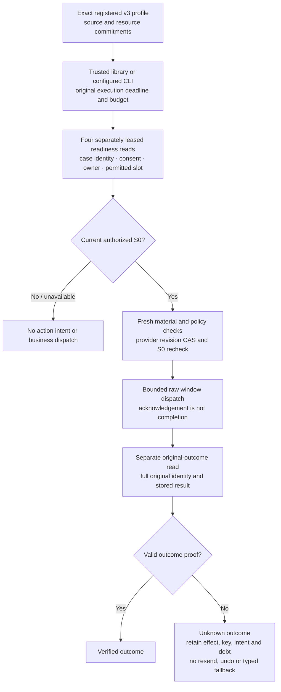

# Window-readiness adaptation — source verification

**FINITE SOURCE IMPLEMENTATION VERIFIED AND ARCHIVED.** The frozen source candidate `3481517789dc4dd215c108f0bee878a4f48d50bd` passed all **1,963** tests, with **107** independently enumerated focused IDs covered by that same execution (zero additional unique tests), and all **293** normalized runtime files unchanged. Independent implementation, full/focused, standalone and public-document reviews are C0/I0/M0. Fresh post-full standard controls passed **42 current-v1** and **156 J05** tests, retaining eight and six bound artifacts respectively. Only the finite child is archived; parent J05/J07 remain open. The first two full attempts remain unsuccessful and unverified; the earlier 900-second diagnostic is diagnostic-only evidence, not the final J05 gate.

Worktree: `/Users/nbk/.codex/worktrees/proofkey-runtime/Pitch project`.

Private evidence directory: `/Users/nbk/.codex/worktrees/proofkey-runtime/Pitch project/.superpowers/sdd/2026-10-10-window-readiness-adaptation` (called `SDD` below). `outputs/...` paths are relative to the worktree; bare private report/log names are relative to SDD.

This report consolidates `closure-document-map.md`, `pre-final-evidence-index.md`, the complete chronological `task-5-report.md`, `progress.md`, corrective reviews and final retained execution evidence. The index predates the corrections and is not the latest Task 5 status. Earlier report preparation only inspected retained files; ROOT subsequently executed the documented offline final gates and independently checked their retained hashes, exact identities, import origins and source stability. No live provider, network call or historical executable/root was used by these final gates.

## Outcome and supported scope

The implementation boundary below is finite source/synthetic scope. The evidence sections identify completed gates separately from remaining closure work.

The implemented candidate is the exact registered `fixed-synthetic-window-readiness-v3` / `flat-window-readiness-v1` composition with the `reschedule-window-readiness-v2` process and `v2-window-readiness` semantics. It adds a finite readiness stage and bounded raw scheduling envelopes within the existing package modules. It does not add a general graph executor or arbitrary profile selection.

The readiness stage makes four separately leased reads: case identity, principal consent revision, owner state, and permitted slot. It preserves the existing owner, phase, version, stop, authorization and original deadline fences before and after reads, merges observations against the latest checkpoint in the transaction, and does not advance on failed save. Readiness that is unavailable or not S0 creates no action/intent/handoff. Fresh policy and provider CAS independently require S0 before a new candidate window write.

Candidate scheduling reads use actual raw response bytes. Candidate window dispatch also uses raw bytes; candidate exact-slot and legacy writes retain their typed route. Original readback is separately bound to the original full identity and stored outcome. HTTP 200 or an acknowledgement is insufficient to establish success or terminal nonexecution. Invalid/unreadable readback stays unknown; committed effects, provider key, intent and reconciliation debt remain, with no resend/undo or typed fallback. Current slot/consent is not substituted for original-outcome identity.

Registered execution is scoped to the reviewed library/configured-CLI run paths. v3 has no registered recover/reply/stop/transfer authority; existing v2 stop support remains a distinct scope. Exact-slot comparisons are adapter/domain comparisons, not new registered exact-slot support. Fresh source composition does not establish an installed distribution, old-root migration, release activation or actual human approval.

## Raw domain and explicit exclusions

All raw limits apply together and are inclusive:

| Dimension | Maximum / requirement |
| --- | --- |
| Response bytes | Nonempty strict UTF-8; at most 262,144 bytes |
| Container nesting | Depth 16, root object at depth 1 |
| Observation count | 128 |
| Total evidence occurrences | 128, counting repeated references |
| Identifier, revision and reason fields | 1,024 Unicode code points |
| JSON/schema domains | No duplicate keys/nonfinite numbers; exact complete envelope, scalar, hash and timestamp domains |

The 1,024-character bound does **not** apply to every arbitrary observation JsonValue string; total bytes and depth still apply. Existing long-value coverage must not be described as a universal string cap. The 129-observation fixture also exceeds evidence occurrences, so it is not isolated observation-limit proof. Out-of-domain candidate input is unavailable/unknown, not silently truncated or normalized into an authorized value. The staged source-registration material also has its separate 1 MiB per-file / 8 MiB aggregate limits, checked before material JSON interpretation.

T3's fresh baseline/candidate × window/exact-slot × 1,024/1,025-reference comparisons distinguish the narrower candidate domain: six cases verify, while the two candidate 1,025 pre-write cases create no business dispatch/effect/intent. These tests also appear in the successful frozen full execution; separately retained final J05 evidence is identified below.

## Identity commitments checked for this draft

The two candidate resource mirrors were read directly during the earlier draft check and both contain 209,199 bytes with the unchanged file hash below. After round 7, the current fixed fixture and world file were rehashed directly; their hashes match the independent refreeze review. That review checked all 86 package pairs, complete literal inventories and semantic commitments. The fixture retains 42 current-v1 and 156 J05 IDs, with the former a subset of the latter. This draft did not load/discover or execute those tests.

| Identity | Value |
| --- | --- |
| Candidate file SHA-256, both mirrors | `19e2cb56c5a7353406020ee06e1b7bf750f27e59e304ffdcbd48ac36963427a7` |
| Candidate semantic release, declared in resource/registration | `487ad1455373bf86f957e2d2a4fd852af47d9ca2c83488e8754b399e015cbc2a` |
| Candidate semantic process bundle, declared in resource/registration | `e8e09a51083d58781ff2e8935263840d08b3457a88f171c49053b81d24de9184` |
| Unchanged policy, declared in resource/registration | `1905842f17fd73559d48f4f2d04928a5be734464b966b7167808a05732cdf752` |
| Baseline release declared in registration | `5bb712b13efaace655ee7180f3d913d93cbd637e3d1685331c6a1eecbade7bf4` |
| Registration / provenance | `synthetic-window-readiness-delta-v1` / `local_controlled_synthetic` |
| Current round-7 refrozen fixture file SHA-256 | `fb1068566216e830e34b123a98d3c7a60b08345f21d5775644655f6b1e3a367f` |
| Reviewed current world.py SHA-256 | `bc4e48a8c506ed8ebae7e7e0d5a5bd3bee50d07c7a94c3bc81138732441224ba` |
| Current six-file inventory digest | `2890a8ae72d08da624ebb8cc2c5b7cf6d6f9f26f6baa2bd277833a853bfaf7c6` |
| Superseded pre-round-7 fixed fixture SHA-256 (historical evidence only) | `42dac89c842dd5bdef0b60650f9472bad64f73505cb09cbe157fa14e8ed4b1d5` |
| Superseded pre-round-7 six-file digest (historical evidence only) | `40e3552308da6666af69d1ce507b2cacfd92ae979c70433d01307ed727341faa` |
| Preserved historical registration fixture SHA-256 | `6dfa8a42dbf22bce5c6ecb94cfe3de40d88b2ec00ba4cbadeeb513b703e0be8f` |
| Preserved historical serialization-vector file SHA-256 | `bed676874ec36d8e0673654aa56a1ecd5104831ae4c72fcbc1962117656a1d14` |

Resource mirrors are `runtime/profiles/flat-window-readiness-v1.json` and `runtime/src/proofkey/resources/profiles/flat-window-readiness-v1.json`. Fixture files are under `runtime/tests/fixtures/`. File-byte hashes and declared semantic hashes are different commitments. Earlier independent freeze/review records recomputed semantics; this draft directly rechecked file bytes and read the stored declarations, not a new semantic qualification.

The 86 package paths are distinct from the broader source/test/script input inventory. Existing expected historical pins remain unchanged; they are not repointed to changed source. Preserving old pins proves preservation of those bytes, not compatibility of the new source with an old executable or resource root.

## Tasks 1–4: existing scoped execution evidence

All log hashes and footer counts in the following table were re-read/recomputed from the retained artifacts while preparing this draft. They are historical scoped runs, not a new aggregate run and not final Task 5 coverage.

| Scope | Existing run and actual outcome | SHA-256 of retained log |
| --- | --- | --- |
| T1 contract/resources | `outputs/window-readiness-task-1-20261010/08-final-focused-green.log`: 19 passed, 27.024 s | `fddbd39d6f5093588dcfab0b696354c9e65eec7308b192d22a3c4cad6c7d7532` |
| T2 combined source/adapter gate | `outputs/window-readiness-task-2-gates-01/tests.log`: 133 passed, 107.148 s | `25490dd7fbb1969c7dad287349d679b358f17bceea6efd16d42651e049bc1cb8` |
| T2 strengthened final direct tests | `outputs/window-readiness-task-2-final-direct/tests.log`: 28 passed, 25.892 s | `a874e492c787dae5c87776fc978a2828031dd32a0853f3de8021ebf964ee68d3` |
| T3 earlier focused gate | `task-3-focused-gate.log`: 173 passed, 423.608 s | `96d95dad47b7428703c7e638b1b45b1d4b338734c3c71657051e8c415716cbc0` |
| T3 strengthened final engine tests | `task-3-final-engine.log`: 24 passed, 20.072 s | `7ac43f4419cef96b19e1c907b3337c1dc0f57a42f798e3f698bc2e9ca2897a5b` |
| T4 initial, before review correction | `task-4-evidence/12-focused-gate.log`: 152 passed, 737.057 s | `dbda161f5e6fc95e4558107bf9c974bf8475560e4edc2783425ce720a0798c43` |
| T4 final scoped correction gate | `task-4-evidence/19-fix1-gate.log`: 67 passed, 141.431 s | `0a1d681be1717a55631d65a8e40bb810ff2753ad537ddfb1305630243a604f89` |

Direct retained-ID comparison confirms the 28 T2 IDs are included in the 133-ID gate; the later run exercises strengthened final test bytes. It is not 161 unique tests or one all-final-assertion run. T3 has 173 earlier IDs and 24 final engine IDs with 22 in common: 175 distinct selected IDs across two runs, not 197 unique tests or one 175-test run. The T4 152-test run predates its prepared-identity error-contract fix; the overlapping 67-test run must not be relabelled or added to it. No defensible grand total is formed by summing T1–4 counts.

The ledger records independent scoped completion/reviews for T1 (`b25fc920c187fcbc87d30b4c2ed075de5471e1ef`), T2 (implementation `ffdac3668e95cc5c1dc3775a997372d4a6f686ed`, review through documentation head `cfc2eae2372c077d7ab77c8cbf362bed7d877e72`), T3 (`fd883f9212b06c6fb98d687f97e1ad73b41aa3f9`) and T4 (initial `3ec0f2bc4c1a58712046356c6ee2d8728d88395c`, scoped fix `ec8a5d0b283af819d1c4e6b6e3693f0cb206e31b`). T4 completion rests on its original full review plus scoped fix review, not a fresh whole-task rerun. Those task verdicts do not approve the eventual final execution receipt.

## Existing measured synthetic fit

T3's real core engine witness has 15 physical calls: 3 binding +4 readiness +6 material +1 dispatch +1 original read. It verifies one reschedule to S1, no handoff/retry/planner call and the original deadline; synchronous transport consumes zero FakeClock active time. That proves core accounting, not registered-entry wall performance. Retained witness log SHA-256: `ccada2a272e7db9f033e6ac4dd3c5f56d6b09573d3be7038a772e308c5f3363d`.

T3's unreadable-original witness preserves the committed effect, exact key/intent and debt across malformed, oversized and throwing original reads, including a real recovery without resend/undo. Retained log SHA-256: `3fc096da7d95c64b50cb869065da797cf44ac3abc72bb61ffc28855e0c742a5b`. These are existing scoped observations, not a historical pending-pair demonstration.

The post-fix T4 `19-fix1-gate.log` contains actual `J05_TIMING` records for both `library` and `configured_cli`. This draft parsed those raw records and confirmed 15 distinct lease IDs per lane, all settled, each reserving 10 seconds and measuring 0.025000000000005684 synthetic seconds. Both lanes include the original three admission calls and import their accounting without reset.

| Existing T4 lane | Calls | Active seconds | Synthetic host elapsed | Effective parent / remaining |
| --- | ---: | ---: | ---: | --- |
| Library | 15 | 0.37500000000008527 | 16.875015000000175 s | 120 s / 103.124985 s |
| Configured CLI | 15 | 0.37500000000008527 | 16.875015000000175 s | 110 s / 93.124985 s |

The report/ledger records one verified effect and finalized `admission_observed` source/claim/route per lane. These are paced **synthetic-clock** measurements; test process duration and simulated host elapsed are not wall-performance, installed-provider or completed-event-drill claims. The unchanged business ceilings remain 24 calls, 120 active seconds and 10 seconds per tool. The final J05 capture below reproduces these synthetic measurements on the frozen candidate.

## Preserved unsuccessful development attempts

The following T1–4 counts were checked against retained log footers. Failure/error event counts include subtests and may exceed method counts. Filenames containing `green` are not evidence of success by themselves. Corrected later runs do not erase these attempts.

| Stage / retained attempts | Actual failed results and diagnosis |
| --- | --- |
| T1 `outputs/window-readiness-task-1-20261010/01`, `02`, `03` logs | 1 method/1 error (missing resource); 14 methods/22 errors (missing contract/API); 9 methods/68 failures/14 errors (behavioral admission/identity denials). |
| T1 `04-focused-green-attempt.log`, `06-missing-field-red.log` | 18 methods/1 failure/1 error due to truncated generated resource JSON; 1 method/1 error from uninitialized exact-type registration. Corrected in the later retained runs. |
| T2 `outputs/window-readiness-task-2-red-01/tests.log`, `...green-01/tests.log` | 15 methods/2 failures/23 errors from absent APIs/raw decoder; 15 methods/3 setup errors. |
| T2 `...identity-01/tests.log`, `...red-02/tests.log` | 26 methods/2 test-layout errors; 2 methods/2 behavioral failures. The identity attempt has the report's post-run test-hash caveat. |
| T3 `task-3-red-1.log`, `task-3-red-2.log`, `task-3-red-policy.log` | 3 methods/1 failure/15 errors (missing entry/helper); 11 methods/2 failures/18 errors (finite branch/save); 1 method/1 failure (independent policy admitted OTHER). |
| T3 `task-3-red-rebase.log`, `task-3-red-rebase-corrected.log` | 22 methods/3 failures/9 errors; corrected fixture rerun 3 methods/1 failure/2 errors. These exposed real late-observation loss plus overly early snapshot injection and incorrect exception expectations. |
| T3 `task-3-green-4.log` | 22 methods/7 errors from accidental test-field edits and an overly narrow missing-generation expectation; later corrected. |
| T4 `task-4-evidence/01-red.log`, `02-green-attempt.log` | 4 methods/8 errors (missing selection/preparation); 4 methods/1 error caused by the old cumulative admission-phase guard. |
| T4 `03-diagnosis.log` | Manual registered attempt, not a unittest summary: stopped under the old guard after 6 calls, 0.15 synthetic active seconds, 6.750006 synthetic elapsed seconds and no effect, as recorded in the report. |
| T4 `04-resource-red.log`, `06-parent-guard-red.log`, `07-original-red.log` | 1 method/1 failure (semantic-equivalent uncommitted resource bytes accepted); 1 method/1 error (old five-second ordinary guard); 1 method/1 failure (prepared original error mapping). |
| T4 `08-composition-attempt.log`, `09-library-parent.log` | 15 methods/3 errors (CLI blanket-v1 rejection and two test-wire/property mistakes); 2 methods/2 errors (wire-key mistake and expected source-drift denial during a concurrent bootstrap edit). The latter source-drift denial is not a product defect. |
| T4 `16-fix1-red.log` | 1 method/1 failure, 4.341 s: valid-shaped changed original request ID returned `invalid_input` instead of `identity_changed`. Denial/root retention already held; final scoped correction fixes the error contract, not an authorization bypass. |

The underlying T1/T2 attempt filenames and full commands remain in their task reports and `outputs/window-readiness-task-2-attempts.md`. T3's full chronology remains in `task-3-report.md`; T4's complete chronology and post-fix amendment remain in `task-4-report.md`. Reader-script errors (the freeze checker's raw-versus-default-null comparison and a reviewer's interleaved-JSON parsing) were corrected in the reader without changing evidence. They are not runtime pass/fail results.

## Task 5 chronology, failed gates and controls

Task 5 adds explicit historical/current comparison lanes and an outer-only J05 runner. The original fixed fixture was committed at `c7a22e9b2c9377862be663863394d1b83cd5ad25`. Rounds 4–6 corrected external harness/tests without changing package/fixture commitments. Round 7 fixes a separately confirmed legacy package validation regression, then updates only the current fixture's world pin and six-file digest. The final frozen execution candidate is `3481517789dc4dd215c108f0bee878a4f48d50bd`; its full/focused gates passed as documented below.

| Attempt / correction | Recorded outcome and retained evidence |
| --- | --- |
| Pre-freeze `676a65a` checkpoint | 18 bounded tests passed; four explicit missing-fixture positives returned 2 failures/2 errors. Both standalone pre-freeze probes returned invalid missing-fixture manifests with empty tests/imports/artifacts. `outputs/window-readiness-final-6lO88JFq/`. Initial API/selection/test-setup errors and the unchanged 128-case receipt ceiling are documented in the full report. |
| Pre-freeze review I1 and fix `8051af1` | Literal backslash-n markers/separators prevented six adversarial cases from reaching their intended stage. One genuine RED then GREEN and 19 bounded passing tests are retained under `outputs/window-readiness-final-fXXloP5e/`. No final qualification is inferred. |
| Private report indexing accident | The private report was force-added in `737e558` and removed from the Git index in `438949b`; local evidence/history were retained. This was not a runtime source fix. |
| Initial fixture cross-check | Checker initially mismatched raw baseline edges against serialized `condition:null` defaults; the checker was corrected without changing source/fixture. `outputs/window-readiness-final-Cn1XBu1z/controller-freeze-check.json`. |
| Focused attempt 1 at `c7a22e9` | **Incomplete:** 101 planned, 43 started, 42 completed/passed; SIGINT −2 / wrapper 254, 55.43748062523082 s. No observed test failure/timeout and no completion summary. Controller stopped after static review found `cli` versus `configured_cli`; J05 was not reached. Exact counts are in `outputs/window-readiness-final-Cn1XBu1z/focused-interruption.json`. |
| Whole-leaf Phase A and correction `3f16aee` | Static I1: timing consumer label mismatch; M1: universal 1,024-string wording. Corrected to actual labels and precise identifier/revision/reason wording. Capture-level fabricated unit records produced genuine 2-failure RED, then 2-pass GREEN and 20-pass bounded gate. This is validator evidence, not real fit. |
| Focused attempt 2 at `3f16aee` | **Incomplete failed gate:** 103 planned, 84 started, 58 passed, 25 methods observed failed, 1 interrupted, 19 unstarted. There are 23 direct FAIL lines plus 3 failed-subtest events; these are not additive unique methods. SIGINT −2 / wrapper 254, 422.33542962512 s. `outputs/window-readiness-focused2-DqgiTn6t/interrupted-receipt.json` retains the reconciliation and exact interrupted method. |
| Persistent current-v1 diagnostic within attempt 2 | 42 inner tests passed and eight artifacts existed, but the manifest is **invalid**: `ValueError: pinned module binding changed: proofkey.adapters`. Normal lazy imports added attributes after the baseline snapshot. Successful test bodies do not override failed import integrity. `.../current-v1-diagnostic/manifest.json`. |
| Lost temporary J05 audit within attempt 2 | A failed outer subtest and roughly 300 seconds were observed, but no final child manifest/tests log was retained. **Exact error and partial/completed inner coverage are UNKNOWN.** It is not proven timeout/fit failure or 156-test completion. The unsuccessful rapid-copy watcher was stopped and not reused. |
| Import-baseline correction `e12de51` | Exact current-lane-only preload of six known adapters before initial snapshot; existing binding/origin/alias guards remain. Import-only no-op probes gave 3-failure RED across 2 tests, then 2-pass GREEN and 22-pass bounded gate. Those probes do not qualify business scenarios. Scoped review is recorded clean. |
| Untouched `e12de51` current-v1 **preflight** | **Passed preflight only:** exit 0, 35.813711791764945 s; 42 planned/executed/raw records, eight artifacts, source stable, both import snapshots retained. `outputs/window-readiness-controls-u9EBX6rt/current-v1/manifest.json`, SHA-256 `8dae57049c8fe0200ae4dd7e6766630a3d0a9278d528e55841e7b7fe6ec50650`. It establishes the repaired seam with actual controls, not final post-full qualification. |
| Untouched `e12de51` J05 preflight | **Invalid:** exit 1, 300.07879237504676 s; retained exact error `child timeout after 300 seconds`. Manifest SHA-256 `ac3b023fe604f6b591a96a28eacf2577c7e1faadfcfcf8f294e044be2ac5b05d` at `.../j05/manifest.json`. Empty tests/artifacts and no measured fit mean partial inner coverage is unknown, not zero. The incomplete manifest has source_stable=false; independent external before/after input snapshots are recorded equal. A harness cutoff does not prove violation of 24/120/10 business budgets. |
| Authorized 900-second diagnostic on unchanged `e12de51` inputs | **Diagnostic passed, not standard-launcher qualification:** exit 0, 549.2977093751542 s wall; 156 tests in 546.249 s, OK. Exact planned/executed/156 raw records, eight groups and six artifacts; no failure/error/skip/xfail/unexpected-success records. The timeout override affected only the runpy-loaded outer process; the child loaded unchanged code. All 293 input hashes remained equal. `outputs/window-readiness-controls-u9EBX6rt/j05-diagnostic-900/`. |
| Reviewed official harness correction `14774f79642c6cabf5aeb60258f691f24e35eb96` | Only the J05 qualifier and outer-test file changed: fixed child timeout 300→900 s, J05 outer margin 930 s, factory outer bound remains 330 s. Business 24/120/10 and all package/fixture/inner-ID/clock-helper behavior remain unchanged. Genuine bounded RED: 2 methods/3 assertion failures in 0.184 s; GREEN: 2 passed in 0.205 s; bounded gate: 24 passed in 22.311 s. Independent round-4 review C0/I0/M0 approves the next gate, not qualification. |
| First immutable full attempt, `14774f7` | **Incomplete failed attempt / unverified:** 1,961 expected full IDs and 107 expected focused IDs; 490 outer starts, 487 completed pass lines, two failed methods with three failed subtests, one interrupted method, 1,471 unstarted. Root sent SIGINT after observing failures; test process −2, controller 1, no timeout. Test elapsed 162.11232224991545 s; controller elapsed 164.27092579193413 s. Source/current/harness stability are all true. Retained separately under `outputs/j05-full-Fvj26hax/run/`; no final testsRun/completion summary. |
| Exact first-full failure diagnosis | The failed methods were `test_adapter_deadlines.AdapterDeadlineTests.test_final_transaction_guard_rolls_back_after_observations_and_effect_insert` (observations subtest) and `test_adapters.AdapterTests.test_terminal_proof_deadline_expiry_during_fence_lookup_exposes_no_identity` (two advance/request subtests). The interrupted method was `test_factory_qualification.FactoryQualificationTests.test_added_package_module_rejected_by_closed_inventory`. Exact unchanged-source reproduction: two methods/three failing subtests in 0.725 s. |
| Phase evidence and private corrected-hook probes | The observations fault watched the old typed wrapper, bypassed by shared raw-data extraction; its clock did not advance and fault remained armed. The SQL fence watcher now fired during setup dispatch rather than the intended read. Phase trace and two private corrected-hook probes (2 passed, 0.752 s) support **test fault-injection seam drift**, not a demonstrated production guard failure. The initial trace driver used nonexistent `world.path` and failed with AttributeError; only the private driver was corrected to `world._path`. No runtime change was needed to obtain the trace. |
| Reviewed test-only correction `732b84ba487a6f0c1d62325b49af4e115514a06d` | Exactly `test_adapter_deadlines.py` and `test_adapters.py` changed. Hook the actual shared observation builder and arm expiry explicitly in the read phase, adding fault-fired/clock/phase assertions while retaining all rollback/no-identity/fresh-proof assertions. RED: 2 methods/3 failed subtests in 0.592 s; GREEN: 2 passed in 0.761 s; complete affected modules: **54 passed in 15.187 s**. Independent round-5 review C0/I0/M0. Package 86 pins, current-v1 42 IDs, J05 156 IDs and both modules' method identities remain unchanged. Guard-removal mutants were not run. |
| Second immutable full attempt, `732b84b` | **Incomplete failed attempt / unverified:** execution `7bcf80dd-3a11-4af6-bf2d-5460aba08b80`, frozen commit `732b84ba487a6f0c1d62325b49af4e115514a06d`, 1,961 full / 107 focused expected IDs. Exact reconciliation: 1,142 unique outer starts, 1,140 completed pass lines, one failed method, zero failed-subtest events, one interrupted method and 819 unstarted. Root sent SIGINT after observing failure; test process −2, controller 1, no timeout. Test elapsed 1189.4020676668733 s; controller elapsed 1191.52095916681 s. All 293 source inputs and archive/current/harness stability checks passed. `outputs/j05-full-6my5jjwj/run/receipt.json` records `passed=false`, `result=unverified`; no final testsRun/completion summary or completed focused coverage. |
| Exact second-full failure and packet diagnostic | Failed method: `test_packet_source.PacketSourceTests.test_advancing_clock_uses_one_original_receipt_observation_timestamp`; interrupted method: `test_process.ProcessTests.test_incomplete_material_coverage_and_unknown_graph_readback_denied`. Exact unchanged-`732b84b` reproduction: exit 1, one test failed in 0.136 s, 0.39846300007775426 s outer duration. Assertion compares nested `stored_at=2026-10-08T10:00:00.000013Z` with enclosing `provider_at=2026-10-08T10:00:00.000013+00:00`, the same aware UTC instant. `outputs/j05-packet-diagnostic-dElTgc/` retains the raw failure and before/after equal 293-input snapshots. |
| Packet timestamp source trace and private probe | The report traces the difference to J02 raw extraction: nested typed receipt JSON emits `Z`; raw enclosing `datetime.isoformat()` emits `+00:00`. The real stored timestamp is reused, and the public typed readback/verifier compare the same instant. A private probe with the same advancing clock and no source monkeypatch parses all three stored timestamps as equal, retains acknowledged dispatch and verified `authoritative_content_stored_owner_pending`, and observes provider time before the later read. This supports a representation-sensitive test assertion diagnosis in this case, not blanket approval of raw timestamp behavior or full qualification. |
| Reviewed round-6 test-only correction `4b4e8a430ae23488c92f899fc7109561699ed624` | Changes only `test_packet_source.py`: independently parse both operands of the two timestamp equalities, without rounding or loss of timezone/precision. Keeps the advancing clock, acknowledged dispatch, actual verifier and strict provider-before-read assertion. Fresh original RED: one failure in 0.136 s; GREEN: one pass in 0.138 s; complete affected module: 21 passed in 3.101 s. Separate real generated-field +1 microsecond probes fail the provider/observed equality respectively (one failure, no errors each), preserving sensitivity. Scoped review C0/I0/M0; no package, fixture or selected-ID change. It does not clear the separate validation bug below. |
| Confirmed separate legacy validation regression | `outputs/raw-factoring-validation-probe-20261010/receipt.json` retains two fresh legacy roots differing only in optional `operator.packet_id` revision. The optional fact is excluded from valid required material. With empty revision, raw-factored dispatch acknowledged and persisted one effect, while original read then raised `AuthorityReadback` validation; the former typed projection rejects that observation before commit. Valid `v1` control acknowledges and reads successfully. All 354 audit inventory entries (including bytecode) remained unchanged. This is a real direct-simulator legacy regression, not evidence that the fixed valid host fixture failed; the suspected dead ownership projection hook was separately ruled out. |
| Round-7 plan and nonvacuous rollback correction | Initial plan review identified that handoff alone cannot prove rollback of mutated facts. The corrected plan added real legacy `transfer_owner`/`owner_accepted` and valid controls; rereview C0/I0/M0 and strict child validation preceded plan/spec commit `d39d0d6cc5a913f384e7ee88b26edc96a26ecd9b`. The state value correctly remains accepted while its revision advances; owner, epoch and state-revision rows provide actual mutation controls. |
| Reviewed round-7 implementation `69f406c48849e15e05d9a36af15237306ded4b28` | Exactly world.py and test_adapters.py changed. Inside the existing transaction, typed dispatch again validates `AuthorityObservation` and serializes typed observations before effect insertion; raw `window_envelope` keeps direct dictionaries. Both branches invoke the common assembler once; existing rollback, deadlines, encoder, 24/120/10 budgets and raw limits remain. Four invalid subcases (two legacy operations × empty/whitespace revisions) assert ValidationError, equality of all fact-row columns, zero effects/rejections. Two valid controls prove acknowledgement, one effect, original read identity/stage and packet observation; transfer demonstrates four changed ownership rows. RED: two methods/four failures in 0.749 s; GREEN: two methods/six subcases in 0.738 s; complete five-module gate: **143 passed in 49.964 s**. Independent review C0/I0/M0. |
| Round-7 sensitivity and retained unsuccessful setup | Fresh-process removal of only the restored typed projection reproduces exactly four missing-ValidationError failures; both valid controls pass. This is expected-RED sensitivity, not qualification. An initial probe failed its replacement-count assertion before mutation/test execution, then the private match-before-dedent setup was corrected. The provisional `inventory-in-progress.json` has a transient log hash/empty self-hash and is explicitly superseded by final `inventory-receipt.json`; it is not final evidence. |
| Reviewed round-7 refreeze `3481517789dc4dd215c108f0bee878a4f48d50bd` | Fixture-only commit changes exactly two values: world.py pin and current six-file digest. All other 85 pins, 86 names/order, five-key fixture/eight-field registration shape, metadata, candidate/resource/semantic commitments, historical fixtures and exact 42/156 selected IDs are unchanged. Independent pure file/JSON/AST review C0/I0/M0 confirms all pins and the complete 293-file inventory. This establishes reviewed source consistency for proceeding to execution, not successful execution or final qualification. |
| Third immutable full attempt, `3481517` | **PASSED:** UUID `bdb06fca-c5c5-495e-adcc-ddab21c40504`, `outputs/j05-full-uLBO57BY/run/`. All **1,963** expected/start/completed/pass identities match exactly once, with zero failures/errors/skips/xfails/unexpected successes; **107** independent focused IDs share that execution, adding zero unique tests. All **293** source files and seven harness/input commitments are stable; exit 0, no timeout, 7471.902 test seconds / 7475.334921374917 controller seconds. Independent full/focused review C0/I0/M0. The two added round-7 regression methods explain the increase from the earlier 1,961 IDs; 42/156 inner lists are unchanged. |

The diagnostic's synthetic witnesses retain 15 calls in each lane, 0.37500000000008527 active seconds, maximum tool elapsed 0.025000000000005684 s and positive parent remainder (configured CLI 93.124985 s, library 103.124985 s). Those measurements do not become live latency evidence through the approximately 549-second harness wall time. The successful diagnostic justified reviewing a larger finite harness cutoff; it did not itself pass the subsequently required standard-launcher gates.

Exact new evidence hashes were re-read from the existing files for this refresh:

| Retained artifact | SHA-256 |
| --- | --- |
| `outputs/window-readiness-controls-u9EBX6rt/j05-diagnostic-900/manifest.json` | `d1125efae3c9f5a63d2691713222ea315351ac9ee5b637d0cf0b46bc4184fd0d` |
| Same parent's `j05-diagnostic-900-result.json` | `5fb357227e92f612254bec133d0976f4a3ee977fd51c82bc22510d9e8caccb0f` |
| Diagnostic `tests.log` | `46d7b3bf0396ede755c582fd1f5e34d0411e629c855c4715ffd485435f584899` |
| `task-5-fix4-review.md` | `08e7269bfff9fa99ecd575e81adf218e37e3db08a9d3f923196bb145523e32c6` |
| `outputs/j05-full-Fvj26hax/run/receipt.json` | `152f8bbec576e1fdc8c2fa659adb1e1faeed116edfcf755e345e90b902cefad2` |
| First full `run/stderr.txt` | `5531c035643fa0ab5201c49ef199c86776fb4166f2c3c133470ca55f40a8aaaa` |
| First full `interruption-analysis.json` (outside immutable run folder) | `2e9783874c884f8788cf6a095997c20cfab8260f2ca422b8c547d89543ed1706` |
| `outputs/j05-deadline-diagnostic-pukTOk/phase-trace.json` | `2aed7a1e6a4bf3c33f0714428c5e162bb586d3940e6835f9031a87d0a4359e67` |
| Same parent's `correct-hooks.stderr.log` | `b55204124d62d7e72d45ad49c6a0886ad7293c094401ed6dffb37e9cf37b3fb5` |
| `outputs/j05-round5-r3FOw5/modules.log` | `34f525de88d4b876069b9a0d1edf1eb7fdd8b04f2e1e3378f7c25550d73bfbef` |
| `outputs/j05-round5-r3FOw5/postcommit.json` | `46d636d70649b43c459f581766c03cff51b257be1a2e5f0111ae3139a91b8414` |
| `task-5-fix5-review.md` | `69e96ade7fe548f57c0a60d5df595d9f488c48c90253a86657e0809ce8c16f44` |
| Second full `outputs/j05-full-6my5jjwj/run/pre-execution.json` | `c94d127d33b4edcec16710c85086c82e0531a29c071f743cc3c747be0df9815e` |
| Second full `run/receipt.json` | `2f9e8e6c30579cb2af355a6243093dfa3ae381d9783bf37379a7bef75e7a1cc9` |
| Second full `run/stderr.txt` | `6761df4e61f354f12f65995c6888d5a47f414299214c16d3d75b37bb8d994ec0` |
| Second full `interruption-analysis.json` (outside immutable run folder) | `c41a4176ae17f440d771e5836c54b4ab80a527df0334b1226436765957d5c234` |
| `outputs/j05-packet-diagnostic-dElTgc/receipt.json` | `6978a15b4040578da0db473f73d3e507c0ead9188f294f647de4d92a2a3917c9` |
| Packet diagnostic `before.json` = `after.json` | `bdd889da26866ae0bcf6f9d1ce1ba81779ea0959e01ac0e9b8871cb7ddd532a6` |
| Packet diagnostic `stderr.log` | `b9a1ada057c4f75a71b68dfd6698661029920251e95c0e85937b61b2046a63d6` |
| Packet diagnostic `trace_timestamps.py` | `a86f372a7da35e3c0f003faa8164b0f65eb6fd03ee9f46c79e08601cdf855fbb` |
| Packet diagnostic `trace-timestamps.json` | `c81769ebfc080882b25387f2589d0ecd3890bf9f06bee6c7b562e4d88381c8ab` |
| `task-5-fix6-review.md` | `a573e974c48edbc4dd53daee39baf52f424947d268a954c5f6844272348a3e6d` |
| `outputs/j05-round6-IIe5Gi/module.log` | `ade42de68c52d3e792a26d4ab2dd961b3c5700a097d6f59cf0fc40db2711267d` |
| `outputs/raw-factoring-validation-probe-20261010/receipt.json` | `127b9ef1cef7bd723243e2c3e00b555f15c3f31b9a38e1fa7147755a25f625f0` |
| `task-5-round7-report.md` | `915a34bbf2096f0787d615b65c495ae02f39d9c66ea1ea36738e5c9e4cad906d` |
| `task-5-round7-review.md` | `2e9bf731f11e670bb1139dae235e6de32bdcb4429289961e8f8b31646c17daa8` |
| `outputs/legacy-precommit-round7-20261010/red.log` | `f309f1387450be30a38c17f392cde24987b8a87cc7e63cba0f8205dd57321663` |
| Round-7 `green.log` | `d8aff0f5d2e49b7d8a6e4824ce880c2eafe29d8892ae9221ec140918ffa5da2d` |
| Round-7 `scoped-modules.log` | `6d6090c2a85ebff58e4913761e11deab73a2aa9fc6218dca32d59687457979fa` |
| Round-7 `sensitivity-attempt1.log` | `dcd8bf8b6480c615a1027c10c8111c24d7783dad8d6c7ad192d41e224f39f279` |
| Round-7 `sensitivity.log` | `16b0a040c8dc2cf11af2bbae7c2b9ee9b9b50941b796217fe596d365378cdd37` |
| `task-5-round7-freeze-review.md` | `fc863e153fc9d8abb6d5b1176bf2489a6d175a203586f7d04ae3c0df1423c6ee` |
| `outputs/j05-round7-freeze-Zaj9qFuU/receipt.json` | `50c1ed898a3d42f66a5acfd8749d8a39bd189cc8a36fe83fcf03e93e0bb15a3d` |
| Third full `outputs/j05-full-uLBO57BY/run/pre-execution.json` | `f67391475d3b3c5dd826ca4fd7e55597d4dadff0aecd8fbe06cb9773407f22ca` |

Round-4 canonical runtime inventory is `e7e033d715ccb15ded3d612823d9da9de8b7d989edd29251aecab6cdf48811b5`. Round-5 canonical inventory is `9dd81ae0bcd7ae25b1f7d5481a4e2330b87b52148689276d6986b3c35ed72dca`; the review and retained postcommit snapshot attribute exactly the two authorized external test changes. These are successive source snapshots, not equal hashes or additional fixture/package pins. Neither failed full-run artifact is rewritten or relabelled by a later correction.

The round-7 refreeze review's canonical current 293-file mapping digest is `7aa1fdbaea3658c7c9605689f01822214324727eeba2005175da33bacb7ae0c6`, with each path mapped to `{"bytes": N, "sha256": ...}`. It is not interchangeable with path-to-hash-only snapshots or the hash of a formatted inventory file. The old fixed fixture and old six-file digest above remain historical commitments; they do not describe the newly refrozen candidate. Protected historical registration/vector fixtures are unchanged, not repointed.

The old 128-required-case factory limit remains unchanged. J05's 156 IDs are represented by eight fixed module receipt groups that bind all ordered per-test records; eight groups are not eight tests. The 42 current-v1 IDs overlap the J05 list and must not be added to claim 198 unique tests. Final full/focused identities were freshly enumerated from the immutable committed runtime at `3481517` and matched to completed outcomes as detailed below; they were not inferred from earlier selections or successful totals.

## Default v1 outcome

The final full suite and fresh current-v1 standalone affirmatively test that default/None/historical registrations reject changed current source while preserving literal historical serialization vectors. The explicit current comparison lane executes supported v1 with its own identity. Expected historical/default denial is not a deliberately red positive test. Preserved old pins are not repointed to manufacture an old-source success.

## Current-source v2 and unchanged goods/other paths

The successful frozen full suite includes current-source v2/stop, unchanged goods/other workflows and the assertion-bearing adversarial qualifier methods. Those are current-source comparisons, not new qualification of an old installed artifact. Disposable nested child transcripts are not all separately retained; exact passed parent methods plus their pinned assertions establish that full-suite coverage. Fresh standalone lanes provide the separately retained inner records described below.

## Final full-discovery execution — PASSED

- Frozen candidate: `3481517789dc4dd215c108f0bee878a4f48d50bd`; UUID `bdb06fca-c5c5-495e-adcc-ddab21c40504`.
- Command: the fixed recorded interpreter with `-B -m unittest discover -s runtime/tests -v`, executed in the committed archive's fresh source tree with bytecode/user-site disabled.
- Exact expected/start/executed/pass/testsRun equality: **1,963**, each identity once; zero failures/errors/fixture failures/skips/xfails/unexpected successes. Process exit **0**, no timeout.
- Test footer **7471.902 s**; subprocess capture **7473.10689362511 s**; full controller **7475.334921374917 s**. These layers are distinct from business budgets.
- All **293** normalized runtime files match across current source, immutable reference and execution tree, before and after; all seven input/harness commitments and 23 retained file hashes were independently checked.
- Full receipt: `outputs/j05-full-uLBO57BY/run/receipt.json`, SHA-256 `4db45c6499aa3984a30998daeaa4044bf366bda6c03491c46983915df1869379`.
- Raw stderr: SHA-256 `52dff17b259648cea732d6d96045a1ab124b2029ad3cf413fe90550c619f9991`; raw stdout: `25de239a87a4ce786e82ec95e3e46d56705cd6611478b7bcd26904e1ee8f6f5c`.
- Committed archive SHA-256: `d95a3bf0c945620280199c21c83ab256fcc11f4218eac0f4d125521656e6f33e`.
- ROOT's independent readback: `outputs/j05-full-uLBO57BY/root-independent-check.json`; independent review: `whole-leaf-full-evidence-review.md`, SHA-256 `db1fdd3c1c67ecb0fe046bd1a7ffcbf18a3c993208ab2e1702c86969597af83a`, **C0/I0/M0** for this full/focused gate.

Both previous full attempts remain failed/interrupted and unverified, not partially reused or relabelled. Private controller fixture tests and the old 1,829-line parser compatibility check are not fresh repository coverage. The fixed 10,800-second controller, 900-second J05 child, 930-second J05 outer and 330-second factory outer cutoffs are harness limits, not modified business allowances. No synthetic guard-probe tier or profiling optimization was adopted.

## Final focused coverage — PASSED WITHIN THE SAME EXECUTION

Exactly **107** independently enumerated focused IDs occur once with passed outcomes in the full run above. The focused receipt names the same UUID, binds the full receipt and explicitly records **zero additional unique tests**. It is not a second invocation. Receipt: `outputs/j05-full-uLBO57BY/run/focused-subset-receipt.json`, SHA-256 `2bc026721a66f3038a0087b1aa04a6237976c5cf3d7b19054c48b5813fbab69c`. Earlier interrupted focused attempts remain separate unsuccessful history.

## Final standalone current-v1 qualification — PASSED

Fresh post-full standard launcher, fixed source `3481517`, lane `current-source-v1-comparison-v1`, execution `synthetic-factory-c7944f9f30724784bd7d29c2befd795d`: **42** exact planned/executed/passed/raw-record identities, no nonpassing records, exit 0; **22.104 test seconds / 23.86 real seconds**. All 293 input files are stable. All 35 initial imported bindings persist unchanged; four legitimate later imports bring the final set to 39, with every recorded origin and file hash checked. Before/after import-set equality is not falsely asserted.

All eight canonical artifacts and their proposal/regression/stage joins validate. Manifest: `outputs/window-readiness-final-RIfMz8oJ/current-v1/manifest.json`, SHA-256 `9ca8b35f976a099299711c4d4cb3ebf64dc06c95b9431276eea022c95692086a`. The unsupported non-v1 comparison remains unavailable in this v1 lane. This is distinct from the earlier `e12de51` preflight and does not inherit its source identity.

## Final standalone J05 qualification and measured fit — PASSED

The fresh **standard** `runtime/scripts/qualify_window_readiness.py --output <new-absolute-directory>` launch used the fixed interpreter, sanitized environment and unmodified 900-second child cutoff. It passed **156** exact planned/executed/raw-record IDs in **363.170 test seconds / 365.15 real seconds**, exit 0. There were no failures/errors/skips/xfails/unexpected successes. All 293 source files are stable and equal to the final full-run source inventory. All 82 initial import bindings remain unchanged, with two legitimate later imports; every final origin/file hash was checked.

Manifest: `outputs/window-readiness-final-RIfMz8oJ/j05/manifest.json`, execution `synthetic-factory-54ec61bd13c6428ba13cf36da86169d6`, SHA-256 `9c405881e61ebb661857039e0ad484e1d67cbd04842b550afcb88eb631899c72`. The exact 156 raw outputs bind eight complete module groups, not eight tests. Six canonical artifacts have matching proposal/regression/stage identities. The regression file SHA-256 is `417fe4cbaeb0586fcf86bed9da75dcd2d4f55a6dbf1e08209e18c0d9f8631957`; staged manifest SHA-256 is `ae6da5be3c15ec9a944d0e082a1fb8cd271123b5d40a1a6c3b384270a68012d9`. Staging remains `staged_simulation`, not release activation or actual human approval.

| Final J05 lane | Separate settled leases | Synthetic active | Maximum synthetic tool time | Synthetic host elapsed | Parent remaining |
| --- | ---: | ---: | ---: | ---: | ---: |
| Library | 15 | 0.37500000000008527 s | 0.025000000000005684 s | 16.875015000000175 s | 103.124985 s |
| Configured CLI | 15 | 0.37500000000008527 s | 0.025000000000005684 s | 16.875015000000175 s | 93.124985 s |

Both raw finalization records report `admission_observed`, the original complete binding, distinct route/claim IDs and final artifact/journal/source hashes. These records are captured from assertion-bearing tests; their temporary case roots are not claimed to be separately retained for external readback. All calls are separately accounted, including the three imported admission calls. The business limits remain **24 calls / 120 active seconds / 10 seconds per tool**. Synthetic elapsed time is not live latency or a completed 600-second hackathon drill. The failed 300-second run and successful timeout-overridden diagnostic remain separate historical attempts.

## Evidence review and document/child closure

Task 5's execution and independent evidence review gates passed. Whole-leaf static implementation review (`whole-leaf-static-3481517-review.md`), full/focused review (`whole-leaf-full-evidence-review.md`) and final standalone review (`whole-leaf-standalone-evidence-review.md`, SHA-256 `acaf29455fc093e6539554259d2a6edd5275ed15e32006c098301bd0dac06e0d`) all report **C0/I0/M0** in their stated scopes. Independent four-document review (`whole-leaf-public-docs-review.md`, SHA-256 `95c824baa496544bb1a97a6e0735f2b512c9a5d9a6f7c5f084467d6a1a2ce6f7`) accepted the bundle after one stale future-tense sentence was corrected. ROOT's initial check passed 127 local links/anchors, eight support rows, unchanged 13-closed/19-open counts and six protected file hashes; `public-docs-check-1.json` retains that earlier document checkpoint, not later hashes.

Child-only strict validation passed, then OpenSpec archived [this finite child](../../openspec/changes/archive/2026-10-10-window-readiness-adaptation/tasks.md) on **10 October 2026**, adding ten requirements and replacing six across exactly four capabilities. All seven unrelated existing requirement bodies and six protected files remained byte-identical under the recorded normalized requirement-body comparison/file hashes. The new [living window-readiness specification](../../openspec/specs/window-readiness-adaptation/spec.md) preserves source-versus-historical and v1/v2/v3 authority boundaries. `openspec validate --all --strict --json` passed **12/12** items (ten living specs and two open changes), zero failures. Informational long-requirement notices remain; the archive also emitted a nonblocking suggestion to split more than ten deltas.

The archive command reported **16/17** task checkboxes because task 6.3 was the archive operation itself; it was checked only after the successful move and exact sync validation. All **17/17** finite child tasks are now checked. This does not complete any previously unmet parent requirement. Final postarchive documentation/hash review is retained separately in SDD.

Historical counts/reviews stay historical; old hash cells are not replaced, the 1,829-test stop-v2 result is not relabelled, and child archive never closes its parent. The public README/support-map changes occur **after** runtime verification: they change the README member of the 293-file inventory, not executable code, tests or resources. Thus the successful runtime receipts name exact source commit `3481517`, not the later documentation commit or its new inventory. No second runtime execution is claimed for documentation-only edits.

| Final retained evidence | Result |
| --- | --- |
| [Full receipt](../../outputs/j05-full-uLBO57BY/run/receipt.json) | 1,963 passed; exact frozen source and unchanged execution inputs |
| [Focused subset](../../outputs/j05-full-uLBO57BY/run/focused-subset-receipt.json) | 107 within that same execution; zero additional unique tests |
| [Fresh current-v1 manifest](../../outputs/window-readiness-final-RIfMz8oJ/current-v1/manifest.json) | 42 passed; eight bound artifacts |
| [Fresh standard J05 manifest](../../outputs/window-readiness-final-RIfMz8oJ/j05/manifest.json) | 156 passed; eight groups and six bound artifacts |

## Historical pending preservation and parent boundaries

**Historical pending-state preservation remains UNQUALIFIED. Parent J05 and J07 remain OPEN.** The recorded older J06 pair is completed/verified with no waits. Its current availability, authority and deadline support are unestablished. This final work did not access the old executable or root. A fresh fixture, completed phase with processing_status=pending, relocated package, copied root, recreated grant or repinned implementation cannot establish already-pending original-pair preservation.

The earlier discovery recorded executable `/private/tmp/proofkey-j06-0yc_36hd/installed-env/bin/python` and root `/private/tmp/proofkey-j06-installed-80e0d6f-attempt5/probe/library-window/case-feb2ba2f2de14021894506f99484d9c8`. This final work did not reopen or execute them. The recorded completed-only case had one verified reschedule and no waits; it is not an already-pending original case.

Changing that status requires separately authorized evidence from an independently identified already-pending original executable/resource pair, preserving its actual routes, keys, versions, postconditions, deadlines, debts/effects and reads. Source-qualified current compositions cannot substitute for it.

There is no new installation, native HTTP/live provider operation, actual human approval, external release, activation, migration, retained-version resolver or completed timed drill from this leaf/draft. Broader recovery/reply/restart and launch/installation obligations remain outside the current evidence. Parent release/human/security/unfamiliar-engineer/whole-change gates also remain open. Source hashes and scoped test/review evidence do not establish production readiness, provider participation or historical compatibility.

## Dated successor to earlier public support evidence

This report is the later source-evidence addendum to [public support boundaries](2026-10-10-public-support-boundaries.md), [safe trace](2026-10-10-safe-evidence-trace.md), [stop-v2](2026-10-10-observed-stop-v2.md), and the [previous-cycle design](judge-remediation-2026-10-09/next-cycle-design.md). Their original files, candidates and counts remain unchanged. In particular, the seven-row/19-link map belongs to `14bdde4`, the 1,829-test stop result to `4c8fd5a`, and the 1,693-test/J22-J32 snapshot to its own earlier candidate. None is relabelled as verification of `3481517` or its later documentation changes. The new public map requires its own local-link/hash checks and independent review.

## Rulings made and their costs

These are explicit implementation/evidence choices, not additional capabilities or automatic approval of future work.

| # | Ruling | Cost / retained limit |
| --- | --- | --- |
| 1 | Complete the trace/quickstart slice and investigate J07 next. | Other controls remain deferred. |
| 2 | Trace the exact CLI envelope; do not invent an unbound readback join. | Independent end-to-end integration proof remains separate. |
| 3 | Treat a synthetic quickstart as technical evidence, not usability evidence. | J21 requires a real unfamiliar user. |
| 4 | Execute full regression from a committed Git archive. | The wider host environment is not hermetically frozen. |
| 5 | Permit transitively imported inert provider definitions, not clients or calls. | A heavier import surface still needs review. |
| 6 | Implement same-owner stop before general controls. | J07 remains partial; reply/recovery are separate. |
| 7 | Use a new literal v2 inventory and fresh roots. | More pinned code; no repinning old roots. |
| 8 | Develop the next contract while trace inputs stay frozen. | Evidence candidates must remain distinct. |
| 9 | Repair the typed two-packet fixture without weakening production validation. | The witness remains fixture-dependent and synthetic. |
| 10 | Reuse exact-hash focused evidence after example-only changes. | A fresh final full suite is still mandatory. |
| 11 | Review an early source checkpoint while compatibility work continues. | Any source fix invalidates applicable earlier evidence. |
| 12 | Require a real pending-state demo in addition to narrow tests. | Extra execution and a small trusted selector are required. |
| 13 | Run a frozen full gate alongside independent static review. | A finding can require another entire run. |
| 14 | Retain all unjudged whole-leaf boundaries. | No global qualification label follows. |
| 15 | Keep README concise and link a detailed support matrix. | Two views require consistency maintenance. |
| 16 | Prepare documentation in parallel with code using precise pending labels. | Final consistency checking cannot be skipped. |
| 17 | Keep J05 inside existing package modules. | Less modularity; future extraction is separate work. |
| 18 | Restrict automatic terminal proof to a validated original window operation. | More classification tests; proof never grants authorization. |
| 19 | Claim exact-slot parity only inside all raw bounds. | Legacy-valid out-of-domain input is explicitly unsupported. |
| 20 | Share a pure full-ID formula with retained-source validation. | Shared validation affects legacy paths and needs regression coverage. |
| 21 | Add an explicit current-v1 comparison lane; preserve historical pins. | Another fixed fixture/lane must be maintained. |
| 22 | Require complete retained inputs and candidate binding. | Incomplete diagnostics cannot count as completed evidence. |
| 23 | Retain the existing function-local world material import. | Existing dependency coupling remains. |
| 24 | Separate the v3 ordinary parent deadline from the five-second admission phase. | Ordinary execution may outlast admission; expiry/authority tests are necessary. |
| 25 | Apply the same closed trusted selector at CLI bootstrap. | Additional security-seam tests and review are required. |
| 26 | Reuse host.py without changing it. | Correctness also depends on its existing constructor tests/review. |
| 27 | Bind 156 test records through eight fixed receipt groups. | Group counts can obscure coverage unless all IDs/hashes are checked. |
| 28 | Share full/focused coverage only with independent exact-ID/outcome proof. | Less isolated repeatability; separate standalone lanes remain required. |
| 29 | Raise only the J05 harness cutoff from 300 to 900 seconds after measured evidence; outer margin 930. | Slower stuck-run detection; business limits remain 24/120/10. |
| 30 | Correct obsolete fault-injection seams, not production guards. | Tests must assert the injection actually fired in the intended phase. |
| 31 | Compare parsed aware packet instants, not `Z` versus `+00:00` spelling. | No single textual UTC spelling is enforced; one-microsecond mutants retain sensitivity. |
| 32 | Restore typed validation/serialization before legacy commit, retaining the raw branch. | Two branches need coverage; pins and final full evidence must be refreshed. |
| 33 | Assert the real owner-accepted state-row revision change, not a fictional state-value transition. | A different state-transition variant is not covered; complete rollback equality remains required. |

No profiling/guard-probe optimization was adopted. The speculative durable text-observation design received **REFINE, C0/I4/M3** and is not implemented or approved: demonstrate a useful read-only consumer first, resolve current-source compatibility and state the actual access/revocation contract before adding a persistent quotation subsystem.
