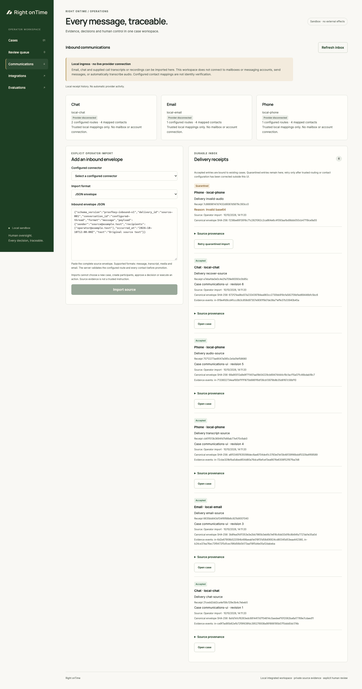

# Inbound communications verification — 2026-10-10

## Result

Implemented a **local** inbound communication harness, not live channel connectivity. PostgreSQL receipts and atomic case promotion, bounded email/chat/transcript/media import, signed loopback webhooks, quarantine/retry, UI provenance and unchanged v1 case contracts are covered. All processing/provider calls remain explicit.

## Fresh verification

| Check | Result | Boundary |
| --- | --- | --- |
| Project Python regression | 758 tests + 789 subtests passed in 106.48 s | Selected project directories listed below; excludes 11 newly added transport/CLI cases collected later |
| Final complete channel suite | 102 tests passed in 14.94 s | Includes all 11 additional raw HTTP/CLI tests, real PostgreSQL, no live providers |
| Final Node UI/widget regression | 70 passed, 0 failed/skipped | Includes actual DOM checks, polling, communication error/race regressions |
| Communications browser E2E | Passed | Real HTTP, PostgreSQL, offline PNG/WAV validation, no provider installed |
| Prior media browser E2E | Passed | Two **test-provider** dispatches, zero live calls; schema dropped |
| Prior model browser/CLI E2E | Passed | 16 authored cutoffs, 18 **scripted** dispatches, zero live calls/effects |
| OpenSpec strict validation | Passed | New behavior recorded in living specifications |

The Python project regression covers `tools/dwelly_platform/tests`, `tools/dwelly_service/tests`, `tools/dwelly_cases/tests`, `tools/dwelly_model/tests`, `tools/dwelly_bridge/tests`, `tools/dwelly_analysis/tests`, `tools/dwelly_e2e/tests`, `tools/dwelly_channels/tests`, `contracts/v1`, `datasets/team-handoff-v1/tests`, `tests/test_dataset_export.py`, `tests/test_cloud_case_smoke.py` with `--import-mode=importlib`. Do not collect archived generated `outputs/` as tests.

## Communications E2E evidence

- Chat containing script-like and policy-override source text rendered inertly.
- MIME plain text and real PNG accepted into one atomic source batch.
- Supplied phone transcript marked unverified; real WAV stored without ASR.
- Unknown route quarantined without case mutation; explicit retry after trusted configuration correction accepted once.
- Exact redelivery returned same receipt; modified content with same identity returned HTTP 409.
- Invalid audio encoding quarantined; original form input and case drafts retained.
- Browser reload issued no repeat writes. No model/media-processing job, decision or business action created.
- Failed inbox refresh after accepted POST did not prevent case refresh; stale failed GET did not overwrite newer success.
- Original test schema dropped after evidence extraction.

Retained synthetic records: [browser summary](browser-summary.json), [database report](database-report.json).

[Mobile screenshot](mobile.png). Both layouts were visually inspected; no horizontal overflow at the tested mobile viewport. No production data is included in these fixtures.

## Review and fixes

Three parallel implementation/review domains were used. Independent cross-reviews covered normalization, transaction atomicity, transport/CLI and UI. Fixes included bounded channel errors surviving the PostgreSQL transaction wrapper, preserving original channel semantics on retry, independent UI refreshes after acceptance, and discarding superseded GET errors. Extra actual CLI and raw-header tests closed the transport review's coverage gaps.

## Limits

No Gmail/Outlook/WhatsApp/Twilio account, live mailbox, phone call, public ingress, outbound send or paid LLM/ASR was tested. The webhook signing scheme belongs to this local harness, not a vendor. The existing trusted-local operator model is not production authentication. MIME supports text and images; audio uses phone/chat envelopes. Mapping is not proof of sender identity or consent. No accuracy claim follows from these integration tests.

## Local handoff

The platform was restarted on `http://127.0.0.1:8095/` with the example channel config, using the existing local database. No case was seeded or overwritten. Existing cases remain; sample mappings target `case-1` and must be adjusted to the intended existing case or that case created explicitly. The public webhook listener is not enabled in this running instance. No push or cloud deployment was performed.
