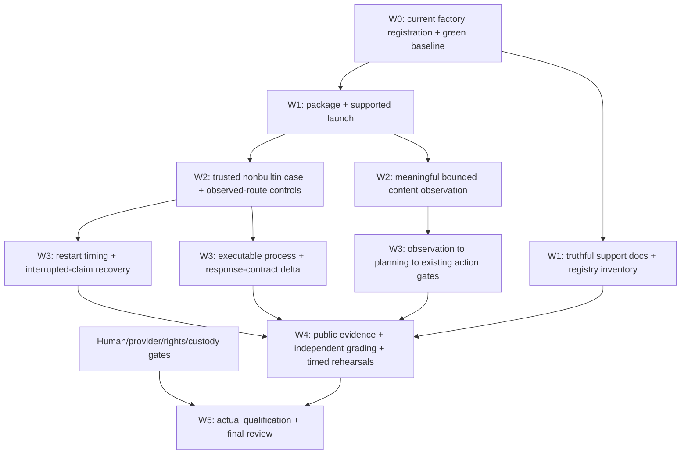

# Judge remediation: complete work register

Updated: 10 October 2026. Latest completed frozen runtime: source candidate `7b4c6e2`, all 1,798 tests passed with all 277 runtime files unchanged. **Thirteen narrow items are closed and 19 remain open.** J08 has an independently reviewed public support map; J23/J24 now have a reviewed, verified and archived content-free trace/source quickstart. Stop-v2 has separate ongoing verification. J13 is verified, independently approved and [archived](../../../openspec/changes/archive/2026-10-09-installed-offline-resources/tasks.md), alongside the earlier J22/J32 leaf. This register covers every recommendation, not a claim that all recommendations have been implemented or that synthetic verification qualifies production.

J06 update: installed candidate `80e0d6f` passed four new-case library/trusted-CLI positions and seven negative positions after the final fixture-read/input fixes. Scoped re-review cleared I1/I2/M1. Frozen regression passed with 1,768 passes and one environment-dependent skip, separately passed in its required macOS environment. Strict prearchive OpenSpec validation passed and the [J06 child is archived](../../../openspec/changes/archive/2026-10-09-trusted-replay-case-provisioning/tasks.md); J06 is closed only for this bounded scope. [Exact J06 evidence and retained five-attempt denominator](../2026-10-09-trusted-replay-cases.md).

## Decision

Keep the product bet: **easy integration → rapid adaptation → reliable case resolution**, for the engineer connecting an unfamiliar delivery/logistics environment. Fix the failed baseline first, then implement thin executable slices. Do not expand into a generic arbitrary-code agent platform, real money execution, or live customer contact.

The first business demonstrations remain rescheduling and whole-order refusal/return. Service refusal and operator handoff are the next public-path evidence slice; a queued handoff is not an operator's acceptance. Six provider-neutral interfaces remain in scope; six live integrations do not.

The original five-provider assessment and ZIP are immutable. This register is a response to those findings, **not a new judge score**. The complete original-to-work-item mapping is in [source-map.json](source-map.json). That file is a preserved discovery snapshot; its references to approval being pending precede the user's current instruction. The separate [r2 assessment and source adjudication](../../../outputs/proofkey_runtime_panel_2026-10-09_r2/reports/ASSESSMENT.md) are complete: five named seats answered, four satisfy the strict aggregate schema, and all 30 findings were checked. No additional J22/J32 defect was reproduced, so no second panel was warranted. Current execution status is below.

## What has actually changed

| Work | Evidence | Scope |
| --- | --- | --- |
| Late final-observation timeout corrected | `15453e1`; [timing verification](../2026-10-09-admission-phase-budgets.md) | 34 focused tests and 3 independent real-component probes; not general registered recovery |
| Evidence regression expectations corrected | `9c1ea1c`; [baseline verification](../2026-10-09-baseline-corrections.md) | Real original evidence, malformed/missing/revoked references and unavailable processing are distinguished; production behavior unchanged |
| API environment selected and checked | Same baseline verification | Existing isolated environment, 24 API tests; no new installation claim |
| Full recommendation inventory and source-backed design inputs | This directory | 31 findings, 31 recommendations, 15 next actions, 40 rubric explanations and 24 declined-scope entries mapped; discovery/documentation only |
| Explicit synthetic factory registration and fresh-process verification implemented | `94b0eec`, `ecf36ac`; [verification](../2026-10-09-factory-registration.md), [completed plan](../../superpowers/plans/2026-10-09-synthetic-factory-registration.md) | User approved the corrected plan; both task reviews and whole-leaf review approved. Historical pins/bytes preserved; no activation or changed-process authority added |
| Public registry commitments and positive short-parent evidence implemented | `0e71716`, `0122660`, `40138e1`; [verification](../2026-10-09-registry-commitments.md), [implementation plan](../../superpowers/plans/2026-10-09-registry-commitments-and-short-parent-evidence.md) | J22/J32 narrow criteria verified and independently reviewed; unchanged wire/digest and authority boundaries. J32 changes tests only. Leaf archived; strict OpenSpec validation 6/6 passed |
| Installed offline resources repaired | `8802299`, docs `5bc38c8`; [verification](../2026-10-09-installed-resources.md), [plan](../../superpowers/plans/2026-10-09-installed-offline-resources.md) | Exact package data and current registration; fresh no-index wheel installation on CPython 3.12.14/macOS arm64. Console/module/library/API × two fixed cases: 8/8, persisted effects/exports/closure and unchanged installed files. No wider integration or release-verifier claim |
| Trusted new-case preparation and launch implemented | `80e0d6f`; [verification](../2026-10-09-trusted-replay-cases.md), [plan](../../superpowers/plans/2026-10-09-trusted-replay-case-provisioning.md) | Bounded trusted Python hook; final installed 4/4 positives and 7/7 negatives. Five-attempt totals: 16/20 positive complete-check passes and 34/35 negatives. Frozen regression, scoped re-review and strict prearchive validation passed; [child archived](../../../openspec/changes/archive/2026-10-09-trusted-replay-case-provisioning/tasks.md) |
| Public support map reviewed | `14bdde4`; [verification](../2026-10-10-public-support-boundaries.md) | Seven evidence-bound rows, 19 local link/anchor checks, historical content preserved, independent C0/I0/M0 review. Documentation only; no new runtime or human onboarding acceptance |
| Content-free trace and source quickstart completed | `7b4c6e2`; [verification](../2026-10-10-safe-evidence-trace.md) | Scoped and whole-leaf reviews passed, all 1,798 frozen tests passed, 277 files unchanged, two fresh source captures. J23/J24 child archived; no independent dispatch/readback, installed or human-onboarding claim |

Latest full runtime run: **1,798 tests, all passed, zero skips/failures/errors**, 1,006.163 test seconds (1,007.464 elapsed), exit 0, on archived source `7b4c6e2`. All 277 source files stayed unchanged while the separate working tree advanced to `64dd1a9`; the [trace report](../2026-10-10-safe-evidence-trace.md) links its exact receipt and retained attempts. Historical J06 remains **1,769 tests: 1,768 passed and one environment-dependent skip**, 662.578 test seconds, on `ea0aa4e` with executable bytes matching `80e0d6f`; its skipped macOS alias test separately passed in 0.087 seconds. [J06 evidence](../2026-10-09-trusted-replay-cases.md) retains those distinct denominators. Historical J13 evidence remains **1,696 tests, zero errors/failures/skips**, 888.324 seconds on `8e655ec`, stable 260-file inventory; the same-code factory qualifier passed 37/37, and README-only installed candidate `5bc38c8` passed eight installed positions. [J13 evidence](../2026-10-09-installed-resources.md), the earlier 1,693-test/246-file `40138e1`, 1,685-test/742.788-second/236-file `ecf36ac`, and 1,646-test/14-error result remain preserved. Non-v1 execution remains unavailable; staging remains simulated. No live integration or timed adaptation claim follows.

## Execution order

These are dependency waves, not promises of hours or completion dates. Independent analysis, fixtures and documentation can run in parallel. Host/admission implementation is serialized because its slices change the same authority boundary. Each behavior change gets its own OpenSpec delta, approved plan, RED/GREEN tests, independent review and leaf archive. The umbrella and unfinished parent stay open.

## All work items

State meanings: **closed** = named evidence meets the narrow criterion; **partial** = measured progress but criterion unmet; **open** = not yet established, not necessarily missing code. “Prepared” below describes planning output, never implementation completion.

| ID | State | Wave / owner | Next action and required exit evidence |
| --- | --- | --- | --- |
| J01 | closed | W0 / implementer + independent verifier | [Latest frozen suite](../2026-10-09-trusted-replay-cases.md): 1,769 run, 1,768 passed, one environment-dependent skip, zero failures/errors; skipped alias test separately passed. Stable 272-file inventory and HEAD. Earlier baselines remain preserved. |
| J02 | closed | W0 / factory implementer | [Implemented and independently reviewed](../2026-10-09-factory-registration.md): immutable explicit registration, historical byte vectors and current-source receipt binding; non-v1 remains unavailable and staging remains synthetic. |
| J03 | closed | W0 / regression verifier | Retain the corrected evidence tests and contract; future work must not turn recovery into implicit evidence intake. |
| J04 | closed | W0 / verifier | Existing API environment verified; J13 now adds separate fresh installed console/module/library/API evidence for the exact recorded target. |
| J05 | open | W3 / process-adaptation implementer | Actually execute a finite changed response-envelope parser and readiness phase under a new registered version, then prove baseline/candidate differences, preserved old routes and reviewed release. Metadata-only version changes do not pass. |
| J06 | closed | W2 / integration implementer | Trusted Python provisioning and separate synthetic authority implemented; `80e0d6f` passed 4/4 fresh installed new-case positions and 7/7 negatives without changing fixed pins. Scoped final-fix re-review and frozen regression passed (one environment-dependent skip separately passed); strict prearchive validation passed and the [child is archived](../../../openspec/changes/archive/2026-10-09-trusted-replay-case-provisioning/tasks.md); see [evidence](../2026-10-09-trusted-replay-cases.md). |
| J07 | open | W2–3 / admission implementer | First permit recover/reply/stop only for fully observed original routes, with original identity, authority, debt and deadlines. Classify interrupted claims separately. Record remaining denials. |
| J08 | closed | W1 / documentation reviewer | [Public seven-row map](../../../runtime/README.md#support-and-evidence-map), exact candidate/launch/evidence links and dated historical supersessions. Candidate `14bdde4`, 19/19 local links, independent task/whole-leaf approval C0/I0/M0; [verification](../2026-10-10-public-support-boundaries.md). No runtime, native integration or unfamiliar-human claim. |
| J09 | open | W4 / independent verifier | Capture public service-refusal/handoff, exact-slot and retained reply/stop cases with independent per-effect expectations. Queued, accepted, initiated and physically received remain distinct. |
| J10 | open | W3–4 / recovery implementer + verifier | Fresh-process fault campaign preserving original route/key/generation/time/debt; include uncertain partial effects, wait, stop and ownership races. Do not erase sealed claims. |
| J11 | open | W2–3 / processing implementer | First meaningful bounded UTF-8/transcript/text-PDF observations, then an explicit observation-to-plan phase. Images/audio stay unavailable until a real authorized processor is exercised. |
| J12 | open | External gate / human provider owner | Prepare disabled-by-default native adapters and exact contract probes; execute only with approved account, budget and data scope. Retain native IDs/usage/semantic readback. Synthetic transport is not provider participation. |
| J13 | closed | W1 / packaging implementer | [Installed verification](../2026-10-09-installed-resources.md) passed for exact approved artifacts, thirteen resources, both distributions and all eight installed positions outside checkout. Full suite 1,696/1,696; independent technical review C0/I0/M0; child archived. The user-approved four downloads and every attempted run are retained. This closes only the recorded CPython/macOS target. |
| J14 | open | W1–4 / release verifier | J13 supplies exact source/resources/dependencies/build/installed-execution evidence for one bounded target. Public `verify_release` and general executable release reproduction remain unavailable; never return a full-verification label from static hashes or this scoped harness alone. |
| J15 | open | External gate / human rights owner | Prepare exact artifact/input/dependency provenance and notice checklist; obtain actual contributor/employer/data permissions where required. No inferred legal clearance. |
| J16 | open | W4 / platform verifier | Run the same installed artifact on an available Linux environment, retaining filesystem/security guarantees. macOS results are not Linux results; Windows remains unverified. No image pull without scope. |
| J17 | open | External gate / independent human custodian | Separate identities, mounts, labels and access paths; execute denial/leak probes and record custody. Same-UID directories stay rehearsal. Do not expose withheld labels to development agents. |
| J18 | open | External gate / authorized human reviewer | Review the exact executable candidate and activation scope. User design/plan approval and simulated review do not equal runtime release signoff. |
| J19 | open | W4–5 / run controller + independent grader | Freeze and run A=1, B=7, C=4, D=12 positions, each complete exercise within one measured 600-second target. Include setup, waits and export; record misses honestly. A also needs real review. |
| J20 | open | W4 / eval implementer | Version and execute all declared workload positions and R01–R15 obligations, using independent expected effects. Keep failure, timeout, denied and unsupported rows in the denominator. |
| J21 | open | External gate / unfamiliar engineer and operator | Observe real onboarding and packet use, task outcome and effort. Model review is not user research. Prepared script first; actual observation later. |
| J22 | closed | W1 / bounded API implementer | [Implemented and independently reviewed](../2026-10-09-registry-commitments.md): detached validated public commitments replace private consumer coupling; malformed/empty/bounded records, substitution, single-composition and literal wire/digest regressions covered. Full frozen suite passed; leaf archived. Maximum-envelope performance remains unmeasured. |
| J23 | closed | W4 / evidence implementer | Bounded content-free receipt projection, separate stage statuses and mandatory unverified/unknown/unobserved markers. `7b4c6e2`: scoped/whole-leaf review, 1,798 tests passed and [child archived](../../../openspec/changes/archive/2026-10-09-safe-evidence-trace/tasks.md). No independent dispatch, original-readback or current-file proof; [verification](../2026-10-10-safe-evidence-trace.md). |
| J24 | closed | W1 / documentation reviewer | Outcome-first source quickstart executed on two fresh synthetic cases, with exact output/state/export/closure checks and review. Archived with J23; [verification](../2026-10-10-safe-evidence-trace.md). Real unfamiliar-user validation remains J21. |
| J25 | open | External gate / human team lead | Confirm actual event acceptance, eligible work, five human participants, ownership and availability. Existing conversation names are not current confirmation. |
| J26 | open | W5 / human demo owner | Approve realistic dated exit gates, then produce and review an actual demo/video from the frozen working path. No submission, upload or publication inferred. |
| J27 | open | W1–5 / nonauthor auditors | Review full relevant modules and cross-module paths, recording exact covered hashes/lines and omissions. A source inventory is not a security review. |
| J28 | closed | W0 / timing verifier | Preserve original bounded parent time and separate final-observation phase. J32 extends coverage without reopening this verified fix. |
| J29 | closed | All / every author and reviewer | Keep original scores and all synthetic/actual/unverified labels truthful. Closure applies to reviewed artifacts, not automatic approval of future claims. |
| J30 | open | W5 / nonauthor reviewer + root | Whole-change review after implementation and evidence; archive only genuinely complete leaves, then the parent when all its requirements are met. |
| J31 | open | W4 + external gate / label author and human validator | Generate versioned provisional development labels, preserve provenance/disagreement, and obtain separate revalidation. These are not protected truth labels. |
| J32 | closed | W0 / timing-test author | [Real-component short-parent evidence](../2026-10-09-registry-commitments.md): UTC- and monotonic-limited two-second phases, final-write expiry and generous-budget sensitivity control; original parent authority and durable timing preserved. No production timing change. Full frozen suite passed; leaf archived. |

The thirteen closed rows stay in the register. No item is removed because another judge omitted it or because it is an optional suggestion. Optional items may be explicitly deferred, but currently remain open.

## Chosen defaults for the next specifications

1. **Provisioning:** implemented finite trusted Python preparation/bootstrap selected by explicit release ID, with separate synthetic review and transport authority. Business JSON cannot supply a Python import, path, approval, clock or authority. Library and trusted CLI positions are verified; a persistent manifest launcher and API composition selector remain unestablished.
2. **Registered controls:** observed routes first; interrupted prepared/sealed claims require a different state-classification change. Reconcile original effects; never re-admit as a fresh case.
3. **Process adaptation:** one reviewed finite version adding a real readiness read and changed response-envelope normalization. Keep permissions and policies identical. Preserve the old registered executable for unfinished old work; no in-place migration in the first slice.
4. **Time:** a trusted continuation timeline must not move before observed state or extend the saved business deadline. A fresh process's monotonic origin is not the old process's clock.
5. **Packaging:** one explicit installed-resource strategy, initially exact local macOS/Python target. Linux must be actually run. Do not weaken no-follow/owner/alias checks for portability.
6. **Content:** deterministic text observations first with explicit source coordinates and bounds. Processing is a separate authorized phase, not a side effect of intake. Model/ASR rows require real evidence separately.
7. **Evaluation:** extend the existing capture/ledger/reference components, do not create a parallel scoring system. Agent-generated labels are provisional development material. No score increases inferred from fixing bugs.

These defaults are proposed implementation directions grounded in [integration discovery](integration-discovery.md) and [qualification discovery](qualification-discovery.md). They do not silently amend the parent contracts. Each larger interface change still needs its own written design/plan review.

## Human and external decisions to prepare, not fabricate

| Decision package | Prepared artifact should contain | Required actual decision/evidence |
| --- | --- | --- |
| Provider pilot | Exact account/provider, input classes, operations, cap, stop conditions, redaction and retention | Authorized account owner approval and actual request/response/usage receipt |
| Rights/release | File hashes, author/source, dependency artifact/license/notice, excluded material | Relevant rights holder/contributor/employer decisions; publishing authority if later requested |
| Release review | Candidate and plan hashes, regression results, new vs preserved behavior, unresolved risks | Named authorized human disposition on that exact candidate |
| Custody | Public/private interfaces, identity map, denied paths, leakage probes, frozen split families | Independent custodian and enforced access evidence |
| Usability | Clean environment and input, task instruction, timing start/stop, no coaching rule, observed problems | Actual unfamiliar engineer/operator run |
| Event/demo | Rules/eligibility checklist, human roles, staged exits, demo source and evidence links | Current organizer/team confirmations and human presentation review |

Creating these packs does not authorize sending them, enrolling accounts, buying credits, running live providers, opening hidden holdouts, publishing code or submitting to the event.

## Stop rules and claims

- A failed or absent check remains visible. No deletion of an old receipt or failed position to improve the score.
- If authority, account scope, install artifact, real human decision or isolated environment is missing, continue independent offline work and report that exact gate.
- No blanket “all fixed”, “production-ready”, “protected assessment passed” or “six integrations connected” label from this program's planning or unit tests.
- The factory registration, **J22/J32, J13, J06, J08 and J23/J24 leaves are complete and archived.** Their closure covers only each bounded verified scope. Broader release verification and remaining integration slices stay open; their behavior changes still need the prescribed design/plan review. Original factory-plan review issues F1–F4 and their resolution remain preserved for provenance.

## Reading order

1. This register — decisions, scope, all J-IDs and sequencing.
2. [Current J06 verification](../2026-10-09-trusted-replay-cases.md) and [implementation plan](../../superpowers/plans/2026-10-09-trusted-replay-case-provisioning.md), then [J13 installed verification](../2026-10-09-installed-resources.md) and [completed plan](../../superpowers/plans/2026-10-09-installed-offline-resources.md), [registry/timing verification](../2026-10-09-registry-commitments.md) and [factory verification](../2026-10-09-factory-registration.md) — current and historical bounded evidence, with their limits.
3. [Support matrix](support-matrix.md) — exact current public/registered/core boundaries, source-reviewed draft.
4. [Integration discovery](integration-discovery.md) and [qualification discovery](qualification-discovery.md) — source-backed seams, prohibited shortcuts and independent slice proposals.
5. [source-map.json](source-map.json) — all original source text/mappings and observed seat identity limits.
6. [r2 assessment](../../../outputs/proofkey_runtime_panel_2026-10-09_r2/reports/ASSESSMENT.md) — five returned answers, four schema-eligible score sets, all 30 source-adjudicated findings and the bounded stop decision.
