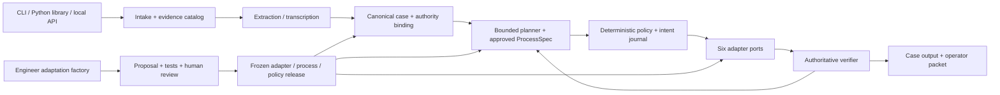

## Context

ProofKey prepares an adaptive development and evaluation harness for an unfamiliar Delivery & Logistics environment. Its runtime autonomously supports rescheduling and permitted goods refusal/return operations. Rejected completed work is registered and handed to an operator; autonomous quality/liability/financial adjudication and financial execution are excluded, not the evidence needed for human review.

The original v2, v2.1 and v2.2 documents and their assessment packets are immutable preparation baselines. This active runtime design incorporates the user's 18 answers and all ten confirmed Drive follow-up choices; the later “да” clarified follow-up 5. Revised 8 October 2026, Europe/London. The engineer is the primary user; priorities are easy integration, rapid adaptation, then reliable resolution. Actual environment permissions and completion semantics remain discovery dependencies. See [decisions](decisions.md), [public research](research.md), [unknowns](discovery.md) and [acceptance](acceptance.md).

**Review status:** the six adapter surfaces and design choices are confirmed. The user approved this revised written design and autonomous detailed planning on 8 October with “да делай автономно”. The [detailed implementation plan](../../../docs/superpowers/plans/2026-10-08-proofkey-runtime.md) is a separate review/execution handoff before product coding. No code, installation, live call or runtime drill is performed by this revision.

**Drive revision, 8 October:** [Drive workflow v3](drive-workflow-v3.md) adds original rescheduling/operator diagrams and a source-linked crosswalk. Confirmed follow-up choices now specify both consent modes, durable stop/phase recovery, facts-only operator help, versioned owner transfer, bounded waiting, record-only internal-case disposition and ProcessSpec-first documentation. [Process views](process-profiles.md) add the goods refusal/return companion and source-linked regression obligations. These are written design artifacts, not implemented ProcessSpec/runtime evidence. Follow-up 5 now confirms authenticated saved-result replay without repeated actions/messages or automatic business-status refresh.

## Goals / Non-Goals

**Goals:** Build a reusable harness and strong competition entry with both approved logistics workflows, six narrow adapters, multimodal evidence, bounded AI planning, durable recovery and verified output. The engineer can discover a connection, propose and test adapter/process changes, obtain human review and release a reproducible profile. Structured-only operation remains available when no text is supplied. Both scripted and interactive clarification are supported.

**Non-Goals:** Distributed services, autonomous liability/refund/coverage adjudication, financial execution, runtime code modification, production certification, publication or submission. Raw-audio processing is in scope; live phone calls, voice synthesis and a graphical dashboard are not required. Native logistics connections and paid API campaigns need separate concrete access/budget approval. Subscriptions do not prove API entitlement. This revision does not execute runtime drills.

## Decisions

### Code location and implementation baseline

Use a clean `runtime/` subtree containing the `proofkey` package, project metadata, tests, public development fixtures, README and LICENSE. This is a source-release boundary within the current repository, not a new nested Git repository. Private `work/` and `outputs/` are not automatically releasable.

The proposed bet is Python 3.11+, Pydantic canonical schemas, typing protocols, SQLite, argparse and unittest. A thin FastAPI loopback service exposes the same pipeline as the Python library and CLI; it is not another workflow engine. Anthropic is the first text/vision/PDF extraction and bounded planning route; ElevenLabs is the first raw-audio transcription route. Both sit behind provider-neutral protocols, with fixture replay and unavailable modes clearly labeled. Package versions, exact model IDs, usable credentials and spend caps require preflight, not copying documentation examples.

Owned new code is Apache-2.0. Preserve dependency notices and distinguish SDK licenses from service, model, data and asset terms. Do not relicense private/raw evidence or third-party archives. Structured local traces are mandatory; OpenTelemetry export is optional. Jev/TypeSafe, hosted Arize, a frontend, additional model backends and orchestration frameworks remain optional experiments.

Preserve `work/adaptive_factory_source_2026-10-06/adaptive-agent-factory/` and `outputs/` as evidence. Do not import the archived simulator or planner into the new operational runtime. Reuse small validation/hash ideas and behavioral invariants with provenance; redesign scope routing, goods contracts, durable intent and resume authentication. The reference's existing synthetic tests are not the new candidate's acceptance receipts.

### Architecture and common entry points

CLI, library and loopback API are the proposed interpretation of “Combination”. They share schemas, gates, journal and export semantics. HTTP access or a local caller is not customer authentication; effect envelopes require authoritative scoped principal binding. Outbound effect ports stay offline initially. Non-loopback deployment, multi-user service and UI require further security design.

### Six integration surfaces, one action discipline

Propose six typed ports. These are six offline connector interfaces and simulated providers, not six connected commercial services. Each provider's operational state is separate from the runtime journal and from evaluator-only expectations. The runtime uses public interfaces; tests may inject faults without making fault labels available to runtime.

| Surface | Minimum public operations | Designated authority and limits |
|---|---|---|
| Case records | `read_case`, `read_principal` | Case/object/customer binding, authenticated request/consent revision and risk records; initially read-only. A free-text CRM note is not policy or proof of identity. |
| Delivery operations | `read_delivery`, `register_goods_refusal`, `register_service_refusal`, `read_refusal` | Object kind, current stage and recorded refusal. No quality, liability, financial or completion adjudication. |
| Scheduling | `list_permitted_slots`, `reschedule`, `read_schedule` | Permitted slots and authoritative schedule. One conditional reschedule effect; listing a slot does not reserve it. |
| Returns | `read_return_policy`, `create_return`, `read_return` | Eligibility, permitted items/quantity/destination and return initiation. No implied collection, physical receipt or refund. |
| Customer messaging | `send_clarification`, `send_status`, `read_message` | Authorized recipient and constrained message kinds. Accepted/sent/delivered are distinct; message content cannot grant business permissions. |
| Operator inbox | `enqueue_handoff`, `read_receipt`, `read_resume`; scoped `transfer_owner`, `read_owner` | Accepted case/owner/packet receipt, versioned ownership and authenticated decisions. Offline transfer stays in this sixth port; native transfer is disabled until its authority/conditional receipt guarantees are evidenced. Receipt is not a decision or final resolution. |

All effects use the same policy gate, immutable intent journal, shared budget and verifier. One adapter cannot call another effect adapter privately, mint a new request generation, reset a budget or perform a compensating write. Policy stays in the core, not in vendor mappings. Only explicitly enabled methods can dispatch, including messages and operator delivery.

The scheduling port is the single authority for the committed schedule in the offline profile. If a future integration requires both slot reservation and delivery-plan mutation, it needs explicitly specified partial states and native recovery evidence before those effects can be enabled; the six-surface design does not pretend those writes form an atomic transaction.

Alternatives considered:

- **Three coarse connectors** (records, logistics, communications): less initial wiring, but hide authority boundaries and make schema changes less local.
- **Workflow-specific gateways:** convenient end-to-end methods, but mix business policy and provider coordination and weaken reusable adaptation contracts.
- **Six narrow ports (recommended):** more explicit contract tests, with clearer authority, permissions, completion and unsupported-capability behavior. Keep this as a modular monolith, not six network services.

### Versioned contracts and connection profiles

A read returns a typed value plus designated authority, object ID, provider revision, provider/observation time and evidence reference. An intent binds case, object, authenticated principal, authorized request generation, operation, policy/consent revisions, expected authoritative revision vector, immutable arguments fingerprint, postcondition and deadline. Transport returns `rejected`, `acknowledged` or `outcome_unknown`; verification separately returns `verified`, `rejected`, `pending`, `outcome_unknown` or `conflict`.

The environment manifest records each enabled operation's authority, permission, acknowledgement meaning, authoritative readback, idempotency scope, conditional-write semantics, timeout, terminal non-execution evidence and provider/account quota/concurrency/rate-limit behavior. Missing evidence is `unknown`, not a favorable default. An unknown mandatory guarantee disables that operation while preserving separately authorized reads, clarification or handoff. Shared backpressure covers all ports using the same account; rate-limit responses cause bounded deferral, not unbounded Retry-After waiting or a fresh retry key. Unknown transport/effect disposition still requires reconciliation. No throughput claim follows from per-case caps.

Retain two public structured profiles: flat JSON and nested envelopes mapped into the same strict canonical contract. A no-text input remains usable with sufficient authenticated structured intent, object binding and authority; missing mandatory facts produce clarification/handoff. Public Onfleet/Bringg/Shippo documentation can inspire identifiers, nested objects, windows and distinct return states. These are documented-pattern simulations, not faithful live adapters or Dwelly tool contracts. Transport success, business acceptance and verified postcondition stay separate.

### Required multimodal evidence and model roles

Required input classes are structured records, free text, supplied transcripts, images/photos, documents and raw audio. Proposed initial formats are UTF-8 TXT/JSON, JPEG/PNG, unencrypted PDF and WAV/MP3; “all” means all agreed classes, not every binary format. Actual support for each format must be tested. Unsupported/encrypted/malformed inputs remain visible, not silently dropped.

The evidence catalog retains original reference, hash, MIME type, source, case/access binding, observation time and transformation lineage. Extracted assertions link to text spans, page/region or audio intervals where the processor supplies them; unknown coordinates are marked unknown. Extraction is an observation, never identity, policy, consent or an instruction to the harness. Original photos/audio/chats remain private and available only to appropriately scoped authorized reviewers alongside extracts, conflicts and missing evidence. Public packages use synthetic or rights-cleared scoped-redacted derivatives with lineage; redaction is not an anonymization certification. No automatic publication or deletion is enabled. Exact retention duration is undecided and needs an explicit policy before native service use; do not invent a TTL or treat omission as indefinite production retention.

AI has all three requested roles: extract evidence/intent, propose bounded runtime tool steps, and help the engineer prepare adapter/process diffs. The policy engine alone permits effect dispatch. Model role, exact provider/model, prompt/version, input hashes, latency, usage and output status are retained. An untrusted photo, PDF, transcript or chat cannot redefine policy, tools or process.

Each input class is reported as intake-only, deterministic-processed, actual-provider-processed, recorded-replay, unavailable or failed. An attached file, canned visual finding or supplied transcript is not proof of image processing or ASR. Raw-audio acceptance needs actual bytes processed by a declared processor; image/PDF acceptance likewise requires real content processing. Replay proves integration behavior only. No paid model work runs in this design revision.

### Approved workflows, clarification and operator decisions

Keep two explicit rescheduling profiles. **Main demo: authorized-window selection**, with earliest-feasible as the proposed deterministic tie-break inside the authenticated customer's window/timezone/constraints. **Second mode: exact-slot confirmation**, requiring a current authenticated confirmation bound to the specific slot/constraints and consent revision. Both require native capacity, lifecycle eligibility, current policy and conditional-write guarantees. Listing a slot does not reserve it. A changed/unavailable exact slot requires applicable fresh confirmation or handoff; the runtime cannot silently switch consent mode to choose another slot. No address change or selection outside consent is inferred. Earliest-feasible is not a native organizer policy.

Goods refusal/return initially covers the whole authoritative order: every item and quantity must be bound and eligible. A partial-item request goes to an operator rather than silently expanding to the whole order. Independent refusal and return effects still apply. Completed-service refusal registers the dispute and hands it off; the harness does not assess workmanship or liability.

Clarification supports scripted rehearsal replies and interactive authenticated replies through the same scoped request/response contract. Persist the question identity, owner/ownership epoch, recipient, request generation, awaited fields, origin phase, next gate, versions, deadline and remaining budget. Scripted replies are labeled simulated; no fabricated customer response. Waiting and expiry are first-class states, not unbounded polling. Operator-supplied facts return to the saved completeness and current authority gates (source A0), never directly to execution (A1/B). Facts are not customer consent; delegated authority needs explicit profile evidence. Missing/stale/wrong-question replies and repeated authentication failures cannot refresh budgets or skip expiry.

The operator packet includes permitted originals, photos/docs/audio/transcripts/chats, source-linked observations, contradictions, unknowns, policy, action history, independent partial states and the precise requested decision. Human dispositions can record refund review, coverage review or a recommendation to open an internal case. **Internal-case disposition is record-only initially; actual creation is deferred/disabled**, distinct from the existing handoff queue. A decision record does not execute money, admit liability or mean the customer was paid. Any resumed logistics action is freshly authorized; a financial disposition cannot add a payment tool.

### Operator ownership and bounded waiting

Human case ownership and the runtime's serial executor ownership are separate records. The operator-inbox port models transfer of the same case/packet using a stable transfer ID, expected current ownership epoch, target scoped owner, packet/case revisions and expiry. A transfer intent and dispatch use the shared gate/journal/budget. Only an authoritative conditional ownership transition plus durable target acceptance and matching readback establish a new epoch; queue acknowledgement or a new queue ID is insufficient. No duplicate handoff case is created by reassignment.

The old owner remains accountable until durable target acceptance is confirmed. Accountability is not permission to act during uncertainty: from the transfer intent through pending/unknown acceptance, fence newly received action-bearing decisions and all undispatched intents derived from earlier decisions from both contenders, then reconcile `read_owner` within the saved bounds. Already-started effects retain possible execution and are reconciled under their original identities. Definite transfer rejection retains the old epoch; verified target acceptance changes the epoch and rejects late old-owner decisions. A local expiry without non-execution proof is still unknown, not rejection. Decision-based dispatch must conditionally protect current material ownership state/revision including pending transfer, not merely the epoch (which may be unchanged while pending). An already-started decision changing case/packet revisions prevents stale transfer acceptance. Local fencing cannot retract an in-flight external effect; native enablement requires evidenced revision/race semantics rather than assuming them. Never rollback/reassign by a fresh key to hide an unknown transfer. Native transfer remains disabled if these guarantees are unknown; offline guarantees are simulated, not production evidence.

Durable waits and policy-defined expiry are first-scope requirements. Automatic reminders are off by default. Expiry cannot auto-pick an owner, repeat a message or create a refund/internal case. A scoped transfer is permitted only under explicit approved profile authority, target, deadline and receipt rules; automatic transfer scheduling is not required. Any future reminder requires authorized recipient, cadence, maximum count, deadline and its own effect ID/receipt. Missing policy values disable the affected automatic effect; no arbitrary cadence, retention duration or unbounded waiting is inferred. Exercise clocks include all waiting.

### Cross-adapter conditional writes

Before every effect, refresh material authorities and check binding, risk, consent, policy and current unresolved intents. Each enabled write must have a provider-side conditional precondition covering every fact whose concurrent change could invalidate it, or an evidenced equivalent such as a documented reservation/version token binding those authorities. Local SQLite locking and a fresh preflight read do not prevent external races.

The offline providers model a version vector and reject stale conditional writes atomically in their simulated operational world. This is an offline contract model, not proof that a future native API provides the same guarantee. If the real API only versions one record and leaves material external preconditions unprotected, disable the affected business write until equivalent evidence exists. Do not loosen the core gate to make the connection look successful.

### Typed routing and authority

The route records request class, object kind and ID, authenticated principal, evidence references, case version and allowed operations. The environment manifest designates authority per fact. Extracted text can supply the requested intent but cannot establish object identity, permissions or policy. Conflicting authoritative facts, stale binding and unknown scope disable business writes. A restricted clarification or operator route has its own permissions and journal.

### Logical request generations and supersession

Persist one authorized request generation before assigning effect IDs. A proposed effect ID is the hash of a canonical tuple `(case_id, object_id, request_generation, operation, stage)`. Persist the argument fingerprint separately; the same effect ID with different arguments is a conflict. Transport retries and duplicate inputs retain the original effect ID, provider key and request fingerprint.

Different input event IDs do not prove a new business request. An authenticated request ID, matching historical consent/request revision and canonical intent bind duplicates to the existing generation. If request identity cannot be established, do not dispatch another business effect. A genuinely new or changed requested business action requires a separate authenticated intent, fresh authorized generation and explicit supersession record where applicable. Consent revocation invalidates dispatch permission; it does not itself create new business intent or convert a duplicate into a new request. An unresolved original effect blocks a conflicting replacement until authoritative reconciliation or an independently safe, separately authorized action is evidenced. An operator decision cannot declare an unknown write non-executed, supply provider idempotency, erase uncertainty or bypass a material dependency. A new key never bypasses an uncertain original write.

For a duplicate matching a completed request, return the saved result only after matching case/object/request generation and immutable intent fingerprint and verifying current scoped permission to disclose it. Historical request/consent identity identifies the stored generation; it is not required to be current business consent for this read-only disclosure. If current access cannot be established or was revoked, withhold case details. A bounded access-authority check is permitted and is not a business-status refresh. The replay preserves the saved result/version, as-of timestamp, per-effect states, unknowns and stop; it is labeled historical, not present truth. It triggers no model processing, business effect, customer message, handoff, automatic business readback/reconciliation or new generation, and never resets execution budgets/deadlines. Ongoing effect recovery is a separately scoped workflow, not an implicit consequence of duplicate receipt. Automatic status refresh is excluded; any future explicit refresh needs its own reviewed bounded read contract.

### Stop disposition and a separate subsequent refusal

Persist authenticated `stop_requested` for the scheduling generation independently of execution state, atomically with local dispatch ineligibility. Stop accepted before dispatch prevents prepared/undispatched business intents from being sent. If transport already began, stop cannot promise cancellation of the external operation: retain its possible execution and reconcile the original ID/key. Readback may show executed, terminal-not-executed, pending or unknown; every result preserves stop. Even verified idempotency or proof of terminal non-execution cannot authorize a resend after stop. Duplicate inputs, operator resume and profile migration cannot revive that stopped generation. Separately authorized bounded reads/status/handoff remain possible but do not inherit permission from the stopped request.

This stop means no further business attempts, **not order cancellation, delivery cancellation or automatic compensation**. Where stop/consent revision is a material provider-side precondition, require an evidenced conditional guarantee; local serialization cannot retract an already in-flight native request or establish external atomicity. A crash after the stop commit restores the stop and remaining reconciliation budget.

A later goods/service refusal is a new explicit authenticated intent with a new generation, fresh object kind, lifecycle, inventory/quantity, policy and consent checks. Keep original scheduling outcome and stop visible; do not interpret cancellation alone as refusal. If the uncertain scheduling effect can invalidate refusal/return prerequisites, block the dependent write until authoritative reconciliation establishes a safe state. A separate request does not reset case budgets or reactivate the old schedule. Refusal registration/return initiation still have independent IDs/readbacks; neither is an undo of the original reschedule.

### Partial outcomes

Goods refusal registration and return creation use separate logical IDs and readbacks. A verified refusal with rejected, pending or unknown return creation remains a partial result; recovery does not register refusal again or roll it back automatically. Physical receipt is a separate observed stage, never implied by a return request. Service refusal registration and operator receipt are also independently verified. Neither permits an adjudication or financial action.

### Durable phase checkpoints and effect recovery

Checkpoint intake, extraction, completeness, authority checks, slot selection/confirmation, clarification, operator waiting, dispatch and verification. Persist phase/next gate, profile/process/policy versions, case/request/consent/evidence revisions, processing status, question/awaited fields, ownership state/revision, stop disposition and budgets. Save a phase transition before its next external effect; effect-intent durability remains required independently. Each extraction/transcription/planner role requires finite profile-defined invocation and usage caps under the shared case/campaign limits. Before each external provider call, durably reserve/debit its invocation and capped usage allowance with invocation identity and processing status; journal failure prevents the call. An interrupted invocation remains consumed/unknown, not completed or free to repeat; any necessary new attempt consumes the remaining authorized budget and is explicitly recorded. Restore the exact phase on restart, invalidate stale observations and rerun current material authority gates before any effect. An execution/reconciliation checkpoint does not restart intake/extraction. A missing or incompatible checkpoint fails closed. No checkpoint is permission to skip authentication. A completed-request duplicate uses the authenticated historical saved-result path, not phase restart or automatic effect recovery.

Select one runtime process, one SQLite owner and serial execution per case. Before a send, commit the immutable intent, fingerprint, case and policy versions, postcondition and key. Commit dispatch_started before entering transport. Fail closed on journal failure. An interrupted dispatch becomes outcome_unknown even if it may have crashed before the actual send. After restart reconcile first. Retry with the same key only under verified provider semantics and fresh authorization; no unsafe unknown retry. Never claim external exactly-once from local deduplication.

A safe resend requires verified provider idempotency or authoritative terminal evidence that the original request did not execute and cannot execute later. It also requires an active, non-stopped authorized generation and all current gates. A negative readback, eventual-consistency 404 or pending request is insufficient. A retry cap is not a safety guarantee.

Counters and active deadlines are persisted. Reusing a logical ID with different arguments is a conflict. Restart never resets budgets. The baseline is explicitly not a distributed journal; SQLite durability settings, storage behavior and fault probes require verification in the selected environment.

### Finite provisional budgets

For calibration use 120 seconds active execution per case, 4 planner calls, 24 total tool calls including readbacks and failures, 6 distinct logical effects with one reserved for handoff, 3 reconciliation reads per intent, at most one contract-safe resend, and 2 clarification requests. A tool call is bounded by 10 seconds or the remaining active budget. Structured-only has zero planner calls. Waiting is persisted with an owner and policy-supplied expiry; an unknown expiry never authorizes unbounded polling. Live provider spend stays zero until a separately approved campaign. Calibrate on validation and freeze before holdout.

### Reviewed process adaptation and isolation

Use a versioned `ProcessSpec`: a finite allowed-operation graph with prerequisites, approval/wait states, acknowledgement interpretation, authoritative readback and completion conditions. Keep process, schema mapping and business policy separate. AI/coding agents propose a diff, source basis, new/changed tests, migration impact and candidate release. Human approval is required before activating any adapter, process or policy change. Runtime can replan inside the approved graph, not rewrite it or change permissions.

The human-reviewed ProcessSpec and its contract tests are canonical. Draw.io/Figma/Mermaid views are versioned explanatory projections, not activation paths. Preserve imported originals unchanged and identify the source/release version behind derived views; a diagram discrepancy is a documentation defect, not permission to change behavior. Native diagram synchronization/integration is out of the first scope. The current Markdown views are design-only until a runtime schema, executable profiles and test receipts exist.

The lead adaptation packet changes acknowledgement/readback meaning AND process, with schema/no-text changes as additional coverage. Examples include an HTTP-success/business-rejection envelope and an extra readiness read or permitted approval-wait before a write. New approval roles/permissions require authority evidence; a process change cannot grant them. Unfinished intents retain their original process/policy versions, keys, fingerprints and postconditions until reconciliation or an explicit compatible migration; a release cannot reinterpret pending effects as success.

Measure from packet release through discovery, proposal, regression, human review and reproducible candidate release. Record queues, human interventions, changes and regressions. Four separate 600-second exercises are specified in [acceptance](acceptance.md): adaptation, declared positive batch, declared crash-recovery set and unsafe-rejection batch. These are user targets, not passed measurements. The frozen v2.2 90-minute preparation drill remains historical, not retroactively rewritten. The official 30-minute unseen batch is separate; ten minutes per unseen case is not assumed.

LLM-proposed labels carry judge/model identity, evidence basis, ambiguity, version and provisional status. Agreement is not gold truth or calibration. Prepare an unsent team revalidation pack; reviewed labels retain reviewer disposition and history. Deterministic effect invariants remain independent of model labels. Public feedback makes its source family validation data; a new frozen holdout checks the candidate when custody and isolation exist.

Runtime and evaluator require different enforced sandbox identities, restricted mounts, environment and endpoints; two folders or two processes under a shared accessible identity are insufficient. Public business policy remains accessible. Hidden labels, fault flags, grading functions and privileged world state are not. Files, inherited handles, credentials, debug endpoints, error responses and canary leakage are probed before readiness.

A human custodian who does not tune from hidden cases is required for a protected holdout. The user and coding agents can implement and rehearse now; their shared context/access does not establish independent custody. If separation is impossible, label the set rehearsal, not holdout. Do not invent an extra team member or treat agents as registered human entrants.

### Generated output and bounded batch

Implement an exporter for every supplied case ID under `ANSWERS/<case>/ANSWER.md` and `REASONING.md`. Include verified per-effect outcomes, partial/pending/unknown states, policy/evidence references, action IDs and handoff receipt state. Rationale is concise and auditable, not hidden chain-of-thought. Retain failed/no-output cases without human correction; use safe filesystem handling so a case ID cannot escape the output root or collide silently with another ID.

Use the supplied Guide's 30-minute unseen window as a whole-batch rehearsal target, not an official case-count assumption or already measured capacity. Persist partial progress, share the global deadline, measure an export reserve and test multiple provisional workload sizes. One process may interleave independent cases while serializing effects within each case; do not introduce distributed workers. The first offline batch may be serial as long as its limitation and unfinished cases are recorded.

## Implementation sequence and review gates

`tasks.md` is the OpenSpec work breakdown, not a substitute for the detailed Superpowers implementation plan. Current development resources are the user and coding agents; actual event human roles/availability and registrations remain unconfirmed. Estimates below are additive person-hours, not agent wall-clock forecasts, measurements or deadline commitments.

| Stage | Accountable role | Initial effort | Exit evidence |
|---|---|---:|---|
| A: contracts and plan | User + design/review agents | 2–4 h | Approved design, reviewed detailed plan, examples and execution mode |
| B: foundational contracts, six adapters and profiles | Adapter owner | 9–14 h | Initial ProcessSpec/schema, six-port contracts including scoped owner transfer, profile parity, unknown cases |
| C: journal, process enforcement and both workflows | Core owner | 14–22 h | Phase/stop checkpoints, durable IDs/budgets, dual consent profiles, independent effects and recovery receipts |
| D: common interfaces and clarification | Interface owner | 6–10 h | CLI/library/API parity, authenticated waits/replies and operator boundary |
| E: modalities and model roles | Evidence/model owner | 12–20 h | Required-class processing receipts, bounded planning, explicit replay/unavailable status |
| F: process adaptation factory | Adaptation owner + human reviewer | 6–10 h | Reviewed schema/semantics/process diff, regressions and compatible release |
| G: acceptance, label pack and release | Review/eval owner | 10–14 h | Source-linked regressions, four timed drills, complete output, label and isolation status |
| Total | Scheduling decision | 59–94 h | Unmeasured rebaseline (+5–8 h); not an event completion promise |

Delta from 54–86: adapter ownership contract +1–2 h, core phase/stop/consent controls +2–4 h, regression allocation +2 h. Diagram synchronization, automatic reminders, actual internal-case creation and automatic completed-case status refresh are excluded. Saved-result replay is covered by existing core/output work; no new measured estimate follows from confirmation. These ranges are planning judgments without measured task-time receipts.

Initial ProcessSpec schemas/examples include consent mode, durable phases/stop, facts-only operator re-entry, owner epochs/transfer and refusal/return companion; freeze these before parallel consumers. C enforces that baseline graph before model-backed effect planning. B adapters and C journal work can then run in parallel. D/E can begin on contracts, but end-to-end claims wait for C. F changes/releases an existing reproducible process; it does not introduce the first ProcessSpec after its consumers. G needs a frozen candidate and the source-linked regression obligations in process-profiles.md. Map files to agent owners and human review checkpoints in the detailed plan. Event commitment also needs real team capacity/eligibility. If time is insufficient, remove optional UI, voice calls, extra backends/formats and hosted observability first. A staged release may honestly leave required media or workflows unfinished; it cannot silently drop them and claim the agreed design complete.

The first deterministic baseline uses all six offline surfaces, both positive workflows, partial/unknown recovery, clarification, service-refusal and unsupported-scope handoff, plus generated output. The complete agreed candidate adds all input classes, model roles, interfaces and reviewed process adaptation. Development/rehearsal fixtures and API connectivity alone are not production, protected holdout, calibrated correctness or six live connections.

## Migration and release boundaries

Create the new package only after the design/plan handoff. Keep reference source and all prior deliverables immutable; selectively port helpers with attribution rather than silently replacing the reference. New local demo outputs go in a new run directory and never overwrite the frozen judge or event evidence.

Do not auto-upgrade SQLite schemas or reinterpret unfinished intents. A future migration must preserve fingerprints, keys, counters and unresolved-effect state, and fail closed if its semantics are unavailable. Rollback selects a compatible candidate and journal schema; it never replays uncertain effects to recover apparent progress.

Before a live connection, record native authority/permissions, conditional-write/readback semantics, operator identity and provider terms. Before competition submission, clarify prebuilt eligibility and freeze timing, prepare a clean releasable repository and separately authorize publication/submission. Before runtime readiness claims, verify enforced oracle isolation, custody, timed batch and accepted external output. An offline milestone can remain explicitly incomplete on these live/assessment gates.

## Open questions

- The user's choices are captured in [decisions](decisions.md). Revised written-design approval is recorded; review/execution handoff of the newly written detailed plan remains outstanding.
- What exact waiting expiry/transfer limits and evidence retention duration apply? Automatic reminders and native diagram synchronization are off; missing policy cannot be filled by guesswork.
- Which event team registrations, review availability and dated go/no-go checkpoints are confirmed? Local coding can use the user and agents without waiting for five human developers.
- Which native tools, fact authorities, retry/version guarantees and completion/handoff semantics will the organizers expose?
- Are these specific pre-event materials eligible, and which freeze clause governs? Retain the supplied Guide and conservative procedure until clarified.
- What enforced sandbox identities/storage mechanism will support oracle isolation? Until verified, new fixture runs are rehearsal rather than protected evaluation.
- Which exact provider/model routes are usable with API entitlement, privacy permissions and a capped campaign? Available subscriptions are resources, not access/spend receipts.

## Risks / Trade-offs

- Native API may not support refusal records, safe retries or authoritative readback. Disable the unsupported effect and expose pending/operator outcomes; do not invent semantics.
- Conservative routing can lower autonomous coverage. Positive controls for both workflows and unnecessary-handoff reporting expose this trade-off.
- A single SQLite executor is simple but limits throughput and does not solve host/storage failures by declaration.
- One adaptation drill or a small holdout is mechanism evidence, not a general speed or accuracy claim.
- Sixty-second pitch explains the product; a separate trace demonstrates evidence. Optional UI/live calls/extra backends are cut before safety, either workflow or required input-class disclosure.
