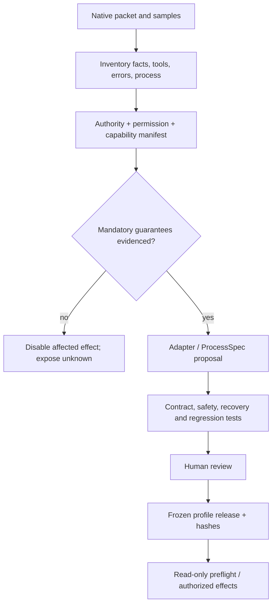

# Native discovery and unknowns register

Status: design-only, revised 8 October 2026, Europe/London. Public websites are useful patterns; none grants event or customer authority. Unknowns are explicit connection states, not defects to conceal. An unsupported effect may leave independently authorized reads, clarification and handoff available.

| Unknown | Required evidence / exit condition | Preparation now | Owner / boundary |
|---|---|---|---|
| Native tools, versions and samples | Actual tool inventory, request/response/error samples and versioned contract | Strict canonical schemas, six ports, documented-pattern simulators | Integrator; no claimed vendor connection |
| Fact authority and principal | Designated case/object/consent/risk/policy sources; authenticated scope and revision | Per-fact authority manifest and spoof/conflict fixtures | Integrator + organizer/native custodian |
| Slot eligibility/capacity | Native lifecycle/window/timezone rules and conditional capacity commitment | Earliest-feasible permitted-window profile; forbidden-stage cases | Unknown guarantee disables reschedule |
| Whole-order return eligibility | All item/quantity binding, stage, destination and permitted refusal/return operations | Whole-order inventory fixtures and partial-item handoff | Unknown policy disables return creation |
| Conditional effects | Server-side protection for all material preconditions or evidenced equivalent | Simulated revision-vector race tests | Local lock/fresh read is not external atomicity |
| Retry and readback | Idempotency scope, terminal non-execution proof, pending/timeout semantics and authoritative postconditions | HTTP-success/business-failure and eventual-read fixtures | No general exactly-once claim |
| Shared quotas/rate limits | Provider/account limits shared across ports, concurrency and 429/Retry-After effect disposition | Shared backpressure, bounded deferral within persisted deadlines and native contract tests | Per-case budgets are not provider quota; unknown effect disposition is reconciled, never blindly retried |
| Process changes | Current approved operation graph, prerequisites, owner/wait rules and process version | Versioned ProcessSpec and semantic/process adaptation packets | Proposed changes require tests + human approval |
| Evidence access / retention | Content retrieval rights, formats/limits, private artifact scope, retention and deletion policy | Hash/provenance catalog and public synthetic assets | No private provider upload merely because a reference exists |
| Model routes and cost | API entitlement, exact provider/model identity, secret handling, privacy permission, bounded campaign budget | Protocols, stub/replay routes and readiness ledger | Subscriptions alone are insufficient; no new spend now |
| Clarification timing/auth | Authorized recipient, reply binding, expiry, native send/receipt semantics | Scripted and interactive wait contract | Scripted responses are simulated; no guaranteed person availability |
| Operator decisions | Durable owner/packet receipt, authenticated scoped decision, expiry/replay rules and internal-case receipt | Evidence-rich packet, financial-disposition records, strict resume tests | No refund/coverage execution; inbox acceptance is not final resolution |
| Labels / evaluation | Team-reviewed expected facts, ambiguity dispositions, grader repeatability and sensitivity evidence | Provisional LLM label schema and unsent review pack | LLM agreement is not truth/calibration |
| Isolation / custody | Enforced distinct identities/mounts/tool/network boundaries, canary probes and independent human custodian | Threat model and rehearsal fixtures | Until verified, rehearsal rather than protected holdout |
| Official workload | Case count, modalities, concurrency, native timeouts, expected output/completion | Freeze declared rehearsal workloads; measured export reserve | No throughput promise before timing |
| Event rules / eligibility | Organizer answer for prebuilt scope, 16:30/17:00 freeze conflict, team registrations, rights | Conservative freeze procedure, release manifest, unsent questions | Local preparation can continue; submission gate remains unresolved |

## Connection enablement procedure

Human approval cannot substitute for a missing native guarantee. A new provider may implement several ports; six ports do not require six vendors. Access credentials are never public fixture data.

## Draft organizer questions — unsent

1. Which pre-event harness code, prompts, prepared profiles and synthetic fixtures are eligible?
2. Does the source/config/prompt/process/demo freeze apply at 16:30, with only generated unseen outputs allowed until 17:00?
3. Which Delivery & Logistics tool contracts, fact authorities, process rules and media capabilities will be supplied?
4. What independently verified state constitutes reschedule, refusal, return initiation and operator handoff completion?
5. What workload, execution/network boundaries and output validation apply to the unseen batch?

These are prepared questions, not messages sent to organizers. No answer is assumed.
