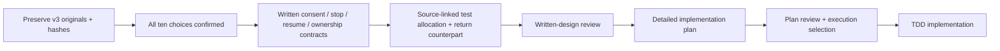

# Drive workflow v3 — source integration and design implications

Imported 8 October 2026, Europe/London, from the [user-supplied folder](https://drive.google.com/drive/folders/1MPwvVnAIhDVEcQ8V-iAy63pjPKC4M_Pa). Status: source incorporated and all ten confirmed follow-up choices reconciled in the written design; the later “да” closes follow-up 5. This does not approve the whole written design or an unseen implementation plan, or replace the user's existing 18 decisions.

## Source package and provenance

All seven returned stored files were fetched through connected Drive and copied unchanged into a private local evidence directory. Byte counts match the listing; SHA-256 hashes are retained in the [capture manifest](</Users/nbk/Documents/Pitch project/work/drive-import-2026-10-08-unjbzp/manifest.json>). No Drive originals, sharing settings or external account configuration were changed.

| Original | Local original | Read / verification status |
|---|---|---|
| START-HERE.txt | [Source notes](</Users/nbk/Documents/Pitch project/work/drive-import-2026-10-08-unjbzp/START-HERE.txt>) | Fully read. Source describes an emulated discussion design and three unresolved logic issues; configuration/installation statements are unverified source claims, not commands executed here. |
| Dwelly-Delivery-Workflow-v3.drawio | [Editable source](</Users/nbk/Documents/Pitch project/work/drive-import-2026-10-08-unjbzp/Dwelly-Delivery-Workflow-v3.drawio>) | XML parsed; all process labels, branch labels and endpoints inspected. Native editing/rendering not tested. |
| 00 — Легенда.png | [Legend preview](</Users/nbk/Documents/Pitch project/work/drive-import-2026-10-08-unjbzp/00 — Легенда.png>) | Visually inspected source preview, not a native Draw.io screenshot. |
| A — Запрос и согласование.png | [Request and agreement](</Users/nbk/Documents/Pitch project/work/drive-import-2026-10-08-unjbzp/A — Запрос и согласование.png>) | Visually inspected; XML supplies the precise labels where the tall preview is small. |
| B — Выполнение и проверка.png | [Execution and verification](</Users/nbk/Documents/Pitch project/work/drive-import-2026-10-08-unjbzp/B — Выполнение и проверка.png>) | Visually inspected, with XML readback. |
| C — Работа оператора.png | [Operator workflow](</Users/nbk/Documents/Pitch project/work/drive-import-2026-10-08-unjbzp/C — Работа оператора.png>) | Visually inspected; dense lower branches, not declared presentation-ready. |
| Figma — Dwelly Workflow.url | [Original shortcut](</Users/nbk/Documents/Pitch project/work/drive-import-2026-10-08-unjbzp/Figma — Dwelly Workflow.url>) | Read as a pointer only. Figma board/content/access and its stated readiness are not verified. |

The package is a team-provided design source, not evidence of an official Dwelly process/API or a working runtime. Source notes contain a corporate account identifier; the original stays private, and that identifier is omitted from this summary. A [redacted review copy](</Users/nbk/Documents/Pitch project/work/drive-import-2026-10-08-unjbzp/START-HERE.redacted.txt>) replaces that one account field, with [hash lineage](</Users/nbk/Documents/Pitch project/work/drive-import-2026-10-08-unjbzp/redaction.json>); this is scoped redaction, not anonymization certification. Do not copy raw originals into Apache/public/demo packages without rights and scoped redaction. Prior frozen v2.2 evidence and ZIP remain untouched.

## Structural verification

| Page | Process vertices | Transition edges | Dangling local endpoints |
|---|---:|---:|---:|
| A: request and agreement | 23 | 36 | 0 |
| B: execution and verification | 23 | 32 | 0 |
| C: operator workflow | 19 | 22 | 0 |
| Total process | 65 | 90 | 0 |

Counting rule: process vertices exclude page titles/subtitles and separate `<edge-id>-label` vertices; the fourth legend page is excluded. Labels are stored separately from many edges. The [authored graph inspection](</Users/nbk/Documents/Pitch project/work/drive-import-2026-10-08-unjbzp/graph-inspection.json>) joins the observed label convention for review; it is not an executable ProcessSpec. Cross-page chevrons are descriptive references, not XML edges proven correct by the local endpoint check. Counts and valid XML do not establish complete logic or native editability.

## What the source contributes

The three-page flow makes human / agent / deterministic-program roles explicit, handles structured and free-text intake, records waiting questions, verifies every scheduling call outcome and distinguishes queue pending from waiting for an operator. B's verified terminal state explicitly says the delivery itself is not yet performed. Those distinctions fit our shared gate/journal/verifier architecture.

The diagram is a **rescheduling example**. It does not supply the goods refusal/return counterpart, multimodal processor path, six-port capability map or engineer adaptation loop. Those remain required by the existing design, not removed by importing this source.

## Source crosswalk and confirmed design consequences

| Source location | Observed issue / useful pattern | Consequence for a revised profile / tests |
|---|---|---|
| A `2:196`, `2:199` | Human confirms the exact slot; prior approved choice permits agent selection within an authenticated window. | D1: retain both modes; window mode leads the demo, exact-slot cannot silently broaden consent. |
| C `5:329` → `5:332` via `5:432`/`5:416`; B `4:310` → retry path | Stop/cancel disposition can disappear when an unknown write is reconciled as non-executed. Source notes flag this as unfixed. | D2: persist stop independently of outcome; no resend/undo. A later refusal is a separate authenticated generation with material dependency checks. |
| Early A clarification/auth failure → C; C `5:424` → `5:338` (A1) | Operator-supplied data can return after completeness/authentication gates. Source notes flag early re-entry as unfixed. | D3: restore origin/missing fields and pass completeness/current authority checks; facts are not customer consent. |
| B0 `4:163` saved-state switch | No explicit checkpoint route for intake/extraction/completeness/authentication before confirmation. | D4: persist/resume exact phase, next gate, question, processing status, versions and budgets; never jump directly to execution. |
| B verified result `4:187`, `4:193`; B0 `4:163` | Saved terminal success has no explicit replay branch. Source notes distinguish this from restoring unfinished steps. | D5 confirmed: historical saved-result replay after exact request/current disclosure-access checks; no repeated actions/messages or automatic business-status refresh/new request. |
| C2 `5:308` → `5:317`, edge `5:368` | “Case ID exists” may be read as sufficient handoff acceptance. | Existing canonical contract remains stronger: case + packet identity/version + durable owner receipt, not queue acknowledgement alone. |
| C `5:341`, `5:353` | Owner transfer is named, but ownership generation, stale decisions and in-flight acceptance are unspecified. | D6: same case/packet, stable transfer/epoch, durable target acceptance; old owner accountable, pending/unknown actions fenced, stale decisions rejected. Within sixth port. |
| C `5:323`, `5:404` | Waiting/reminders/expiry appear without exact limits or effect permissions. | D7: durable waits/expiry first; automatic reminders off. Transfer needs bounded authority/receipt rules. Exact policy values remain unknown. |
| Existing design's internal-case disposition | Source C has a case queue but no distinct internal-case creation contract. | D8: record-only initially; real internal-case creation deferred/disabled. Case-record port remains read-only. |
| Source notes / all artifacts | Private originals, derivative previews and a Figma pointer have different access/readiness. | D9: scoped private originals and synthetic/redacted public derivatives, no auto-publication/deletion. Exact retention duration remains unknown. |
| Draw.io / Figma versus ProcessSpec | Multiple editable views can drift; notes acknowledge incomplete Figma routes. | D10: reviewed ProcessSpec/tests canonical; native diagram sync excluded now, six logistics ports unchanged. |

No original diagram route was repaired. Confirmed missing stop/checkpoint/ownership and completed-result replay routes are now specified in design/spec deltas and [process views/regression obligations](process-profiles.md), not implemented. The source cannot be activated unchanged as a runtime profile.

## Revised planning delta — written review candidate

1. Retain this capture and crosswalk without changing past artifacts or confirmed platform scope.
2. All ten choices are recorded; [follow-up 5](follow-up-questions.md) confirms historical saved-result replay. Its exact request/access/as-of/no-action fixtures remain to implement/freeze.
3. Written ProcessSpec/safety requirements now cover consent modes, stop, pre-effect recovery, facts-only re-entry and scoped owner transfer. The goods refusal/return companion retains independent initiation/receipt/financial boundaries.
4. R01–R15 allocate planned source-linked positive/unsafe/unknown regression obligations. Both autonomous workflow families and existing timed denominators remain required; these are not executed tests.
5. Retain the **59–94 additive person-hour** unmeasured rebaseline from 54–86: adapter ownership contracts +1–2 h, core phase/stop controls +2–4 h, regressions +2 h. Automatic reminders, real internal-case creation, native diagram sync and automatic completed-case status refresh excluded. Saved-result replay fits existing core/output work; confirmation is not a timing receipt or event promise.
6. Review this written design, then prepare/review the detailed Superpowers implementation plan and select execution. Native API, bounded policy values, retention duration, provider budget, event eligibility and protected-evaluation gates remain separate.

The four 600-second targets remain targets, not new timing receipts. No model campaign, runtime execution, native diagram edit, external message or public release was performed.
