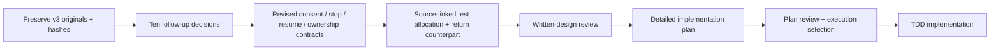

# Drive workflow v3 — source integration and design implications

Imported 8 October 2026, Europe/London, from the [user-supplied folder](https://drive.google.com/drive/folders/1MPwvVnAIhDVEcQ8V-iAy63pjPKC4M_Pa). Status: source incorporated; ten follow-up decisions pending. This does not approve a new implementation plan or replace the user's existing 18 decisions.

## Source package and provenance

All seven returned stored files were fetched through connected Drive and copied unchanged into a private local evidence directory. Byte counts match the listing; SHA-256 hashes are retained in the [capture manifest](</Users/nbk/Documents/Pitch project/work/drive-import-2026-10-08-unjbzp/manifest.json>). No Drive originals, sharing settings or external account configuration were changed.

| Original | Local original | Read / verification status |
|---|---|---|
| START-HERE.txt | [Source notes](</Users/nbk/Documents/Pitch project/work/drive-import-2026-10-08-unjbzp/START-HERE.txt>) | Fully read. Source describes an emulated discussion design and three unresolved logic issues; configuration/installation statements are unverified source claims, not commands executed here. |
| Dwelly-Delivery-Workflow-v3.drawio | [Editable source](</Users/nbk/Documents/Pitch project/work/drive-import-2026-10-08-unjbzp/Dwelly-Delivery-Workflow-v3.drawio>) | XML parsed; all process labels, branch labels and endpoints inspected. Native editing/rendering not tested. |
| 00 — Легенда.png | [Legend preview](</Users/nbk/Documents/Pitch project/work/drive-import-2026-10-08-unjbzp/00 — Легенда.png>) | Visually inspected source preview, not a native Draw.io screenshot. |
| A — Запрос и согласование.png | [Request and agreement](</Users/nbk/Documents/Pitch project/work/drive-import-2026-10-08-unjbzp/A — Запрос и согласование.png>) | Visually inspected; XML supplies the precise labels where the tall preview is small. |
| B — Выполнение и проверка.png | [Execution and verification](</Users/nbk/Documents/Pitch project/work/drive-import-2026-10-08-unjbzp/B — Выполнение и проверка.png>) | Visually inspected, with XML readback. |
| C — Работа оператора.png | [Operator workflow](</Users/nbk/Documents/Pitch project/work/drive-import-2026-10-08-unjbzp/C — Работа оператора.png>) | Visually inspected; dense lower branches, not declared presentation-ready. |
| Figma — Dwelly Workflow.url | [Original shortcut](</Users/nbk/Documents/Pitch project/work/drive-import-2026-10-08-unjbzp/Figma — Dwelly Workflow.url>) | Read as a pointer only. Figma board/content/access and its stated readiness are not verified. |

The package is a team-provided design source, not evidence of an official Dwelly process/API or a working runtime. Source notes contain a corporate account identifier; the original stays private, and that identifier is omitted from this summary. A [redacted review copy](</Users/nbk/Documents/Pitch project/work/drive-import-2026-10-08-unjbzp/START-HERE.redacted.txt>) replaces that one account field, with [hash lineage](</Users/nbk/Documents/Pitch project/work/drive-import-2026-10-08-unjbzp/redaction.json>); this is scoped redaction, not anonymization certification. Do not copy raw originals into Apache/public/demo packages without rights and scoped redaction. Prior frozen v2.2 evidence and ZIP remain untouched.

## Structural verification

| Page | Process vertices | Transition edges | Dangling local endpoints |
|---|---:|---:|---:|
| A: request and agreement | 23 | 36 | 0 |
| B: execution and verification | 23 | 32 | 0 |
| C: operator workflow | 19 | 22 | 0 |
| Total process | 65 | 90 | 0 |

Counting rule: process vertices exclude page titles/subtitles and separate `<edge-id>-label` vertices; the fourth legend page is excluded. Labels are stored separately from many edges. The [authored graph inspection](</Users/nbk/Documents/Pitch project/work/drive-import-2026-10-08-unjbzp/graph-inspection.json>) joins the observed label convention for review; it is not an executable ProcessSpec. Cross-page chevrons are descriptive references, not XML edges proven correct by the local endpoint check. Counts and valid XML do not establish complete logic or native editability.

## What the source contributes

The three-page flow makes human / agent / deterministic-program roles explicit, handles structured and free-text intake, records waiting questions, verifies every scheduling call outcome and distinguishes queue pending from waiting for an operator. B's verified terminal state explicitly says the delivery itself is not yet performed. Those distinctions fit our shared gate/journal/verifier architecture.

The diagram is a **rescheduling example**. It does not supply the goods refusal/return counterpart, multimodal processor path, six-port capability map or engineer adaptation loop. Those remain required by the existing design, not removed by importing this source.

## Crosswalk and unresolved issues

| Source location | Observed issue / useful pattern | Consequence for a revised profile / tests |
|---|---|---|
| A `2:196`, `2:199` | Human confirms the exact slot; current approved choice allows agent selection within an authenticated window. | Declare exact-slot and authorized-window consent modes explicitly; do not silently revoke the prior decision. Question 1. |
| C `5:329` → `5:332` via `5:432`/`5:416`; B `4:310` → retry path | Stop/cancel disposition can disappear when an unknown write is reconciled as non-executed. Source notes flag this as unfixed. | Persist no-further-write intent independently of outcome; reconciliation is not consent to retry or undo. Question 2. |
| Early A clarification/auth failure → C; C `5:424` → `5:338` (A1) | Operator-supplied data can return after completeness/authentication gates. Source notes flag early re-entry as unfixed. | Restore origin/missing fields and pass A0/current authority checks before effects; operator notes cannot manufacture customer authority. Question 3. |
| B0 `4:163` saved-state switch | No explicit checkpoint route for intake/extraction/completeness/authentication before confirmation. | Persist pre-effect phase, next gate, awaited question and versions; never resume every existing request at execution. Question 4. |
| B verified result `4:187`, `4:193`; B0 `4:163` | Saved terminal success has no explicit replay branch. Source notes distinguish this from restoring unfinished steps. | Authenticated duplicate replay returns the retained outcome/evidence without repeating effects or messages; current-status read is separate. Question 5. |
| C2 `5:308` → `5:317`, edge `5:368` | “Case ID exists” may be read as sufficient handoff acceptance. | Existing canonical contract remains stronger: case + packet identity/version + durable owner receipt, not queue acknowledgement alone. |
| C `5:341`, `5:353` | Owner transfer is named, but ownership generation, stale decisions and in-flight acceptance are unspecified. | Define versioned transfer and accepted new owner; old-owner decisions must not race a new accepted ownership epoch. Question 6. |
| C `5:323`, `5:404` | Waiting/reminders/expiry appear without exact limits or effect permissions. | Scoped recipient, cadence, maximum reminder effects, deadline and safe expiry; include waiting in clock. Question 7. |
| Existing design's internal-case disposition | Source C has a case queue but no distinct internal-case creation contract. | Distinguish recording a decision from a new scoped creation effect; initial case-record port remains read-only absent a reviewed change. Question 8. |
| Source notes / all artifacts | Private originals, derivative previews and a Figma pointer have different access/readiness. | Define original-evidence access/retention; exclude from automatic public release. Question 9. |
| Draw.io / Figma versus ProcessSpec | Multiple editable views can drift; notes acknowledge incomplete Figma routes. | Choose canonical reviewed process artifact and versioned derived views; do not assume native synchronization. Question 10. |

No original diagram route was repaired during this import. Missing explicit stop/checkpoint/terminal/ownership requirements are recorded for the next reviewed design; the source cannot be activated unchanged as a runtime profile.

## Proposed planning delta — awaiting the ten answers

1. Retain this capture and crosswalk without changing past artifacts or confirmed platform scope.
2. Resolve [ten follow-up questions](follow-up-questions.md); recommendations there are proposals, not user answers.
3. Revise ProcessSpec/safety requirements for the missing routes and operator semantics. Add a goods refusal/return companion using independent initiation/receipt/financial boundaries. Do not present the rescheduling diagram as coverage of returns.
4. Allocate positive, cancel-during-unknown, early-operator, pre-confirmation-crash, terminal-duplicate, ownership-race and reminder-budget tests. Preserve both main positive workflows and complete timed denominators.
5. Revisit workload and the unmeasured 54–86 person-hour estimate after deciding whether reminders, reassignment, actual internal-case creation and native diagram synchronization are required now. Do not hide expanded scope inside the old estimate.
6. Review the revised written design, then write/review the detailed Superpowers implementation plan. Native API, provider budget, event eligibility and protected-evaluation gates remain separate.

The four 600-second targets remain targets, not new timing receipts. No model campaign, runtime execution, diagram edit, external message or public release was performed.
