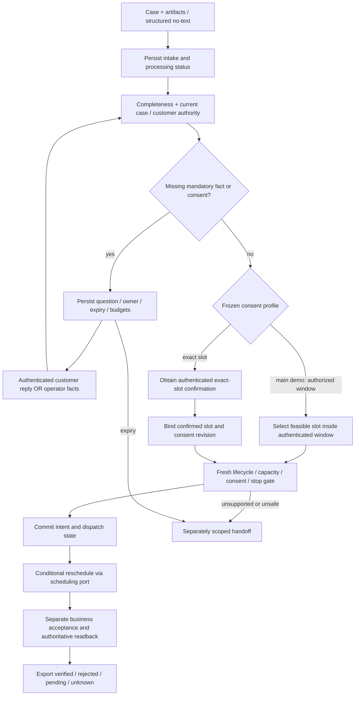
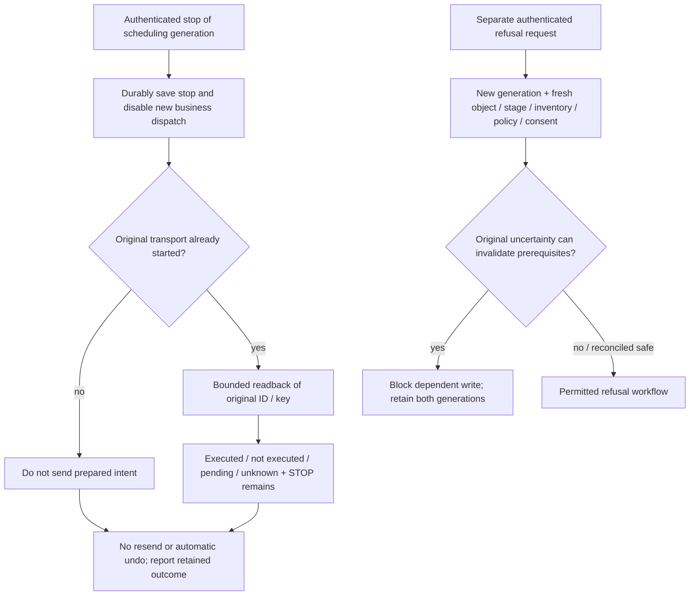
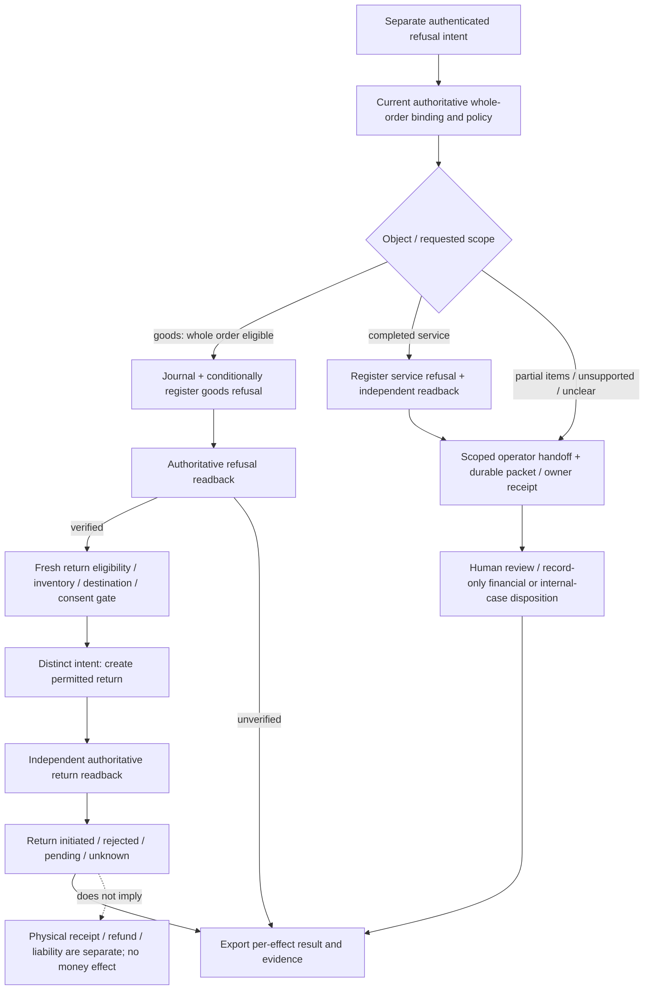
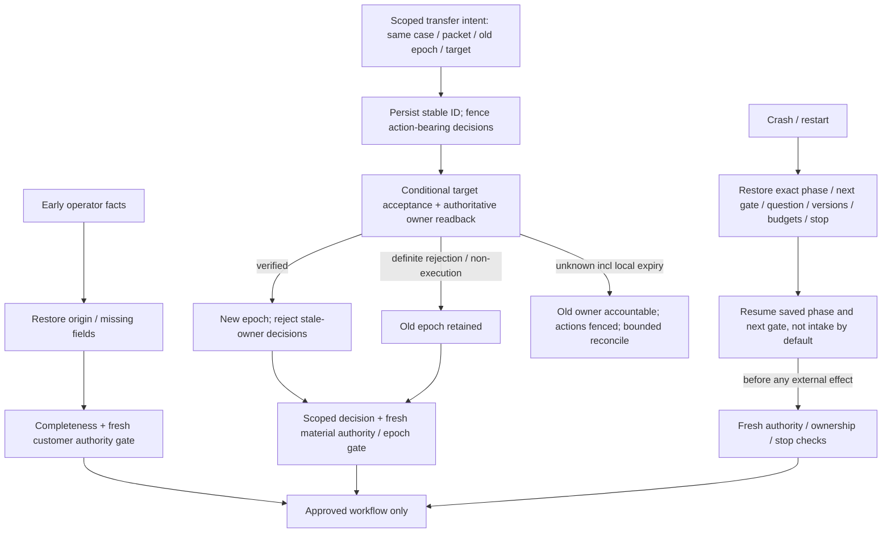

# Process profiles and source-linked regression obligations

Design revision: 8 October 2026, Europe/London. These are explanatory projections of the proposed contracts, **not executable ProcessSpec, repaired native diagrams or test results**. Reviewed runtime ProcessSpec + contract tests will be canonical; released views must identify their profile/process release hash. Imported v3 originals remain unchanged. Follow-up 5 (completed-duplicate response) is unresolved and deliberately has no approved replay/refresh branch here.

## 1. Rescheduling — main demo first, two consent profiles

Window mode can use the proposed earliest-feasible tie-break. Exact-slot mode cannot substitute another slot without applicable fresh confirmation. A slot listing is not reservation. Every wait and external effect uses saved budgets, identity and its applicable gate; no displayed edge overrides those requirements.

## 2. Stop is not undo; refusal is a separate request

No automatic edge from stop to refusal: the customer must supply the new request. New generation does not reset case budgets, clear original uncertainty or revive scheduling. Provider idempotency/non-execution proof alone does not override stop. Already-started native transport cannot be declared cancelled by a local flag.

## 3. Goods refusal / return companion and service refusal

This first profile sequences return initiation after verified refusal; transport acknowledgement alone cannot satisfy that prerequisite. Verified refusal survives a failed/unknown return. A future independent return-only process would need separate reviewed scope. Whole-order means every authoritative item and quantity, not a model's inferred inventory. Internal-case disposition is a record, not actual creation or a duplicate handoff queue case.

## 4. Operator facts, ownership transfer and recovery

Old-owner accountability and executor ownership are different. Pending transfer fences new action-bearing decisions and earlier prepared/undispatched decision intents; already-started effects remain possibly executed and must be reconciled. Decision-based dispatch must conditionally protect material ownership state/revision including pending transfer; an unchanged epoch or fresh local read is insufficient. A stale packet/ownership revision blocks transfer acceptance. No duplicate case, renewed budget or automatic ownership change follows from expiry. Ownership never grants unrestricted access to raw evidence. Reminders are disabled initially; enabled transfer needs bounded, reviewed profile rules. Missing wait/transfer expiry values disable the unsupported path, not the entire separately authorized read-only case view.

## 5. Required untimed regressions before the timed candidate freezes

These are **planned obligations**, not existing fixtures/test passes. The detailed implementation plan must assign exact test files/inputs/hashes and independent failure drivers. Source node IDs refer to the preserved XML inspected in drive-workflow-v3.md. Related variants remain one source family for split/contamination reporting; LLM-proposed labels remain provisional.

| ID | Driver / source | Required observable result | Owner / dependency |
|---|---|---|---|
| R01 | Dual consent; A `2:196`, `2:199` | Window positive + exact-slot positive; unavailable exact slot never broadens mode | Core; consent/profile contracts |
| R02 | Stop before send; C `5:329`, `5:332` | Prepared intent never dispatches; crash restores stop | Core; checkpoint/journal |
| R03 | Stop during unknown; B `4:310` retry route | Executed, terminal non-execution and still-unknown readbacks all preserve no-resend; stop survives idempotency | Core + adapters; readback fixtures |
| R04 | Duplicate stop / old input / migration | No stopped-generation revival; original keys/outcome and case budgets retained | Core + adaptation |
| R05 | Refusal as separate next request | Fresh generation/consent and current stage/inventory; dependent uncertainty blocks; refusal and return remain independent | Core; R02–R04 + return policy |
| R06 | Early operator → A1 source bug; C `5:424`, `5:338` | Facts return through completeness/current auth; missing customer scope prevents effects | Interfaces + core |
| R07 | Pre-confirmation checkpoint; B0 `4:163` | Restart at intake/extraction/completeness/auth/confirmation; no invented receipt/repeated message. Crash after provider dispatch retains pre-debited attempt/usage allowance; a new processing attempt is not free | Core + evidence/interfaces |
| R08 | Reply staleness / auth loops | Wrong question, revoked principal, stale evidence and repeated invalid replies do not skip gates or reset budgets | Interfaces; R06–R07 |
| R09 | Queue ID only; C2 `5:308`, `5:317` | No handoff completion/resume without matching case/packet/owner receipt | Operator adapter + verifier |
| R10 | Owner acceptance / rejection; C `5:341`, `5:353` | Stable transfer of same case/packet; new epoch only on verified acceptance; definite rejection retains old | Operator adapter + core |
| R11 | Transfer crash / unknown / expiry | Crash before/after acceptance reconciles original key; unknown expiry is not rejection; action-bearing decisions fenced | Core + operator adapter |
| R12 | Old decision vs transfer / stale packet race | Conditional ownership-state/revision winner; fence old-owner intent prepared before pending transfer despite unchanged epoch; no stale effect, duplicate case or packet acceptance | Core + conditional adapter fixtures |
| R13 | Waiting/reminders; C `5:323`, `5:404` | Saved owner/expiry/budgets; no automatic reminder/transfer/financial creation on timeout | Interfaces + core |
| R14 | Record-only internal case / private originals / view drift | No internal-case creation; scoped evidence access; no raw auto-publication/deletion; diagram cannot activate behavior | Interfaces + evidence + adaptation |
| R15 | Completed duplicate; B `4:187`, `4:193`, `4:163` | No repeat business effect; response/replay/refresh expectation **pending follow-up 5** | Core; resolve D5 before fixture freeze |

The four existing 600-second exercises retain their declared 7/4/12 execution workloads until an exact new workload is reviewed and frozen. The untimed obligations above do not inherit historical receipts or silently inflate those timed denominators. They are mandatory regression coverage before measuring the complete revised candidate. Missing fixtures, runtime implementation, campaign access or actual processing remain unfinished. No native diagram synchronization, live logistics connection or paid model call is introduced here.
