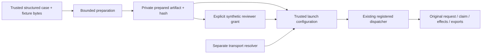

# J06 — approved design

## Status and intended outcome

The user approved this written design on 2026-10-09 after reviewing commit `2e4ace3` and the implementation plan after `657b668`. Implementation at executable candidate `80e0d6f` passed final installed acceptance and scoped re-review. Frozen regression at documentation HEAD `ea0aa4e` ran 1,769 tests: 1,768 passed, one environment-dependent macOS alias test skipped and separately passed with inherited macOS TMPDIR, zero failures/errors. Strict final OpenSpec validation and child archival remain pending. See [verification](../../../docs/verification/2026-10-09-trusted-replay-cases.md).

The integrating engineer supplies a new structured test case and independently authored synthetic source facts. The installed package prepares an inspectable release, accepts separately provisioned synthetic review and transport authority, and runs it through existing registered library/CLI execution. Neither the package code nor its fixed demonstrations are edited to onboard that case.

The product priority remains easy integration, then rapid adaptation, then reliable case resolution. This leaf establishes the first reusable integration seam; it does not complete all three priorities.

## Pre-implementation source context

- `ProfileRegistry(entries)` accepts finite trusted releases, while its builtin constructor supplies only two demonstrations (`host.py`).
- `RuntimeFactory.create_registered` and `HostDispatcher(..., admission_composition=...)` already implement the registered execution path. Their admission, ownership, debt and cleanup behavior is retained.
- `CliConfiguration` has no composition field, and `cli.main` does not pass one to the dispatcher. Existing `main(..., configuration=...)` is the trusted injection point (`bootstrap.py`, `cli.py`).
- Registered admission requires one registered release, fixed factory `fixed-synthetic-v1`, profile v1.3 and process v1. Review grants bind the exact artifact hash, including resource path/device/inode (`host_admission.py`).
- Existing test helpers construct the required declarations and grants. Production APIs must not import those helpers or turn their synthetic labels into real review claims.
- `request_fingerprint` covers kind, consent mode and arguments; it is not a full-case identity. Complete original request and authenticated identity remain bound by admission claims.

## Goals / Non-Goals

**Goals:**

1. A documented installed-package hook for a fresh nonbuiltin structured reschedule or goods refusal/return.
2. Two-stage preparation and authorization, with no automatic grant generation or renewal.
3. Fresh private state, bounded immutable input snapshots, no overwrite/adoption and unchanged existing admission enforcement.
4. Four independently checked positive positions: two new business cases × library/trusted CLI bootstrap, each using fresh state.
5. Preserve default CLI behavior and denial of unsupported versions, controls, ambiguous claims and invalid authority.

**Non-Goals:** native services, money, provider/model/ASR calls, narrative/media processing, API selection, arbitrary profiles or code imports, generic plugins, multiple releases in one composition, standalone manifest commands, recovery/reply/stop enablement, interrupted-claim repair, process/acknowledgement changes, migration, human release signoff, protected assessment, timed readiness claims and other platforms.

## Approaches considered

| Approach | Benefit | Cost / limit | Decision |
| --- | --- | --- | --- |
| Trusted Python preparation plus existing CLI/library entrypoints | Reuses the real admission path; small, explicit trust boundary | Engineer supplies a short application bootstrap, not only a JSON file | Recommended |
| New persistent manifest/configuration command | More convenient shell onboarding | Adds a file format, trust selection, persistence/reopen and migration contracts | Defer to a separate leaf |
| Generic dynamically loaded adapter/factory framework | Broad extension model | New code-execution authority and much larger attack surface | Excluded |

## Selected interfaces and data flow

One new public module contains a closed input record, detached prepared result and two functions. These are proposed signatures, not an already available API:

```text
SyntheticCaseReleaseSpecV1(
  host_release_id, registered_release_id, resource_id,
  request: CanonicalRequest, fixture_bytes: bytes
)

prepare_synthetic_release(spec, *, parent, clock, execution)
  -> PreparedSyntheticReleaseV1

configure_registered_cli(prepared, *, approvals, review_id,
  auth_resolver, clock, execution, host_limits, interface_limits,
  total_seconds, publication_reserve_seconds, shutdown_seconds)
  -> CliConfiguration
```

The prepared result holds the existing detached host release, registered release registry and executable binding, plus the private preparation root/path identities and original clock reference for identity comparison during configuration. `prepared.summary()` returns only the three supplied release/resource IDs, profile/process versions, business and artifact hashes, and `status="prepared_synthetic_unapproved"`; it excludes filesystem paths, fixture contents and credentials. The typed object is trusted application data, not a public wire response. A prepared result is not authority and is revalidated when configured/used.



### Preparation is not execution

The helper accepts only exact structured `CanonicalRequest` values for `reschedule_window` or `goods_refusal`, with no narrative/evidence processing in this leaf. It derives the business commitment from that value rather than taking an unchecked caller-provided digest. That digest is labelled a business commitment, not a complete request allowlist.

The profile is the packaged, pinned `flat-v1.3` profile; process versions remain v1. There is no profile path, module path, factory selection or implementation byte override in the input. The helper snapshots the exact installed implementation paths already declared by the fixed family. Hashing them identifies bytes; it does not certify their authorship or complete executable closure.

Before creating any child, validate exact input types/identifiers, existing execution bounds, request shape, and a nonempty fixture of at most 1 MiB. The finite fixture gate is:

1. Valid UTF-8 JSON with no duplicate keys or nonfinite numbers; maximum container nesting is 64, counting the root object as depth 1. Enforce the nesting bound before recursive JSON decoding, with JSON string/escape handling, so an overdeep input cannot bypass the bound through a decoder failure.
2. Exactly the top-level keys `version`, `as_of`, `scopes`, and `facts`. Version equals `synthetic-provider-v1`; `as_of` is an aware ISO timestamp; `scopes` is a one-element array; `facts` is a nonempty object.
3. The sole scope has exactly `case_id`, `object_id`, `principal_id`, and `readers`. Its three IDs equal the request; readers is a nonempty string-to-nonempty-string map. This checks shape, not whether any reader is authorized.
4. Every fact key is a nonempty qualified `authority.field` string. Every fact has exactly `value`, `revision`, `case_id`, `object_id`, and `evidence_ref`; outer IDs equal the request, revision/evidence reference are nonempty strings, and value is bounded JSON already covered by the byte/depth gate.
5. Required `case.binding.value` has exactly the request's `case_id`, `object_id`, `principal_id`, and `request_id`. Required `customer.request_fingerprint.value` equals the business fingerprint derived from the request.

Final-review representability amendment: decoded fixture text must contain no actual CR character (U+000D), including CRLF and bare-CR formatting. Reject it as `invalid_input` before child allocation; JSON-escaped `\r` string content remains accepted. The unchanged admission consumer normalizes actual CR/CRLF during text reads, so those exact source bytes cannot pass its composition comparison. Do not normalize accepted input or alter the fixed consumer. Callers must supply LF formatting themselves.

Unknown top-level/scope/fact-envelope fields are intentionally rejected by this narrow preparation API. Nested domain fact values other than the two explicit commitments, consent correctness, capability coverage and positive eligibility remain the existing runtime's responsibility. These are bounded preparation checks, not a new general source-policy validator; preparation success alone does not promise successful execution. The 1 MiB raw-fixture bound is a ceiling, not a guarantee that every smaller input is representable: serialize and check all existing declaration limits before allocating a child, including the 1 MiB source-declaration limit after embedding/escaping the exact fixture text. Reject overflow as `invalid_input`; do not raise existing registered-release limits.

Use one immutable byte snapshot for source validation, hash, private fixture file and source declaration. Copy the exact packaged profile bytes. Emit only honest existing synthetic declarations: unchanged profile, no claimed executed regression, preserved migration, unestablished authorship/dependency completeness. The helper never constructs a review grant, transport handle, database, admission attempt, claim, route or effect.

### Filesystem and lifecycle

The application supplies an existing absolute private parent owned by the current user with mode 0700. Filesystem root, home, the current working directory and any location inside the installed `proofkey` package tree are invalid parents. These are explicit path/identity checks, not Git or repository discovery. Running and provisioning outside the checkout is an acceptance-harness obligation. Traverse without following symlinks, pin directory identities, and allocate one opaque exclusive child independent of business IDs. Fixed children separate data, resources, control, inventories and outputs; directories are private and staged data files are single-link regular files with mode 0600.

Never overwrite or adopt existing children, follow aliases, derive paths from request identifiers, or create runtime state beneath site-packages. Recheck identities across I/O, including recorded parent identities when a prepared result is reused; a replacement parent is never silently rebound. Bound preparation by the supplied original execution context.

On failure raise `SyntheticPreparationFailureV1` with one bounded code (`invalid_input`, `invalid_target`, `timeout`, `io_failure`, or `identity_changed`) and an optional `retained_root` path available only to the trusted Python caller. Its string representation contains the code only; public JSON, receipts and logs must not serialize the path or raw exception. A retained path identifies an allocation attempt, not permission to traverse it after an identity change. No usable prepared value is returned; preserve any newly created partial private directory without automatic deletion or repair. Both success and failure close all temporary descriptors; neither the prepared result nor the failure retains an open descriptor. A successful preparation root remains owned by the caller even when review is declined.

### Separate authorization and CLI composition

The artifact hash exists after preparation because it binds resource identity. The application/reviewer then explicitly supplies `ProvisionedReviewResolverV1` and a review ID bound to that exact artifact, with existing `synthetic_rehearsal` provenance. The configuration helper validates those existing types and scope/time checks; it does not generate or refresh authority. `AuthResolver` is separately supplied and remains subject to existing source ACL checks.

Preparation, configuration and business launch are separate timing lifecycles. Preparation ends with its supplied context; the reviewer may respond later. Both helpers require the exact `SyntheticReplayClock` accepted by registered admission, not merely a duck-typed synthetic clock. Configuration receives a fresh bounded `execution` context on the same trusted clock and uses the existing review resolver/control-context check. It does not reuse an expired preparation context or persist its context as the business deadline. Existing `cli.main` captures its own launch context and registered admission rechecks the grant at use time: a grant expiring between configuration and launch fails. Capturing these separate pre-launch contexts cannot extend a grant or renew any already-started case deadline.

Add optional `admission_composition=None` to `CliConfiguration`. Non-None requires exact `LocalAdmissionCompositionV1`, exact `RuntimeFactory`, exact `SyntheticReplayClock`, and consistent one-release selection. The helper constructs a `ProfileRegistry` containing only the prepared host release; the composition's `ReleaseRegistryV1` contains exactly the bound registered artifact. Resolving `binding.host_release_id` must yield that host release with the same profile, fixture, resource and business commitments. The default None path and existing parser remain unchanged. `cli.main` forwards the field to its existing `HostDispatcher` construction; deeper validation is not bypassed or replaced.

A small trusted application bootstrap outside the installed package calls `proofkey.cli.main(argv, configuration=configuration)` and explicitly supplies the prepared host ID through the existing `--release` option. Omitting it retains the parser's `host-window-replay-v1` default; there is no implicit remapping to the prepared release, and mismatched selection fails. There is no new `--config`, import, factory, grant, clock or profile-path flag. The library example uses the same prepared composition with the existing `HostDispatcher`/`run_command` API; no extra execution wrapper is added. Direct `python -m proofkey.cli` keeps the two original defaults.

### Compatibility and retained state

Final-review configuration amendment: hold no-follow fixture ancestry and named file identity across host-release validation and the subsequent snapshot. Require private single-link regular-file metadata, use the existing bounded nonblocking descriptor reader, recheck ancestry/name metadata and the committed fixture hash, and decode UTF-8 without newline transformation. This does not change default configuration or expand authority.

One prepared composition represents one release and isolated resource/control roots. The two example kinds and four positive positions each receive separate preparations. Existing marked roots, pending claims and duplicate cases are never reset or silently rebound. Registered recover/reply/stop and transfer retain their current denial/unavailability. Changing the helper must not require altering executable admission pins; if investigation proves otherwise, stop and revise this design before implementation.

## Acceptance and evidence

The new window example changes identities, requested window and permitted slots. The goods example changes identities, inventory/item quantity and permitted return destination. Each business fingerprint must differ from its builtin counterpart. Merely relabelling case IDs cannot pass.

For library and trusted CLI positions, independently read the actual saved request, binding, original claim/route, journal and source effects. Expect exactly one verified reschedule or one verified goods-refusal registration plus one verified return creation. Verify expected slot/inventory/destination, public receipt, export hashes and owner shutdown. Return creation means initiated, not physically received or paid.

Retain the full denominator for negative tests: invalid inputs, authority mismatch, wrong proof, source/pin/resource drift, path aliases, existing state and unsupported controls. Include delayed review with a fresh configuration context, expired configuration context, grant expiry between configuration and launch, nonexact clock type, wrong/omitted host release selection, and descriptor closure after partial preparation. Pre-preparation failure must not allocate state; wrong proof later may legitimately leave audited admission data, so assert the actual stage-specific state rather than demanding impossible universal zero writes.

Build and install the candidate from staged existing exact dependencies; no acquisition or provider access is needed. Run outside checkout with user site/PYTHONPATH disabled. No imports from tests, runtime fixture mutation, source-pin rewrites or package edits are allowed in examples. Verify installed files remain unchanged. Run focused regressions and one frozen full suite after approved implementation, plus independent review. Record every attempt, target, source/artifact hashes and unresolved limits.

## Risks / Trade-offs

- New filesystem helper → reuse existing no-follow primitives, bounded/exclusive operations, identity checks, fault tests and private failure evidence; no generic allocator.
- Synthetic grants are constructible → keep their creation explicit in the demonstration and clearly separate from production authorization/human review.
- Full fixture data includes proof strings → private staging only; public output and errors must not expose fixture, resolver, grant or source declaration bodies.
- Preparation captures installed bytes → preserve exact execution checks and label closure/rights unestablished. J14 remains open.
- Python bootstrap is less convenient than a manifest command → document this exact capability; do not claim standalone configuration-file onboarding or observed usability.

## Migration / rollback

This is opt-in and source-compatible: no field is required by existing callers and default construction remains unchanged. To stop using it, remove the custom application bootstrap and retain any original state for later authorized inspection; never reset a started case or replay it as a new case. No data migration or registered-state downgrade is included.

## Approved decision and next gate

Approved and implemented: the trusted Python preparation/bootstrap option, four installed positive positions and the preserved denial boundary. Final installed attempt passed 4/4 positives and 7/7 negatives; all five attempts remain recorded. Whole-change review C0/I2/M1 was followed by a scoped re-review clearing I1/I2/M1 at `80e0d6f`. Strict final OpenSpec validation and archival are the remaining gates. Native integrations and a standalone persistent config-file launcher require separate scope. Inherited reader/path-pin behavior outside the scoped fix and independent final source-snapshot recomputation remain outside the verified claim.
