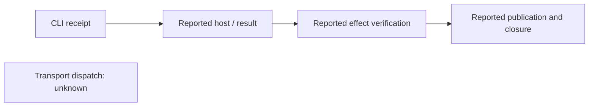

# Read an offline execution trace

Activate an existing Python environment with the [pinned dependencies](requirements-api.lock) already installed. From the checkout root:

```sh
PROOFKEY_SOURCE_DIR="$(pwd -P)/runtime/src"
PROOFKEY_PYTHON="$(command -v python)"
export PYTHONDONTWRITEBYTECODE=1 PYTHONNOUSERSITE=1 PYTHONPATH="$PROOFKEY_SOURCE_DIR"
PROOFKEY_DEMO_DIR="$(mktemp -d)"
cd "$PROOFKEY_DEMO_DIR"
"$PROOFKEY_PYTHON" -m proofkey.cli run --release host-window-replay-v1 --input - > receipt.json <<'JSON'
{"case_id":"C1","object_id":"O1","principal_id":"U1","request_id":"REQ1","request_revision":"v1","consent_revision":"v1","kind":"reschedule_window","consent_mode":"window","arguments":{"window_start":"2026-10-08T10:00:00+00:00","window_end":"2026-10-08T12:00:00+00:00","inventory":{"item-1":1}},"evidence_ids":[],"narrative":null}
JSON
PROOFKEY_RUN_EXIT=$?
printf 'CLI exit: %s\n' "$PROOFKEY_RUN_EXIT"
"$PROOFKEY_PYTHON" -m proofkey.trace --format json < receipt.json > trace.json
"$PROOFKEY_PYTHON" -m proofkey.trace --format markdown < receipt.json > trace.md
```

Open `trace.md`. These are fixed synthetic fixtures, not current consent. For goods refusal, use the [second source example](README.md#source-checkout-quickstart) in another fresh directory; [trusted new cases](examples/registered-cases/README.md) require separate registration.



The trace is an unverified projection: it observes neither original readbacks nor current publication files. CLI exit 0 means completed, committed coordination; inspect each effect and owner closure independently. Renderer exit 0 means rendering succeeded; invalid input/usage returns 2. A verified effect implies neither physical receipt nor payment.

Keep `$PROOFKEY_DEMO_DIR`, including `receipt.json`, traces and `.proofkey` state. Do not retry pending/unknown work with a new key; retain evidence and inspect the [result guidance](README.md#read-results).
